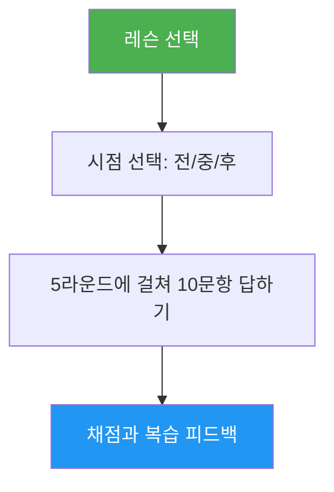

# 레슨 퀴즈

> 특정 Claude Code 레슨에 대한 이해도를 10문항으로 테스트하고, 문항별 피드백과 복습할 곳을 알려 주는 대화형 퀴즈입니다.

## 주요 특징

- 레슨마다 개념 이해와 실무 적용을 섞은 10문항
- 레슨 10개 전체를 다룸(01-슬래시 명령어부터 10-CLI까지)
- 세 가지 시점 모드: 사전 테스트, 진도 확인, 숙달 확인
- 정답과 해설을 담은 문항별 피드백
- 레슨의 특정 섹션을 가리키는 맞춤 복습 안내
- `references/question-bank.md`에 레슨 전체에 걸친 100문항의 문제 은행

## 언제 쓰나

| 이렇게 말하면... | 스킬이... |
|---|---|
| "훅 퀴즈 내 줘" | 레슨 06: 훅에 대한 10문항 퀴즈를 진행합니다 |
| "레슨 퀴즈 03" | 레슨 03: 스킬에 대한 지식을 테스트합니다 |
| "내가 MCP를 이해했을까" | 레슨 05: MCP에 대한 이해도를 평가합니다 |
| "연습 퀴즈" | 레슨을 고르게 한 뒤 퀴즈를 냅니다 |

## 동작 방식



## 사용법

```
/lesson-quiz [lesson-name-or-number]
```

예:
```
/lesson-quiz hooks
/lesson-quiz 03
/lesson-quiz advanced-features
/lesson-quiz           # (레슨을 고르라고 묻습니다)
```

## 출력

### 점수 보고서
- 등급(숙달 / 능숙 / 발전 중 / 입문)과 함께 10점 만점의 총점
- 문항 분류별 분석(개념과 실무)

### 문항별 피드백
틀린 문항마다:
- 내가 고른 답과 정답
- 그 답이 맞는 이유에 대한 해설
- 복습할 레슨의 구체적인 섹션

### 시점에 맞춘 안내
- **사전 테스트**: 출발점을 정하고, 공부할 때 집중할 부분을 짚어 줍니다
- **레슨 중**: 이해한 것과 다시 볼 것을 구분해 줍니다
- **레슨 후**: 숙달했는지 확인하거나 남은 빈틈을 정확히 짚어 줍니다

## 리소스

| 경로 | 설명 |
|---|---|
| `references/question-bank.md` | 답, 해설, 복습 위치를 갖춘 미리 작성된 100문항(레슨당 10문항) |
