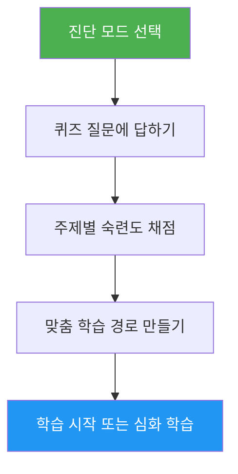

# 자가 진단과 학습 경로 안내

> 10개 기능 영역을 평가하고, 부족한 기술을 찾아, 실력을 끌어올릴 맞춤 학습 경로를 만들어 주는 종합 Claude Code 숙련도 진단입니다.

## 주요 특징

- 두 가지 진단 모드: 빠른 진단(질문 8개, 2분)과 심층 진단(5라운드, 5분)
- 10개 기능 영역 평가: 슬래시 명령어, 메모리, 스킬, 훅, MCP, 서브에이전트, 체크포인트, 고급 기능, 플러그인, CLI
- 숙련도(없음 / 기초 / 능숙)를 매기는 주제별 채점
- 의존 관계를 고려해 우선순위를 정하는 부족한 부분 분석
- 구체적인 실습과 성공 기준을 담은 맞춤 학습 경로
- 후속 조치: 학습 시작, 심화 학습, 연습 프로젝트, 다시 진단

## 언제 쓰나

| 이렇게 말하면... | 스킬이... |
|---|---|
| "내 수준 평가해 줘" | 진단 퀴즈를 진행하고 내 레벨을 정합니다 |
| "어디서부터 시작해야 할까" | 내 경험을 평가하고 시작 지점을 제안합니다 |
| "내 실력 확인해 줘" | 10개 영역 전체에 걸친 자세한 기술 프로필을 만듭니다 |
| "다음에 뭘 배워야 할까" | 부족한 부분을 찾아 우선순위를 정한 학습 경로를 만듭니다 |

## 동작 방식



## 진단 모드

### 빠른 진단(약 2분)
- 2라운드에 걸친 예/아니요 경험 질문 8개
- 전체 레벨 결정: 입문 / 중급 / 고급
- 튜토리얼 링크와 함께 구체적으로 부족한 부분 나열
- 이럴 때 좋음: 처음 쓰는 사용자, 빠른 점검

### 심층 진단(약 5분)
- 10개 기능 영역을 다루는 5라운드 질문(라운드당 주제 2개)
- 주제별 채점(주제당 0-2점, 최대 20점 — 체크포인트는 0-1점, 고급 기능은 0-3점)
- 강점 영역, 우선 보완할 부분, 복습 항목을 담은 숙련도 표
- 학습 단계와 예상 시간을 갖춘, 의존 관계를 고려한 학습 경로
- 부족한 주제를 엮은 추천 연습 프로젝트
- 이럴 때 좋음: 실력을 끌어올리려는 숙련 사용자, 주기적인 실력 점검

## 사용법

```text
/self-assessment
```

## 출력

### 기술 프로필 표
주제별 점수, 숙련도, 상태(학습 / 복습 / 숙달)를 보여 줍니다.

### 맞춤 학습 경로
- 의존 순서에 따라 학습 단계로 구성
- 주제마다 튜토리얼 링크, 집중할 부분, 핵심 실습, 성공 기준 포함
- 이미 숙달한 주제를 빼고 조정한 예상 시간
- 여러 부족한 영역을 엮은 연습 프로젝트

### 후속 조치
결과를 본 뒤 다음 중에서 고를 수 있습니다:
- 첫 번째 부족한 주제의 튜토리얼을 안내형 실습으로 시작
- 특정 부족한 영역을 깊이 학습
- 부족한 부분을 다루는 연습 프로젝트 준비
- 다른 진단 모드로 다시 보기
