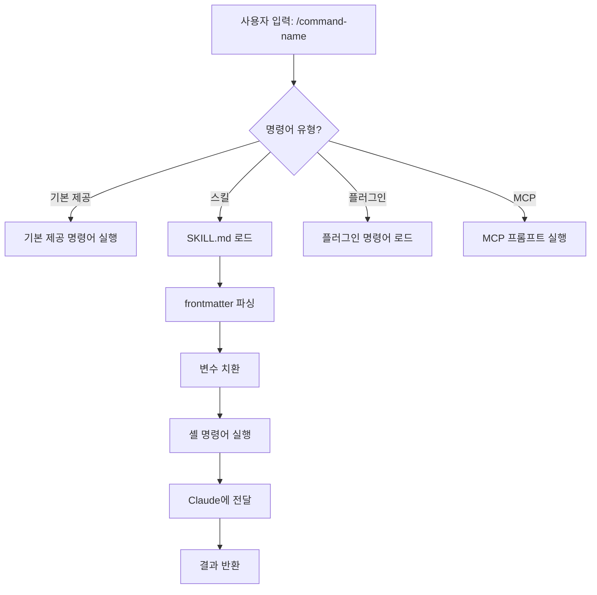
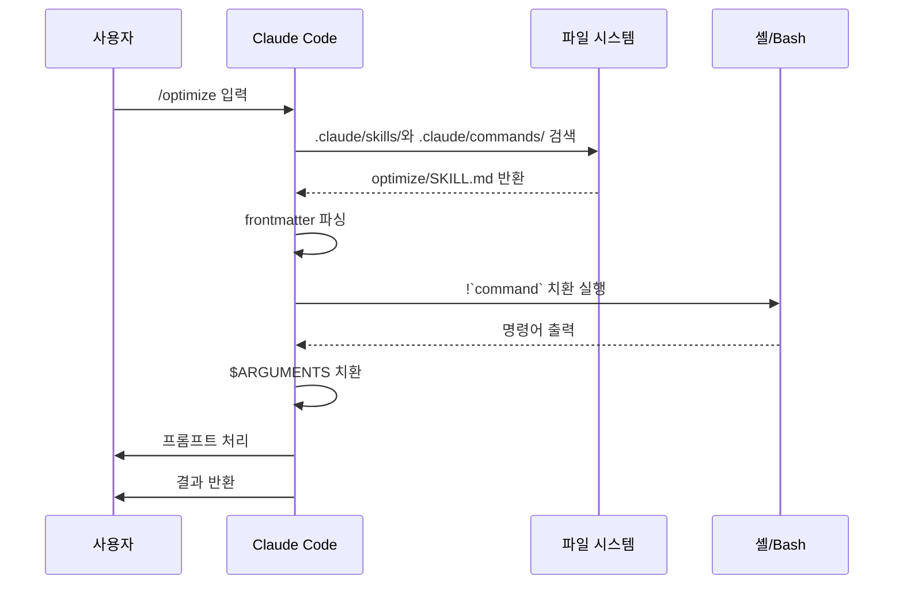

<picture>
  <source media="(prefers-color-scheme: dark)" srcset="../resources/logos/claude-howto-logo-dark.svg">
  
</picture>

# 슬래시 명령어

## 개요

슬래시 명령어는 대화형 세션에서 Claude의 동작을 제어하는 단축 명령입니다. 다음과 같은 종류가 있습니다:

- **기본 제공 명령어**: Claude Code가 제공 (`/help`, `/clear`, `/model`)
- **스킬**: `SKILL.md` 파일로 만든 사용자 정의 명령어 (`/optimize`, `/pr`)
- **플러그인 명령어**: 설치한 플러그인이 제공하는 명령어 (`/frontend-design:frontend-design`)
- **MCP 프롬프트**: MCP 서버가 제공하는 명령어 (`/mcp__github__list_prs`)

> **참고**: 사용자 정의 슬래시 명령어는 스킬로 통합되었습니다. `.claude/commands/`의 파일도 여전히 동작하지만, 이제는 스킬(`.claude/skills/`)을 권장합니다. 두 방식 모두 `/command-name` 형태의 단축 명령을 만듭니다. 전체 레퍼런스는 [스킬 가이드](../03-skills/)를 참고하세요.

> **역주**: Claude Code 공식 문서는 이제 "slash command" 대신 "command(명령어)"라는 이름을 씁니다. 이 가이드에서는 원문을 따라 "슬래시 명령어"로 옮겼습니다.

## 기본 제공 명령어 레퍼런스

기본 제공 명령어는 자주 하는 작업을 위한 단축 명령입니다. **60개 이상의 기본 제공 명령어**와 **약 20개의 번들 스킬**(일부는 기능 플래그로 제한됨)을 사용할 수 있습니다. Claude Code에서 `/`를 입력하면 전체 목록을 볼 수 있고, `/` 뒤에 글자를 이어 입력하면 목록이 걸러집니다.

> **참고**: v2.1.236부터는 슬래시 명령어를 잘못 입력했거나 현재 세션에서 쓸 수 없는 명령어에서 Enter를 누르면, 가장 비슷한 명령어를 조용히 실행하는 대신 오류를 표시합니다. 모호하지 않은 접두어와 정의된 별칭은 이전처럼 실행됩니다.

| 명령어 | 용도 |
|---------|---------|
| `/add-dir <path>` | 작업 디렉토리 추가 |
| `/advisor [model\|off]` | 조언자(advisor) 모델 설정. 대화형 창으로 열리며, 데스크톱 앱·Remote Control·헤드리스(`-p` / Agent SDK) 세션에서는 대신 텍스트 형식으로 입력합니다 — 인수 없이 `/advisor`, `/advisor <model>`, `/advisor off` (v2.1.260+) |
| `/agents` | 더 이상 동작하지 않는 명령어입니다. 대화형 마법사는 v2.1.198에서 제거되었고, v2.1.281부터는 `/agents`가 `/` 메뉴와 `/help`에도 나타나지 않습니다. 입력하면 마법사가 어디로 갔는지만 설명합니다. 서브에이전트를 만들거나 관리하려면 Claude에게 요청하거나 `.claude/agents/` 파일을 직접 편집하세요 |
| `/branch [name]` | 현재 시점의 대화 사본으로 전환하고 원래 대화는 그대로 보존(`/resume`으로 돌아갈 수 있음) |
| `/fork [prompt]` | 현재 대화를 새 **백그라운드 세션**으로 복사하고 지금 세션에서 계속 작업합니다. 그 시점부터 두 세션은 서로 독립적이며, 사본은 `claude agents`에 별도 행으로 표시됩니다(v2.1.212+). 사본이 제자리에서 편집하는 경우를 제외하면, Claude Code는 사본이 코드를 바꾸기 전에 자체 worktree를 만들도록 지시합니다(이 격리 지시는 v2.1.221+ 필요) |
| `/subtask <task>` | 전체 대화를 이어받는 **포크된 서브에이전트**를 생성해, 사용자가 계속 작업하는 동안 해당 작업을 처리하게 합니다. 작업이 끝나면 결과가 이 대화로 돌아옵니다(v2.1.212+) |
| `/btw [question]` | Claude가 주 작업을 하는 동안 일회성 곁가지 질문을 합니다. 주 대화의 컨텍스트를 어지럽히지 않습니다. 인수 없이 `/btw`를 입력하면 마지막 곁가지 질문을 다시 엽니다(v2.1.212+) |
| `/cd <path>` | 프롬프트 캐시를 깨뜨리지 않고 세션을 새 작업 디렉토리로 이동(v2.1.169에서 추가) |
| `/chrome` | Chrome 브라우저 통합 설정 |
| `/clear` | 대화 지우기(별칭: `/reset`, `/new`) |
| `/color [color\|default]` | 프롬프트 표시줄 색상 설정. 인수 없이 `/color`를 입력하면 세션 색상을 무작위로 고르고(v2.1.128+), 색상 이름이나 16진수 값을 주면 그 색으로 설정합니다. |
| `/compact [instructions]` | 대화를 압축하며, 무엇에 집중할지 지시를 덧붙일 수 있습니다. 압축에 실패하면 아무 일 없이 넘어가는 대신 UI에 오류로 표시됩니다(v2.1.216) |
| `/config` | 설정 열기(별칭: `/settings`) |
| `/context` | 컨텍스트 사용량을 색상 격자로 시각화. 사용량이 컨텍스트 윈도우 한도를 넘으면 명시적인 경고를 표시합니다(v2.1.216) |
| `/copy [N]` | 어시스턴트 응답을 클립보드에 복사. `w`를 누르면 파일로 저장 |
| `/cost` | `/usage`를 빠르게 입력하기 위한 별칭 — 비용 탭을 엽니다(v2.1.118+) |
| `/desktop` | 데스크톱 앱에서 이어서 작업(별칭: `/app`) |
| `/diff` | 커밋하지 않은 변경 사항을 보는 대화형 diff 뷰어. 전체 화면 렌더링에서는 대신 대화 옆에 diff 패널을 열어 작업하는 동안 계속 띄워 둡니다. 패널은 변경된 파일과 추가·삭제된 줄 수를 보여 주고, Claude가 파일을 편집하거나 셸 명령어를 실행할 때마다 새로 고쳐집니다. 닫으려면 `/diff`를 다시 실행하거나 `✕`를 클릭하세요(v2.1.260+). 기존 렌더러에서는 프롬프트 자리에 뷰어가 열립니다 |
| `/doctor` | 설치 상태 진단 — Claude가 응답하는 중에도 열 수 있습니다. 번들 스킬이며, Claude가 설정을 점검하고 수정 사항을 제안한 뒤 사용자가 확인하면 적용합니다(`claude doctor`는 읽기 전용 진단만 실행). `/doctor prompt-audit`(또는 `/checkup prompt-audit`)는 CLAUDE.md 파일, 스킬, 에이전트, 명령어에서 예전 모델에 맞춰 작성된 프롬프트 패턴을 점검합니다(v2.1.283) |
| `/effort [low\|medium\|high\|xhigh\|max\|auto\|ultracode [on\|off]]` | 방향키 슬라이더로 노력 수준 설정. 수준: `low` → `medium` → `high` → `xhigh`(v2.1.111에서 추가) → `max`. 기본값은 Opus 5.5(v2.1.280부터 기본 모델), Sonnet 5.5, Haiku 5.5에서 `medium`, Opus 5, Sonnet 5, Opus 4.8에서 `high`, Opus 4.7에서 `xhigh`입니다. `xhigh`는 Fable 5.1, Fable 5, Opus 5.5, Sonnet 5.5, Haiku 5.5, Opus 5, Sonnet 5, Opus 4.8, Opus 4.7에서 쓸 수 있고, `max`는 Fable 5.1, Fable 5, Opus 5.5, Sonnet 5.5, Haiku 5.5, Opus 5, Sonnet 5, Opus 4.8/4.7/4.6, Sonnet 4.6에서 동작합니다. `/effort`가 모델별 설정으로 바뀌기 전에 저장한 수준은 Opus 5.5 같은 새 모델에는 적용되지 않습니다(v2.1.280). 슬라이더에는 **Ultracode** 토글도 있습니다(Tab 키 또는 `/effort ultracode [on\|off]`). 이것은 모델의 노력 수준이 아니라, 세션이 어떤 노력 수준으로 실행되든 Claude가 동적 워크플로우를 조율하게 하는 기능입니다. v2.1.284부터는 더 이상 `xhigh`를 강제하지 않으며 수준을 바꿔도 켜진 상태로 유지됩니다. `/effort ultracode`는 해당 세션 동안만 유지되고, `ultracode` 설정을 쓰면 계속 유지됩니다 |
| `/exit` | REPL 종료(별칭: `/quit`) |
| `/export [filename]` | 현재 대화를 파일이나 클립보드로 내보내기 |
| `/usage-credits` | 속도 제한에 걸렸을 때 쓸 추가 사용량 설정(v2.1.144에서 `/extra-usage`에서 이름이 바뀌었으며, `/extra-usage`도 별칭으로 계속 동작) |
| `/fast [on\|off]` | 빠른 모드 켜기/끄기. Opus 5.5(v2.1.280부터 빠른 모드 기본 모델), Opus 5, Opus 4.8에 적용됩니다 |
| `/feedback` | 피드백 제출. v2.1.141부터 최근 세션(지난 24시간 또는 7일)을 첨부할 수 있어 여러 세션에 걸친 보고에도 맥락이 포함됩니다. v2.1.178부터 `/bug`는 설명을 입력해야 제출할 수 있습니다. |
| `/focus` | 포커스 보기 전환(v2.1.110에서 추가, 포커스 전환용 `Ctrl+O`를 대체) |
| `/goal <statement>` | 세션 단위 완료 조건을 등록합니다. Claude는 목표를 달성할 때까지 계속 작업합니다. `/goal clear`로 지웁니다. 활성 목표는 상태 표시줄에 나타나며, 경과 시간·턴 수·토큰 사용량을 보여 주는 실시간 오버레이 패널이 함께 표시됩니다(v2.1.139에서 추가). |
| `/help` | 도움말 보기 |
| `/hooks` | 훅 설정 보기 |
| `/ide` | IDE 통합 관리 |
| `/init` | `CLAUDE.md` 초기화. 대화형으로 진행하려면 `CLAUDE_CODE_NEW_INIT=1`을 설정하세요 |
| `/insights` | 세션 분석 보고서 생성 |
| `/install-github-app` | GitHub Actions 앱 설정 |
| `/install-slack-app` | Slack 앱 설치 |
| `/keybindings` | 키 바인딩 설정 열기 |
| `/fewer-permission-prompts` | 최근 Bash/MCP 도구 호출을 분석해 우선순위가 매겨진 허용 목록을 `.claude/settings.json`에 추가하고 권한 프롬프트를 줄입니다(v2.1.111에서 추가) |
| `/login` | Anthropic 계정 전환 |
| `/logout` | Anthropic 계정에서 로그아웃 |
| `/mcp` | MCP 서버와 OAuth 관리 |
| `/memory` | `CLAUDE.md` 편집, 자동 메모리 켜기/끄기 |
| `/mobile` | 모바일 앱용 QR 코드(별칭: `/ios`, `/android`) |
| `/model [model]` | 모델 선택(좌우 방향키로 노력 수준 조절). v2.1.153부터는 선택한 모델이 새 세션의 **기본값으로 저장**됩니다(IDE와 동일). 현재 세션에만 적용하려면 선택한 뒤 `s`를 누르세요. (키 바인딩 `modelPicker:setAsDefault`는 `modelPicker:thisSessionOnly`로 이름이 바뀌었고, 예전 `d` 동작은 이제 `s`입니다.) v2.1.219부터 선택기는 통합된 Opus 행을 "Opus (1M context)"로 표시했지만, v2.1.283부터는 Opus가 이미 1M 윈도우를 쓰는 Opus 행과 Default 행에서 이 레이블을 뺍니다(윈도우 크기는 그대로). |
| `/output-style [name]` | 출력 스타일 목록 보기와 전환(v2.1.91에서 제거되었다가 v2.1.269에서 다시 추가). 인수 없이 실행하면 스타일 목록과 현재 스타일을 표시합니다. 헤드리스와 Remote Control 세션에서도 동작하며, 선택한 스타일은 `.claude/settings.local.json`에 저장됩니다 |
| `/passes` | Claude Code 무료 1주일 이용권 공유 |
| `/permissions` | 권한 보기/수정(별칭: `/allowed-tools`) |
| `/plan [description]` | 계획 모드 진입 |
| `/plugin` | 플러그인 관리 |
| `/proactive` | `/loop`의 별칭(v2.1.105에서 추가) |
| `/powerup` | 애니메이션 데모가 포함된 대화형 레슨으로 기능 알아보기 |
| `/privacy-settings` | 개인정보 설정(Pro/Max 전용) |
| `/release-notes` | 변경 로그 보기 |
| `/recap` | 세션으로 돌아왔을 때 세션 요약 보기(v2.1.108에서 추가) |
| `/reload-plugins` | 활성 플러그인 다시 로드. v2.1.221부터는 대부분의 설치가 바로 활성화되므로, 설치 요약에 `Run /reload-plugins to activate.`가 표시될 때만 필요합니다. v2.1.260부터 헤드리스 세션에서도 쓸 수 있어 Claude Code 데스크톱과 SDK의 명령어 목록에도 나타납니다 |
| `/reload-skills` | 세션을 다시 시작하지 않고 스킬 디렉토리를 다시 검색(v2.1.152에서 추가). 전체 스킬 목록을 Claude에게 다시 보내므로 컴팩션 이후에 스킬을 복원할 수 있습니다(v2.1.299) |
| `/remote-control` | claude.ai에서 원격으로 제어(별칭: `/rc`) |
| `/remote-env` | 기본 원격 환경 설정 |
| `/rename [name]` | 세션 이름 변경 |
| `/resume [session]` | 대화 재개(별칭: `/continue`) |
| `/review [low\|medium\|high\|xhigh\|max\|ultra] [--fix] [--comment] [pr#\|branch\|path]` | `/code-review`의 별칭(v2.1.223). 현재 diff나, 지정한 PR 번호·브랜치·경로를 리뷰합니다 — 예: `/review 1234`. 같은 노력 수준과 플래그를 받습니다. 수준을 지정하지 않으면 마지막으로 입력한 `low`–`max` 수준을 다시 씁니다 |
| `/rewind` | 대화 및/또는 코드 되감기(별칭: `/checkpoint`, `/undo`) |
| `/sandbox` | 샌드박스 모드 켜기/끄기 |
| `/schedule [description]` | 클라우드 예약 작업 생성/관리 |
| `/scroll-speed` | 전체 화면 모드의 마우스 휠 스크롤 속도를 조절하는 대화형 창 열기: ←/→로 조절, `r`로 초기화, Enter로 저장. `~/.claude/settings.json`에 저장됩니다(v2.1.139에서 추가). |
| `/security-review` | 브랜치의 보안 취약점 분석 |
| `/skill-doctor` | 로드된 스킬 중 쓰이지 않는 것과 각 스킬이 컨텍스트에서 차지하는 비용을 보여 주어 어떤 스킬을 끌지 판단하게 합니다. 보고서는 `/plugin` 관리자의 **Stats** 탭에서 열리며, 비대화형 `-p` 모드에서는 텍스트로 출력됩니다. Remote Control로 실행하면 `Skill usage reports are not available on this connection.`이라고 응답하므로, 세션을 호스팅하는 머신의 터미널에서 실행하세요(v2.1.252+ 필요) |
| `/skills` | 사용 가능한 스킬 목록 |
| `/stats` | `/usage`를 빠르게 입력하기 위한 별칭 — 통계 탭(일별 사용량, 세션, 연속 사용 기록)을 엽니다(v2.1.118+) |
| `/stickers` | Claude Code 스티커 주문 |
| `/status` | 버전, 모델, 계정, 그리고 `background job · attached`, `background job · unattended`, `interactive` 중 하나를 표시하는 `Session kind` 행을 보여 줍니다(이 행은 v2.1.221에서 추가). Claude가 응답하는 중에도 열 수 있습니다 |
| `/statusline` | 상태 표시줄 설정 |
| `/tasks` | 백그라운드 작업 목록 보기/관리 |
| `/team-onboarding` | 최근 30일간의 Claude Code 세션, 명령어, MCP 사용 기록으로 팀원 적응 가이드를 만들고 공유 링크를 반환합니다(v2.1.101에서 추가) |
| `/teleport` | 웹용 Claude Code 세션을 이 터미널에서 재개합니다. 웹 세션 선택기가 열립니다(별칭: `/tp`). claude.ai 구독이 필요합니다 |
| `/terminal-setup` | 터미널 키 바인딩 설정 |
| `/theme` | 테마 선택기 열기 / 사용자 정의 테마 관리(v2.1.118). 사용자 정의 테마는 `~/.claude/themes/<name>.json`에 JSON으로 정의합니다 |
| `/tui [default\|fullscreen]` | 터미널 UI 렌더러를 설정(`fullscreen`은 깜빡임 없는 렌더링)하고 그 렌더러로 다시 실행합니다. 인수 없이 `/tui`를 입력하면 현재 렌더러를 출력합니다(v2.1.110에서 추가) |
| `/ultrareview` | 클라우드 기반 다중 에이전트 종합 코드 리뷰(v2.1.111에서 추가). 이제는 `/code-review ultra`로 실행하는 것을 권장하며, `/ultrareview`는 별칭으로 남아 있습니다. Pro와 Max에서는 3회 무료이고, 그 이후에는 사용 크레딧이 필요합니다 |
| `/upgrade` | 상위 요금제 업그레이드 페이지 열기 |
| `/usage` | 대표 사용량 대시보드(v2.1.118) — 요금제 사용 한도, 속도 제한, 비용, 일별 세션 통계를 한곳에서 보여 줍니다. `/cost`와 `/stats`는 특정 탭을 바로 여는 별칭입니다. 최대 노력 수준, 워크플로우, 항상 로드되는 컨텍스트, 큰 도구 결과에 대해 경고합니다(v2.1.299) |
| `/voice` | 누르고 말하기(push-to-talk) 음성 받아쓰기 켜기/끄기 |
| `/workflows` | 실행 중이거나 완료된 동적 워크플로우 실행 보기(v2.1.154에서 추가). [동적 워크플로우](../09-advanced-features/README.md#dynamic-workflows)를 참고하세요 |

> **`/cd`가 중요한 이유:** 예전에는 디렉토리를 바꾸면 캐시가 식어 다음 턴이 느려지고 비용도 늘었습니다. `/cd`는 디렉토리를 바꿔도 프롬프트 캐시를 유지합니다.

### 번들 스킬

다음 스킬은 Claude Code에 기본으로 포함되어 있으며 슬래시 명령어처럼 호출합니다:

| 스킬 | 용도 |
|-------|---------|
| `/batch <instruction>` | worktree를 사용해 대규모 병렬 변경을 조율 |
| `/claude-api` | 프로젝트 언어에 맞는 Claude API 레퍼런스 로드 |
| `/dataviz` | 실행 가능한 색상 팔레트 검증기를 포함한 차트·대시보드 디자인 가이드(v2.1.198) |
| `/debug [description]` | 디버그 로깅 켜기 |
| `/design [description]` | **디자인 캔버스** 생성 — 여러 아트보드로 구성된 시각 디자인(UI 목업, 화면 흐름, 랜딩 페이지, 포스터)을 아티팩트로 게시하고 코드가 아닌 시각적으로 다듬습니다. 레이아웃을 여러 번 고쳐 가며 만들고 싶다면 HTML을 직접 쓰는 대신 이 스킬을 쓰세요. v2.1.265+, 아티팩트를 쓸 수 있는 세션, Design 템플릿이 있는 계정이 필요하며, Bedrock, Vertex, Foundry, AWS의 Claude Platform에서는 쓸 수 없습니다. 독립형 Claude Design(claude.ai/design)은 2026년 12월 14일에 종료됩니다. |
| `/loop [interval] [prompt]` | 지정한 간격으로 프롬프트를 반복 실행 |
| `/code-review [low\|medium\|high\|xhigh\|max\|ultra] [--fix] [--comment] [--max-findings n\|all\|default] [pr#\|branch\|path]` | 현재 diff — 또는 지정한 PR 번호, 브랜치, 경로 — 에서 정확성 버그를 리뷰합니다. `--fix`를 주면 발견 사항을 적용하고, `--comment`를 주면 GitHub PR 인라인 댓글로 게시하며, `ultra`를 주면 클라우드 심층 리뷰를 실행합니다. `github.com` PR을 대상으로 `ultra`를 쓰면 `--post`가 발견 사항을 PR에 게시하도록 미리 선택합니다. 노력 수준을 지정하지 않으면 마지막으로 입력한 수준을 다시 씁니다(v2.1.223). 처음에는 v2.1.147에서 `/simplify`를 흡수했지만, v2.1.154에서 `/simplify`가 별도 명령어로 돌아왔습니다. `--max-findings <n>\|all`을 주면 평소 한도보다 많거나 적은 발견 사항을 보고하며, 이 선택은 `--max-findings default`를 줄 때까지 유지됩니다(v2.1.288) |
| `/simplify` | 정리 전용 리뷰(재사용 / 단순화 / 효율 / 추상화 수준)를 실행하고 수정 사항을 적용합니다. 버그는 찾지 **않으므로** 버그를 찾으려면 `/code-review`를 쓰세요. 잠시 `/code-review --fix`의 별칭이었다가(v2.1.152), v2.1.154에서 정리 전용이 되었습니다 |

### 지원 중단된 명령어

| 명령어 | 상태 |
|---------|--------|
| `/pr-comments` | v2.1.91에서 제거됨 — PR 댓글을 보려면 Claude에게 직접 요청하세요 |
| `/vim` | v2.1.92에서 제거됨 — /config → Editor mode를 사용하세요 |

### 최근 변경 사항

- `/fork`와 `/subtask`는 **v2.1.212**에서 역할이 맞바뀌었습니다. 이제 `/fork`는 대화를 새로운 독립 백그라운드 세션으로 복사하고, 예전에 `/fork`가 하던 포크된 서브에이전트 동작은 새 `/subtask` 명령어로 옮겨졌습니다. 이력: `/fork`는 v2.1.77부터 v2.1.161까지 `/branch`의 별칭이었고, v2.1.161부터 v2.1.211까지는 포크된 서브에이전트를 시작했습니다(지금의 `/subtask` 동작). 에이전트 뷰가 꺼져 있으면 `/subtask`를 쓸 수 없고 `/fork`가 포크된 서브에이전트 동작을 유지합니다
- 인수 없이 `/resume`을 실행하면 지난 세션 선택기가 열립니다. 보이는 목록에서 제거한 세션도 포함되며, 고른 세션을 백그라운드 세션으로 재개합니다(v2.1.212)
- 백그라운드에서 실행 중인 세션에 `/resume`이나 `claude --resume`을 쓰면 거부하는 대신 해당 세션을 열고, `claude --resume <id> "prompt"`는 프롬프트를 다음 턴으로 보냅니다(v2.1.285)
- `/output-style`은 지원 중단(v2.1.73)되었다가 제거(v2.1.91)된 뒤 **v2.1.269에서 다시 추가**되었습니다. v2.1.278에서 다시 정식으로 동작하는 명령어가 되었고 헤드리스와 Remote Control 세션에서도 동작합니다. 출력 스타일은 `/config` → Output style이나 `outputStyle` 설정으로도 계속 쓸 수 있으며, 기본 제공 스타일은 Default, Proactive, Explanatory, Learning, Concise(v2.1.237에서 추가)입니다
- `/review`가 `/code-review`의 완전한 별칭이 되어 같은 대상, 노력 수준, 플래그를 받습니다(v2.1.223). 이력: v2.1.186에서 처음 `/code-review medium` 엔진으로 옮겨졌지만 그때는 PR 전용이었습니다
- `/effort` 명령어 추가. `max` 수준은 Opus 4.6+에서 사용 가능(처음에는 Opus 4.6 전용)
- 누르고 말하기 음성 받아쓰기를 위한 `/voice` 명령어 추가
- 예약 작업을 만들고 관리하는 `/schedule` 명령어 추가
- 프롬프트 표시줄을 꾸미는 `/color` 명령어 추가
- /pr-comments는 v2.1.91에서 제거 — PR 댓글을 보려면 Claude에게 직접 요청하세요
- /vim은 v2.1.92에서 제거 — 대신 /config → Editor mode를 사용하세요
- `/ultraplan`은 v2.1.222에서 제거 — 대신 계획 모드를 사용하세요
- 대화형 기능 레슨을 위한 /powerup 추가
- 샌드박스 모드를 켜고 끄는 /sandbox 추가
- `/model` 선택기가 원시 모델 ID 대신 사람이 읽기 쉬운 이름(예: "Sonnet 4.6")을 표시
- `/resume`이 `/continue` 별칭 지원
- MCP 프롬프트를 `/mcp__<server>__<prompt>` 명령어로 사용 가능([명령어로 쓰는 MCP 프롬프트](#명령어로-쓰는-mcp-프롬프트) 참고)
- 팀원 적응 가이드를 자동으로 만드는 `/team-onboarding` 추가(v2.1.101)
- 깜빡임 없는 전체 화면 TUI 렌더링을 위한 `/tui` 명령어 추가(v2.1.110)
- 포커스 보기를 전환하는 `/focus` 명령어 추가. 이제 `Ctrl+O`는 상세 대화 기록(verbose transcript) 표시만 전환(v2.1.110)
- 세션 컨텍스트 요약을 직접 불러오는 `/recap` 명령어 추가(v2.1.108)
- `/rewind`의 별칭으로 `/undo` 추가(v2.1.108). `/checkpoint`와 함께 지금도 `/rewind`의 별칭입니다
- `/loop`의 별칭으로 `/proactive` 추가(v2.1.105)
- `/effort`에 대화형 방향키 슬라이더와, `high`와 `max` 사이의 새 수준 `xhigh`가 생겼고, Opus 4.7 요금제의 기본 노력 수준이 `xhigh`로 올라갔습니다(v2.1.111). Opus 4.8의 기본값은 `high`(v2.1.154)이며, Opus 5도 기본값이 `high`입니다(v2.1.219)
- 클라우드 기반 다중 에이전트 종합 코드 리뷰를 위한 `/ultrareview` 추가(v2.1.111)
- Bash/MCP 도구 호출을 분석하고 `.claude/settings.json`의 허용 목록으로 권한 프롬프트를 줄이는 `/fewer-permission-prompts` 추가(v2.1.111)
- Opus 4.7을 쓰는 Max 구독자는 자동 모드에 더 이상 `--enable-auto-mode` 플래그가 필요 없음(v2.1.112)
- `/goal` 추가 — Claude가 여러 턴에 걸쳐 향해 가는 세션 단위 완료 조건. 실시간 오버레이가 경과 시간, 턴 수, 토큰 사용량을 표시(v2.1.139)
- `/scroll-speed` 추가 — TUI 실시간 미리보기 창의 마우스 휠 스크롤 속도 조절. 머신별로 저장(v2.1.139)
- `/reload-skills` 추가 — 세션을 다시 시작하지 않고 스킬 디렉토리 다시 검색(v2.1.152)
- `/model`이 선택한 모델을 새 세션의 기본값으로 저장. 현재 세션에만 적용하려면 `s`를 누름(키 바인딩 `modelPicker:setAsDefault` → `modelPicker:thisSessionOnly`)(v2.1.153)
- `/workflows` 추가 — 실행 중이거나 완료된 동적 워크플로우 실행 보기(v2.1.154)
- `/simplify`가 `/code-review`의 버그 찾기와 분리된 정리 전용 리뷰 명령어(재사용 / 단순화 / 효율 / 추상화 수준)로 돌아옴(v2.1.154)
- `/status`에 연결된(attached) 백그라운드 작업과 무인(unattended) 백그라운드 작업을 대화형 세션과 구분해 보여 주는 `Session kind` 행 추가(v2.1.221)
- 안전한 경우 플러그인을 설치하면 바로 활성화되며, `/reload-plugins`는 설치 요약에서 요청할 때만 필요(v2.1.221)
- `/ultraplan` 제거 — 계획 모드 사용(v2.1.222)
- `/code-review`와 `/review`는 노력 수준을 생략하면 마지막으로 입력한 수준을 기억해 사용(v2.1.223)
- 클라우드 다중 에이전트 리뷰는 `/code-review ultra`로 실행하는 것이 권장 방식이 되었고, `/ultrareview`는 별칭으로 유지(v2.1.223)
- `high`, `xhigh`, `max` 노력 수준의 `/code-review`도 다른 수준처럼 백그라운드 에이전트에서 실행(v2.1.232)
- 사용자 정의 서브에이전트를 만들라고 권하던 시작 화면 팁과 `/powerup` 둘러보기의 같은 안내가 제거됨(v2.1.232)
- Claude가 작업 중일 때도 `/permissions`를 열 수 있으며, 규칙 변경은 현재 턴의 나머지 부분에 적용됨(v2.1.234)
- Claude가 작업 중일 때도 `/add-dir <path>`를 쓸 수 있으며, `/add-dir`, `/autocompact`, `/theme`, `/help`, `/config`, `/advisor` 대화 상자는 Claude가 응답을 마칠 때까지 기다리지 않고 **전체 화면 TUI에서** 턴 도중에 열림(`/bug`는 v2.1.232부터 이미 바로 열림)(v2.1.234)

### `/goal` — 세션 단위 완료 조건

> **v2.1.139 신규 기능**

`/goal`로 현재 세션의 완료 조건을 등록하세요. Claude는 여러 턴에 걸쳐 목표를 향해 작업하며, 오버레이 패널에 경과 시간, 턴 수, 사용한 토큰이 표시됩니다. `/goal clear`로 지울 수 있습니다. 대화형 모드, `claude -p`, Remote Control에서 동작합니다.

```
사용자: /goal 결제 서비스를 REST에서 gRPC로 마이그레이션하고 통합 테스트를 통과시켜 줘.
Claude: 목표를 등록했습니다. 목표를 해제할 때까지 이 목표를 향해 작업하겠습니다.
[Goal panel: ⏱ 0s · turns 0 · tokens 0]

사용자: REST 엔드포인트 목록부터 정리해 줘
Claude: [작업을 수행하고, 패널이 갱신됨]
```

**멈춘 백그라운드 작업 점검(v2.1.234):** 목표가 활성화된 동안 백그라운드 작업이 30분 넘게 진척이 없으면, Claude는 말없이 계속하는 대신 상태를 알려 줍니다. 기준 시간(분)은 `CLAUDE_CODE_GOAL_CHECKIN_MINUTES` 환경 변수로 조정하고, `0`으로 설정하면 점검을 완전히 끕니다.

### `/team-onboarding` — 팀원 적응 가이드

> **v2.1.101 신규 기능**

`/team-onboarding`을 사용하면 프로젝트의 로컬 Claude Code 사용 기록으로 팀원 적응 가이드를 만들 수 있습니다. Claude가 지난 30일 동안의 세션, 명령어, MCP 서버 사용 내역을 분석해 새로 합류한 개발자가 빠르게 생산성을 낼 수 있도록 돕는 온보딩 가이드를 만들고, 공유 링크를 반환합니다.

기본 제공 명령어이므로 따로 설치할 필요가 없습니다.

**사용법:**

```bash
claude /team-onboarding
```

생성되는 가이드는 다음을 바탕으로 합니다:

- 최근 세션에서 반복되는 워크플로우
- 가장 자주 실행하는 명령어
- 사용 중인 [MCP 서버](../05-mcp/README.md)

**제공 시기:** Claude Code v2.1.101(2026년 4월 11일)에 출시되었습니다.

## 사용자 정의 명령어(현재는 스킬)

사용자 정의 슬래시 명령어는 **스킬로 통합**되었습니다. 두 방식 모두 `/command-name`으로 호출하는 명령어를 만듭니다:

| 방식 | 위치 | 상태 |
|----------|----------|--------|
| **스킬(권장)** | `.claude/skills/<name>/SKILL.md` | 현재 표준 |
| **레거시 명령어** | `.claude/commands/<name>.md` | 계속 동작 |

스킬과 명령어의 이름이 같으면 **스킬이 우선**합니다. 예를 들어 `.claude/commands/review.md`와 `.claude/skills/review/SKILL.md`가 모두 있으면 스킬 버전이 사용됩니다.

### 마이그레이션 방법

기존 `.claude/commands/` 파일은 수정하지 않아도 계속 동작합니다. 스킬로 옮기려면:

**이전(명령어):**
```
.claude/commands/optimize.md
```

**이후(스킬):**
```
.claude/skills/optimize/SKILL.md
```

### 왜 스킬인가요?

스킬은 레거시 명령어에 없는 다음 기능을 제공합니다:

- **디렉토리 구조**: 스크립트, 템플릿, 참고 파일을 함께 묶을 수 있음
- **자동 호출**: 관련이 있을 때 Claude가 스킬을 자동으로 실행할 수 있음
- **호출 제어**: 사용자, Claude, 또는 둘 다 호출할 수 있게 선택
- **서브에이전트 실행**: `context: fork`로 격리된 컨텍스트에서 스킬 실행
- **점진적 공개**: 추가 파일은 필요할 때만 로드

### 사용자 정의 명령어를 스킬로 만들기

`SKILL.md` 파일이 들어 있는 디렉토리를 만드세요:

```bash
mkdir -p .claude/skills/my-command
```

**파일:** `.claude/skills/my-command/SKILL.md`

```yaml
---
name: my-command
description: 이 명령어가 하는 일과 언제 사용하는지 설명
---

# 내 명령어

이 명령어가 호출되면 Claude가 따를 지침입니다.

1. 첫 번째 단계
2. 두 번째 단계
3. 세 번째 단계
```

### Frontmatter 레퍼런스

| 필드 | 용도 | 기본값 |
|-------|---------|---------|
| `name` | 명령어 이름(`/name`이 됨) | 디렉토리 이름 |
| `description` | 간단한 설명(Claude가 언제 쓸지 판단하는 데 도움) | 비어 있지 않은 첫 줄 |
| `argument-hint` | 자동 완성에 표시할 예상 인수 | 없음 |
| `allowed-tools` | 권한 확인 없이 명령어가 쓸 수 있는 도구 | 상속 |
| `model` | 사용할 특정 모델 | 상속 |
| `disable-model-invocation` | `true`이면 사용자만 호출 가능(Claude는 불가) | `false` |
| `user-invocable` | `false`이면 `/` 메뉴에서 숨김 | `true` |
| `context` | `fork`로 설정하면 격리된 서브에이전트에서 실행 | 없음 |
| `agent` | `context: fork`를 쓸 때의 에이전트 유형 | `general-purpose` |
| `hooks` | 스킬이 실행될 때 등록되는 훅(모든 훅 이벤트 가능, 등록되면 세션이 끝날 때까지 유지) | 없음 |

### 인수

명령어는 인수를 받을 수 있습니다:

**`$ARGUMENTS`로 모든 인수 받기:**

```yaml
---
name: fix-issue
description: 번호로 지정한 GitHub 이슈 수정
---

코딩 표준에 맞춰 다음 이슈를 수정하세요: #$ARGUMENTS
```

사용법: `/fix-issue 123` → `$ARGUMENTS`가 "123"이 됩니다

**`$0`, `$1` 등으로 인수를 하나씩 받기:**

```yaml
---
name: review-pr
description: 우선순위를 지정해 PR 리뷰
---

다음 PR을 리뷰하세요: #$0 (우선순위: $1)
```

사용법: `/review-pr 456 high` → `$0`="456", `$1`="high"

`${CLAUDE_PROJECT_DIR}`는 프로젝트 루트의 절대 경로로 바뀝니다(v2.1.196).

### 셸 명령어로 동적 컨텍스트 넣기

`` !`command` ``를 사용하면 프롬프트보다 먼저 bash 명령어를 실행합니다:

> **참고(v2.1.299)**: `UserPromptSubmit` 훅은 명령어가 확장되기 전에 실행되므로, 프롬프트를 차단하는 훅은 이 `!` 명령어들의 실행도 막습니다.

```yaml
---
name: commit
description: 현재 컨텍스트를 반영해 git 커밋 생성
allowed-tools: Bash(git *)
---

## 컨텍스트

- 현재 git 상태: !`git status`
- 현재 git diff: !`git diff HEAD`
- 현재 브랜치: !`git branch --show-current`
- 최근 커밋: !`git log --oneline -5`

## 할 일

위 변경 사항을 바탕으로 git 커밋 하나를 만드세요.
```

### 파일 참조

`@`를 사용해 파일 내용을 포함합니다:

```markdown
다음 파일의 구현을 리뷰해 줘: @src/utils/helpers.js
두 파일을 비교해 줘: @src/old-version.js @src/new-version.js
```

> **역주**: 한국어 프롬프트에서는 `@경로` 뒤에 조사를 바로 붙이지 마세요(예: `@src/app.js를`). 조사까지 경로로 읽혀 파일을 찾지 못할 수 있습니다. 위 예처럼 경로를 문장 끝에 두거나 경로 뒤에 공백을 두세요.

## 플러그인 명령어

플러그인은 사용자 정의 명령어를 제공할 수 있습니다:

```
/plugin-name:command-name
```

이름이 겹치지 않으면 간단히 `/command-name`으로도 쓸 수 있습니다.

**예:**
```bash
/frontend-design:frontend-design
/commit-commands:commit
```

## 명령어로 쓰는 MCP 프롬프트

MCP 서버는 프롬프트를 슬래시 명령어로 노출할 수 있습니다:

```
/mcp__<server-name>__<prompt-name> [arguments]
```

**예:**
```bash
/mcp__github__list_prs
/mcp__github__pr_review 456
/mcp__jira__create_issue "버그 제목" high
```

### MCP 권한 문법

권한 설정에서 MCP 서버 접근을 제어합니다:

- `mcp__github` - GitHub MCP 서버 전체 접근
- `mcp__github__*` - 모든 도구에 대한 와일드카드 접근
- `mcp__github__get_issue` - 특정 도구 접근

> **v2.1.299+:** 규칙은 이름을 지정한 서버에만 적용됩니다 — `mcp__github`는 더 이상 `github__x`나 `github_`라는 이름의 서버와 일치하지 않습니다. 정규화된 이름에 `__`가 들어 있는 서버라면 `mcp__<whole normalized name>__*` 형식으로 쓰세요(서브에이전트의 `tools:` 목록도 마찬가지입니다).

## 명령어 구조



## 명령어 수명 주기



## 이 폴더의 명령어

이 예제 명령어들은 스킬이나 레거시 명령어로 설치할 수 있습니다.

### 1. `/optimize` - 코드 최적화

성능 문제, 메모리 누수, 최적화할 부분을 찾아 코드를 분석합니다.

**사용법:**
```
/optimize
[코드 붙여넣기]
```

### 2. `/pr` - 풀 리퀘스트 준비

린팅, 테스트, 커밋 형식을 포함한 PR 준비 체크리스트를 안내합니다.

**사용법:**
```
/pr
```

**스크린샷:**


### 3. `/generate-api-docs` - API 문서 생성기

소스 코드에서 종합적인 API 문서를 생성합니다.

**사용법:**
```
/generate-api-docs
```

### 4. `/commit` - 컨텍스트를 반영한 Git 커밋

저장소의 동적 컨텍스트를 바탕으로 git 커밋을 만듭니다.

**사용법:**
```
/commit [선택: 커밋 메시지]
```

### 5. `/push-all` - 스테이징, 커밋, 푸시

모든 변경 사항을 스테이징하고 커밋한 뒤, 안전 검사를 거쳐 원격 저장소로 푸시합니다.

**사용법:**
```
/push-all
```

**안전 검사:**
- 비밀 정보: `.env*`, `*.key`, `*.pem`, `credentials.json`
- API 키: 실제 키와 자리 표시자를 구분해 감지
- 큰 파일: Git LFS 없이 `>10MB`인 파일
- 빌드 결과물: `node_modules/`, `dist/`, `__pycache__/`

### 6. `/doc-refactor` - 문서 구조 개선

프로젝트 문서를 더 명확하고 찾기 쉽게 재구성합니다.

**사용법:**
```
/doc-refactor
```

### 7. `/setup-ci-cd` - CI/CD 파이프라인 설정

품질 보증을 위한 pre-commit 훅과 GitHub Actions를 구성합니다.

**사용법:**
```
/setup-ci-cd
```

### 8. `/unit-test-expand` - 테스트 커버리지 확장

테스트되지 않은 분기와 엣지 케이스를 겨냥해 테스트 커버리지를 높입니다.

**사용법:**
```
/unit-test-expand
```

## 설치

### 스킬로 설치(권장)

스킬 디렉토리에 복사하세요:

```bash
# 스킬 디렉토리 만들기
mkdir -p .claude/skills

# 명령어 파일마다 스킬 디렉토리 만들기
for cmd in optimize pr commit; do
  mkdir -p .claude/skills/$cmd
  cp 01-slash-commands/$cmd.md .claude/skills/$cmd/SKILL.md
done
```

### 레거시 명령어로 설치

명령어 디렉토리에 복사하세요:

```bash
# 프로젝트 전체(팀)
mkdir -p .claude/commands
cp 01-slash-commands/*.md .claude/commands/ && rm .claude/commands/README.md

# 개인용
mkdir -p ~/.claude/commands
cp 01-slash-commands/*.md ~/.claude/commands/ && rm ~/.claude/commands/README.md
```

## 나만의 명령어 만들기

### 스킬 템플릿(권장)

`.claude/skills/my-command/SKILL.md`를 만드세요:

```yaml
---
name: my-command
description: 이 명령어가 하는 일. [트리거 조건]일 때 사용합니다.
argument-hint: [optional-args]
allowed-tools: Bash(npm *), Read, Grep
---

# 명령어 제목

## 컨텍스트

- 현재 브랜치: !`git branch --show-current`
- 관련 파일: @package.json

## 지침

1. 첫 번째 단계
2. 인수를 사용하는 두 번째 단계: $ARGUMENTS
3. 세 번째 단계

## 출력 형식

- 응답 형식을 정하는 방법
- 포함할 내용
```

### 사용자 전용 명령어(자동 호출 없음)

Claude가 자동으로 실행하면 안 되는, 부작용이 있는 명령어에 사용합니다:

```yaml
---
name: deploy
description: 프로덕션에 배포
disable-model-invocation: true
allowed-tools: Bash(npm *), Bash(git *)
---

애플리케이션을 프로덕션에 배포합니다:

1. 테스트 실행
2. 애플리케이션 빌드
3. 배포 대상에 푸시
4. 배포 확인
```

## 모범 사례

| 권장 | 비권장 |
|------|---------|
| 명확하고 동작 중심적인 이름 사용 | 일회성 작업을 위한 명령어 만들기 |
| 트리거 조건이 담긴 `description` 포함 | 명령어 안에 복잡한 로직 구현 |
| 명령어는 한 가지 작업에 집중 | 민감한 정보 하드코딩 |
| 부작용이 있으면 `disable-model-invocation` 사용 | description 필드 생략 |
| 동적 컨텍스트에는 `!` 접두사 사용 | Claude가 현재 상태를 안다고 가정 |
| 관련 파일은 스킬 디렉토리에 정리 | 모든 것을 파일 하나에 넣기 |

## 문제 해결

### 명령어를 찾을 수 없을 때

**해결 방법:**
- 파일이 `.claude/skills/<name>/SKILL.md`나 `.claude/commands/<name>.md`에 있는지 확인
- frontmatter의 `name` 필드가 예상한 명령어 이름과 같은지 확인
- Claude Code 세션 다시 시작
- `/help`를 실행해 사용 가능한 명령어 확인

### 명령어가 예상대로 실행되지 않을 때

**해결 방법:**
- 더 구체적인 지침 추가
- 스킬 파일에 예시 포함
- bash 명령어를 쓴다면 `allowed-tools` 확인
- 간단한 입력으로 먼저 테스트

### 스킬과 명령어가 충돌할 때

이름이 같은 스킬과 명령어가 모두 있으면 **스킬이 우선**합니다. 둘 중 하나를 지우거나 이름을 바꾸세요.

## 관련 가이드

- **[스킬](../03-skills/)** - 스킬(자동 호출되는 기능) 전체 레퍼런스
- **[메모리](../02-memory/)** - CLAUDE.md로 유지하는 컨텍스트
- **[서브에이전트](../04-subagents/)** - 작업을 위임받는 AI 에이전트
- **[플러그인](../07-plugins/)** - 명령어 모음 번들
- **[훅](../06-hooks/)** - 이벤트 기반 자동화

## 추가 자료

- [공식 대화형 모드 문서](https://code.claude.com/docs/ko/interactive-mode) - 기본 제공 명령어 레퍼런스
- [공식 스킬 문서](https://code.claude.com/docs/ko/skills) - 스킬 전체 레퍼런스
- [CLI 레퍼런스](https://code.claude.com/docs/ko/cli-reference) - 명령줄 옵션

---

**최종 업데이트**: 2026년 10월 18일
**Claude Code 버전**: 2.1.302
**출처**:
- https://code.claude.com/docs/ko/output-styles
- https://code.claude.com/docs/ko/skills
- https://code.claude.com/docs/en/slash-commands
- https://code.claude.com/docs/ko/interactive-mode
- https://code.claude.com/docs/ko/interactive-mode#review-changes-with-diff
- https://code.claude.com/docs/en/changelog
- https://code.claude.com/docs/ko/commands
- https://code.claude.com/docs/en/whats-new/2026-w34
- https://code.claude.com/docs/ko/model-config
- https://github.com/anthropics/claude-code/blob/main/CHANGELOG.md
- https://github.com/anthropics/claude-code/releases/tag/v2.1.139
- https://github.com/anthropics/claude-code/releases/tag/v2.1.144
- https://github.com/anthropics/claude-code/releases/tag/v2.1.152
- https://github.com/anthropics/claude-code/releases/tag/v2.1.153
- https://github.com/anthropics/claude-code/releases/tag/v2.1.154
- https://github.com/anthropics/claude-code/releases/tag/v2.1.281
- https://code.claude.com/docs/ko/fast-mode
- https://github.com/anthropics/claude-code/releases/tag/v2.1.283
- https://code.claude.com/docs/ko/workflows#let-claude-decide-with-ultracode
- https://github.com/anthropics/claude-code/releases/tag/v2.1.285
- https://code.claude.com/docs/ko/hooks#hooks-in-skills-and-agents
- https://code.claude.com/docs/ko/permissions#mcp
- https://code.claude.com/docs/en/changelog#2-1-299
- https://code.claude.com/docs/ko/hooks#hook-lifecycle
- https://code.claude.com/docs/ko/fullscreen
- https://support.claude.com/en/articles/17440474-migrate-from-standalone-claude-design-to-claude
**호환 모델**: Claude Fable 5, Claude Opus 5, Claude Sonnet 5, Claude Sonnet 4.6, Claude Opus 4.8, Claude Haiku 4.5

*[Claude How To](../) 가이드 시리즈의 일부입니다*
