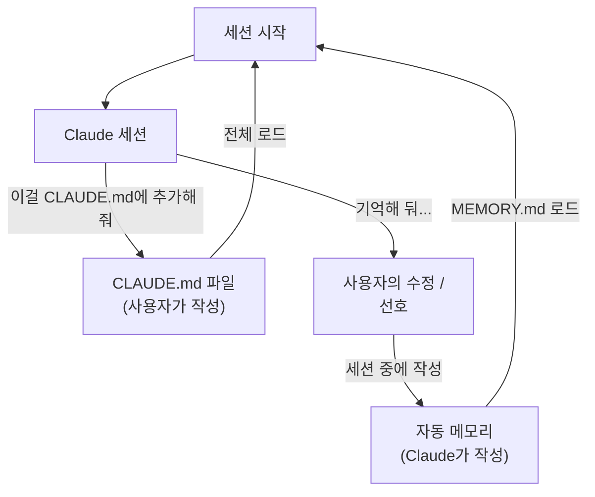
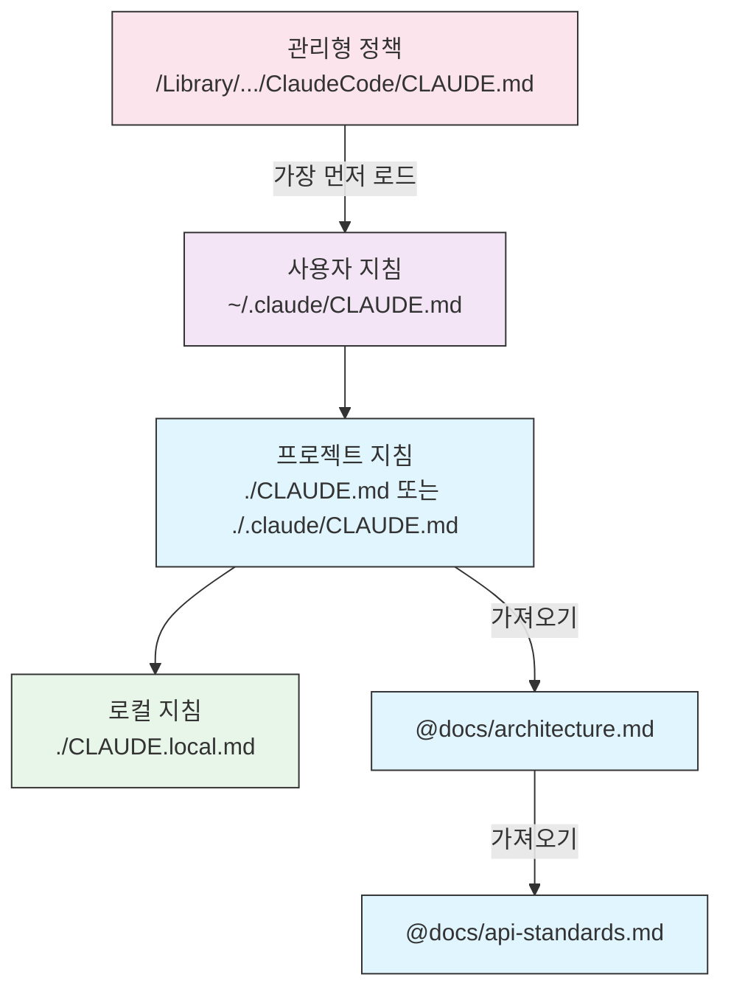
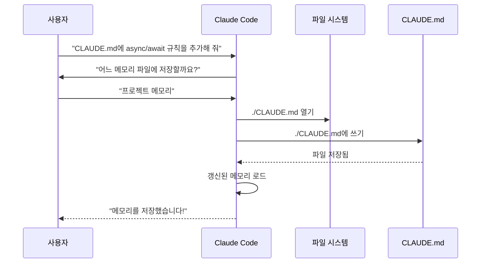
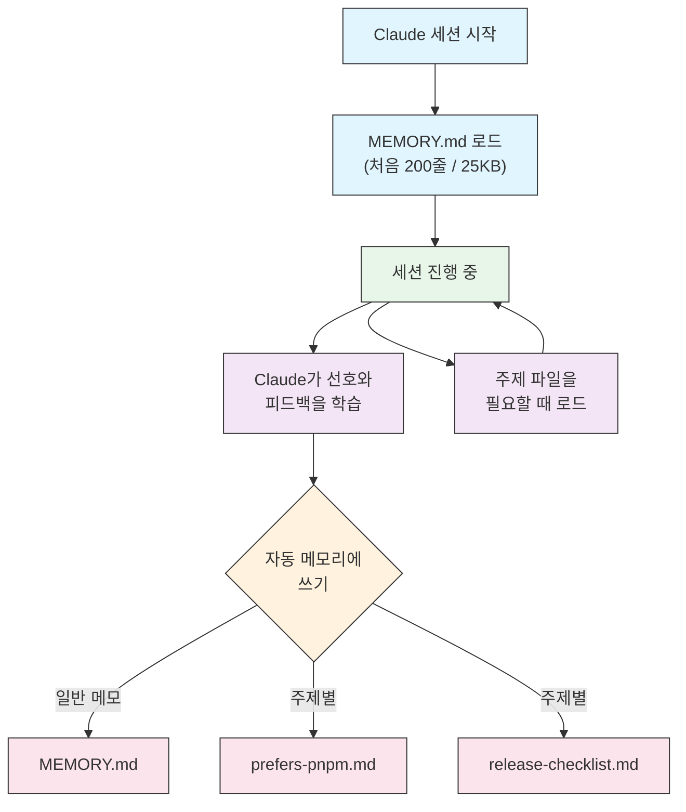

<picture>
  <source media="(prefers-color-scheme: dark)" srcset="../resources/logos/claude-howto-logo-dark.svg">
  
</picture>

# 메모리 가이드

메모리는 Claude가 세션과 대화를 넘어 컨텍스트를 유지하게 합니다. 두 가지 형태가 있는데, claude.ai의 자동 종합과 Claude Code의 파일 시스템 기반 CLAUDE.md입니다.

## 개요

Claude Code의 메모리는 여러 세션과 대화에 걸쳐 이어지는 지속적인 컨텍스트를 제공합니다. 일시적인 컨텍스트 윈도우와 달리, 메모리 파일로 다음을 할 수 있습니다:

- 팀 전체에 프로젝트 표준 공유
- 개인 개발 선호 설정 저장
- 디렉토리별 규칙과 설정 유지
- 외부 문서 가져오기
- 프로젝트의 일부로 메모리를 버전 관리

메모리 시스템은 전역 개인 설정부터 특정 하위 디렉토리까지 여러 수준에서 동작하므로, Claude가 무엇을 기억하고 그 지식을 어떻게 적용할지 세밀하게 제어할 수 있습니다.

## 메모리 명령어 빠른 참조

| 명령어 | 목적 | 사용법 | 사용 시점 |
|---------|---------|-------|-------------|
| `/init` | 프로젝트 메모리 초기화 | `/init` | 새 프로젝트 시작, CLAUDE.md 첫 설정 |
| `/memory` | 편집기에서 메모리 파일 편집 | `/memory` | 대규모 갱신, 재구성, 내용 검토 |
| `#` 접두사 | ~~한 줄 메모리 빠르게 추가~~ **제거됨** | — | 대신 `/memory`를 쓰거나 대화로 요청 |
| `@path/to/file` | 외부 내용 가져오기 | `@README.md` 또는 `@docs/api.md` | CLAUDE.md에서 기존 문서 참조 |

## 빠른 시작: 메모리 초기화

### `/init` 명령어

`/init` 명령어는 Claude Code에서 프로젝트 메모리를 설정하는 가장 빠른 방법입니다. 프로젝트의 기본 문서를 담은 CLAUDE.md 파일을 만들어 줍니다.

**사용법:**

```bash
/init
```

**하는 일:**

- 프로젝트에 새 CLAUDE.md 파일을 만듭니다(보통 `./CLAUDE.md` 또는 `./.claude/CLAUDE.md`)
- 프로젝트 규칙과 가이드라인을 정합니다
- 세션 간에 컨텍스트를 유지하는 기반을 마련합니다
- 프로젝트 표준을 문서화하는 템플릿 구조를 제공합니다

**향상된 대화형 모드:** `CLAUDE_CODE_NEW_INIT=1`을 설정하면 프로젝트 설정을 단계별로 안내하는 여러 단계의 대화형 흐름이 켜집니다:

```bash
CLAUDE_CODE_NEW_INIT=1 claude
/init
```

**`/init`을 써야 할 때:**

- Claude Code로 새 프로젝트를 시작할 때
- 팀 코딩 표준과 규칙을 정할 때
- 코드베이스 구조에 대한 문서를 만들 때
- 협업 개발을 위한 메모리 계층을 설정할 때

**예제 워크플로우:**

```markdown
# 프로젝트 디렉토리에서
/init

# Claude가 다음과 같은 구조로 CLAUDE.md를 만듭니다:
# 프로젝트 설정
## 프로젝트 개요
- 이름: 내 프로젝트
- 기술 스택: [사용하는 기술]
- 팀 규모: [개발자 수]

## 개발 표준
- 코드 스타일 선호
- 테스트 요구 사항
- Git 워크플로우 규칙
```

### 빠른 메모리 갱신

> **참고**: 인라인 메모리용 `#` 단축키는 제거되었습니다. `/memory`로 메모리 파일을 직접 편집하거나, Claude에게 대화로 기억해 달라고 요청하세요(예: "이 프로젝트에서는 항상 TypeScript strict 모드를 쓴다는 걸 기억해 둬").

메모리에 정보를 추가하는 권장 방법은 다음과 같습니다:

**방법 1: `/memory` 명령어 사용**

```bash
/memory
```

시스템 편집기에서 메모리 파일을 열어 직접 편집합니다.

**방법 2: 대화로 요청**

```
이 프로젝트에서는 항상 TypeScript strict 모드를 쓴다는 걸 기억해 둬.
메모리에 추가해 줘: 프로미스 체인보다 async/await를 선호함.
```

Claude에게 무언가를 기억해 달라고 하면 자동 메모리에 저장됩니다. 대신 CLAUDE.md를 바꾸려면 "이걸 CLAUDE.md에 추가해 줘"라고 말하거나, `/memory`로 파일을 직접 편집하세요.

**이전 방식 참고** (더 이상 동작하지 않음):

예전에는 `#` 접두사 단축키로 규칙을 인라인으로 추가할 수 있었습니다:

```markdown
# 이 프로젝트에서는 항상 TypeScript strict 모드 사용  ← 더 이상 동작하지 않음
```

이 방식을 써 왔다면 `/memory` 명령어나 대화형 요청으로 바꾸세요.

### `/memory` 명령어

`/memory` 명령어를 쓰면 Claude Code 세션 안에서 CLAUDE.md 메모리 파일을 바로 편집할 수 있습니다. 시스템 편집기에서 메모리 파일을 열어 폭넓게 편집할 수 있게 해 줍니다. 파일이 GUI 편집기에서 열리면 파일이 열려 있는 동안에도 세션이 멈추지 않으므로 병행해서 작업을 계속할 수 있습니다(v2.1.216). Vim 같은 터미널 편집기는 여전히 종료할 때까지 터미널을 차지합니다.

**사용법:**

```bash
/memory
```

**하는 일:**

- 시스템 기본 편집기에서 메모리 파일을 엽니다
- 내용을 크게 추가하고, 수정하고, 재구성할 수 있습니다
- 계층에 있는 모든 메모리 파일에 바로 접근할 수 있습니다
- 세션 간에 유지되는 컨텍스트를 관리할 수 있습니다

**`/memory`를 써야 할 때:**

- 기존 메모리 내용을 검토할 때
- 프로젝트 표준을 크게 갱신할 때
- 메모리 구조를 재구성할 때
- 자세한 문서나 가이드라인을 추가할 때
- 프로젝트가 발전함에 따라 메모리를 유지하고 갱신할 때

**비교: `/memory`와 `/init`**

| 측면 | `/memory` | `/init` |
|--------|-----------|---------|
| **목적** | 기존 메모리 파일 편집 | 새 CLAUDE.md 초기화 |
| **사용 시점** | 프로젝트 컨텍스트 갱신/수정 | 새 프로젝트 시작 |
| **동작** | 편집기를 열어 변경 | 시작용 템플릿 생성 |
| **워크플로우** | 지속적인 유지 보수 | 한 번만 하는 설정 |

**예제 워크플로우:**

```markdown
# 편집할 메모리 열기
/memory

# Claude가 선택지를 보여 줍니다:
# 1. Managed Policy Memory
# 2. Project Memory (./CLAUDE.md)
# 3. User Memory (~/.claude/CLAUDE.md)
# 4. Local Project Memory

# 2번(Project Memory, 프로젝트 메모리) 선택
# 기본 편집기에서 ./CLAUDE.md 내용이 열림

# 수정하고 저장한 뒤 편집기 닫기
# Claude가 갱신된 메모리를 자동으로 다시 로드
```

**메모리 가져오기(import) 사용:**

CLAUDE.md 파일은 외부 내용을 포함하는 `@path/to/file` 문법을 지원합니다:

```markdown
# 프로젝트 문서
프로젝트 개요는 @README.md 참고
사용 가능한 npm 명령어는 @package.json 참고
시스템 설계는 @docs/architecture.md 참고

# 절대 경로로 홈 디렉토리에서 가져오기
@~/.claude/my-project-instructions.md
```

**가져오기 기능:**

- 상대 경로와 절대 경로를 모두 지원합니다(예: `@docs/api.md` 또는 `@~/.claude/my-project-instructions.md`)
- 재귀 가져오기를 지원하며 최대 깊이는 4단계입니다
- 외부 위치에서 처음 가져올 때는 보안을 위해 승인 대화 상자가 표시됩니다
- 가져오기 지시어는 마크다운 코드 스팬이나 코드 블록 안에서는 해석되지 않습니다(그래서 예제에 적어 두어도 안전합니다)
- 기존 문서를 참조해 중복을 피하는 데 도움이 됩니다
- 참조한 내용을 Claude의 컨텍스트에 자동으로 포함합니다

## 메모리 아키텍처

Claude Code의 메모리는 범위마다 목적이 다른 계층 구조를 따릅니다. Claude 웹/데스크톱의 24시간 종합 주기(아래 [Claude 웹/데스크톱의 메모리](#claude-웹데스크톱의-메모리) 참고)와 달리, Claude Code에는 두 가지 메모리 시스템이 있으며 둘 다 세션이 시작될 때마다 로드되고 타이머가 아니라 계속해서 갱신됩니다:



## Claude Code의 메모리 계층

Claude Code에는 서로 보완하는 두 가지 메모리 시스템이 있으며, 둘 다 대화가 시작될 때마다 로드됩니다: **CLAUDE.md 파일**(사용자가 작성하는 지침)과 **자동 메모리**(Claude가 직접 작성하는 메모)입니다. CLAUDE.md 파일들은 **서로 덮어쓰지 않고 컨텍스트에 이어 붙습니다** — 상위 단계가 하위 단계를 대체하는 엄격한 우선순위 체계가 아닙니다. `.claude/rules/*.md` 파일은 주제나 경로 단위 지침을 위한, 이와 관련된 별도의 메커니즘입니다.

**로드 순서에 따른 CLAUDE.md 파일 위치(가장 넓은 범위부터 가장 구체적인 범위까지):**

| 범위 | 위치 | 목적 |
|-------|----------|---------|
| 관리형 정책 | macOS: `/Library/Application Support/ClaudeCode/CLAUDE.md`<br>Linux/WSL: `/etc/claude-code/CLAUDE.md`<br>Windows: `C:\Program Files\ClaudeCode\CLAUDE.md` | IT/DevOps가 관리하는 조직 전체 지침. 개인 설정으로 제외할 수 없습니다. |
| 사용자 지침 | `~/.claude/CLAUDE.md` | 모든 프로젝트에 적용되는 개인 선호 설정 |
| 프로젝트 지침 | `./CLAUDE.md` 또는 `./.claude/CLAUDE.md` | 팀이 공유하고 버전 관리하는 지침. v2.1.277부터는 작업 디렉토리나 그 상위에 `CLAUDE.md`나 `CLAUDE.local.md`가 없으면 `./AGENTS.md`가 대신 이 단계에서 로드됩니다 — `/config`의 **Project instructions**(프로젝트 지침) 설정으로 제어 |
| 로컬 지침 | `./CLAUDE.local.md` | 개인적인 프로젝트별 선호 설정. `.gitignore`에 추가하세요 |

디렉토리 트리 안에서 Claude Code는 작업 디렉토리에서 위로 올라가며 파일을 찾습니다: `foo/bar/`에서 실행하면 `foo/CLAUDE.md`가 `foo/bar/CLAUDE.md`보다 먼저 로드되므로, 실행한 위치에 더 가까운 지침이 *마지막에* 읽힙니다 — 덮어쓴다는 의미의 "가장 높은 우선순위"가 아니라, 컨텍스트에서 가장 나중에 나온다는 뜻일 뿐입니다. 각 디렉토리 안에서는 `CLAUDE.local.md`가 `CLAUDE.md` 뒤에 붙습니다. 작업 디렉토리 *아래* 하위 디렉토리에 있는 CLAUDE.md와 CLAUDE.local.md 파일은 시작할 때가 아니라, Claude가 그 하위 디렉토리의 파일을 읽을 때 필요에 따라 로드됩니다.

조직은 별도 파일을 배포하는 대신 `claudeMd` 키를 써서 관리형 CLAUDE.md 내용을 `managed-settings.json` 안에 직접 넣을 수도 있습니다. 이 키는 관리형/정책 설정에서만 적용되며, 사용자나 프로젝트 설정에서 `claudeMd`를 지정해도 효과가 없습니다.

**`.claude/rules/*.md`** — 주제별로 나눈 모듈식 지침이며, `paths` frontmatter로 특정 파일 경로에만 적용되게 할 수도 있습니다. `paths` 필드가 없는 규칙은 조건 없이 `.claude/CLAUDE.md`와 같은 우선순위로 로드되고, 경로 범위 규칙은 Claude가 일치하는 파일을 읽거나 쓰거나 편집할 때 필요에 따라 로드됩니다 — `cat`, `head`, `tail`, `sed -n`, `grep` 같은 단일 파일 Bash 읽기로 볼 때도 마찬가지입니다(Write/Edit는 v2.1.288부터, Bash 읽기는 v2.1.293부터). 사용자 수준 규칙(`~/.claude/rules/`)은 프로젝트 규칙보다 먼저 로드됩니다.

**자동 메모리**(`~/.claude/projects/<project>/memory/`)는 별개의 시스템입니다: CLAUDE.md 내용이 아니라 Claude 자신의 메모이며, 위의 이어 붙이기 순서에 속하지 않습니다. 아래 [자동 메모리](#자동-메모리)를 참고하세요.

> **참고**: `CLAUDE.local.md`는 완전히 지원되며 [공식 문서](https://code.claude.com/docs/ko/memory)에 설명되어 있습니다. 버전 관리에 커밋하지 않는 개인적인 프로젝트별 선호 설정을 담습니다. `CLAUDE.local.md`를 `.gitignore`에 추가하세요.

**메모리 발견 동작:**



표시된 모든 파일은 덮어쓰기로 선택되는 것이 아니라 하나의 컨텍스트로 이어 붙습니다 — 뒤쪽 상자는 앞쪽 상자를 "대신"하는 것이 아니라 컨텍스트에서 더 뒤에 나타날 뿐입니다.

## AGENTS.md

`AGENTS.md`는 여러 도구가 함께 쓰는 프로젝트 컨텍스트 파일입니다: CLAUDE.md와 같은 *종류*의 문서로, 여러 코딩 에이전트가 하나의 프로젝트 규칙을 공유할 수 있도록 작성합니다. **v2.1.277**부터 Claude Code는 따로 가져오지 않아도 이 파일을 프로젝트 지침으로 직접 읽습니다.

**기본 동작** (`claude-md-or-agents-md`):

| 프로젝트에 있는 파일 | Claude Code가 읽는 파일 |
|---------------------------|------------------------|
| `AGENTS.md`만 있고 `CLAUDE.md`는 없음 | `AGENTS.md` |
| `AGENTS.md`와 `CLAUDE.md`가 모두 있음 | `CLAUDE.md`만 |
| `@AGENTS.md`로 `AGENTS.md`를 가져오는 `CLAUDE.md` | 가져오기가 펼쳐진 `CLAUDE.md` |

**AGENTS.md를 막는 파일.** Claude Code는 작업 디렉토리와 그 위의 모든 디렉토리에서 `CLAUDE.md`, `.claude/CLAUDE.md`, `CLAUDE.local.md`를 찾습니다. 그중 하나라도 있으면 `AGENTS.md`는 읽지 않습니다. `~/.claude/CLAUDE.md`, 관리형 CLAUDE.md, `.claude/rules/`는 이 검사에 포함되지 **않으며**, 어느 프로젝트 파일이 선택되든 함께 계속 로드됩니다.

> **경고**: `CLAUDE.local.md`를 추가하면 아무 알림 없이 `AGENTS.md`를 더 이상 읽지 않습니다. 로컬 재정의 파일을 만든 뒤 프로젝트 지침이 사라진 것 같다면 대개 이 때문입니다.

**읽히는 파일.** 작업 디렉토리와 그 위에 있는 모든 `AGENTS.md`와 `.claude/AGENTS.md`는 세션 시작 시 로드되고, 하위 디렉토리의 파일은 Claude가 그곳의 파일을 읽을 때 필요에 따라 로드됩니다. `@path` 가져오기는 CLAUDE.md에서와 똑같이 펼쳐지고, `claudeMdExcludes`도 적용됩니다.

**절대 읽지 않는 파일**: `AGENTS.local.md`, `AGENTS.override.md`, 그리고 `.agents/` 아래의 모든 파일.

**동작 선택하기.** **Project instructions**(프로젝트 지침) 설정에는 네 가지 값이 있습니다:

| 값 | 효과 |
|-------|--------|
| `claude-md-or-agents-md` | 기본값 — CLAUDE.md 파일이 없을 때만 `AGENTS.md`를 읽음 |
| `claude-md-and-agents-md` | 둘 다 있으면 둘 다 읽음 |
| `claude-md` | CLAUDE.md 파일만 읽고 `AGENTS.md`는 무시 |
| `managed-only` | 관리형 정책 지침만 읽음 |

`/config`에서 바꾸거나 설정 파일에서 지정하세요:

```jsonc
{
  "pluginConfigs": {
    "agents-md@builtin": {
      "options": {
        "instructionFiles": "claude-md-and-agents-md"
      }
    }
  }
}
```

이 키는 사용자 설정과 관리형 설정에서만 적용되며, 프로젝트나 로컬 설정에서 지정해도 효과가 없습니다.

**직접 읽기를 쓸 수 없는 경우.** v2.1.277 이전 버전(Bedrock/Vertex/Foundry, LLM 게이트웨이 뒤, 텔레메트리를 끈 환경에서는 v2.1.281 이전), 업그레이드 후 첫 세션, 또는 기본 제공 `agents-md` 플러그인을 끈 경우에는 Claude Code가 `AGENTS.md`를 스스로 읽지 않습니다. 이럴 때는 CLAUDE.md에서 가져오세요:

```markdown
@AGENTS.md
```

## `claudeMdExcludes`로 CLAUDE.md 파일 제외하기

대규모 모노레포에서는 일부 CLAUDE.md 파일이 지금 하는 작업과 관계없을 수 있습니다. `claudeMdExcludes` 설정으로 특정 CLAUDE.md 파일을 건너뛰어 컨텍스트에 로드되지 않게 할 수 있습니다:

```jsonc
// ~/.claude/settings.json 또는 .claude/settings.json에서
{
  "claudeMdExcludes": [
    "**/packages/legacy-app/CLAUDE.md",
    "**/vendors/**/CLAUDE.md"
  ]
}
```

패턴은 glob 문법으로 절대 파일 경로와 대조되므로, 저장소 기준 상대 패턴은 `**/`로 시작하세요. 특히 다음과 같은 경우에 유용합니다:

- 하위 프로젝트가 많고 그중 일부만 관련 있는 모노레포
- 외부에서 가져온(vendored) CLAUDE.md나 서드파티 CLAUDE.md 파일이 들어 있는 저장소
- 오래되었거나 관계없는 지침을 제외해 Claude의 컨텍스트 윈도우에서 잡음 줄이기

## 설정 파일 계층

Claude Code 설정(`autoMemoryDirectory`, `claudeMdExcludes` 등)은 우선순위에 따라 결정됩니다 — 위의 CLAUDE.md 파일과 달리 설정은 이어 붙지 않고 실제로 덮어씁니다. 같은 설정이 여러 범위에 있으면 더 높은 단계가 이깁니다:

| 단계 | 위치 | 범위 |
|-------|----------|-------|
| 1 (가장 높음) | 관리형 — `managed-settings.json`, plist/레지스트리, 또는 서버 관리형 | 조직 전체에 강제 적용. 재정의할 수 없음 |
| 2 | 명령줄 인수 | 일시적인 세션 재정의 |
| 3 | `.claude/settings.local.json` | 로컬 재정의(git에서 무시) |
| 4 | `.claude/settings.json` | 프로젝트 수준(git에 커밋) |
| 5 (가장 낮음) | `~/.claude/settings.json` | 사용자 선호 설정 |

관리형 설정은 `managed-settings.json`과 함께 드롭인 디렉토리 `managed-settings.d/`도 지원합니다: 기본 파일이 먼저 병합되고, 그다음 드롭인 디렉토리의 `*.json` 파일이 알파벳 순서로 그 위에 병합됩니다(스칼라 값은 덮어쓰고, 배열은 이어 붙인 뒤 중복을 제거하며, 객체는 깊은 병합). 덕분에 여러 팀이 공유 파일을 편집하지 않고도 각자의 정책 조각을 배포할 수 있습니다. 이것은 CLAUDE.md가 아니라 **settings.json**의 메커니즘이므로, 위에서 설명한 CLAUDE.md 파일 위치에는 적용되지 않습니다.

권한 규칙(`allow`/`ask`/`deny`)은 다른 설정과 다르게 동작합니다: 상위 단계가 하위 단계를 대체하지 않고 범위들 사이에서 병합됩니다.

**플랫폼별 설정 (v2.1.51+):**

설정은 다음 방법으로도 구성할 수 있습니다:
- **macOS**: 속성 목록(plist) 파일
- **Windows**: Windows 레지스트리

이 플랫폼 고유 메커니즘은 JSON 설정 파일과 함께 읽히며 같은 우선순위 규칙을 따릅니다.

> **참고 (v2.1.119)**: 이제 `/config`에서 바꾼 내용은 `~/.claude/settings.json`에 저장됩니다. `/config`로 쓴 값은 위에서 설명한 정책/로컬/프로젝트 우선순위 체계를 그대로 따르며, 더 이상 세션 한정이 아닙니다. 대화형으로 편집할 때는 `/config`를 쓰고, 스크립트나 관리형 설정에서는 `settings.json` 파일을 직접 편집하세요.

### 보존과 정리 설정

| 설정 | 타입 | 기본값 | 설명 |
|---------|------|---------|-------------|
| `cleanupPeriodDays` | integer(일 단위) | 30 | `~/.claude/` 아래의 세션 기록과 기타 애플리케이션 데이터를 보존하는 기간. `file-history/`(체크포인트 스냅샷), `plans/`, `debug/`, `tasks/`, `shell-snapshots/`, `backups/`가 포함됩니다. `~/.claude/checkpoints/` 폴더는 없습니다. 기간이 지난 파일은 시작할 때 정리됩니다. |

```jsonc
// ~/.claude/settings.json
{
  "cleanupPeriodDays": 14
}
```

### 작성자 표시, 음성, PR URL 설정

| 설정 | 타입 | 설명 |
|---------|------|-------------|
| `attribution.commit` | string | Claude가 만드는 커밋에 덧붙는 텍스트(기본값은 `Co-Authored-By: Claude` 트레일러). `""`이면 숨깁니다. 지원 중단된 `includeCoAuthoredBy` 플래그를 대체합니다. |
| `attribution.pr` | string | Claude가 만드는 풀 리퀘스트 설명에 덧붙는 텍스트. `""`이면 숨깁니다. PR에서는 지원 중단된 `includeCoAuthoredBy` 플래그를 대체합니다. |
| `attribution.sessionUrl` | boolean | 웹 세션과 Remote Control 세션에서 만든 커밋과 PR에서 claude.ai 세션 링크를 뺍니다(v2.1.183+). |
| `voice.enabled` | boolean | 눌러서 말하기(push-to-talk) 음성 받아쓰기(`/voice`)를 켭니다. 지원 중단된 `voiceEnabled` 플래그를 대체합니다. |
| `prUrlTemplate` | string | **v2.1.119에서 새로 추가.** 하단 PR 배지에 쓸 사용자 정의 URL 템플릿. GitLab, Bitbucket, 사내 코드 리뷰 플랫폼에 유용합니다. `{host}`, `{owner}`, `{repo}`, `{number}`, `{url}` 자리 표시자를 지원하며, GitLab 머지 리퀘스트 링크는 바뀌지 않습니다. |

```jsonc
// ~/.claude/settings.json
{
  "attribution": {
    "commit": "",
    "pr": ""
  },
  "voice": {
    "enabled": true
  },
  "prUrlTemplate": "https://reviews.example.com/{owner}/{repo}/pull/{number}"
}
```

빈 문자열(`""`)은 해당 작성자 표시를 숨기고, `"attribution": false`는 모두 숨깁니다(v2.1.281+).

#### 지원 중단된 설정 이름

다음 레거시 설정 키는 아직 동작하지만 지원 중단되었습니다. 위의 대체 키를 쓰세요.

| 지원 중단된 키 | 대체 키 | 참고 |
|----------------|-------------|-------|
| `includeCoAuthoredBy` | `attribution.commit` / `attribution.pr` | 예전의 단일 플래그가 커밋용과 PR용 스위치로 나뉘었습니다. 이전 설치 환경에서는 레거시 키를 계속 써도 되지만, 새 프로젝트에서는 중첩 형식을 쓰세요. |
| `voiceEnabled` | `voice.enabled` | 앞으로 추가될 음성 관련 옵션과 함께 `voice` 네임스페이스 아래로 묶였습니다. |

## 모듈식 규칙 시스템

`.claude/rules/` 디렉토리 구조로 경로별 규칙을 체계적으로 만드세요. 규칙은 프로젝트 수준과 사용자 수준 모두에서 정의할 수 있습니다:

```
your-project/
├── .claude/
│   ├── CLAUDE.md
│   └── rules/
│       ├── code-style.md
│       ├── testing.md
│       ├── security.md
│       └── api/                  # 하위 디렉토리 지원
│           ├── conventions.md
│           └── validation.md

~/.claude/
├── CLAUDE.md
└── rules/                        # 사용자 수준 규칙(모든 프로젝트)
    ├── personal-style.md
    └── preferred-patterns.md
```

규칙은 하위 디렉토리를 포함해 `rules/` 디렉토리 안에서 재귀적으로 발견됩니다. `~/.claude/rules/`의 사용자 수준 규칙은 프로젝트 수준 규칙보다 먼저 로드되므로, 개인 기본값을 두고 프로젝트에서 재정의할 수 있습니다.

### YAML frontmatter로 경로별 규칙 지정

특정 파일 경로에만 적용되는 규칙을 정의합니다:

```markdown
---
paths: src/api/**/*.ts
---

# API 개발 규칙

- 모든 API 엔드포인트는 입력 검증을 포함해야 함
- 스키마 검증에는 Zod 사용
- 모든 매개변수와 응답 타입을 문서화
- 모든 작업에 오류 처리 포함
```

**glob 패턴 예:**

- `**/*.ts` - 모든 TypeScript 파일
- `src/**/*` - src/ 아래의 모든 파일
- `src/**/*.{ts,tsx}` - 여러 확장자
- `{src,lib}/**/*.ts, tests/**/*.test.ts` - 여러 패턴

### 하위 디렉토리와 심볼릭 링크

`.claude/rules/`의 규칙은 두 가지 정리 기능을 지원합니다:

- **하위 디렉토리**: 규칙은 재귀적으로 발견되므로 주제별 폴더로 정리할 수 있습니다(예: `rules/api/`, `rules/testing/`, `rules/security/`)
- **심볼릭 링크**: 여러 프로젝트에서 규칙을 공유할 수 있도록 심볼릭 링크를 지원합니다. 예를 들어 중앙 위치의 공유 규칙 파일을 각 프로젝트의 `.claude/rules/` 디렉토리에 심볼릭 링크로 연결할 수 있습니다. v2.1.284부터는 프로젝트 바깥에서 심볼릭 링크로 연결한 규칙(또는 바깥에서 심볼릭 링크로 연결한 `.claude` 디렉토리)도 `@path` 가져오기와 같은 외부 가져오기 승인 프롬프트를 표시합니다

## 메모리 위치 표

CLAUDE.md 파일과 규칙은 엄격한 덮어쓰기로 선택되지 않고 컨텍스트에 이어 붙습니다 — 아래의 "로드 순서"는 *어느 것이 이기는지*가 아니라 *컨텍스트의 어디에 나타나는지*를 뜻합니다. 자동 메모리는 자체 저장 위치를 가진 별도의 메커니즘입니다.

| 위치 | 유형 | 로드 순서 | 공유 | 접근 | 적합한 용도 |
|----------|------|-------------|--------|--------|----------|
| `/Library/Application Support/ClaudeCode/CLAUDE.md` (macOS) | 관리형 정책 | 1번째(가장 먼저 로드) | 조직 | 시스템 | 회사 전체 정책 |
| `/etc/claude-code/CLAUDE.md` (Linux/WSL) | 관리형 정책 | 1번째(가장 먼저 로드) | 조직 | 시스템 | 조직 표준 |
| `C:\Program Files\ClaudeCode\CLAUDE.md` (Windows) | 관리형 정책 | 1번째(가장 먼저 로드) | 조직 | 시스템 | 회사 가이드라인 |
| `~/.claude/rules/*.md` | 사용자 규칙 | 2번째 | 개인 | 파일 시스템 | 개인 규칙(모든 프로젝트) |
| `~/.claude/CLAUDE.md` | 사용자 메모리 | 3번째 | 개인 | 파일 시스템 | 개인 선호 설정(모든 프로젝트) |
| `./.claude/rules/*.md` | 프로젝트 규칙 | 4번째 | 팀 | Git | 경로별 모듈식 규칙 |
| `./CLAUDE.md` 또는 `./.claude/CLAUDE.md` | 프로젝트 메모리 | 5번째 | 팀 | Git | 팀 표준, 공유 아키텍처 |
| `./CLAUDE.local.md` | 프로젝트 로컬 | 6번째(가장 나중에 로드) | 개인 | Git(무시됨) | 개인적인 프로젝트별 선호 설정 |
| `~/.claude/projects/<project>/memory/` | 자동 메모리 | 해당 없음 — 별도 메커니즘 | 개인 | 파일 시스템 | Claude가 자동으로 남기는 메모와 학습 내용 |

## 메모리 갱신 수명 주기

Claude Code 세션에서 메모리 갱신은 다음과 같이 흘러갑니다:



## 자동 메모리

자동 메모리는 Claude가 프로젝트에서 작업하면서 유형별 메모(`user`, `feedback`, `project`, `reference`)를 자동으로 저장하는 지속 디렉토리입니다. 아키텍처, 파일 경로, 디버깅 해결책처럼 코드베이스에서 알아낼 수 있는 내용은 저장하지 않습니다. 사용자가 직접 작성하고 관리하는 CLAUDE.md 파일과 달리, 자동 메모리는 세션 중에 Claude가 직접 작성합니다.

### 자동 메모리의 동작 방식

- **위치**: `~/.claude/projects/<project>/memory/`
- **진입점**: 자동 메모리 디렉토리의 메인 파일은 `MEMORY.md`입니다
- **주제 파일**: 메모마다 하나씩 두는 선택적 추가 파일(예: `prefers-pnpm.md`, `release-checklist.md`)
- **로딩 동작**: 세션 시작 시 `MEMORY.md`의 처음 200줄(또는 처음 25KB 중 먼저 도달하는 쪽)이 컨텍스트에 로드됩니다. 주제 파일은 시작할 때가 아니라 필요할 때 로드됩니다.
- **읽기/쓰기**: Claude는 세션 중에 사용자의 선호, 피드백, 프로젝트 컨텍스트를 배우면서 메모리 파일을 읽고 씁니다
- **frontmatter**: YAML frontmatter로 시작하는 파일에는 `modified` 필드가 붙습니다 — Claude Code가 파일을 쓸 때마다 기록하는 ISO 8601 타임스탬프입니다(v2.1.214)

### 자동 메모리 아키텍처



### 자동 메모리 디렉토리 구조

```
~/.claude/projects/<project>/memory/
├── MEMORY.md              # 진입점(시작할 때 처음 200줄 / 25KB 로드)
├── prefers-pnpm.md        # 주제 파일(필요할 때 로드)
├── release-checklist.md   # 주제 파일(필요할 때 로드)
└── team-contacts.md       # 주제 파일(필요할 때 로드)
```

### 버전 요구 사항

자동 메모리를 쓰려면 **Claude Code v2.1.59 이상**이 필요합니다. 이전 버전을 쓰고 있다면 먼저 업그레이드하세요:

```bash
npm install -g @anthropic-ai/claude-code@latest
```

### 자동 메모리 켜고 끄기

자동 메모리는 **기본으로 켜져 있습니다**. `autoMemoryEnabled` 설정(기본값 `true`)으로 제어하며, `false`이면 Claude는 자동 메모리 디렉토리를 읽지도 쓰지도 않습니다. 세션 중에 `/memory`로 켜고 끌 수도 있습니다.

```json
{
  "autoMemoryEnabled": false
}
```

환경 변수로 끄려면 `CLAUDE_CODE_DISABLE_AUTO_MEMORY=1`을 설정하세요. `0`으로 설정하면 `--bare` 모드나 `autoMemoryEnabled: false` 때문에 꺼질 상황에서도 자동 메모리가 강제로 **켜집니다**.

### 사용자 정의 자동 메모리 디렉토리

기본적으로 자동 메모리는 `~/.claude/projects/<project>/memory/`에 저장됩니다. `autoMemoryDirectory` 설정(**v2.1.74**부터 사용 가능)으로 이 위치를 바꿀 수 있습니다:

```jsonc
// 어느 설정 파일에서든: 사용자, 프로젝트, 로컬, 관리형 정책
{
  "autoMemoryDirectory": "/path/to/custom/memory/directory"
}
```

> **참고**: `autoMemoryDirectory`는 사용자, 프로젝트, 로컬, 관리형 정책, `--settings` 등 어느 설정 범위에서든 읽힙니다. 값은 절대 경로이거나 `~/`로 시작해야 합니다.

다음과 같은 경우에 유용합니다:

- 자동 메모리를 공유 위치나 동기화되는 위치에 저장할 때
- 자동 메모리를 기본 Claude 설정 디렉토리와 분리할 때
- 기본 계층 밖의 프로젝트별 경로를 쓸 때

### worktree와 저장소 공유

같은 git 저장소의 모든 worktree와 하위 디렉토리는 하나의 자동 메모리 디렉토리를 공유합니다. 따라서 worktree를 오가거나 같은 저장소의 다른 하위 디렉토리에서 작업해도 같은 메모리 파일을 읽고 씁니다.

### 서브에이전트 메모리

(Agent 도구로 생성한) 서브에이전트는 자체 지속 메모리를 가질 수 있습니다. 서브에이전트 정의의 `memory` frontmatter 필드로 그 메모리 디렉토리의 위치를 정합니다:

```yaml
memory: user      # ~/.claude/agent-memory/<agent-name>/
memory: project   # .claude/agent-memory/<agent-name>/ (git으로 공유 가능)
memory: local     # .claude/agent-memory-local/<agent-name>/ (커밋하지 않음)
```

서브에이전트는 시작할 때 그 디렉토리에 있는 `MEMORY.md`의 처음 200줄/25KB를 읽고, 이를 관리할 수 있도록 Read/Write/Edit 도구를 받습니다. 자동 메모리가 꺼져 있으면 효과가 없습니다.

> **참고**: 서브에이전트도 자체 자동 메모리를 관리할 수 있습니다. 자세한 내용은 [서브에이전트 메모리 공식 문서](https://code.claude.com/docs/ko/sub-agents#enable-persistent-memory)를 참고하세요.

### 자동 메모리 제어

자동 메모리는 `CLAUDE_CODE_DISABLE_AUTO_MEMORY` 환경 변수로 제어할 수 있습니다:

| 값 | 동작 |
|-------|----------|
| `0` | 자동 메모리를 강제로 **켬** |
| `1` | 자동 메모리를 강제로 **끔** |
| *(설정 안 함)* | 기본 동작(자동 메모리 켜짐) |

```bash
# 이 세션에서 자동 메모리 끄기
CLAUDE_CODE_DISABLE_AUTO_MEMORY=1 claude

# 자동 메모리를 명시적으로 강제로 켜기
CLAUDE_CODE_DISABLE_AUTO_MEMORY=0 claude
```

## `--add-dir`로 디렉토리 추가하기

`--add-dir` 플래그를 쓰면 Claude Code가 현재 작업 디렉토리 외의 추가 디렉토리에서도 CLAUDE.md 파일을 로드할 수 있습니다. 다른 디렉토리의 컨텍스트가 필요한 모노레포나 여러 프로젝트를 함께 다루는 구성에서 유용합니다.

이 기능을 켜려면 다음 환경 변수를 설정하세요:

```bash
CLAUDE_CODE_ADDITIONAL_DIRECTORIES_CLAUDE_MD=1
```

그런 다음 플래그와 함께 Claude Code를 실행합니다:

```bash
claude --add-dir /path/to/other/project
```

Claude는 현재 작업 디렉토리의 메모리 파일과 함께, 지정한 추가 디렉토리의 CLAUDE.md도 로드합니다.

## 실전 예제

### 예제 1: 프로젝트 메모리 구조

**파일:** `./CLAUDE.md`

```markdown
# 프로젝트 설정

## 프로젝트 개요
- **이름**: 전자상거래 플랫폼
- **기술 스택**: Node.js, PostgreSQL, React 18, Docker
- **팀 규모**: 개발자 5명
- **마감**: 2025년 4분기

## 아키텍처
@docs/architecture.md
@docs/api-standards.md
@docs/database-schema.md

## 개발 표준

### 코드 스타일
- 포맷팅에는 Prettier 사용
- airbnb 설정으로 ESLint 사용
- 최대 줄 길이: 100자
- 2칸 들여쓰기 사용

### 이름 규칙
- **파일**: kebab-case (user-controller.js)
- **클래스**: PascalCase (UserService)
- **함수/변수**: camelCase (getUserById)
- **상수**: UPPER_SNAKE_CASE (API_BASE_URL)
- **데이터베이스 테이블**: snake_case (user_accounts)

### Git 워크플로우
- 브랜치 이름: `feature/description` 또는 `fix/description`
- 커밋 메시지: Conventional Commits 규칙 준수
- 병합 전 PR 필수
- 모든 CI/CD 검사 통과 필수
- 최소 1명의 승인 필요

### 테스트 요구 사항
- 코드 커버리지 최소 80%
- 모든 핵심 경로에 테스트 필수
- 단위 테스트에는 Jest 사용
- E2E 테스트에는 Cypress 사용
- 테스트 파일 이름: `*.test.ts` 또는 `*.spec.ts`

### API 표준
- RESTful 엔드포인트만 사용
- JSON 요청/응답
- HTTP 상태 코드를 올바르게 사용
- API 엔드포인트 버전 관리: `/api/v1/`
- 모든 엔드포인트를 예제와 함께 문서화

### 데이터베이스
- 스키마 변경에는 마이그레이션 사용
- 자격 증명 하드코딩 금지
- 커넥션 풀링 사용
- 개발 환경에서는 쿼리 로깅 켜기
- 정기 백업 필수

### 배포
- Docker 기반 배포
- Kubernetes 오케스트레이션
- 블루-그린 배포 전략
- 실패 시 자동 롤백
- 배포 전에 데이터베이스 마이그레이션 실행

## 자주 쓰는 명령어

| 명령어 | 목적 |
|---------|---------|
| `npm run dev` | 개발 서버 시작 |
| `npm test` | 테스트 스위트 실행 |
| `npm run lint` | 코드 스타일 검사 |
| `npm run build` | 프로덕션 빌드 |
| `npm run migrate` | 데이터베이스 마이그레이션 실행 |

## 팀 연락처
- 테크 리드: Sarah Chen (@sarah.chen)
- 프로덕트 매니저: Mike Johnson (@mike.j)
- DevOps: Alex Kim (@alex.k)

## 알려진 문제와 우회 방법
- 사용량이 많은 시간대에는 PostgreSQL 커넥션 풀이 20개로 제한됨
- 우회 방법: 쿼리 대기열 구현
- Safari 14에서 async generator 호환성 문제
- 우회 방법: Babel 트랜스파일러 사용

## 관련 프로젝트
- 분석 대시보드: `/projects/analytics`
- 모바일 앱: `/projects/mobile`
- 관리자 패널: `/projects/admin`
```

### 예제 2: 디렉토리별 메모리

**파일:** `./src/api/CLAUDE.md`

````markdown
# API 모듈 표준

이 파일은 /src/api/ 안의 모든 것에 대해 루트 CLAUDE.md를 보완합니다. 메모리 파일은
덮어쓰지 않고 이어 붙으므로 루트 CLAUDE.md도 여전히 적용되며, Claude Code는
이 하위 트리의 파일을 읽거나 쓰거나 편집할 때 이 파일을 필요에 따라 로드합니다.

## API 전용 표준

### 요청 검증
- 스키마 검증에는 Zod 사용
- 입력은 항상 검증
- 검증 오류는 400으로 반환
- 필드 단위 오류 상세 포함

### 인증
- 모든 엔드포인트에 JWT 토큰 필요
- 토큰은 Authorization 헤더에 담기
- 토큰은 24시간 후 만료
- 리프레시 토큰 메커니즘 구현

### 응답 형식

모든 응답은 다음 구조를 따라야 합니다:

```json
{
  "success": true,
  "data": { /* 실제 데이터 */ },
  "timestamp": "2025-11-06T10:30:00Z",
  "version": "1.0"
}
```

오류 응답:
```json
{
  "success": false,
  "error": {
    "code": "VALIDATION_ERROR",
    "message": "사용자에게 보여 줄 메시지",
    "details": { /* 필드 오류 */ }
  },
  "timestamp": "2025-11-06T10:30:00Z"
}
```

### 페이지네이션
- 커서 기반 페이지네이션 사용(오프셋 아님)
- `hasMore` 불리언 포함
- 최대 페이지 크기는 100으로 제한
- 기본 페이지 크기: 20

### 속도 제한
- 인증된 사용자는 시간당 요청 1000개
- 공개 엔드포인트는 시간당 요청 100개
- 초과하면 429 반환
- retry-after 헤더 포함

### 캐싱
- 세션 캐싱에는 Redis 사용
- 캐시 유지 시간: 기본 5분
- 쓰기 작업 시 무효화
- 캐시 키에 리소스 유형 태그 붙이기
````

### 예제 3: 개인 메모리

**파일:** `~/.claude/CLAUDE.md`

```markdown
# 나의 개발 선호 설정

## 나에 대해
- **경력**: 풀스택 개발 8년
- **선호 언어**: TypeScript, Python
- **커뮤니케이션 스타일**: 직설적으로, 예시와 함께
- **학습 스타일**: 코드를 곁들인 시각적 다이어그램

## 코드 선호

### 오류 처리
try-catch 블록과 의미 있는 오류 메시지를 쓰는 명시적인 오류 처리를 선호합니다.
일반적인 오류는 피하세요. 디버깅을 위해 오류는 항상 로그로 남기세요.

### 주석
주석은 무엇(WHAT)이 아니라 왜(WHY)를 설명하는 데 쓰세요. 코드는 그 자체로 설명이 되어야 합니다.
주석은 비즈니스 로직이나 명확하지 않은 결정을 설명해야 합니다.

### 테스트
TDD(테스트 주도 개발)를 선호합니다.
테스트를 먼저 쓰고 그다음 구현하세요.
구현 세부 사항이 아니라 동작에 집중하세요.

### 아키텍처
모듈식이고 느슨하게 결합된 설계를 선호합니다.
테스트하기 쉽도록 의존성 주입을 쓰세요.
관심사를 분리하세요(Controllers, Services, Repositories).

## 디버깅 선호
- 접두사를 붙여 console.log 사용: `[DEBUG]`
- 컨텍스트 포함: 함수 이름, 관련 변수
- 가능하면 스택 트레이스 사용
- 로그에는 항상 타임스탬프 포함

## 커뮤니케이션
- 복잡한 개념은 다이어그램으로 설명
- 이론을 설명하기 전에 구체적인 예시부터 보여 주기
- 변경 전/후 코드 조각 포함
- 마지막에 핵심 요점 요약

## 프로젝트 구성
프로젝트는 다음과 같이 구성합니다:

   project/
   ├── src/
   │   ├── api/
   │   ├── services/
   │   ├── models/
   │   └── utils/
   ├── tests/
   ├── docs/
   └── docker/

## 도구
- **IDE**: vim 키 바인딩을 쓰는 VS Code
- **터미널**: Oh-My-Zsh를 쓰는 Zsh
- **포맷**: Prettier (한 줄 100자)
- **린터**: airbnb 설정을 쓰는 ESLint
- **테스트 프레임워크**: React Testing Library를 곁들인 Jest
```

_직접 해 본 테스트_
Claude에게 새 규칙을 저장해 달라고 요청했습니다.


어디에도 `Claude.md` 파일이 없었기 때문에 Claude는 규칙을 저장하지 않았습니다. 그래서 Claude에게 저장 위치를 확인해 달라고 요청했습니다.


### 예제 4: 세션 중 메모리 갱신

Claude Code 세션이 진행 중일 때 Claude에게 직접 요청해 CLAUDE.md에 새 규칙을 추가할 수 있습니다(무언가를 *기억해* 달라고 하면 대신 자동 메모리에 저장됩니다):

```markdown
사용자: 이걸 CLAUDE.md에 추가해 줘: 새 컴포넌트는 모두 클래스 컴포넌트 대신
       React hooks를 쓰는 걸 선호해.

Claude: 메모리에 추가하겠습니다. 어느 메모리 파일에 넣을까요?
        1. 프로젝트 메모리 (./CLAUDE.md)
        2. 개인 메모리 (~/.claude/CLAUDE.md)

사용자: 프로젝트 메모리

Claude: ✅ 메모리를 저장했습니다!

./CLAUDE.md에 추가한 내용:
---

### 컴포넌트 개발
- React Hooks와 함께 함수형 컴포넌트 사용
- 클래스 컴포넌트보다 hooks 선호
- 재사용 로직은 커스텀 hooks로 작성
- 이벤트 핸들러에는 useCallback 사용
- 비용이 큰 계산에는 useMemo 사용
```

또는 크게 갱신하거나 재구성할 때는 `/memory`로 메모리 파일을 직접 편집하세요.

#### 메모리 추가 팁

- 규칙은 구체적이고 실행 가능하게 작성하세요
- 관련 규칙은 섹션 제목 아래에 모으세요
- 내용을 중복하지 말고 기존 섹션을 갱신하세요
- 알맞은 메모리 범위(프로젝트 또는 개인)를 고르세요

## 메모리 기능 비교

| 기능 | Claude 웹/데스크톱 | Claude Code (CLAUDE.md) |
|---------|-------------------|------------------------|
| 자동 종합 | ✅ 24시간마다 | ✅ 자동 메모리 |
| 프로젝트 간 공유 | ✅ 공유됨 | ❌ 프로젝트별 |
| 팀 접근 | ✅ 공유 프로젝트 | ✅ Git으로 추적 |
| 검색 가능 | ✅ 기본 제공 | ✅ `/memory`로 |
| 편집 가능 | ✅ 채팅 안에서 | ✅ 파일 직접 편집 |
| 가져오기/내보내기 | ✅ 예 | ✅ 복사/붙여넣기 |
| 지속성 | ✅ 24시간 이상 | ✅ 무기한 |

### Claude 웹/데스크톱의 메모리

#### 메모리 종합 타임라인


**메모리 요약 예시:**

```markdown
## Claude가 기억하는 사용자 정보

### 직무 배경
- 경력 8년의 시니어 풀스택 개발자
- TypeScript/Node.js 백엔드와 React 프런트엔드 중심
- 오픈 소스에 활발히 기여
- AI와 머신러닝에 관심

### 프로젝트 컨텍스트
- 현재 전자상거래 플랫폼 개발 중
- 기술 스택: Node.js, PostgreSQL, React 18, Docker
- 개발자 5명으로 구성된 팀에서 작업
- CI/CD와 블루-그린 배포 사용

### 커뮤니케이션 선호
- 직설적이고 간결한 설명을 선호
- 시각적 다이어그램과 예시를 좋아함
- 코드 조각을 반김
- 비즈니스 로직은 주석으로 설명

### 현재 목표
- API 성능 개선
- 테스트 커버리지를 90%로 높이기
- 캐싱 전략 구현
- 아키텍처 문서화
```

## 모범 사례

### 권장 사항 - 포함할 내용

- **구체적이고 자세하게**: 모호한 안내 대신 명확하고 자세한 지침을 쓰세요
  - ✅ 좋음: "모든 JavaScript 파일에 2칸 들여쓰기 사용"
  - ❌ 피할 것: "모범 사례를 따를 것"

- **체계적으로 정리**: 명확한 마크다운 섹션과 제목으로 메모리 파일을 구성하세요

- **알맞은 계층 수준 사용**:
  - **관리형 정책**: 회사 전체 정책, 보안 표준, 규정 준수 요구 사항
  - **프로젝트 메모리**: 팀 표준, 아키텍처, 코딩 규칙(git에 커밋)
  - **사용자 메모리**: 개인 선호 설정, 커뮤니케이션 스타일, 도구 선택
  - **디렉토리 메모리**: 모듈별 규칙과 재정의

- **가져오기 활용**: `@path/to/file` 문법으로 기존 문서를 참조하세요
  - 재귀 가져오기는 최대 깊이 4단계까지 지원합니다
  - 메모리 파일 사이의 중복을 피할 수 있습니다
  - 예: `프로젝트 개요는 @README.md 참고`

- **자주 쓰는 명령어 기록**: 반복해서 쓰는 명령어를 적어 두면 시간을 아낄 수 있습니다

- **프로젝트 메모리 버전 관리**: 팀 모두가 활용할 수 있도록 프로젝트 수준 CLAUDE.md 파일을 git에 커밋하세요

- **주기적으로 검토**: 프로젝트가 발전하고 요구 사항이 바뀌면 메모리를 정기적으로 갱신하세요

- **구체적인 예시 제공**: 코드 조각과 구체적인 시나리오를 포함하세요

### 비권장 사항 - 피할 것

- **비밀 정보 저장 금지**: API 키, 비밀번호, 토큰, 자격 증명을 절대 넣지 마세요

- **민감한 데이터 포함 금지**: 개인 식별 정보(PII), 사적인 정보, 기업 기밀을 넣지 마세요

- **내용 중복 금지**: 대신 가져오기(`@path`)로 기존 문서를 참조하세요

- **모호한 표현 금지**: "모범 사례를 따를 것", "좋은 코드를 작성할 것" 같은 일반적인 문장은 피하세요

- **너무 길게 쓰지 않기**: CLAUDE.md 하나당 **200줄 이하**를 목표로 하세요. 더 긴 파일도 전부 로드되지만 지침을 따르는 정도가 떨어집니다 — 아래 [CLAUDE.md를 작게 유지하기](#claudemd를-작게-유지하기)를 참고하세요

- **과도하게 나누지 않기**: 계층은 전략적으로 쓰고, 하위 디렉토리 재정의를 지나치게 만들지 마세요

- **갱신 잊지 않기**: 오래된 메모리는 혼란과 낡은 관행을 낳을 수 있습니다

- **중첩 한도 초과 금지**: 메모리 가져오기는 최대 깊이 4단계까지 지원합니다

### CLAUDE.md를 작게 유지하기

Anthropic의 현재 가이드는 "모든 것을 CLAUDE.md에 넣어라"와 정반대입니다. 이 파일은 **모든** 세션에 로드되므로, 한 줄을 추가할 때마다 그 줄과 아무 관계 없는 작업에서도 그 줄이 주의를 두고 경쟁하게 됩니다.

**경험칙: CLAUDE.md는 200줄 이하로 유지하세요.** 더 긴 파일도 전부 로드되지만, 파일이 커질수록 지침을 따르는 정도가 떨어집니다.

파일이 커지기 시작하면 문장을 다듬기보다 내용을 밖으로 옮기세요:

| 내용 | 둘 곳 | 이유 |
|---------|------------------|-----|
| 여러 단계로 된 절차 | [스킬](../03-skills/) | 관련 있을 때만 필요에 따라 로드 |
| 디렉토리나 파일 유형별 규칙 | `paths:` frontmatter가 있는 `.claude/rules/*.md` | glob으로 범위가 정해지며, 일치하는 파일을 다룰 때만 로드 |
| 참고 자료와 긴 예제 | 스킬의 `references/` 디렉토리 | 스킬이 필요할 때만 읽음 |
| Claude가 *사용자*에 대해 기억해야 할 것 | 자동 메모리(기본으로 켜짐) | 자동으로 작성되고 로드됨 |

> **참고**: `@path` 가져오기는 큰 CLAUDE.md를 정리해 줄 뿐 컨텍스트를 아껴 주지는 **않습니다** — 가져온 파일도 로드 시점에 똑같이 들어옵니다. 실제로 로드되는 양을 줄이는 방법은 경로 범위 규칙으로 나누는 것입니다.

`/doctor`(v2.1.206+)는 설정을 점검하고, CLAUDE.md가 쓸모 있는 수준을 넘어 커지면 줄이는 방법을 제안합니다.

### 검증 리마인더를 쓰지 마세요

예전 가이드에서는 "끝났다고 말하기 전에 항상 테스트를 실행할 것"이나 "작업을 다시 확인할 것" 같은 줄을 권장했습니다. **Claude Opus 5와 Fable 5에서는 이런 줄이 과도한 검증을 일으킵니다** — Claude가 이미 올바른 작업을 다시 확인하느라 턴과 토큰을 낭비합니다.

Anthropic은 Claude 5 세대를 위해 Claude Code 자체 시스템 프롬프트의 80% 이상을 걷어 냈지만, 측정된 성능 저하는 없었습니다. 같은 원칙이 CLAUDE.md에도 적용됩니다: Claude가 수행할 확인 항목을 나열하기보다 목표를 밝히고 판단은 Claude에게 맡기세요.

Opus 5나 Fable 5를 대상으로 하는 기존 CLAUDE.md 파일에서는 검증 리마인더를 지우세요. 정말로 알기 어려운 프로젝트 요구 사항은 남겨 두세요 — "통합 테스트에는 Docker가 실행 중이어야 함"은 리마인더가 아니라 정보입니다.

### 메모리 관리 팁

**알맞은 메모리 단계 고르기:**

| 활용 사례 | 메모리 단계 | 이유 |
|----------|-------------|-----------|
| 회사 보안 정책 | 관리형 정책 | 조직 전체의 모든 프로젝트에 적용 |
| 팀 코드 스타일 가이드 | 프로젝트 | git으로 팀과 공유 |
| 내가 선호하는 편집기 단축키 | 사용자 | 개인 선호, 공유하지 않음 |
| API 모듈 표준 | 디렉토리 | 해당 모듈에만 적용 |

**빠른 갱신 워크플로우:**

1. 규칙 하나: `/memory`로 편집기를 열거나 대화로 요청
2. 여러 변경: `/memory`로 편집기 열기
3. 초기 설정: `/init`으로 템플릿 만들기

**가져오기 모범 사례:**

```markdown
# 좋은 예: 기존 문서 참조
@README.md
@docs/architecture.md
@package.json

# 피할 것: 다른 곳에 이미 있는 내용 복사
# README 내용을 CLAUDE.md에 복사하지 말고 가져오기만 하세요
```

## 설치 방법

### 프로젝트 메모리 설정

#### 방법 1: `/init` 명령어 사용(권장)

프로젝트 메모리를 설정하는 가장 빠른 방법입니다:

1. **프로젝트 디렉토리로 이동:**
   ```bash
   cd /path/to/your/project
   ```

2. **Claude Code에서 init 명령어 실행:**
   ```bash
   /init
   ```

3. **Claude가 CLAUDE.md를 만들고** 템플릿 구조로 채웁니다

4. **생성된 파일을 수정해** 프로젝트에 맞추세요

5. **git에 커밋:**
   ```bash
   git add CLAUDE.md
   git commit -m "/init으로 프로젝트 메모리 초기화"
   ```

#### 방법 2: 직접 만들기

직접 설정하고 싶다면:

1. **프로젝트 루트에 CLAUDE.md 만들기:**
   ```bash
   cd /path/to/your/project
   touch CLAUDE.md
   ```

2. **프로젝트 표준 추가:**
   ```bash
   cat > CLAUDE.md << 'EOF'
   # 프로젝트 설정

   ## 프로젝트 개요
   - **이름**: 프로젝트 이름
   - **기술 스택**: 사용하는 기술 나열
   - **팀 규모**: 개발자 수

   ## 개발 표준
   - 코딩 표준
   - 이름 규칙
   - 테스트 요구 사항
   EOF
   ```

3. **git에 커밋:**
   ```bash
   git add CLAUDE.md
   git commit -m "프로젝트 메모리 설정 추가"
   ```

### 개인 메모리 설정

1. **~/.claude 디렉토리 만들기:**
   ```bash
   mkdir -p ~/.claude
   ```

2. **개인 CLAUDE.md 만들기:**
   ```bash
   touch ~/.claude/CLAUDE.md
   ```

3. **선호 설정 추가:**
   ```bash
   cat > ~/.claude/CLAUDE.md << 'EOF'
   # 나의 개발 선호 설정

   ## 나에 대해
   - 경력: [경력 수준]
   - 선호 언어: [사용하는 언어]
   - 커뮤니케이션 스타일: [선호 스타일]

   ## 코드 선호
   - [선호 사항]
   EOF
   ```

### 디렉토리별 메모리 설정

1. **특정 디렉토리용 메모리 만들기:**
   ```bash
   mkdir -p /path/to/directory/.claude
   touch /path/to/directory/CLAUDE.md
   ```

2. **디렉토리별 규칙 추가:**
   ```bash
   cat > /path/to/directory/CLAUDE.md << 'EOF'
   # [디렉토리 이름] 표준

   이 파일은 이 디렉토리에 대해 루트 CLAUDE.md를 보완합니다. 메모리 파일은
   덮어쓰지 않고 이어 붙으며, Claude Code는 이 디렉토리의 파일을 읽거나 쓰거나
   편집할 때 이 파일을 필요에 따라 로드합니다.

   ## [구체적인 표준]
   EOF
   ```

3. **버전 관리에 커밋:**
   ```bash
   git add /path/to/directory/CLAUDE.md
   git commit -m "[디렉토리] 메모리 설정 추가"
   ```

### 설정 확인

1. **메모리 위치 확인:**
   ```bash
   # 프로젝트 루트 메모리
   ls -la ./CLAUDE.md

   # 개인 메모리
   ls -la ~/.claude/CLAUDE.md
   ```

2. **Claude Code는 세션을 시작할 때** 이 파일들을 자동으로 로드합니다

3. 프로젝트에서 새 세션을 시작해 **Claude Code로 테스트**하세요

## 공식 문서

최신 정보는 Claude Code 공식 문서를 참고하세요:

- **[메모리 문서](https://code.claude.com/docs/ko/memory)** - 메모리 시스템 전체 레퍼런스
- **[슬래시 명령어 레퍼런스](https://code.claude.com/docs/ko/interactive-mode)** - `/init`과 `/memory`를 포함한 모든 기본 제공 명령어
- **[CLI 레퍼런스](https://code.claude.com/docs/ko/cli-reference)** - 명령줄 인터페이스 문서

### 공식 문서의 핵심 기술 정보

**메모리 로딩:**

- 모든 메모리 파일은 Claude Code를 실행할 때 자동으로 로드됩니다
- Claude는 현재 작업 디렉토리에서 위로 올라가며 CLAUDE.md 파일을 찾습니다
- 하위 트리의 파일은 해당 디렉토리에 접근할 때 상황에 맞게 발견되어 로드됩니다

**가져오기 문법:**

- `@path/to/file`로 외부 내용을 포함합니다(예: `@~/.claude/my-project-instructions.md`)
- 상대 경로와 절대 경로를 모두 지원합니다(상대 경로는 작업 디렉토리가 아니라 가져오기를 담은 파일을 기준으로 해석됩니다)
- 재귀 가져오기는 최대 깊이 4단계까지 지원합니다
- 외부 위치에서 처음 가져올 때는 승인 대화 상자가 표시됩니다
- 마크다운 코드 스팬이나 코드 블록 안에서는 해석되지 않습니다
- 참조한 내용을 Claude의 컨텍스트에 자동으로 포함합니다

**CLAUDE.md 로드 순서**(엄격한 덮어쓰기가 아니라 컨텍스트에 이어 붙음 — 위의 [Claude Code의 메모리 계층](#claude-code의-메모리-계층) 참고):

1. 관리형 정책(가장 먼저 로드)
2. 사용자 수준 규칙(`~/.claude/rules/`)
3. 사용자 메모리
4. 프로젝트 규칙(`.claude/rules/`)
5. 프로젝트 메모리
6. 로컬 프로젝트 메모리(가장 나중에 로드)

자동 메모리는 별도의 메커니즘(`~/.claude/projects/<project>/memory/`)이며, 이 이어 붙이기 순서에 속하지 않습니다.

## 관련 개념 링크

### 통합 지점
- [MCP 프로토콜](../05-mcp/) - 메모리와 함께 쓰는 실시간 데이터 접근
- [슬래시 명령어](../01-slash-commands/) - 세션별 단축 명령
- [스킬](../03-skills/) - 메모리 컨텍스트를 활용하는 자동화 워크플로우

### 관련 Claude 기능
- [Claude 웹 메모리](https://claude.ai) - 자동 종합
- [공식 메모리 문서](https://code.claude.com/docs/ko/memory) - Anthropic 문서

---

**최종 업데이트**: 2026년 10월 18일
**Claude Code 버전**: 2.1.302
**출처**:
- https://code.claude.com/docs/ko/memory
- https://code.claude.com/docs/ko/memory#agents-md
- https://code.claude.com/docs/ko/memory#when-agents-md-support-is-unavailable
- https://github.com/anthropics/claude-code/releases/tag/v2.1.284
- https://github.com/anthropics/claude-code/releases/tag/v2.1.288
- https://github.com/anthropics/claude-code/releases/tag/v2.1.293
- https://code.claude.com/docs/ko/sub-agents#enable-persistent-memory
- https://code.claude.com/docs/en/settings-reference
- https://code.claude.com/docs/ko/claude-directory
**호환 모델**: Claude Fable 5, Claude Opus 5, Claude Sonnet 5, Claude Sonnet 4.6, Claude Opus 4.8, Claude Haiku 4.5
