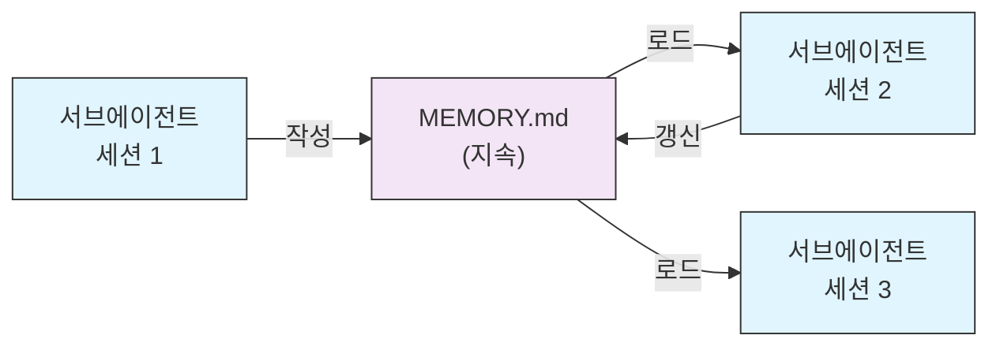
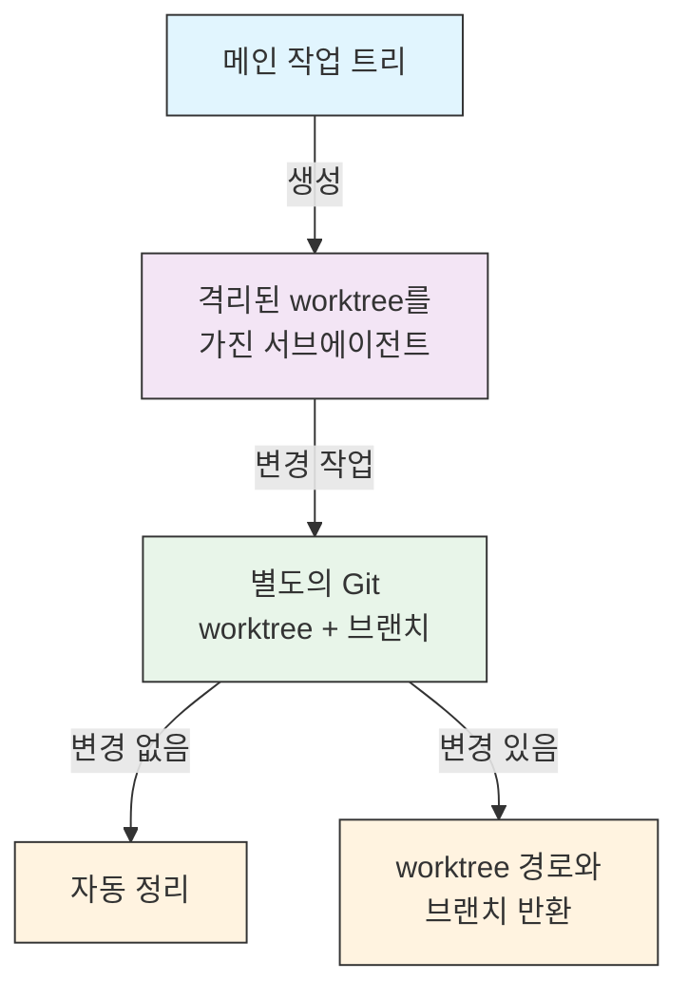
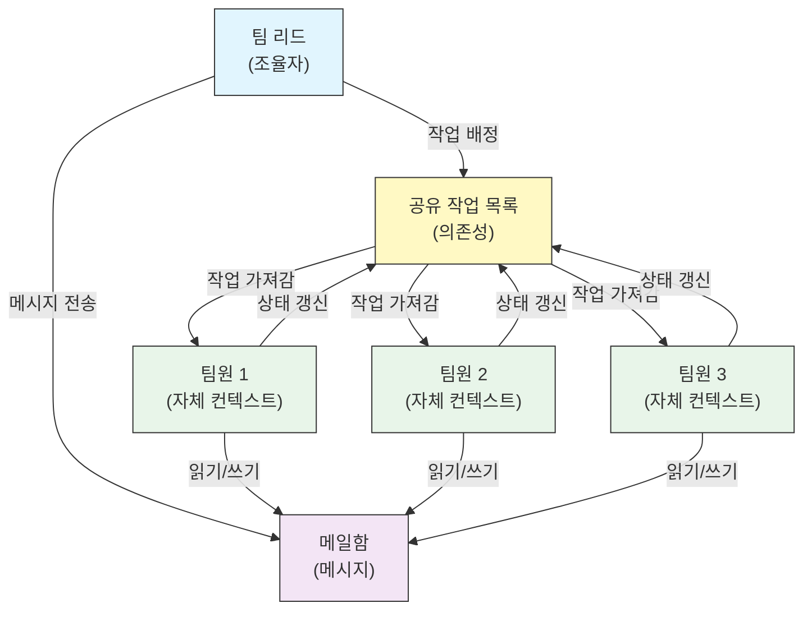
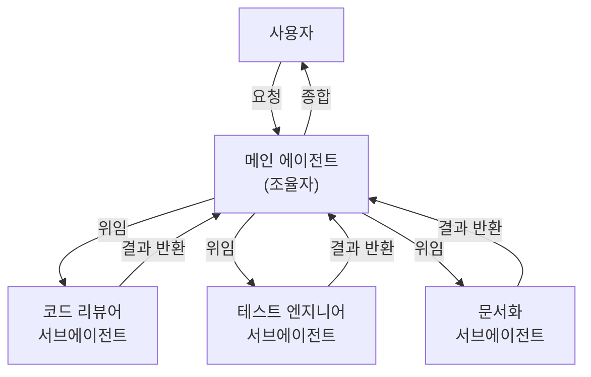
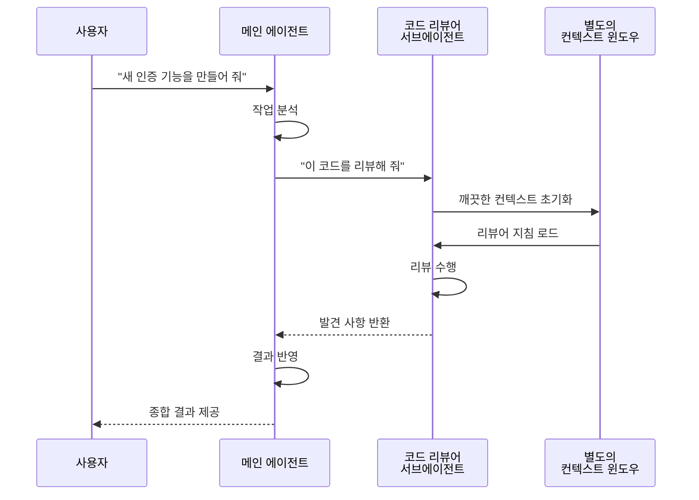
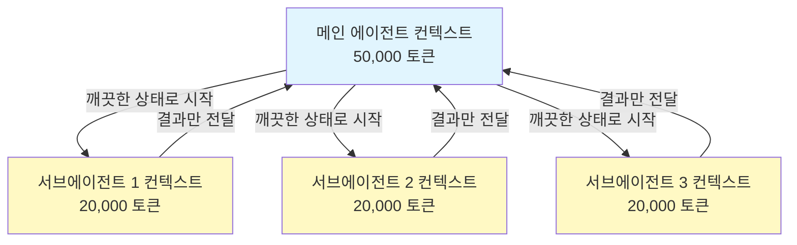
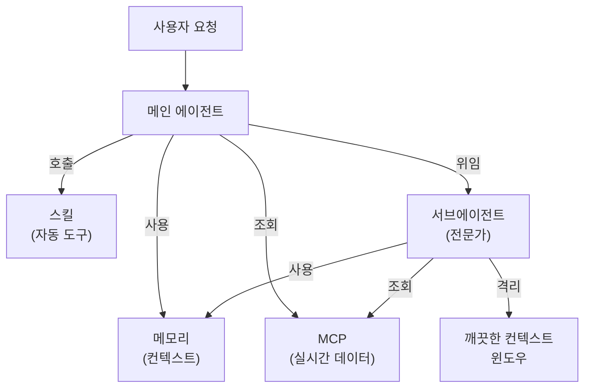

<picture>
  <source media="(prefers-color-scheme: dark)" srcset="../resources/logos/claude-howto-logo-dark.svg">
  
</picture>

# 서브에이전트 - 완전 레퍼런스 가이드

서브에이전트는 Claude Code가 작업을 위임할 수 있는 전문 AI 어시스턴트입니다. 각 서브에이전트는 저마다 정해진 목적이 있고, 메인 대화와 분리된 자체 컨텍스트 윈도우를 쓰며, 특정 도구와 사용자 정의 시스템 프롬프트로 설정할 수 있습니다.

## 목차

1. [개요](#개요)
2. [주요 이점](#주요-이점)
3. [파일 위치](#파일-위치)
4. [설정](#설정)
5. [기본 제공 서브에이전트](#기본-제공-서브에이전트)
6. [서브에이전트 관리](#서브에이전트-관리)
7. [서브에이전트 사용](#서브에이전트-사용)
8. [재개 가능한 에이전트](#재개-가능한-에이전트)
9. [서브에이전트 연결](#서브에이전트-연결)
10. [서브에이전트의 지속 메모리](#서브에이전트의-지속-메모리)
11. [백그라운드 서브에이전트](#백그라운드-서브에이전트)
12. [worktree 격리](#worktree-격리)
13. [포크된 서브에이전트](#포크된-서브에이전트)
14. [생성 가능한 서브에이전트 제한](#생성-가능한-서브에이전트-제한)
15. [`claude agents` CLI 명령어](#claude-agents-cli-명령어)
16. [에이전트 팀(실험적 기능)](#에이전트-팀실험적-기능)
17. [플러그인 서브에이전트 보안](#플러그인-서브에이전트-보안)
18. [아키텍처](#아키텍처)
19. [컨텍스트 관리](#컨텍스트-관리)
20. [서브에이전트를 써야 할 때](#서브에이전트를-써야-할-때)
21. [모범 사례](#모범-사례)
22. [이 폴더의 예제 서브에이전트](#이-폴더의-예제-서브에이전트)
23. [설치 방법](#설치-방법)
24. [파일 구조](#파일-구조)
25. [관련 개념](#관련-개념)
26. [관측 가능성](#관측-가능성)
27. [추가 자료](#추가-자료)

---

## 개요

서브에이전트는 Claude Code에서 다음과 같은 방식으로 작업을 위임해 실행할 수 있게 합니다:

- 별도의 컨텍스트 윈도우를 가진 **격리된 AI 어시스턴트** 생성
- 전문성을 위한 **사용자 정의 시스템 프롬프트** 제공
- 기능을 제한하는 **도구 접근 제어** 적용
- 복잡한 작업으로 인한 **컨텍스트 오염** 방지
- 여러 전문 작업의 **병렬 실행** 지원

각 서브에이전트는 깨끗한 상태에서 독립적으로 동작하며, 작업에 꼭 필요한 컨텍스트만 받은 뒤 결과를 메인 에이전트에 돌려주어 종합하게 합니다.

**빠른 시작**: Claude에게 서브에이전트를 만들어 달라고 요청하거나("보안을 리뷰하는 서브에이전트를 만들어 줘"), `.claude/agents/<name>.md` 파일을 직접 추가하세요 — 아래 [서브에이전트 관리](#서브에이전트-관리)를 참고하세요.

> **참고**: v2.1.198부터 `/agents` 명령어는 더 이상 대화형 생성 마법사를 열지 않습니다. 서브에이전트를 만들고 관리하려면 Claude에게 요청하거나 `.claude/agents/` 파일을 직접 편집하세요.

---

## 주요 이점

| 이점 | 설명 |
|---------|-------------|
| **컨텍스트 보존** | 별도의 컨텍스트에서 동작해 메인 대화가 오염되지 않음 |
| **전문성** | 특정 분야에 맞게 조정되어 성공률이 높음 |
| **재사용성** | 여러 프로젝트에서 쓰고 팀과 공유 가능 |
| **유연한 권한** | 서브에이전트 유형마다 도구 접근 수준을 다르게 설정 |
| **확장성** | 여러 에이전트가 서로 다른 부분을 동시에 작업 |

---

## 파일 위치

서브에이전트 파일은 범위가 다른 여러 위치에 저장할 수 있습니다:

| 우선순위 | 유형 | 위치 | 범위 |
|----------|------|----------|-------|
| 1 (가장 높음) | **관리형** | 관리형 설정 | 조직 전체 |
| 2 | **CLI 정의** | `--agents` 플래그(JSON) | 세션 한정 |
| 3 | **프로젝트 서브에이전트** | `.claude/agents/` | 현재 프로젝트 |
| 4 | **사용자 서브에이전트** | `~/.claude/agents/` | 모든 프로젝트 |
| 5 (가장 낮음) | **플러그인 에이전트** | 플러그인의 `agents/` 디렉토리 | 플러그인을 통해 |

이름이 겹치면 우선순위가 높은 쪽이 우선합니다.

> **중첩된 `.claude/`의 우선순위 (v2.1.178)**: 같은 에이전트 이름이 여러 중첩 `.claude/agents/` 디렉토리에 정의되어 있으면(예: 패키지마다 `.claude/` 폴더가 있는 모노레포) **현재 작업 디렉토리에 가장 가까운 정의가 이깁니다**. 중첩된 워크플로우와 출력 스타일 정의에도 같은 규칙이 적용됩니다.

---

## 설정

### 파일 형식

서브에이전트는 YAML frontmatter와 그 뒤에 오는 마크다운 시스템 프롬프트로 정의합니다:

```yaml
---
name: your-sub-agent-name
description: 이 서브에이전트를 언제 호출해야 하는지에 대한 설명
tools: tool1, tool2, tool3  # 선택 - 생략하면 모든 도구를 상속
disallowedTools: tool4  # 선택 - 명시적으로 금지할 도구
model: sonnet  # 선택 - sonnet, opus, haiku, 또는 inherit
permissionMode: default  # 선택 - 권한 모드
maxTurns: 20  # 선택 - 에이전트 턴 수 제한
skills: skill1, skill2  # 선택 - 컨텍스트에 미리 로드할 스킬
mcpServers: server1  # 선택 - 제공할 MCP 서버
memory: user  # 선택 - 지속 메모리 범위(user, project, local)
background: false  # 선택 - 백그라운드 작업으로 실행
effort: high  # 선택 - 추론 노력 수준(low, medium, high, xhigh, max)
isolation: worktree  # 선택 - git worktree 격리
initialPrompt: "코드베이스 분석부터 시작하세요"  # 선택 - 자동으로 제출되는 첫 턴
experimental:  # 선택 - 실험적 설정 블록
  cacheTtl: "1h"  # 이 서브에이전트의 캐시 TTL: "5m" 또는 "1h" (v2.1.248+)
hooks:  # 선택 - 구성 요소 범위의 훅
  PreToolUse:
    - matcher: "Bash"
      hooks:
        - type: command
          command: "./scripts/security-check.sh"
---

서브에이전트의 시스템 프롬프트를 여기에 씁니다. 여러 문단으로 써도 되며,
서브에이전트의 역할, 기능, 문제 해결 방식을 명확하게 정의해야 합니다.
```

### 설정 필드

| 필드 | 필수 | 설명 |
|-------|----------|-------------|
| `name` | 예 | 고유 식별자(소문자와 하이픈). 조회할 때는 정규화되지만(대소문자와 구분자를 가리지 않음 — 아래 참고), v2.1.218부터 `:`가 들어간 이름은 **거부됩니다**: `:`는 플러그인 네임스페이스용으로 예약되어 있습니다 |
| `description` | 예 | 목적을 설명하는 자연어 문장. 자동 호출을 유도하려면 "use PROACTIVELY"를 넣으세요 |
| `tools` | 아니요 | 특정 도구의 쉼표 구분 목록. 생략하면 모든 도구를 상속합니다. 에이전트가 `claude --agent`로 메인 스레드에서 실행될 때 생성할 수 있는 서브에이전트를 제한하는 `Agent(agent_name)` 문법을 지원하며, 서브에이전트 안에서는 이 타입 목록이 무시됩니다. MCP: `mcp__<server>__*`는 서버 전체를 허용합니다(v2.1.299+: 정확히 그 서버 이름에만 일치). |
| `disallowedTools` | 아니요 | 서브에이전트가 쓰면 안 되는 도구의 쉼표 구분 목록 |
| `model` | 아니요 | 사용할 모델: `sonnet`, `opus`, `haiku`, 전체 모델 ID, 또는 `inherit`. 기본값은 설정된 서브에이전트 모델 |
| `permissionMode` | 아니요 | `default`(수동 모드. v2.1.200부터 별칭 `manual`도 허용), `acceptEdits`, `dontAsk`, `bypassPermissions`, `plan`, `auto`. v2.1.212부터 Task 도구의 `mode` 호출 매개변수는 지원 중단되어 무시됩니다 — 여기서 재정의하지 않으면 서브에이전트는 기본적으로 상위 세션의 권한 모드를 상속합니다. 상위 세션이 `bypassPermissions`, `acceptEdits`, `auto`로 실행 중이면 서브에이전트의 `permissionMode`는 무시됩니다 |
| `maxTurns` | 아니요 | 서브에이전트가 진행할 수 있는 최대 에이전트 턴 수 |
| `skills` | 아니요 | 미리 로드할 스킬의 쉼표 구분 목록. 시작할 때 스킬 전체 내용을 서브에이전트의 컨텍스트에 넣습니다. **v2.1.133+:** 서브에이전트도 Skill 도구로 프로젝트, 사용자, 플러그인 스킬을 발견합니다 — 메인 세션과 같은 목록을 보며, 더 이상 자체 내장 스킬에만 제한되지 않습니다. 미리 로드되는 스킬은 최대 32개이며 각각 한 번씩만 로드되고, Skill 도구가 있는 서브에이전트는 나머지 스킬도 호출할 수 있습니다(v2.1.295). |
| `mcpServers` | 아니요 | 서브에이전트에게 제공할 MCP 서버 |
| `hooks` | 아니요 | 이 서브에이전트가 활성화된 동안에만 실행되는 훅. 모든 훅 이벤트를 지원하며, 가장 많이 쓰는 것은 `PreToolUse`, `PostToolUse`, `Stop`(`SubagentStop`으로 실행)입니다 |
| `memory` | 아니요 | 지속 메모리 디렉토리 범위: `user`, `project`, `local` |
| `background` | 아니요 | 서브에이전트는 이미 기본으로 백그라운드에서 실행됩니다(v2.1.198). v2.1.302부터는 데스크톱 앱과 VS Code에서도 메인 대화의 서브에이전트가 항상 백그라운드에서 실행되며, `claude -p`, Agent SDK, 데스크톱 앱, VS Code에서 서브에이전트가 직접 하는 Agent 호출은 기본적으로 포그라운드에서 실행됩니다. `true`로 설정하면 항상 백그라운드 실행을 *강제*하고 인라인 실행을 막습니다 |
| `effort` | 아니요 | 추론 노력 수준: `low`, `medium`, `high`, `xhigh`, `max`. 세션의 노력 수준을 재정의하며, 쓸 수 있는 수준은 모델에 따라 다릅니다. Claude가 Agent 도구를 호출할 때 `effort` 값을 넘길 수도 있습니다(v2.1.292). |
| `isolation` | 아니요 | `worktree`로 설정하면 서브에이전트에게 자체 git worktree를 줍니다 |
| `initialPrompt` | 아니요 | 서브에이전트가 메인 에이전트로 실행될 때 자동으로 제출되는 첫 턴 |
| `color` | 아니요 | 작업 목록과 대화 기록에서 서브에이전트를 표시할 색상. `red`, `blue`, `green`, `yellow`, `purple`, `orange`, `pink`, `cyan` 중 하나 |
| `experimental` | 아니요 | 실험적 설정 블록(v2.1.248+). `experimental.cacheTtl`로 이 서브에이전트의 캐시 TTL을 정합니다 — `"5m"` 또는 `"1h"` |
| `omitClaudeMd` | 아니요 | `true`로 설정하면 사용자, 프로젝트, 로컬 CLAUDE.md 파일 없이 서브에이전트를 실행합니다(v2.1.271+). 관리형 정책 파일은 여전히 로드되며, 관리형 서브에이전트는 예외입니다. 에이전트가 `--agent`나 `agent` 설정으로 메인 세션 에이전트로 실행될 때는 무시됩니다. `--agents` JSON에서도 쓸 수 있습니다 |
| `autoCompactWindow` | 아니요 | 이 서브에이전트의 컨텍스트를 메인 대화의 윈도우보다 일찍 자동 컴팩션합니다(v2.1.296+. `--agents` JSON에서도 사용 가능) |

#### 서브에이전트 모델 환경 변수

서브에이전트가 어떤 모델로 실행될지에 영향을 주는 환경 변수는 두 가지입니다:

| 변수 | 버전 | 설명 |
|----------|---------|-------------|
| `CLAUDE_CODE_SUBAGENT_MODEL` | — | 서브에이전트에 쓸 모델을 지정 |
| `CLAUDE_CODE_SUBAGENT_MODEL_FORCE` | v2.1.257+ | `1`로 설정하면 서브에이전트 frontmatter의 `model:`보다 서브에이전트 모델 설정을 강제로 우선 |

> **v2.1.251에서 우선순위가 바뀌었습니다**: 그 이전에는 `CLAUDE_CODE_SUBAGENT_MODEL`이 먼저 적용되어 에이전트 frontmatter를 덮어썼습니다 — `model: inherit`까지 포함해서요. v2.1.251부터는 서브에이전트 자체의 `model:` frontmatter가 이깁니다. 환경 변수가 다시 frontmatter를 덮어쓰게 하려면(예: 평가 실행 전체를 한 모델로 고정할 때) `CLAUDE_CODE_SUBAGENT_MODEL_FORCE=1`(v2.1.257+)을 설정하세요.

### 메인 스레드 에이전트의 frontmatter 적용 (v2.1.117+/v2.1.119+)

에이전트를 메인 스레드 에이전트로 호출하면(`claude --agent <name>`이나 `--print` 모드), 다음 frontmatter 필드가 적용됩니다:

| 필드 | 버전 | 참고 |
|-------|---------|-------|
| `mcpServers` | v2.1.117+ | `claude --agent <name>`으로 메인 스레드 에이전트로 호출할 때 로드 |
| `permissionMode` | v2.1.119+ | `--agent <name>`으로 호출한 기본 제공 에이전트에 적용 |
| `tools` / `disallowedTools` | v2.1.119+ | `--print` 모드(비대화형/스크립트 사용)에서 적용 |

**예 — `mcpServers`와 `permissionMode`를 쓰는 에이전트:**

```yaml
---
name: secure-researcher
description: 범위를 제한한 MCP 접근과 제한된 권한으로 동작하는 조사 에이전트
permissionMode: acceptEdits
mcpServers:
  notion:
    type: http
    url: https://mcp.notion.com/mcp
  github:
    type: http
    url: https://api.githubcopilot.com/mcp/
    headers:
      Authorization: "Bearer ${GITHUB_PERSONAL_ACCESS_TOKEN}"
tools: Read, Grep, Glob
---

당신은 조사 에이전트입니다. 설정된 MCP 서버로 Notion과 GitHub를 조회하고
로컬 파일을 읽을 수 있지만, 승인된 편집 외에는 파일을 쓰거나 명령어를 실행할 수 없습니다.
```

실행 방법:

```bash
claude --agent secure-researcher
```

### 도구 설정 옵션

**옵션 1: 모든 도구 상속(필드 생략)**
```yaml
---
name: full-access-agent
description: 사용 가능한 모든 도구를 쓰는 에이전트
---
```

**옵션 2: 도구를 개별 지정**
```yaml
---
name: limited-agent
description: 지정한 도구만 쓰는 에이전트
tools: Read, Grep, Glob, Bash
---
```

> **Glob/Grep 참고 (v2.1.113+):** macOS/Linux 네이티브 빌드에서는 Glob과 Grep이 별도 도구가 아니라 Bash 도구를 통한 `bfs`/`ugrep`으로 제공됩니다. Windows와 npm-JS 빌드에서는 여전히 독립 도구로 제공됩니다. `allowedTools`에서 Glob/Grep을 그대로 참조해도 되며, 내부 대체는 사용자에게 드러나지 않습니다.

**옵션 3: 조건부 도구 접근**
```yaml
---
name: conditional-agent
description: 도구 접근이 필터링된 에이전트
tools: Read, Bash(npm:*), Bash(test:*)
---
```

### CLI 기반 설정

JSON 형식의 `--agents` 플래그로 한 세션에서만 쓸 서브에이전트를 정의할 수 있습니다:

```bash
claude --agents '{
  "code-reviewer": {
    "description": "코드 리뷰 전문가. 코드를 변경한 뒤 적극적으로(proactively) 사용.",
    "prompt": "당신은 시니어 코드 리뷰어입니다. 코드 품질, 보안, 모범 사례에 집중하세요.",
    "tools": ["Read", "Grep", "Glob", "Bash"],
    "model": "sonnet"
  }
}'
```

**`--agents` 플래그의 JSON 형식:**

```json
{
  "agent-name": {
    "description": "필수: 이 에이전트를 언제 호출할지",
    "prompt": "필수: 에이전트의 시스템 프롬프트",
    "tools": ["선택", "도구", "이름", "배열"],
    "model": "선택: sonnet|opus|haiku"
  }
}
```

> **참고**: v2.1.243부터 `--agents`는 잘못된 JSON이나 잘못된 에이전트 정의를 조용히 무시하지 않습니다 — `--mcp-config`와 마찬가지로 Claude Code가 명확한 오류를 내며 종료합니다.

**에이전트 정의의 우선순위:**

에이전트 정의는 다음 우선순위로 로드됩니다(먼저 일치하는 것이 이김):
1. **관리형** - 관리형 설정(조직 전체)
2. **CLI 정의** - `--agents` 플래그(세션 한정, JSON)
3. **프로젝트 수준** - `.claude/agents/`(현재 프로젝트)
4. **사용자 수준** - `~/.claude/agents/`(모든 프로젝트)
5. **플러그인 수준** - 플러그인의 `agents/` 디렉토리

덕분에 한 세션 동안 CLI 정의로 프로젝트, 사용자, 플러그인 정의를 덮어쓸 수 있습니다. 관리형 정의는 여전히 가장 우선합니다.

---

## 기본 제공 서브에이전트

Claude Code에는 항상 쓸 수 있는 기본 제공 서브에이전트가 여러 개 들어 있습니다:

| 에이전트 | 모델 | 목적 |
|-------|-------|---------|
| **general-purpose** | 상속 | 복잡하고 여러 단계로 된 작업 |
| **Plan** | 상속 | 계획 모드를 위한 조사 |
| **Explore** | 상속(최대 Opus) | 읽기 전용 코드베이스 탐색(quick/medium/very thorough) |
| **claude** | 상속 | 더 전문적인 에이전트에 맞지 않는 작업을 모두 맡는 범용 에이전트. 서브에이전트가 쓸 수 있는 모든 도구를 가짐. 백그라운드로 보낸 세션의 기본 에이전트이기도 함 |
| **statusline-setup** | Sonnet | `/statusline`으로 상태 표시줄을 설정할 때 실행 |
| **claude-code-guide** | Haiku | Claude Code 기능에 대한 질문에 답변 |

### 범용(general-purpose) 서브에이전트

| 속성 | 값 |
|----------|-------|
| **모델** | 상위 세션에서 상속 |
| **도구** | 모든 도구 |
| **목적** | 복잡한 조사 작업, 여러 단계로 된 작업, 코드 수정 |

**사용 시점**: 탐색과 수정이 모두 필요하고 복잡한 추론이 필요한 작업.

### Plan 서브에이전트

| 속성 | 값 |
|----------|-------|
| **모델** | 상위 세션에서 상속 |
| **도구** | Read, Glob, Grep, Bash |
| **목적** | 계획 모드에서 코드베이스를 조사할 때 자동으로 사용 |

**사용 시점**: Claude가 계획을 제시하기 전에 코드베이스를 이해해야 할 때.

### Explore 서브에이전트

| 속성 | 값 |
|----------|-------|
| **모델** | 세션 모델을 상속하되 최대 Opus까지(v2.1.198). 빠르고 저렴하게 쓰려면 `model: haiku`로 설정 |
| **모드** | 엄격한 읽기 전용 |
| **도구** | Glob, Grep, Read, Bash(읽기 전용 명령어만) |
| **목적** | 빠른 코드베이스 검색과 분석 |

**사용 시점**: 코드를 바꾸지 않고 검색하거나 이해할 때.

**탐색 깊이 수준** - 탐색의 깊이를 지정합니다:
- **"quick"** - 탐색을 최소화한 빠른 검색. 특정 패턴을 찾을 때 적합
- **"medium"** - 속도와 철저함의 균형을 맞춘 보통 수준의 탐색. 기본 방식
- **"very thorough"** - 여러 위치와 이름 규칙에 걸친 종합 분석. 시간이 더 걸릴 수 있음

### claude 서브에이전트

| 속성 | 값 |
|----------|-------|
| **모델** | 상위 세션에서 상속 |
| **도구** | 서브에이전트가 쓸 수 있는 모든 도구 |
| **목적** | 더 전문적인 에이전트에 맞지 않는 작업을 맡는 범용 에이전트 |

**사용 시점**: 작업이 더 전문적인 기본 제공 에이전트와 맞지 않을 때. 백그라운드로 보낸 세션의 기본 에이전트이기도 하며, 어떤 권한 모드로 시작하는지는 그 세션을 어떻게 시작했는지에 따라 달라집니다.

### 상태 표시줄 설정(statusline-setup) 서브에이전트

| 속성 | 값 |
|----------|-------|
| **모델** | Sonnet |
| **도구** | Read, Write, Bash |
| **목적** | Claude Code 상태 표시줄 설정 |

**사용 시점**: 상태 표시줄을 설정하거나 사용자 지정할 때.

### Claude Code 가이드 서브에이전트 (`claude-code-guide`)

| 속성 | 값 |
|----------|-------|
| **모델** | Haiku(빠르고 지연 시간이 짧음) |
| **도구** | 읽기 전용 |
| **목적** | Claude Code 기능과 사용법에 대한 질문에 답변 |

**사용 시점**: 사용자가 Claude Code의 동작 방식이나 특정 기능의 사용법을 물을 때.

---

## 서브에이전트 관리

### Claude에게 요청하기(권장)

서브에이전트를 만들거나 관리하는 가장 간단한 방법은 Claude에게 직접 요청하는 것입니다:

```text
코드의 보안 취약점을 리뷰하는 서브에이전트를 만들어 줘.
```

Claude가 알맞은 frontmatter(도구, 모델, 설명)를 골라 `.claude/agents/<name>.md` 파일을 작성해 줍니다. 그다음 파일을 직접 다듬거나 Claude에게 수정을 요청하면 됩니다.

> **참고**: `/agents` 명령어는 더 이상 대화형 생성 마법사를 열지 않습니다(v2.1.198에서 제거). 이제는 Claude에게 요청하거나 `.claude/agents/` 파일을 직접 편집하라고 안내합니다.

### 파일 직접 관리

```bash
# 프로젝트 서브에이전트 만들기
mkdir -p .claude/agents
cat > .claude/agents/test-runner.md << 'EOF'
---
name: test-runner
description: 테스트를 실행하고 실패를 고칠 때 적극적으로(proactively) 사용
---

당신은 테스트 자동화 전문가입니다. 코드 변경을 발견하면 알맞은 테스트를
적극적으로 실행하세요. 테스트가 실패하면 실패 원인을 분석하고, 원래 테스트의
의도를 지키면서 고치세요.
EOF

# 사용자 서브에이전트 만들기(모든 프로젝트에서 사용 가능)
mkdir -p ~/.claude/agents
```

---

## 서브에이전트 사용

### 자동 위임

Claude는 다음을 바탕으로 작업을 알아서 위임합니다:
- 요청에 담긴 작업 설명
- 서브에이전트 설정의 `description` 필드
- 현재 컨텍스트와 사용 가능한 도구

적극적인 사용을 유도하려면 `description` 필드에 "use PROACTIVELY"나 "MUST BE USED"를 넣으세요:

```yaml
---
name: code-reviewer
description: 코드 리뷰 전문가. 코드를 작성하거나 수정한 뒤 적극적으로(PROACTIVELY) 사용하세요.
---
```

### 명시적 호출

특정 서브에이전트를 명시적으로 요청할 수 있습니다:

```
> test-runner 서브에이전트로 실패하는 테스트를 고쳐 줘
> code-reviewer 서브에이전트에게 내 최근 변경 사항을 살펴보게 해 줘
> debugger 서브에이전트에게 이 오류를 조사해 달라고 해 줘
```

> **`subagent_type` 매칭에서 대소문자와 구분자 구분 안 함 (v2.1.140)**: `subagent_type`(`Agent` 도구 호출이나 `--agent` 플래그)은 대소문자를 가리지 않고 구분자 형식도 무시하고 매칭됩니다 — `code-reviewer`, `Code Reviewer`, `code_reviewer`가 모두 같은 에이전트로 해석됩니다. 대소문자가 조금만 달라도 아무 알림 없이 기본 에이전트로 넘어가던 오래된 함정이 사라졌습니다.

### @ 멘션으로 호출

`@` 접두사를 쓰면 특정 서브에이전트가 반드시 호출됩니다(자동 위임 판단을 거치지 않음):

```
> @"code-reviewer (agent)" auth 모듈을 리뷰해 줘
```

### 세션 전체 에이전트

특정 에이전트를 메인 에이전트로 삼아 세션 전체를 실행합니다:

```bash
# CLI 플래그로
claude --agent code-reviewer

# settings.json으로
{
  "agent": "code-reviewer"
}
```

### 사용 가능한 에이전트 확인

설정된 서브에이전트를 확인하려면 Claude에게 묻거나 `.claude/agents/`와 `~/.claude/agents/`를 살펴보세요. (`claude agents`는 이와 관계없습니다: 백그라운드 세션을 보여 주는 에이전트 뷰를 엽니다 — [CLI](../10-cli/README.md#agent-view-claude-agents-v21139) 참고.)

---

## 재개 가능한 에이전트

서브에이전트는 전체 컨텍스트를 보존한 채 이전 대화를 이어 갈 수 있습니다:

```bash
# 처음 호출
> code-analyzer 에이전트로 인증 모듈 리뷰를 시작해 줘
# agentId: "abc123" 반환

# 나중에 에이전트 재개
> abc123 에이전트를 재개해서 이번에는 권한 부여 로직도 분석해 줘
```

**활용 사례**:
- 여러 세션에 걸친 장기 조사
- 컨텍스트를 잃지 않고 반복해서 다듬기
- 컨텍스트를 유지하는 여러 단계의 워크플로우

---

## 서브에이전트 연결

여러 서브에이전트를 차례로 실행합니다:

```bash
> 먼저 code-analyzer 서브에이전트로 성능 문제를 찾고,
  그다음 optimizer 서브에이전트로 고쳐 줘
```

한 서브에이전트의 출력이 다음 서브에이전트의 입력이 되는 복잡한 워크플로우를 만들 수 있습니다.

---

## 서브에이전트의 지속 메모리

`memory` 필드는 서브에이전트에게 대화가 끝나도 유지되는 지속 디렉토리를 줍니다. 덕분에 서브에이전트는 세션 사이에 유지되는 메모, 발견 사항, 컨텍스트를 저장하며 시간이 지날수록 지식을 쌓을 수 있습니다.

### 메모리 범위

| 범위 | 디렉토리 | 활용 사례 |
|-------|-----------|----------|
| `user` | `~/.claude/agent-memory/<name>/` | 모든 프로젝트에 걸친 개인 메모와 선호 |
| `project` | `.claude/agent-memory/<name>/` | 팀과 공유하는 프로젝트별 지식 |
| `local` | `.claude/agent-memory-local/<name>/` | 버전 관리에 커밋하지 않는 로컬 프로젝트 지식 |

### 동작 방식

- 메모리 디렉토리에 있는 `MEMORY.md`의 처음 200줄이 서브에이전트의 시스템 프롬프트에 자동으로 로드됩니다
- 서브에이전트가 메모리 파일을 관리할 수 있도록 `Read`, `Write`, `Edit` 도구가 자동으로 켜집니다
- 서브에이전트는 필요하면 메모리 디렉토리에 파일을 더 만들 수 있습니다

### 설정 예

```yaml
---
name: researcher
description: 조사 결과를 세션 간 지속 메모리에 보관하는 조사 어시스턴트
memory: user
---

당신은 조사 어시스턴트입니다. 메모리 디렉토리를 활용해 조사 결과를 저장하고,
세션을 넘나들며 진행 상황을 추적하고, 시간이 지날수록 지식을 쌓으세요.

세션을 시작할 때마다 MEMORY.md 파일을 확인해 이전 컨텍스트를 떠올리세요.
```



---

## 백그라운드 서브에이전트

서브에이전트는 기본적으로 백그라운드에서 실행됩니다(v2.1.198). v2.1.302부터는 데스크톱 앱과 VS Code에서도 메인 대화의 서브에이전트가 항상 백그라운드에서 실행되며, `claude -p`, Agent SDK, 데스크톱 앱, VS Code에서 서브에이전트가 직접 하는 Agent 호출은 기본적으로 포그라운드에서 실행됩니다. 서브에이전트가 실행되는 동안 Claude는 메인 대화 작업을 계속하고, 서브에이전트가 끝나면 알림을 받습니다. 따라서 서브에이전트가 결과를 돌려줄 때까지 기다리지 않고 계속 진행할 수 있습니다.

### 설정

이미 백그라운드 실행이 기본이므로, frontmatter의 `background: true`는 서브에이전트가 항상 백그라운드에서 실행되도록 *강제*하고 인라인으로 실행되지 않게 막습니다:

```yaml
---
name: long-runner
background: true
description: 오래 걸리는 분석 작업을 백그라운드에서 수행
---
```

### 키보드 단축키

| 단축키 | 동작 |
|----------|--------|
| `Ctrl+B` | 실행 중인 서브에이전트 작업을 백그라운드로 보내기 |
| `Ctrl+X` `Ctrl+K` | 실행 중인 백그라운드 서브에이전트를 모두 중지(3초 안에 두 번 눌러 확인. `Ctrl+F`를 대체) |

### 백그라운드 작업 끄기

백그라운드 작업 지원을 완전히 끄려면 환경 변수를 설정하세요:

```bash
export CLAUDE_CODE_DISABLE_BACKGROUND_TASKS=1
```

---

## worktree 격리

`isolation: worktree` 설정은 서브에이전트에게 자체 git worktree를 주어, 메인 작업 트리에 영향을 주지 않고 독립적으로 변경할 수 있게 합니다.

### 설정

```yaml
---
name: feature-builder
isolation: worktree
description: 격리된 git worktree에서 기능 구현
tools: Read, Write, Edit, Bash, Grep, Glob
---
```

### 동작 방식



- 서브에이전트는 별도 브랜치의 자체 git worktree에서 작업합니다
- 서브에이전트가 아무것도 바꾸지 않으면 worktree는 자동으로 정리됩니다
- 변경 사항이 있으면 worktree 경로와 브랜치 이름이 메인 에이전트에 반환되어 검토하거나 병합할 수 있습니다

---

## 포크된 서브에이전트

포크된 서브에이전트는 깨끗한 상태에서 시작하지 않고, 포크하는 순간 상위 세션의 대화 전체 — 시스템 프롬프트, 도구, 모델, 메시지 기록, 프롬프트 캐시 — 를 물려받습니다. 지금까지 한 작업을 잃지 않고 다른 경로를 탐색할 때 유용합니다.

> **사용 가능 여부**: v2.1.117에서 정식 출시되었습니다. **v2.1.232부터 대화형 세션에서는 포크 모드가 기본으로 켜져 있습니다** — 공식 빌드인지와 관계없이 모든 빌드에서 그렇습니다. v2.1.302부터는 비대화형 모드(`claude -p`), Agent SDK, 데스크톱 앱, VS Code에서도 기본으로 켜져 있으며, `claude mcp serve`에서는 포크 서브에이전트를 제공하지 않습니다. v2.1.232보다 오래된 Claude Code에서 쓰거나, 기본으로 꺼진 곳에서 켜려면 `CLAUDE_CODE_FORK_SUBAGENT=1`을 설정하세요.

> **포크 모드의 서브에이전트는 백그라운드에서 실행됩니다.** 포크 모드가 켜져 있으면(대화형 세션에서는 기본으로 켜짐) Claude Code는 포크 여부와 관계없이 서브에이전트를 백그라운드에서 실행합니다.

### 설정

포크는 에이전트 파일에서 정의하지 않습니다. Claude가 Agent 도구를 `subagent_type: "fork"`로 호출해 시작하거나, 사용자가 `/subtask <task>`(v2.1.212+)로 직접 시작합니다:

```text
/subtask 다른 구현 방식을 탐색하고 장단점을 보고해 줘
```

포크는 다시 포크를 생성할 수 없습니다. 포크를 막으려면 거부 규칙 `Agent(fork)`를 추가하세요:

```json
{
  "permissions": {
    "deny": ["Agent(fork)"]
  }
}
```

> **참고**: `context: fork`는 서브에이전트 필드가 아니라 **스킬**의 frontmatter 필드입니다([스킬](../03-skills/README.md) 참고). Claude Code는 에이전트 정의에서 인식하지 못하는 필드를 조용히 무시합니다.

### 포크 모드를 명시적으로 켜기

모든 곳에서 포크 모드를 끄려면 `CLAUDE_CODE_FORK_SUBAGENT=0`을 설정하세요. v2.1.302 이전 버전에서는 `1`로 설정해야 `claude -p`와 Agent SDK에서 포크가 켜집니다.

```bash
export CLAUDE_CODE_FORK_SUBAGENT=0
claude
```

### 포크와 깨끗한 컨텍스트 중 무엇을 쓸까

| 상황 | 포크 (`subagent_type: "fork"`) | 깨끗한 컨텍스트(기본값) |
|----------|-----------------|-------------------------|
| 다른 구현 방식 탐색 | 예 | 아니요(컨텍스트를 잃음) |
| 기존 컨텍스트를 활용한 긴 조사 | 예 | 아니요 |
| 독립적인 전문 작업 | 아니요 | 예 |
| 컨텍스트 오염 방지 | 아니요 | 예 |

---

## 생성 가능한 서브에이전트 제한

`tools` 필드에 `Agent(agent_type)` 문법을 쓰면, `claude --agent`로 메인 스레드에서 실행되는 에이전트가 생성할 수 있는 서브에이전트를 제어할 수 있습니다. 위임할 서브에이전트를 허용 목록으로 지정하는 방법입니다. 서브에이전트 정의 안에서는 괄호 안의 타입 목록이 무시됩니다.

> **참고**: v2.1.63에서 `Task` 도구의 이름이 `Agent`로 바뀌었습니다. 기존 `Task(...)` 참조도 별칭으로 계속 동작합니다.

### 예

```yaml
---
name: coordinator
description: 전문 에이전트들 사이의 작업 조율
tools: Agent(worker, researcher), Read, Bash
---

당신은 조율 에이전트입니다. 작업은 "worker"와 "researcher" 서브에이전트에게만
위임할 수 있습니다. 직접 탐색할 때는 Read와 Bash를 쓰세요.
```

이 예에서 `claude --agent coordinator`로 실행하면 메인 스레드는 `worker`와 `researcher` 서브에이전트만 생성할 수 있습니다. 다른 곳에 정의되어 있더라도 그 밖의 서브에이전트는 생성할 수 없습니다. `coordinator`가 대신 서브에이전트로 실행되면 타입 목록은 무시됩니다.

---

## `claude agents` CLI 명령어

`claude agents`는 **에이전트 뷰**(v2.1.139+)를 엽니다: 백그라운드 세션을 상태별로 묶어 보여 주는 전체 화면 목록입니다. 설정된 서브에이전트 정의를 나열하지는 않으며, 세션 상태를 스크립트로 다루려면 `claude agents --json`을 쓰세요.

```bash
claude agents
claude agents --json
```

설정된 서브에이전트는 `.claude/agents/`(프로젝트)와 `~/.claude/agents/`(사용자)에 있습니다.

---

## 에이전트 팀(실험적 기능)

에이전트 팀은 여러 Claude Code 인스턴스가 함께 복잡한 작업을 하도록 조율합니다. (위임받은 하위 작업의 결과를 돌려주는) 서브에이전트와 달리, 팀원은 자체 컨텍스트 윈도우를 가지고 독립적으로 일하며 공유 메일함 시스템으로 서로 직접 메시지를 주고받을 수 있습니다.

> **공식 문서**: [code.claude.com/docs/ko/agent-teams](https://code.claude.com/docs/ko/agent-teams)

> **참고**: 에이전트 팀은 실험적 기능이며 기본으로 꺼져 있습니다. Claude Code v2.1.32 이상이 필요합니다. 쓰기 전에 켜세요.

### 서브에이전트와 에이전트 팀 비교

| 측면 | 서브에이전트 | 에이전트 팀 |
|--------|-----------|-------------|
| **위임 모델** | 상위 에이전트가 하위 작업을 위임하고 결과를 기다림 | 팀 리드가 작업을 조율하고 팀원은 독립적으로 실행 |
| **컨텍스트** | 하위 작업마다 새 컨텍스트, 결과는 요약되어 돌아옴 | 팀원마다 자체 지속 컨텍스트 윈도우 유지 |
| **조율** | 순차 또는 병렬, 상위 에이전트가 관리 | 의존성이 자동 관리되는 공유 작업 목록 |
| **커뮤니케이션** | 결과는 상위 에이전트에게만 반환(에이전트 사이 메시지 없음) | 팀원끼리 메일함으로 직접 메시지 가능 |
| **세션 재개** | 지원 | 인프로세스 팀원은 지원하지 않음 |
| **적합한 용도** | 범위가 분명하고 잘 정의된 하위 작업 | 에이전트 사이의 소통과 병렬 실행이 필요한 복잡한 작업 |

### 에이전트 팀 켜기

환경 변수를 설정하거나 `settings.json`에 추가하세요:

```bash
export CLAUDE_CODE_EXPERIMENTAL_AGENT_TEAMS=1
```

또는 `settings.json`에서:

```json
{
  "env": {
    "CLAUDE_CODE_EXPERIMENTAL_AGENT_TEAMS": "1"
  }
}
```

### 팀 시작하기

켜고 나면 프롬프트에서 Claude에게 팀원과 함께 일하라고 요청하세요:

```
사용자: 인증 모듈을 만들어 줘. 팀으로 진행해 줘 — 팀원 하나는 API 엔드포인트,
       하나는 데이터베이스 스키마, 하나는 테스트 스위트를 맡아 줘.
```

Claude가 팀을 만들고, 작업을 배정하고, 작업을 자동으로 조율합니다.

### 표시 모드

팀원의 활동을 어떻게 표시할지 정합니다:

| 모드 | 플래그 | 설명 |
|------|------|-------------|
| **자동** | `--teammate-mode auto` | 터미널에 가장 알맞은 표시 모드를 자동으로 선택 |
| **인프로세스**(기본값) | `--teammate-mode in-process` | 현재 터미널에서 팀원 출력을 인라인으로 표시 |
| **분할 창** | `--teammate-mode tmux` | 팀원마다 별도의 tmux 또는 iTerm2 창을 엶 |
| **iTerm2** | `--teammate-mode iterm2` | (v2.1.186+) 팀원을 전용 iTerm2 창에서 실행. `it2` CLI가 필요하며, 찾을 수 없으면 자동 모드가 경고를 표시 |

```bash
claude --teammate-mode tmux
```

`settings.json`에서 표시 모드를 설정할 수도 있습니다:

```json
{
  "teammateMode": "tmux"
}
```

> **참고**: 분할 창 모드에는 tmux나 iTerm2가 필요합니다. VS Code 터미널, Windows Terminal, Ghostty에서는 쓸 수 없습니다.

### 이동

팀원 사이를 이동하려면 에이전트 패널에서 위아래 화살표 키로 고른 뒤 Enter를 누르거나(인프로세스 모드), 팀원의 창을 클릭하세요(분할 창 모드).

### 팀 설정

팀 설정은 `~/.claude/teams/{team-name}/config.json`에 저장됩니다.

### 팀원 모델 선택

v2.1.234부터 `/config`의 "Default teammate model"(기본 팀원 모델) 설정이 제거되었습니다. 이제 팀원은 생성 호출에서 다른 모델을 명시하지 않는 한 기본적으로 팀 리드의 모델을 상속합니다.

### 아키텍처



**핵심 구성 요소**:

- **팀 리드**: 팀을 만들고, 작업을 배정하고, 조율하는 메인 Claude Code 세션
- **공유 작업 목록**: 의존성을 자동으로 추적하는, 동기화된 작업 목록
- **메일함**: 팀원끼리 상태를 알리고 조율하는 에이전트 사이 메시지 시스템
- **팀원**: 각자 자체 컨텍스트 윈도우를 가진 독립적인 Claude Code 인스턴스

### 작업 배정과 메시지

팀 리드는 작업을 여러 작업 단위로 나눠 팀원에게 배정합니다. 공유 작업 목록은 다음을 처리합니다:

- **자동 의존성 관리** — 작업은 의존하는 작업이 끝날 때까지 기다립니다
- **상태 추적** — 팀원은 작업하면서 작업 상태를 갱신합니다
- **에이전트 사이 메시지** — 팀원은 조율을 위해 메일함으로 메시지를 보냅니다(예: "데이터베이스 스키마가 준비됐으니 쿼리 작성을 시작해도 됩니다")

### 계획 승인 워크플로우

복잡한 작업에서는 팀원이 작업을 시작하기 전에 팀 리드가 실행 계획을 세웁니다. 사용자가 계획을 검토하고 승인하므로, 코드가 바뀌기 전에 팀의 접근 방식이 기대와 맞는지 확인할 수 있습니다.

### 팀용 훅 이벤트

에이전트 팀은 [훅 이벤트](../06-hooks/) 두 가지를 추가합니다:

| 이벤트 | 발생 시점 | 활용 사례 |
|-------|-----------|----------|
| `TeammateIdle` | 팀원이 현재 작업을 마치고 남은 작업이 없을 때 | 알림 보내기, 후속 작업 배정 |
| `TaskCompleted` | 공유 작업 목록의 작업이 완료로 표시될 때 | 검증 실행, 대시보드 갱신, 의존 작업 연결 |

### 모범 사례

- **팀 규모**: 조율이 잘 되도록 팀원은 3~5명으로 유지하세요
- **작업 크기**: 작업마다 5~15분 정도 걸리도록 나누세요 — 병렬로 처리할 만큼 작고, 의미가 있을 만큼 크게
- **파일 충돌 피하기**: 병합 충돌을 막으려면 팀원마다 다른 파일이나 디렉토리를 맡기세요
- **간단하게 시작**: 첫 팀은 인프로세스 모드로 시작하고, 익숙해지면 분할 창으로 바꾸세요
- **명확한 작업 설명**: 팀원이 독립적으로 일할 수 있도록 구체적이고 실행 가능한 작업 설명을 주세요

### 제한 사항

- **실험적 기능**: 이후 릴리스에서 동작이 바뀔 수 있습니다
- **세션 재개 불가**: 인프로세스 팀원은 세션이 끝난 뒤 재개할 수 없습니다
- **세션당 팀 하나**: 한 세션에서 중첩된 팀이나 여러 팀을 만들 수 없습니다
- **고정된 리더**: 팀 리드 역할을 팀원에게 넘길 수 없습니다
- **분할 창 제약**: tmux/iTerm2가 필요하며, VS Code 터미널, Windows Terminal, Ghostty에서는 쓸 수 없습니다
- **세션 간 팀 불가**: 팀원은 현재 세션 안에만 존재합니다

> **경고**: 에이전트 팀은 실험적 기능입니다. 먼저 중요하지 않은 작업으로 테스트하고, 팀원 조율에 예상치 못한 동작이 없는지 지켜보세요.

---

## 플러그인 서브에이전트 보안

플러그인이 제공하는 서브에이전트는 보안을 위해 frontmatter 기능이 제한됩니다. 플러그인 서브에이전트 정의에서는 다음 필드를 **쓸 수 없습니다**:

- `hooks` - 수명 주기 훅을 정의할 수 없음
- `mcpServers` - MCP 서버를 설정할 수 없음
- `permissionMode` - 권한 설정을 재정의할 수 없음

이렇게 해서 플러그인이 서브에이전트 훅을 통해 권한을 높이거나 임의의 명령어를 실행하지 못하게 막습니다.

### 서브에이전트 출력 검사 (v2.1.210+)

v2.1.210부터 Claude Code는 각 서브에이전트의 최종 보고서에서 하네스 자체의 출력 형식을 흉내 내는 텍스트를 검사합니다 — `<system-reminder>` 같은 가짜 태그, 꾸며 낸 `Human:`/`Assistant:` 턴, 권한 우회 플래그나 설정 파일 경로 언급 등입니다. 서브에이전트 출력에 실려 오는 프롬프트 주입을 막기 위한 장치로, 예를 들어 상위 세션을 조작하려고 가짜 제어 토큰을 심어 둔 악성 웹 페이지를 서브에이전트가 가져온 경우를 방어합니다.

검사에서 무언가가 걸리면 Claude Code는 이를 무력화합니다 — 백슬래시를 넣거나, 무엇이 검사를 일으켰는지 밝히는 `[harness: subagent output matched instruction-shaped pattern(s): ...]` 같은 인라인 표시를 넣습니다. 상위 세션은 표시된 텍스트를 따를 지시가 아니라 전달할 발견 사항으로 다뤄야 합니다. 이 검사는 기본으로 켜져 있으며 끄는 방법은 문서화되어 있지 않습니다. 검사는 되도록 잡아내는 쪽으로 동작합니다: 정상적인 서브에이전트 보고서라도 실제 플래그 이름(예: `--dangerously-skip-permissions`)을 그대로 인용하면, 악의적인 일이 없었는데도 표시가 붙을 수 있습니다 — 주입을 놓치는 것보다 오탐이 낫기 때문입니다.

### 서브에이전트 동시 실행 수와 깊이 한도

> **세션당 생성 한도가 없어졌습니다.** Claude Code는 v2.1.212부터 세션당 서브에이전트 생성을 200개로 제한했지만, **v2.1.224에서 이 한도를 없앴습니다** — 오래 실행되는 세션도 더 이상 새 에이전트를 거부하지 않으며, 공식 서브에이전트 레퍼런스에도 한 세션 동안 Claude가 생성할 수 있는 서브에이전트의 총수에는 제한이 없다고 분명히 적혀 있습니다. 이 한도를 재정의하던 `CLAUDE_CODE_MAX_SUBAGENTS_PER_SESSION` 변수도 함께 없어졌습니다.

서브에이전트 확장에 대한 한도 두 가지는 여전히 적용되며, 둘 다 환경 변수로 설정합니다:

- `CLAUDE_CODE_MAX_CONCURRENT_SUBAGENTS` (v2.1.217) - **동시에** 실행되는 서브에이전트의 최대 수. 기본값: 20.
- `CLAUDE_CODE_MAX_SUBAGENT_SPAWN_DEPTH` (v2.1.217) - 서브에이전트가 자신의 서브에이전트를 생성할 때의 최대 **중첩 깊이**. **v2.1.219부터 기본값 3**(v2.1.217~v2.1.218에서는 1). 중첩을 끄려면 `1`로 설정하세요([주요 동작](#주요-동작) 참고).

```bash
export CLAUDE_CODE_MAX_CONCURRENT_SUBAGENTS=20
export CLAUDE_CODE_MAX_SUBAGENT_SPAWN_DEPTH=5
```

---

## 아키텍처

### 상위 수준 아키텍처



### 서브에이전트 수명 주기



---

## 컨텍스트 관리



### 핵심 요점

- 각 서브에이전트는 메인 대화 기록이 없는 **새 컨텍스트 윈도우**를 받습니다
- 서브에이전트에게는 해당 작업에 **관련된 컨텍스트**만 전달됩니다
- 결과는 **요약되어** 메인 에이전트로 돌아옵니다
- 덕분에 긴 프로젝트에서도 **컨텍스트 토큰 소진**을 막을 수 있습니다

### 성능 고려 사항

- **컨텍스트 효율성** - 에이전트가 메인 컨텍스트를 아껴 주므로 세션을 더 오래 이어 갈 수 있습니다
- **지연 시간** - 서브에이전트는 깨끗한 상태에서 시작하므로 초기 컨텍스트를 모으느라 지연 시간이 늘어날 수 있습니다

### 주요 동작

- **중첩 생성은 기본으로 켜져 있으며 깊이 3 (v2.1.219)** - 서브에이전트는 메인 대화 아래 세 단계까지 자신의 서브에이전트를 생성할 수 있습니다. 한도를 바꾸려면 `CLAUDE_CODE_MAX_SUBAGENT_SPAWN_DEPTH`를 설정하고, 중첩을 끄려면 `1`로 설정하세요. 깊이 한도에 도달하면 Claude Code는 포크를 제외한 모든 서브에이전트에게서 `Agent` 도구를 빼앗습니다. (이력: v2.1.172~v2.1.216에서는 바꿀 방법 없이 기본으로 5단계까지 중첩됐고, v2.1.217에서 깊이 1의 선택 기능이 되었다가, v2.1.219에서 기본값이 3이 되었습니다.) 메인 스레드 에이전트(`claude --agent`)가 생성할 수 있는 서브에이전트를 제어하려면 `Agent(agent_type)` 제한 문법을 쓰세요([생성 가능한 서브에이전트 제한](#생성-가능한-서브에이전트-제한) 참고). 서브에이전트 안에서는 타입 목록이 무시됩니다
- **백그라운드 권한** - 백그라운드 서브에이전트에 사전 승인되지 않은 권한이 필요하면, 요청하는 서브에이전트의 이름과 함께 메인 세션에 권한 프롬프트가 표시됩니다
- **백그라운드로 보내기** - 실행 중인 작업을 백그라운드로 보내려면 `Ctrl+B`를 누르세요
- **대화 기록** - 서브에이전트 대화 기록은 `~/.claude/projects/{project}/{sessionId}/subagents/agent-{agentId}.jsonl`에 저장됩니다
- **자동 컴팩션** - 서브에이전트 컨텍스트는 약 95% 용량에서 자동으로 압축됩니다(`CLAUDE_AUTOCOMPACT_PCT_OVERRIDE` 환경 변수로 재정의)
- **확장 사고 상속 (v2.1.198)** - 이제 서브에이전트와 컨텍스트 컴팩션이 세션의 확장 사고 설정을 상속합니다(이전에는 항상 꺼져 있었음). 서브에이전트별 사고 설정 필드는 없습니다

### 추가 제어

- **기본 제공 Explore/Plan 에이전트 끄기** - `CLAUDE_CODE_DISABLE_EXPLORE_PLAN_AGENTS=1`을 설정하면 기본 제공 Explore와 Plan 에이전트가 제거됩니다(v2.1.198)
- **모든 서브에이전트 프롬프트에 덧붙이기** - 비대화형 / `--print` 모드에서 `--append-subagent-system-prompt "<text>"`는 모든 서브에이전트의 시스템 프롬프트에 텍스트를 덧붙입니다(v2.1.205)
- **파일에서 덧붙이기** - `--append-subagent-system-prompt-file ./subagent-rules.txt`는 같은 덧붙일 텍스트를 파일에서 읽으므로, 명령줄로 넘기기에는 너무 긴 프롬프트에 씁니다. 이 역시 `-p` 전용이며 `--append-subagent-system-prompt`와 함께 쓸 수 없습니다(v2.1.261)

---

## 서브에이전트를 써야 할 때

| 상황 | 서브에이전트 사용 | 이유 |
|----------|--------------|-----|
| 단계가 많은 복잡한 기능 | 예 | 관심사 분리, 컨텍스트 오염 방지 |
| 빠른 코드 리뷰 | 아니요 | 불필요한 오버헤드 |
| 병렬 작업 실행 | 예 | 서브에이전트마다 자체 컨텍스트 |
| 전문 지식 필요 | 예 | 사용자 정의 시스템 프롬프트 |
| 오래 걸리는 분석 | 예 | 메인 컨텍스트 소진 방지 |
| 단일 작업 | 아니요 | 불필요하게 지연 시간이 늘어남 |

---

## 모범 사례

### 설계 원칙

**권장:**
- Claude가 만든 에이전트로 시작 - 첫 서브에이전트는 Claude로 만든 다음, 반복해서 다듬으며 맞춤 설정
- 범위가 좁은 서브에이전트 설계 - 하나가 모든 일을 하기보다 하나의 명확한 책임
- 자세한 프롬프트 작성 - 구체적인 지침, 예시, 제약 조건 포함
- 도구 접근 제한 - 서브에이전트의 목적에 꼭 필요한 도구만 허용
- 버전 관리 - 팀 협업을 위해 프로젝트 서브에이전트를 버전 관리에 커밋

**비권장:**
- 역할이 겹치는 서브에이전트 만들기
- 서브에이전트에게 불필요한 도구 접근 허용하기
- 간단한 한 단계 작업에 서브에이전트 쓰기
- 서브에이전트 하나의 프롬프트에 여러 관심사 섞기
- 필요한 컨텍스트 전달 잊기

### 시스템 프롬프트 모범 사례

1. **역할을 구체적으로**
   ```
   당신은 [특정 분야]를 전문으로 하는 코드 리뷰 전문가입니다
   ```

2. **우선순위를 명확하게**
   ```
   리뷰 우선순위(순서대로):
   1. 보안 문제
   2. 성능 문제
   3. 코드 품질
   ```

3. **출력 형식 지정**
   ```
   문제마다 다음을 제공하세요: 심각도, 분류, 위치, 설명, 수정 방법, 영향
   ```

4. **실행 단계 포함**
   ```
   호출되면:
   1. git diff를 실행해 최근 변경 사항 확인
   2. 수정된 파일에 집중
   3. 바로 리뷰 시작
   ```

### 도구 접근 전략

1. **제한적으로 시작**: 꼭 필요한 도구만으로 시작하세요
2. **필요할 때만 확장**: 요구 사항이 생길 때 도구를 추가하세요
3. **가능하면 읽기 전용**: 분석 에이전트에는 Read/Grep을 쓰세요
4. **샌드박스 실행**: Bash 명령어는 특정 패턴으로 제한하세요

---

## 이 폴더의 예제 서브에이전트

이 폴더에는 바로 쓸 수 있는 예제 서브에이전트가 들어 있습니다:

### 1. 코드 리뷰어 (`code-reviewer.md`)

**목적**: 코드 품질과 유지 보수성 종합 분석

**도구**: Read, Grep, Glob, Bash

**전문 분야**:
- 보안 취약점 탐지
- 성능 최적화 지점 파악
- 코드 유지 보수성 평가
- 테스트 커버리지 분석

**사용 시점**: 품질과 보안에 초점을 맞춘 자동 코드 리뷰가 필요할 때

---

### 2. 테스트 엔지니어 (`test-engineer.md`)

**목적**: 테스트 전략, 커버리지 분석, 자동화된 테스트

**도구**: Read, Write, Bash, Grep

**전문 분야**:
- 단위 테스트 작성
- 통합 테스트 설계
- 엣지 케이스 식별
- 커버리지 분석(목표 80% 이상)

**사용 시점**: 종합 테스트 스위트를 만들거나 커버리지를 분석해야 할 때

---

### 3. 문서 작성자 (`documentation-writer.md`)

**목적**: 기술 문서, API 문서, 사용자 가이드

**도구**: Read, Write, Grep

**전문 분야**:
- API 엔드포인트 문서화
- 사용자 가이드 작성
- 아키텍처 문서화
- 코드 주석 개선

**사용 시점**: 프로젝트 문서를 만들거나 갱신해야 할 때

---

### 4. 보안 리뷰어 (`secure-reviewer.md`)

**목적**: 최소 권한으로 하는 보안 중심 코드 리뷰

**도구**: Read, Grep

**전문 분야**:
- 보안 취약점 탐지
- 인증/인가 문제
- 데이터 노출 위험
- 인젝션 공격 식별

**사용 시점**: 수정 권한 없이 보안 감사를 해야 할 때

---

### 5. 구현 에이전트 (`implementation-agent.md`)

**목적**: 기능 개발을 위한 완전한 구현 기능

**도구**: Read, Write, Edit, Bash, Grep, Glob

**전문 분야**:
- 기능 구현
- 코드 생성
- 빌드와 테스트 실행
- 코드베이스 수정

**사용 시점**: 서브에이전트가 기능을 처음부터 끝까지 구현해야 할 때

---

### 6. 디버거 (`debugger.md`)

**목적**: 오류, 테스트 실패, 예상치 못한 동작을 다루는 디버깅 전문가

**도구**: Read, Edit, Bash, Grep, Glob

**전문 분야**:
- 근본 원인 분석
- 오류 조사
- 테스트 실패 해결
- 최소한의 수정 구현

**사용 시점**: 버그, 오류, 예상치 못한 동작을 만났을 때

---

### 7. 데이터 과학자 (`data-scientist.md`)

**목적**: SQL 쿼리와 데이터 인사이트를 위한 데이터 분석 전문가

**도구**: Bash, Read, Write

**전문 분야**:
- SQL 쿼리 최적화
- BigQuery 작업
- 데이터 분석과 시각화
- 통계적 인사이트

**사용 시점**: 데이터 분석, SQL 쿼리, BigQuery 작업이 필요할 때

---

### 8. 클린 코드 리뷰어 (`clean-code-reviewer.md`)

**목적**: 클린 코드 원칙에 따른 가독성과 유지 보수성 리뷰

**도구**: Read, Grep, Glob, Bash

**전문 분야**:
- 이름, 함수 길이, 인수 개수
- 중복과 죽은 코드
- 주석의 품질과 의도
- 기교보다 구조적 명확성

**사용 시점**: 정확성 리뷰와 별개로 스타일과 유지 보수성을 점검하고 싶을 때

---

### 9. 성능 최적화 에이전트 (`performance-optimizer.md`)

**목적**: 성능 병목을 찾아 해결

**도구**: Read, Edit, Bash, Grep, Glob

**전문 분야**:
- 알고리즘 복잡도와 핫 패스
- 메모리 할당과 누수
- 캐싱과 쿼리 최적화
- 동시성과 I/O 병목

**사용 시점**: 코드가 측정 가능할 만큼 느려서 목표를 정한 최적화가 필요할 때

---

## 설치 방법

### 방법 1: Claude에게 요청하기(권장)

원하는 서브에이전트를 설명하고 Claude가 파일을 만들게 하세요:

```text
테스트를 실행하고 실패를 고치는 프로젝트 수준 서브에이전트를 만들어 줘.
Bash, Read, Edit, Grep 도구를 쓸 수 있게 해 줘.
```

Claude가 알맞은 frontmatter로 `.claude/agents/<name>.md`를 작성합니다. 생성된 파일을 검토한 다음 사용하세요. (`/agents` 대화형 생성 마법사는 v2.1.198에서 제거되었으니, 대신 Claude에게 요청하거나 파일을 직접 편집하세요.)

### 방법 2: 프로젝트에 복사

에이전트 파일을 프로젝트의 `.claude/agents/` 디렉토리에 복사하세요:

```bash
# 프로젝트로 이동
cd /path/to/your/project

# agents 디렉토리가 없으면 만들기
mkdir -p .claude/agents

# 이 폴더의 에이전트 파일을 모두 복사
cp /path/to/04-subagents/*.md .claude/agents/

# README 제거(.claude/agents에는 필요 없음)
rm .claude/agents/README.md
```

### 방법 3: 사용자 디렉토리에 복사

모든 프로젝트에서 쓸 에이전트라면:

```bash
# 사용자 agents 디렉토리 만들기
mkdir -p ~/.claude/agents

# 에이전트 복사
cp /path/to/04-subagents/code-reviewer.md ~/.claude/agents/
cp /path/to/04-subagents/debugger.md ~/.claude/agents/
# ... 필요한 것을 더 복사
```

### 확인

설치한 뒤 디렉토리 목록을 확인해 에이전트가 인식되는지 확인하세요:

```bash
ls .claude/agents/
```

현재 세션에서 쓸 수 있는 서브에이전트를 Claude에게 물어볼 수도 있습니다. Claude가 위임할 수 있는 기본 제공 에이전트와 사용자 정의 에이전트를 알려 줍니다.

---

## 파일 구조

```
project/
├── .claude/
│   └── agents/
│       ├── code-reviewer.md
│       ├── test-engineer.md
│       ├── documentation-writer.md
│       ├── secure-reviewer.md
│       ├── implementation-agent.md
│       ├── debugger.md
│       ├── data-scientist.md
│       ├── clean-code-reviewer.md
│       └── performance-optimizer.md
└── ...
```

---

## 관련 개념

### 관련 기능

- **[슬래시 명령어](../01-slash-commands/)** - 사용자가 직접 호출하는 빠른 단축 명령
- **[메모리](../02-memory/)** - 세션 간에 유지되는 지속 컨텍스트
- **[스킬](../03-skills/)** - 재사용 가능한 자율 기능
- **[MCP 프로토콜](../05-mcp/)** - 실시간 외부 데이터 접근
- **[훅](../06-hooks/)** - 이벤트 기반 셸 명령어 자동화
- **[플러그인](../07-plugins/)** - 묶음으로 제공되는 확장 패키지

### 다른 기능과 비교

| 기능 | 사용자 호출 | 자동 호출 | 지속성 | 외부 접근 | 격리된 컨텍스트 |
|---------|--------------|--------------|-----------|------------------|------------------|
| **슬래시 명령어** | 예 | 아니요 | 아니요 | 아니요 | 아니요 |
| **서브에이전트** | 예 | 예 | 아니요 | 아니요 | 예 |
| **메모리** | 자동 | 자동 | 예 | 아니요 | 아니요 |
| **MCP** | 자동 | 예 | 아니요 | 예 | 아니요 |
| **스킬** | 예 | 예 | 아니요 | 아니요 | 아니요 |

### 통합 패턴



---

## 관측 가능성

> **v2.1.139에서 추가되었습니다.**

서브에이전트에서 나가는 API 요청에는 추적과 로그를 요청을 보낸 세션과 연결할 수 있도록 HTTP 헤더 두 개가 추가로 붙습니다:

| 헤더 | 설명 |
|--------|-------------|
| `x-claude-code-agent-id` | 요청하는 서브에이전트의 UUID. |
| `x-claude-code-parent-agent-id` | 이 서브에이전트를 보낸 에이전트의 UUID(메인 에이전트, 또는 연결된 상위 서브에이전트). |

같은 식별자가 `claude_code.llm_request` OpenTelemetry 스팬에도 `claude.code.agent.id`와 `claude.code.agent.parent_id` 속성으로 노출됩니다. 다음과 같은 용도로 쓰세요:

- API 지출을 상위 세션이 아니라 특정 서브에이전트 유형에 귀속시키기
- 나중에 에이전트 호출 체인을 재구성하기(parent_id가 트리를 이룸)
- 폭주하는 서브에이전트에 대해 알림 받기(예: `agent.id` 하나가 세션 지출의 50% 이상을 차지할 때)

전체 내보내기 설정은 [고급 기능 → 텔레메트리](../09-advanced-features/README.md)의 OpenTelemetry 섹션을 참고하세요.

## 추가 자료

- [공식 서브에이전트 문서](https://code.claude.com/docs/ko/sub-agents)
- [CLI 레퍼런스](https://code.claude.com/docs/ko/cli-reference) - `--agents` 플래그와 기타 CLI 옵션
- [플러그인 가이드](../07-plugins/) - 에이전트를 다른 기능과 묶어 배포할 때
- [스킬 가이드](../03-skills/) - 자동으로 호출되는 기능
- [메모리 가이드](../02-memory/) - 지속 컨텍스트
- [훅 가이드](../06-hooks/) - 이벤트 기반 자동화

---

**최종 업데이트**: 2026년 10월 18일
**Claude Code 버전**: 2.1.302
**출처**:
- https://code.claude.com/docs/ko/sub-agents
- https://github.com/anthropics/claude-code/blob/main/CHANGELOG.md
- https://code.claude.com/docs/ko/cli-reference
- https://code.claude.com/docs/ko/agent-teams
- https://code.claude.com/docs/en/changelog#2-1-172
- https://code.claude.com/docs/en/changelog
- https://github.com/anthropics/claude-code/releases/tag/v2.1.117
- https://github.com/anthropics/claude-code/releases/tag/v2.1.131
- https://github.com/anthropics/claude-code/releases/tag/v2.1.138
- https://github.com/anthropics/claude-code/releases/tag/v2.1.139
- https://github.com/anthropics/claude-code/releases/tag/v2.1.140
- https://code.claude.com/docs/ko/model-config
- https://code.claude.com/docs/ko/interactive-mode
- https://github.com/anthropics/claude-code/releases/tag/v2.1.296
- https://code.claude.com/docs/ko/hooks
- https://code.claude.com/docs/ko/agent-view
- https://code.claude.com/docs/ko/sub-agents#permission-modes
- https://code.claude.com/docs/ko/sub-agents#available-tools
- https://code.claude.com/docs/ko/mcp
- https://code.claude.com/docs/en/changelog#2-1-302
**호환 모델**: Claude Fable 5, Claude Opus 5, Claude Sonnet 5, Claude Sonnet 4.6, Claude Opus 4.8, Claude Haiku 4.5
