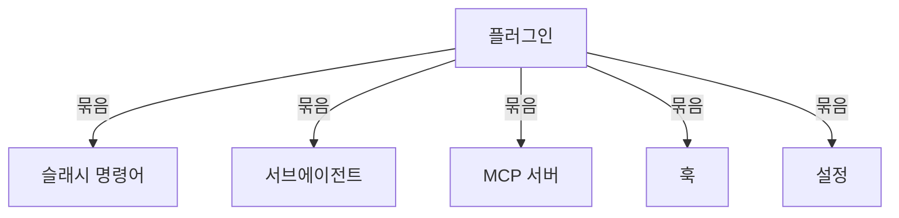
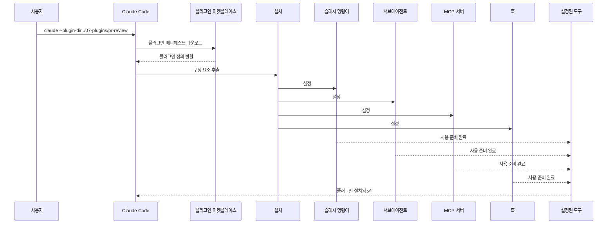
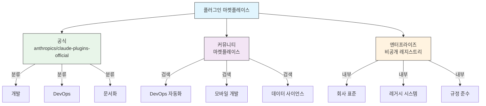
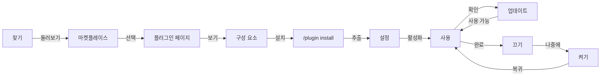
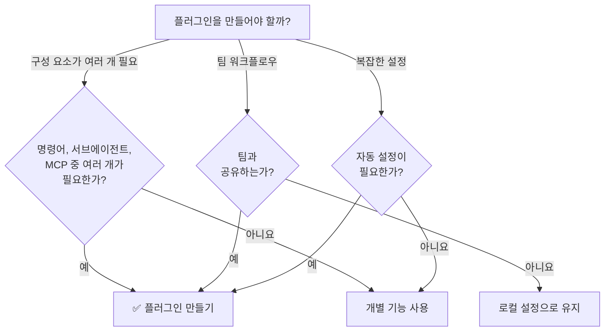

<picture>
  <source media="(prefers-color-scheme: dark)" srcset="../resources/logos/claude-howto-logo-dark.svg">
  
</picture>

# Claude Code 플러그인

이 폴더에는 여러 Claude Code 기능을 하나로 묶어 설치할 수 있는 패키지로 만든 완성된 플러그인 예제가 들어 있습니다.

## 개요

Claude Code 플러그인은 여러 사용자 정의 구성 요소(슬래시 명령어, 서브에이전트, MCP 서버, 훅)를 묶어 명령어 하나로 설치하는 모음입니다. 여러 기능을 하나의 일관되고 공유 가능한 패키지로 합친, 가장 높은 수준의 확장 방식입니다.

## 플러그인 아키텍처



## 플러그인 로딩 과정



> **마켓플레이스 없이도 가능 (v2.1.157+)**: 이제 `.claude/skills` 디렉토리에 둔 플러그인은 마켓플레이스 없이 자동으로 로드됩니다. `claude plugin init <name>`으로 새 플러그인의 골격을 만들면 `~/.claude/skills/<name>/`(사용자 전역)에 생성되며, 다음 세션에서 `<name>@skills-dir`로 자동 로드됩니다.

## 플러그인 유형과 배포

| 유형 | 범위 | 공유 | 관리 주체 | 예 |
|------|-------|--------|-----------|----------|
| 공식 | 전역 | 모든 사용자 | Anthropic | PR Review, Security Guidance |
| 커뮤니티 | 공개 | 모든 사용자 | 커뮤니티 | DevOps, Data Science |
| 조직 | 내부 | 팀원 | 회사 | 내부 표준, 도구 |
| 개인 | 개인 | 단일 사용자 | 개발자 | 사용자 정의 워크플로우 |

## 플러그인 정의 구조

플러그인 매니페스트는 `.claude-plugin/plugin.json`에 있는 JSON 형식입니다:

```json
{
  "name": "my-first-plugin",
  "description": "인사말 플러그인",
  "version": "1.0.0",
  "author": {
    "name": "작성자 이름"
  },
  "homepage": "https://example.com",
  "repository": "https://github.com/user/repo",
  "license": "MIT"
}
```

이런 식별 필드 외에도, 매니페스트는 기본 폴더가 아닌 다른 곳에 있는 구성 요소를 Claude Code에 알려 주고, 발견과 의존성을 위한 메타데이터를 담을 수 있습니다:

| 필드 | 타입 | 설명 |
|-------|------|-------------|
| `workflows` | string \| array | 사용자 정의 [워크플로우](https://code.claude.com/docs/ko/workflows) 스크립트 파일이나 디렉토리(기본 `workflows/`를 대체) |
| `outputStyles` | string \| array | 사용자 정의 출력 스타일 파일이나 디렉토리(기본 `output-styles/`를 대체) |
| `lspServers` | string \| array \| object | 코드 인텔리전스를 위한 LSP 서버 — 정의로 이동, 참조 찾기, 진단. 보통 `"./.lsp.json"`. [LSP 서버 설정](#lsp-서버-설정) 참고 |
| `channels` | array | 메시지 주입을 위한 채널 선언(Telegram, Slack, Discord 방식) |
| `dependencies` | array | 이 플러그인이 필요로 하는 다른 플러그인. semver 버전 제약을 붙일 수 있음 |
| `keywords` | array | 마켓플레이스를 둘러보고 검색할 때 쓰는 발견용 태그 |
| `metadata` | object | 자격 정보나 카탈로그 필드 같은 자체 데이터를 담는 자유 형식 객체 |
| `experimental.themes` | string \| array | 색상 테마 파일이나 디렉토리(기본 `themes/`를 대체) |
| `experimental.monitors` | string \| array | 플러그인이 활성화되면 자동으로 시작되는 [백그라운드 모니터](#백그라운드-모니터-v21105) 설정 |

## 플러그인 구조 예

```
my-plugin/
├── .claude-plugin/
│   └── plugin.json       # 매니페스트(이름, 설명, 버전, 작성자)
├── commands/             # 마크다운 파일로 된 스킬
│   ├── task-1.md
│   ├── task-2.md
│   └── workflows/
├── agents/               # 사용자 정의 에이전트 정의
│   ├── specialist-1.md
│   ├── specialist-2.md
│   └── configs/
├── skills/               # SKILL.md 파일로 된 에이전트 스킬
│   ├── skill-1/
│   │   └── SKILL.md
│   └── skill-2/
│       └── SKILL.md
├── hooks/                # hooks.json에 정의한 이벤트 핸들러
│   └── hooks.json
├── .mcp.json             # MCP 서버 설정
├── .lsp.json             # 코드 인텔리전스용 LSP 서버 설정
├── bin/                  # 플러그인이 켜져 있는 동안 Bash 도구의 PATH에 추가되는 실행 파일(PowerShell 도구도 찾을 수 있음, v2.1.302)
├── settings.json         # 플러그인이 켜지면 적용되는 기본 설정(`agent`와 `subagentStatusLine` 키만 효과 있음)
├── themes/               # 선택: 사용자 정의 Claude Code 테마 제공(v2.1.118+)
├── templates/
│   └── issue-template.md
├── scripts/
│   ├── helper-1.sh
│   └── helper-2.py
├── docs/
│   ├── README.md
│   └── USAGE.md
└── tests/
    └── plugin.test.js
```

> **참고**: `commands/`는 **레거시**입니다. 공식 가이드는 *"새 플러그인에는 `skills/`를 쓰세요."* 라고 안내합니다. 기존 `commands/` 디렉토리는 계속 동작하며 이 모듈의 예제 플러그인 3개에도 들어 있지만, 새 플러그인은 기능을 평면적인 마크다운 명령어 파일 대신 `skills/` 아래의 `SKILL.md` 디렉토리로 두어야 합니다.

### LSP 서버 설정

플러그인은 실시간 코드 인텔리전스를 위한 LSP(Language Server Protocol) 지원을 포함할 수 있습니다. LSP 서버는 작업하는 동안 진단, 코드 탐색, 심볼 정보를 제공합니다.

**설정 위치**:
- 플러그인 루트 디렉토리의 `.lsp.json` 파일
- `plugin.json`의 `lspServers` 키 — 공식 매니페스트 필드 이름입니다. 문자열, 배열, 객체를 받으며, 문자열이나 배열은 LSP 설정 파일이나 디렉토리를 가리키고(예: `"./.lsp.json"`), 객체는 서버를 인라인으로 선언합니다.

#### 필드 레퍼런스

| 필드 | 필수 | 설명 |
|-------|----------|-------------|
| `command` | 예 | LSP 서버 바이너리(PATH에 있어야 함) |
| `extensionToLanguage` | 예 | 파일 확장자를 언어 ID에 대응 |
| `args` | 아니요 | 서버에 넘길 명령줄 인수 |
| `transport` | 아니요 | 통신 방식: `stdio`(기본값) 또는 `socket` |
| `env` | 아니요 | 서버 프로세스의 환경 변수 |
| `initializationOptions` | 아니요 | LSP 초기화 때 보낼 옵션 |
| `settings` | 아니요 | 서버에 넘길 작업 공간 설정 |
| `workspaceFolder` | 아니요 | 작업 공간 폴더 경로 재정의 |
| `startupTimeout` | 아니요 | 서버 시작을 기다리는 최대 시간(ms) |
| `shutdownTimeout` | 아니요 | 정상 종료를 기다리는 최대 시간(ms) |
| `restartOnCrash` | 아니요 | 서버가 비정상 종료되면 자동으로 다시 시작 |
| `maxRestarts` | 아니요 | 포기하기 전까지의 최대 재시작 횟수 |

#### 설정 예

**Go (gopls)**:

```json
{
  "go": {
    "command": "gopls",
    "args": ["serve"],
    "extensionToLanguage": {
      ".go": "go"
    }
  }
}
```

**Python (pyright)**:

```json
{
  "python": {
    "command": "pyright-langserver",
    "args": ["--stdio"],
    "extensionToLanguage": {
      ".py": "python",
      ".pyi": "python"
    }
  }
}
```

**TypeScript**:

```json
{
  "typescript": {
    "command": "typescript-language-server",
    "args": ["--stdio"],
    "extensionToLanguage": {
      ".ts": "typescript",
      ".tsx": "typescriptreact",
      ".js": "javascript",
      ".jsx": "javascriptreact"
    }
  }
}
```

#### 사용 가능한 LSP 플러그인

공식 마켓플레이스에는 미리 설정된 LSP 플러그인이 있습니다:

| 플러그인 | 언어 | 서버 바이너리 | 설치 명령어 |
|--------|----------|---------------|----------------|
| `pyright-lsp` | Python | `pyright-langserver` | `pip install pyright` |
| `typescript-lsp` | TypeScript/JavaScript | `typescript-language-server` | `npm install -g typescript-language-server typescript` |
| `rust-analyzer-lsp` | Rust | `rust-analyzer` | `rustup component add rust-analyzer`로 설치 |

#### LSP 기능

설정하고 나면 LSP 서버가 다음을 제공합니다:

- **즉각적인 진단** — 편집 직후 오류와 경고가 바로 표시됨
- **코드 탐색** — 정의로 이동, 참조 찾기, 구현 찾기
- **호버 정보** — 마우스를 올리면 타입 시그니처와 문서 표시
- **심볼 목록** — 현재 파일이나 작업 공간의 심볼 둘러보기

### `PATH`에 추가되는 `bin/` 디렉토리

플러그인이 켜지면 그 플러그인의 `bin/` 디렉토리가 세션의 `PATH`에 사용자 자신의 `PATH` 항목보다 뒤에 추가되므로, 플러그인이 `git`, `ls` 같은 시스템 명령어를 가릴 수 없습니다. 거기에 들어 있는 실행 파일은 전체 경로 없이 이름만으로 Bash 도구에서 바로 호출할 수 있습니다(PowerShell 도구도 찾을 수 있음, v2.1.302).

```bash
# 플러그인 구조:
my-plugin/
├── .claude-plugin/
│   └── plugin.json
└── bin/
    └── my-tool          # 실행 파일(chmod +x)

# 플러그인이 켜진 Claude Code 세션 안에서:
$ my-tool --help
```

같은 플러그인 안의 훅, 스킬, 명령어가 셸로 호출할 CLI 헬퍼에 쓰세요. 플러그인 저장소에서 파일에 실행 권한(`chmod +x`)을 주세요 — git이 그 비트를 보존합니다.

## 플러그인 옵션 (v2.1.83+)

플러그인은 매니페스트의 `userConfig`로 사용자가 설정할 수 있는 옵션을 선언할 수 있습니다. `sensitive: true`로 표시한 값은 일반 텍스트 설정 파일이 아니라 시스템 키체인에 저장됩니다:

```json
{
  "name": "my-plugin",
  "version": "1.0.0",
  "userConfig": {
    "apiKey": {
      "type": "string",
      "title": "API 키",
      "description": "서비스용 API 키",
      "sensitive": true
    },
    "region": {
      "type": "string",
      "title": "리전",
      "description": "배포 리전",
      "default": "us-east-1"
    }
  }
}
```

## 플러그인 지속 데이터 (`${CLAUDE_PLUGIN_DATA}`) (v2.1.78+)

플러그인은 `${CLAUDE_PLUGIN_DATA}` 환경 변수로 지속 상태 디렉토리에 접근할 수 있습니다. 이 디렉토리는 플러그인마다 고유하고 세션이 끝나도 유지되므로 캐시, 데이터베이스, 기타 지속 상태에 적합합니다:

```json
{
  "hooks": {
    "PostToolUse": [
      {
        "matcher": "*",
        "hooks": [
          {
            "type": "command",
            "command": "node \"${CLAUDE_PLUGIN_ROOT}\"/scripts/track-usage.js \"${CLAUDE_PLUGIN_DATA}\"/usage.json"
          }
        ]
      }
    ]
  }
}
```

이 디렉토리(`~/.claude/plugins/data/<id>/`)는 처음 참조될 때 만들어지고 플러그인을 업데이트해도 유지됩니다. 플러그인이 설치된 마지막 위치에서 제거하면 삭제됩니다(`--keep-data`를 넘기면 유지).

### 백그라운드 모니터 (v2.1.105)

플러그인은 세션이 시작될 때나 플러그인의 스킬이 처음 실행될 때 시작되는 백그라운드 모니터를 등록할 수 있습니다. `plugin.json`의 `experimental.monitors`(또는 `monitors/monitors.json`)에 선언하세요:

```json
{
  "name": "my-plugin",
  "version": "1.0.0",
  "experimental": {
    "monitors": [
      {
        "name": "app-log",
        "command": "tail -f /var/log/app.log",
        "description": "애플리케이션 로그 오류",
        "when": "always"
      }
    ]
  }
}
```

`name`, `command`, `description`은 필수입니다. `when`에는 다음 값을 쓸 수 있습니다:
- `"always"`(기본값) — 세션을 시작할 때와 플러그인을 다시 로드할 때 시작
- `"on-skill-invoke:<skill>"` — 해당 스킬이 처음 실행될 때 시작

알 수 없는 키가 있으면 거부되어 플러그인이 로드되지 않습니다. 최상위 `monitors` 키는 여전히 로드되지만 `claude plugin validate`가 경고합니다.

모니터는 내부적으로 같은 Monitor 도구를 쓰며, stdout 줄을 Claude가 반응할 수 있는 이벤트로 흘려보냅니다.

## 설정 파일의 인라인 플러그인 (`source: 'settings'`) (v2.1.80+)

플러그인은 `source: 'settings'` 필드를 써서 설정 파일 안에 마켓플레이스 항목으로 인라인 정의할 수 있습니다. 별도의 저장소나 마켓플레이스 없이 플러그인 정의를 바로 넣을 수 있는 방법입니다. `extraKnownMarketplaces.<name>.source` 아래에 선언하며, `name`은 마켓플레이스 키와 같아야 하고, 플러그인은 GitHub이나 npm 같은 외부 소스를 참조해야 합니다(상대 경로는 거부됨):

```json
{
  "extraKnownMarketplaces": {
    "inline-tools": {
      "source": {
        "source": "settings",
        "name": "inline-tools",
        "plugins": [
          {
            "name": "quick-lint",
            "source": {
              "source": "github",
              "repo": "my-org/quick-lint"
            }
          }
        ]
      }
    }
  }
}
```

## Mods (v2.1.287+)

mod는 Claude Code의 모양과 동작을 바꾸는 플러그인입니다. mod의 코드는 JavaScript나 TypeScript로 된 훅 모듈입니다: 도구 호출, 프롬프트 제출, 인터페이스 일부를 그릴 때처럼 무언가가 일어나면 Claude Code가 호출하는 이벤트 핸들러입니다. 각 핸들러는 이벤트를 관찰하거나, 다시 쓰거나, 직접 응답할 수 있습니다. mod는 다른 플러그인과 똑같이 설치하고(`/plugin install <plugin>@<marketplace>`), 스킬, MCP 서버와 같은 플러그인에 담아 배포할 수 있으며, 사용자의 권한으로 실행되므로 신뢰할 수 있는 작성자와 마켓플레이스의 mod만 설치하세요. mod는 Claude Code CLI(v2.1.287+), Claude Desktop 앱의 Code 탭, VS Code 확장에서 동작합니다.

| mod로 할 수 있는 일 | 예 |
|-------------------|---------|
| 창과 프롬프트 위 띠 그리기 | 대화 기록 옆의 창이나 프롬프트 위의 띠. 탭, 버튼, 텍스트 필드 포함 |
| 명령어 추가 | Claude 턴 없이, Claude가 작업 중일 때도 함수를 바로 실행하는 `/command` |
| 도구 호출 제어나 변경 | 사용자에게 질문하는 동안 도구 호출을 보류하거나, 거부하거나, 도구를 실행하지 않고 직접 응답 |
| 이벤트에 반응 | 도구 호출, 프롬프트, 턴을 추적. mod의 훅은 변수를 공유하므로, 한 훅이 도구 호출 수를 세고 다른 훅이 그 수를 스피너 옆에 표시할 수 있음 |
| mods API 호출 | 모델 호출, 파일 읽기와 쓰기, 프로세스 시작, 네트워크 요청(훅은 mods API를 통해서만 이런 일을 할 수 있음) |

mod를 만들려면 Claude Code 세션에서 원하는 것을 설명하세요: Claude가 기본 제공 `plugin-authoring` 스킬(또는 직접 `/plugin-authoring` 실행)을 바탕으로 mod를 작성하며, 세션에서 핫 리로드를 켜 두면 mod를 바꾼 턴이 끝날 때마다 다시 로드합니다. `claude plugin validate`는 mod를 실행하지 않고 검사합니다. 관리자는 관리형 설정으로 mod 실행 여부와 대상을 정합니다 — 예를 들어 `allowManagedModsOnly`를 쓰면 조직의 mod와 Claude Code에 내장된 mod만 훅을 실행할 수 있습니다.

> **참고**: v2.1.299–2.1.300에서 `Text`의 `size`, `weight`, `mono`, `tabular`, `dir`(RTL) 속성(`bold`는 지원 중단되고 `weight`로 대체), `Box`의 간격 단계 `xs`–`xl`, 프롬프트 `virtualText`, `$.ui.view({ agentId })`, `prompt.change` 훅이 추가되었고, v2.1.301에서는 여러 줄 입력을 위한 `Input`의 `rows`가 추가되었습니다(Enter는 제출, Shift+Enter는 줄 추가).

> **참고**: 공식 [Mods 개요](https://code.claude.com/docs/en/plugins/mods/overview), [mod 만들기](https://code.claude.com/docs/en/plugins/mods/create), [Mods 레퍼런스](https://code.claude.com/docs/en/plugins/mods/reference)를 참고하세요.

## 플러그인 설정

플러그인은 기본 설정을 제공하는 `settings.json` 파일을 포함할 수 있습니다. 효과가 있는 키는 `agent`와 `subagentStatusLine` 두 가지뿐이며, 나머지 키는 모두 버려집니다. `agent`는 플러그인 에이전트 중 하나의 이름을 받아 그 에이전트를 메인 스레드로 실행합니다:

```json
{
  "agent": "specialist-1"
}
```

플러그인에 `settings.json`이 있으면 설치할 때 그 기본값이 적용됩니다. 사용자는 자신의 프로젝트나 사용자 설정에서 이 설정을 재정의할 수 있습니다.

## 독립 실행형과 플러그인 방식 비교

| 방식 | 명령어 이름 | 설정 | 적합한 용도 |
|----------|---------------|---|---|
| **독립 실행형** | `/hello` | CLAUDE.md에서 직접 설정 | 개인용, 프로젝트별 |
| **플러그인** | `/plugin-name:hello` | plugin.json으로 자동 설정 | 공유, 배포, 팀 사용 |

빠른 개인 워크플로우에는 **독립 실행형 슬래시 명령어를** 쓰세요. 여러 기능을 묶거나, 팀과 공유하거나, 배포용으로 게시하려면 **플러그인을** 쓰세요.

> **공백으로 호출 (v2.1.136+)**: 플러그인 슬래시 명령어는 공백을 써도 동작합니다 — `/myplugin review`는 정식 이름인 `/myplugin:review`로 해석됩니다. 둘 다 괜찮지만, 콜론 형식이 정식이며 스크립트에서는 이 형식을 권장합니다.

> **`skills/` 발견 (v2.1.136+)**: `plugin.json`의 `skills` 항목이 더 이상 플러그인의 기본 `skills/` 디렉토리를 가리지 않습니다. 두 곳에 선언된 스킬은 병합되므로, `plugin.json`에 대표 스킬 몇 개만 나열해도 나머지를 잃지 않습니다.

> **루트 수준 `SKILL.md` 플러그인 (v2.1.142+)**: 최상위에 `SKILL.md`가 있고 **`skills/` 하위 디렉토리가 없는** 플러그인은 그 자체가 하나의 스킬로 표시됩니다 — 플러그인이 *곧* 스킬입니다. 이는 `skills/` 디렉토리나 `plugin.json`의 `skills` 항목을 대체하는 것이 아니라 추가로 쓸 수 있는 패턴입니다. 디렉토리 구조가 별 의미 없는 작은 단일 스킬 플러그인에 쓰세요.

## 실전 예제

### 예제 1: PR 리뷰 플러그인

**파일:** `.claude-plugin/plugin.json`

```json
{
  "name": "pr-review",
  "version": "1.0.0",
  "description": "보안, 테스트, 문서를 아우르는 완전한 PR 리뷰 워크플로우",
  "author": {
    "name": "Anthropic"
  },
  "repository": "https://github.com/your-org/pr-review",
  "license": "MIT"
}
```

**파일:** `commands/review-pr.md`

```markdown
---
name: Review PR
description: 보안과 테스트 검사를 포함한 종합 PR 리뷰 시작
---

# PR 리뷰

이 명령어는 다음을 포함한 완전한 풀 리퀘스트 리뷰를 시작합니다:

1. 보안 분석
2. 테스트 커버리지 확인
3. 문서 업데이트
4. 코드 품질 검사
5. 성능 영향 평가
```

**파일:** `agents/security-reviewer.md`

```yaml
---
name: security-reviewer
description: 보안 중심 코드 리뷰
tools: Read, Grep, Bash
---

# 보안 리뷰어

보안 취약점 찾기를 전문으로 합니다:
- 인증/인가 문제
- 데이터 노출
- 인젝션 공격
- 안전한 설정
```

**설치:**

```bash
claude --plugin-dir ./07-plugins/pr-review

# 결과:
# ✅ 슬래시 명령어 3개 설치됨
# ✅ 서브에이전트 3개 설정됨
# ✅ MCP 서버 2개 연결됨
# ✅ 훅 4개 등록됨
# ✅ 사용 준비 완료!
```

### 예제 2: DevOps 플러그인

**구성 요소:**

```
devops-automation/
├── commands/
│   ├── deploy.md
│   ├── rollback.md
│   ├── status.md
│   └── incident.md
├── agents/
│   ├── deployment-specialist.md
│   ├── incident-commander.md
│   └── alert-analyzer.md
├── mcp/
│   └── kubernetes-config.json
├── hooks/
│   ├── pre-deploy.js
│   └── post-deploy.js
└── scripts/
    ├── deploy.sh
    ├── rollback.sh
    └── health-check.sh
```

### 예제 3: 문서화 플러그인

**포함된 구성 요소:**

```
documentation/
├── commands/
│   ├── generate-api-docs.md
│   ├── generate-readme.md
│   ├── sync-docs.md
│   └── validate-docs.md
├── agents/
│   ├── api-documenter.md
│   ├── code-commentator.md
│   └── example-generator.md
├── mcp/
│   └── github-docs-config.json
└── templates/
    ├── api-endpoint.md
    ├── function-docs.md
    └── adr-template.md
```

## 플러그인 마켓플레이스

Anthropic이 관리하는 공식 플러그인 디렉토리는 `anthropics/claude-plugins-official`이며, 처음 대화형으로 실행할 때 자동으로 등록됩니다. 엔터프라이즈 관리자는 내부 배포를 위한 비공개 플러그인 마켓플레이스도 만들 수 있습니다.

**커뮤니티 마켓플레이스**인 `anthropics/claude-plugins-community`도 있습니다. Anthropic의 자동 검증과 안전성 심사를 통과한 서드파티 플러그인을 제공하며, 카탈로그에서 각 플러그인은 특정 커밋 SHA에 고정되어 있습니다. 공식 마켓플레이스와 달리 직접 추가해야 합니다:

```bash
/plugin marketplace add anthropics/claude-plugins-community

# 그런 다음 claude-community 마켓플레이스 이름으로 설치
/plugin install <plugin-name>@claude-community
```



### 마켓플레이스 설정

엔터프라이즈 사용자와 고급 사용자는 설정으로 마켓플레이스 동작을 제어할 수 있습니다:

| 설정 | 설명 |
|---------|-------------|
| `extraKnownMarketplaces` | 기본값 외에 마켓플레이스 소스를 추가 |
| `strictKnownMarketplaces` | 사용자가 추가할 수 있는 마켓플레이스 제어(관리형 전용) |
| `blockedMarketplaces` | 관리자가 관리하는 마켓플레이스 차단 목록(v2.1.119부터 `hostPattern` / `pathPattern` 정규식 필드 지원) |
| `enabledPlugins`(`false`로 설정) | 특정 플러그인 차단: 관리형 설정에 `"enabledPlugins": { "<plugin>@<marketplace>": false }`를 넣으면 모든 범위에서 설치를 막고 마켓플레이스에서 숨김 |

> **더 쉬운 별칭 (v2.1.232)**: `additionalMarketplaces`는 `extraKnownMarketplaces`의 별칭으로,
> `allowedMarketplaces`는 `strictKnownMarketplaces`의 별칭으로 받아들여집니다.
> 공식 설정 레퍼런스의
> [Marketplace key aliases](https://code.claude.com/docs/en/settings-reference#marketplace-key-aliases)에 둘 다 나와 있습니다.
> 이전 버전은 별칭을 무시하므로 정식 키를 계속 써도 안전합니다.

> **소유자 와일드카드 (v2.1.223+)**: `"owner/*"` 항목은 한 GitHub 소유자 아래의 모든 마켓플레이스
> 저장소를 허용하거나 차단합니다. **`strictKnownMarketplaces`와 `blockedMarketplaces`에서만 받아들여집니다.**
> 그 밖에 `github` 소스가 나오는 곳 — `extraKnownMarketplaces`와 `/plugin marketplace add` 포함 — 에서는
> `repo` 값에 저장소 하나만 지정해야 합니다.

> **강제 적용** (v2.1.117+): `blockedMarketplaces`와 `strictKnownMarketplaces`는 처음 추가할 때만이 아니라 설치, 업데이트, 새로 고침, 자동 업데이트 등 모든 플러그인 수명 주기 이벤트에서 강제로 적용됩니다. `strictKnownMarketplaces`는 관리형 전용입니다.

호스트/경로 정규식을 쓰는 `blockedMarketplaces` 예(v2.1.119):

```json
{
  "blockedMarketplaces": [
    { "source": "hostPattern", "hostPattern": "^evil\\.example\\.com$" },
    { "source": "pathPattern", "pathPattern": "^/opt/approved/" }
  ]
}
```

#### 마켓플레이스 `headersHelper` (v2.1.238)

`url` 마켓플레이스 — 또는 개별 카탈로그 항목 — 는 카탈로그와 같은 출처의 아카이브를 가져올 때 쓸 HTTP 헤더를 만드는 `headersHelper` 명령어를 지정할 수 있습니다. 토큰을 발급하는 서비스 뒤에 있는 비공개 마켓플레이스가 설정에 고정된 비밀 정보 없이 인증하는 방법입니다.

**카탈로그 항목의** 헬퍼는 설치하거나 업데이트할 때만, 그리고 그 명령어를 사용자에게 보여 준 뒤에만 실행됩니다: `claude plugin install`과 `claude plugin update`는 실행하기 전에 `[y/N]`로 묻습니다. 자동화에서 프롬프트 없이 수락하려면 `-y`를 넘기세요.

### 추가 마켓플레이스 기능

- **마켓플레이스 검색창 (v2.1.172)**: `/plugin`에서 마켓플레이스의 플러그인을 둘러볼 때 검색창으로 이름이나 키워드로 걸러 볼 수 있습니다 — 전체 목록을 스크롤하기 느린 큰 마켓플레이스에서 편리합니다.
- **기본 git 시간 제한**: 큰 플러그인 저장소를 위해 30초에서 120초로 늘어남
- **사용자 정의 npm 레지스트리**: 플러그인이 의존성 해석에 쓸 npm 레지스트리 URL을 지정할 수 있음
- **버전 고정**: 재현 가능한 환경을 위해 플러그인을 특정 버전에 고정
- **둘러보기 창의 예상 컨텍스트 비용 (v2.1.143)**: `/plugin` 마켓플레이스 브라우저는 플러그인마다 턴당 예상 컨텍스트 토큰 비용 — 항상 로드되는 스킬, 훅, MCP 서버 설명의 합 — 을 보여 줍니다. 설치하기 전에 플러그인 도입 규모를 가늠할 때 쓰세요. 설치한 뒤에는 [`claude plugin details <name>`](#claude-plugin-details--v21139)으로 같은 예상치를 볼 수 있습니다.

비용 열이 표시된 둘러보기 행의 예:

```text
NAME              VERSION   AUTHOR     CTX/TURN   DESCRIPTION
code-reviewer     1.2.0     anthropic  +1,420     Multi-agent PR review
devops-toolkit    0.4.1     acme       +3,180     SRE playbooks, on-call helpers
docs-helper       0.9.0     community  +610       Doc-style guide enforcement
```

### 마켓플레이스 정의 스키마

플러그인 마켓플레이스는 `.claude-plugin/marketplace.json`에서 정의합니다:

```json
{
  "name": "my-team-plugins",
  "owner": { "name": "my-org" },
  "plugins": [
    {
      "name": "code-standards",
      "source": "./plugins/code-standards",
      "description": "팀 코딩 표준 적용",
      "version": "1.2.0",
      "author": { "name": "platform-team" }
    },
    {
      "name": "deploy-helper",
      "source": {
        "source": "github",
        "repo": "my-org/deploy-helper",
        "ref": "v2.0.0"
      },
      "description": "배포 자동화 워크플로우"
    }
  ]
}
```

| 필드 | 필수 | 설명 |
|-------|----------|-------------|
| `name` | 예 | kebab-case로 쓴 마켓플레이스 이름 |
| `owner` | 예 | 마켓플레이스를 관리하는 조직이나 사용자: 필수 `name`을 가진 객체(`email`, `url`은 선택) |
| `plugins` | 예 | 플러그인 항목 배열 |
| `plugins[].name` | 예 | 플러그인 이름(kebab-case) |
| `plugins[].source` | 예 | 플러그인 소스(경로 문자열 또는 소스 객체) |
| `plugins[].description` | 아니요 | 간단한 플러그인 설명 |
| `plugins[].version` | 아니요 | 시맨틱 버전 문자열 |
| `plugins[].author` | 아니요 | 플러그인 작성자: 필수 `name`을 가진 객체(`email`, `url`은 선택) |
| `renames` | 아니요 | (항목별이 아닌) 마켓플레이스 최상위 필드: 예전 플러그인 `name`을 현재 이름에 대응시켜(제거된 경우 `null`) 사용자가 자동으로 옮겨 가게 함(v2.1.193) |
| `plugins[].displayName` | 아니요 | UI에 표시할 사람이 읽기 쉬운 이름. 조회에는 쓰이지 않음(v2.1.143) |
| `plugins[].defaultEnabled` | 아니요 | `false`이면 사용자가 켤 때까지 플러그인이 꺼진 상태로 설치됨(v2.1.154) |

### 플러그인 소스 유형

플러그인은 여러 위치에서 가져올 수 있습니다:

| 소스 | 문법 | 예 |
|--------|--------|---------|
| **상대 경로** | 문자열 경로 | `"./plugins/my-plugin"` |
| **GitHub** | `{ "source": "github", "repo": "owner/repo" }` | `{ "source": "github", "repo": "acme/lint-plugin", "ref": "v1.0" }` |
| **Git URL** | `{ "source": "url", "url": "..." }` | `{ "source": "url", "url": "https://git.internal/plugin.git" }` |
| **Git 하위 디렉토리** | `{ "source": "git-subdir", "url": "...", "path": "..." }` | `{ "source": "git-subdir", "url": "https://github.com/org/monorepo.git", "path": "packages/plugin" }` |
| **npm** | `{ "source": "npm", "package": "..." }` | `{ "source": "npm", "package": "@acme/claude-plugin", "version": "^2.0" }` |
| **아카이브**(v2.1.224+) | `{ "source": "archive", "url": "..." }` | `{ "source": "archive", "url": "https://cdn.example.com/lint-plugin-1.2.0.zip", "sha256": "…" }` |
| **명령어**(v2.1.229+) | `{ "source": "command", "command": "..." }` | `{ "source": "command", "command": "acme-plugin-resolver --print-dir" }` |

GitHub과 git 소스는 버전 고정을 위한 선택 필드 `ref`(브랜치/태그)와 `sha`(커밋 해시)를 지원합니다.

**소스 이름만 쓰기와 `metadata.pluginRoot` (v2.1.239)**: 이제 마켓플레이스의 `metadata.pluginRoot`가 적용됩니다 — 카탈로그에 플러그인 소스 이름만 쓰면 그 루트 아래의 디렉토리로 해석되므로, 항목마다 전체 상대 경로를 쓰지 않아도 됩니다.

**claude.ai에서 동기화된 스킬 (v2.1.239)**: claude.ai에서 동기화되어 내려온 플러그인은 `name@synced`로 표시됩니다. `claude plugin enable <name>@synced`와 `claude plugin disable <name>@synced`에서도 이렇게 지정하세요. 동기화된 플러그인은 같은 이름의 설치된 플러그인을 절대 덮어쓰지 않으며, 둘은 `@synced` 접미사로 구분되어 함께 존재합니다.

#### `archive` 소스 (v2.1.224+)

HTTPS로 zip 파일에서 플러그인을 설치합니다 — git clone도, npm install도 필요 없습니다.

```json
{
  "source": "archive",
  "url": "https://cdn.example.com/lint-plugin-1.2.0.zip",
  "sha256": "3b1f0c2e9a7d4f5b8c6e1a2d3f4b5c6d7e8f9a0b1c2d3e4f5a6b7c8d9e0f1a2b"
}
```

| 필드 | 필수 | 참고 |
|-------|----------|-------|
| `url` | 예 | **HTTPS만 가능.** `http://`, 루프백, 링크 로컬, 클라우드 메타데이터 호스트는 거부되며 **리디렉션마다** 다시 확인하므로, 리디렉션으로 차단된 호스트에 몰래 접근할 수 없습니다 |
| `sha256` | 아니요 | 16진수 64자. 일치하지 않으면 `Plugin archive integrity check failed`로 설치가 실패합니다 |

아카이브는 **256 MiB**로 제한됩니다. 직접 빌드하지 않은 것에는 `sha256`을 고정하세요 — 그러지 않으면 URL을 통제하는 사람이 세션에서 실행되는 코드를 통제하게 됩니다.

#### `command` 소스 (v2.1.229+)

플러그인이 어디에 있는지를 로컬에 설치된 도구가 결정하게 합니다. 사내 패키지 관리자가
이미 플러그인을 가져오고 배치하는 방법을 알고 있을 때 유용합니다.

```json
{
  "source": "command",
  "command": "acme-plugin-resolver --print-dir",
  "timeout": 60,
  "mode": "copy"
}
```

규칙은 엄격합니다: **명령어는 stdout에 정확히 한 줄을 출력하고 종료 코드 0으로 끝나야 합니다.**
그 한 줄은 완전한 플러그인이 들어 있는 디렉토리의 절대 경로입니다.

| 필드 | 필수 | 기본값 | 참고 |
|-------|----------|---------|-------|
| `command` | 예 | — | 실행할 명령어 |
| `timeout` | 아니요 | `60`(초) | 최대 600 |
| `mode` | 아니요 | `"copy"` | `"copy"`는 디렉토리의 스냅샷을 만들고, `"link"`는 심볼릭 링크를 걸어 편집이 바로 반영됨 |

명령어는 세션마다 다시 해석되며, 결과는 다시 시작하지 않아도 적용됩니다.
조직은 `disableCommandPluginSources`로 이 소스 유형을 완전히 막을 수 있습니다.

예약된 마켓플레이스 이름에 이제 `first-party-plugins`와 `healthcare`가 포함됩니다(v2.1.205) — 공식 용도로 확보된 이름이라 사용자 정의 마켓플레이스가 쓸 수 없습니다.

### 배포 방법

**GitHub(권장)**:
```bash
# 사용자가 여러분의 마켓플레이스를 추가
/plugin marketplace add owner/repo-name
```

**기타 git 서비스**(전체 URL 필요):
```bash
/plugin marketplace add https://gitlab.com/org/marketplace-repo.git
```

중첩된 하위 그룹을 포함한 `gitlab.com` 저장소 URL은 `github.com` URL과 같은 방식으로
복제됩니다(v2.1.232). **스킴은 필수입니다**: v2.1.196부터 스킴 없이 쓴
`gitlab.example.com/team/plugins`는 잘못된 `owner/repo` 약식으로 거부되므로,
`https://gitlab.com/company/plugins.git` 같은 전체 형식을 쓰세요. v2.1.232에서는 GitLab
토큰 계열의 비밀 정보 가리기도 추가되었고, `glab` CLI에도 `gh`가 이미 갖고 있던 샌드박스와
자격 증명 경로 보호가 적용되었습니다.

**비공개 저장소**: git 자격 증명 헬퍼나 환경 변수 토큰으로 지원됩니다. 사용자에게 저장소 읽기 권한이 있어야 합니다.

**디렉토리 제출**: 더 널리 배포하려면 개발자 포털 [claude.ai/directory/manage](https://claude.ai/directory/manage)에서 Anthropic 디렉토리에 플러그인을 제출하세요. Anthropic의 공식 마켓플레이스인 `claude-plugins-official`은 디렉토리 포털로 제출을 받지 않습니다.

### 마켓플레이스 관리

```bash
# 마켓플레이스 CLI 명령어
claude plugin marketplace add <source>       # 마켓플레이스 추가(GitHub, URL, 로컬)
claude plugin marketplace update [name]      # 카탈로그 색인 새로 고침
claude plugin marketplace remove <name>      # 마켓플레이스 제거
claude plugin marketplace list               # 설정된 마켓플레이스 나열
```

> **중요**: `marketplace update`는 플러그인 카탈로그(설치할 수 있는 목록)만 새로 고칩니다. 설치된 플러그인은 업데이트하지 **않습니다**. 설치된 특정 플러그인을 업데이트하려면 `plugin update <name>`을 쓰세요.

### 엄격 모드

마켓플레이스 정의가 로컬 `plugin.json` 파일과 어떻게 상호작용할지 제어합니다:

| 설정 | 동작 |
|---------|----------|
| `strict: true`(기본값) | 로컬 `plugin.json`이 기준이고, 마켓플레이스 항목은 이를 보완 |
| `strict: false` | 마켓플레이스 항목이 플러그인 정의 전체 |

`strictKnownMarketplaces`를 쓴 **조직 제한**:

| 값 | 효과 |
|-------|--------|
| 설정 안 함 | 제한 없음 — 사용자가 어떤 마켓플레이스든 추가 가능 |
| 빈 배열 `[]` | 잠금 — 마켓플레이스를 하나도 허용하지 않음 |
| 소스 객체 배열 | 허용 목록 — 일치하는 마켓플레이스만 추가 가능 |

```json
{
  "strictKnownMarketplaces": [
    { "source": "github", "repo": "my-org/*" },
    { "source": "github", "repo": "trusted-vendor/*" }
  ]
}
```

> **경고**: `strictKnownMarketplaces`를 쓰는 엄격 모드에서는 사용자가 허용 목록에 있는 마켓플레이스의 플러그인만 설치할 수 있습니다. 플러그인 배포를 통제해야 하는 엔터프라이즈 환경에 유용합니다.

## 플러그인 설치와 수명 주기



## 플러그인 기능 비교

| 기능 | 슬래시 명령어 | 스킬 | 서브에이전트 | 플러그인 |
|---------|---------------|-------|----------|--------|
| **설치** | 직접 복사 | 직접 복사 | 직접 설정 | 명령어 하나 |
| **설정 시간** | 5분 | 10분 | 15분 | 2분 |
| **묶음** | 파일 하나 | 파일 하나 | 파일 하나 | 여러 개 |
| **버전 관리** | 수동 | 수동 | 수동 | 자동 |
| **팀 공유** | 파일 복사 | 파일 복사 | 파일 복사 | 설치 ID |
| **업데이트** | 수동 | 수동 | 수동 | 자동 제공 |
| **의존성** | 없음 | 없음 | 없음 | 포함 가능 |
| **마켓플레이스** | 아니요 | 아니요 | 아니요 | 예 |
| **배포 방식** | 저장소 | 저장소 | 저장소 | 마켓플레이스 |

## 플러그인 CLI 명령어

모든 플러그인 작업은 CLI 명령어로 할 수 있습니다:

```bash
claude plugin install <name>@<marketplace>   # 마켓플레이스에서 설치
claude plugin uninstall <name>               # 플러그인 제거
claude plugin update <name>                  # 설치된 플러그인을 최신 버전으로 업데이트
claude plugin list                           # 설치된 플러그인 나열
claude plugin enable <name>                  # 꺼진 플러그인 켜기
claude plugin disable <name>                 # 플러그인 끄기
claude plugin validate <path>                # <path>에 있는 플러그인 구조 검증
claude plugin tag [path]                     # {name}--v{version} 릴리스 git 태그 만들기(v2.1.118+)
claude plugin prune                          # 남겨진 자동 설치 플러그인 의존성 제거(v2.1.121+)
claude plugin uninstall <name> --prune       # 제거하면서 남겨진 의존성까지 연쇄 정리(v2.1.121+)
claude plugin details <name>                 # 구성 요소 목록 + 턴당 예상 토큰 비용 표시(v2.1.139+)
claude plugin configure <name>@<marketplace> # 플러그인 옵션과 설정되지 않은 항목 표시. --values-stdin으로 stdin에서 값 저장(v2.1.285+)
claude plugin init <name>                    # 새 플러그인 골격 만들기(별칭: claude plugin new)
```

**별칭**: `init`은 `claude plugin new`, `uninstall`은 `remove` / `rm`, `list`는 `ls`, `prune`은 `autoremove`.

**알아 두면 좋은 플래그:**

| 명령어 | 플래그 | 목적 |
|---------|------|---------|
| `plugin init` | `--with <components...>` | 특정 구성 요소 폴더의 골격 생성: `skills`, `agents`, `hooks`, `mcp`, `lsp`, `output-style`, `channel` |
| `plugin init` | `-f`, `--force` | 기존 `.claude-plugin/` 디렉토리 덮어쓰기 |
| `plugin install` | `--config <key=value>` | 설치할 때 `userConfig` 옵션 지정. v2.1.285부터는 `<server>.<key>=<value>`로 번들된 `.mcpb` MCP 서버의 자체 설정도 지정할 수 있어, `/plugin` → Configure를 거치지 않고 바로 시작됨 |
| `plugin install` | `-y`, `--yes` | 확인 프롬프트 없이 명령어 수락 |
| `plugin list` | `--available` | 마켓플레이스에서 설치할 수 있는 플러그인도 나열(`--json` 필요) |
| `plugin tag` | `--push` | 태그를 만든 뒤 원격 저장소로 푸시 |
| `plugin tag` | `--dry-run` | 태그를 만들지 않고 무엇이 태그될지만 출력 |
| `plugin validate` | `--strict` | 경고를 오류로 취급 |
| `plugin validate` | `--json` | 기계가 읽을 수 있는 검증 보고서 출력(v2.1.259+) |

`claude plugin validate`는 `.mcp.json` 항목도 검사하며(v2.1.281+), `outputStyles`, `themes`, `monitors`, `lspServers` 경로가 없거나 플러그인 디렉토리 밖을 가리키면 실패합니다(v2.1.283+).

예: `claude plugin tag ./my-plugin`은 (버전 문자열이 아니라) 플러그인의 **경로**를 받습니다. `plugin.json`에서 가져온 `{name}--v{version}` git 태그를 만들며, `plugin.json`과 그것을 감싸는 마켓플레이스 항목이 일치하는지 검증합니다. 배포용 플러그인 릴리스를 만드는 권장 방법입니다.

`claude plugin prune`은 자체 의존성을 함께 설치한 마켓플레이스 플러그인을 설치하거나 제거한 뒤에 유용합니다 — 상위 플러그인이 이미 제거된, 자동 설치된 플러그인을 모두 제거합니다. `plugin uninstall --prune`은 같은 연쇄 정리를 한 번에 합니다.

> **의존성 강제 (v2.1.143)**: 켜져 있는 다른 플러그인이 대상 플러그인에 아직 의존하면 `claude plugin disable <name>`은 **거부합니다**(의존성 그래프가 깨지기 때문). `claude plugin enable <name>`은 의존성마다 따로 켜게 하지 않고, 확인 프롬프트 한 번으로 **전이 의존성까지 강제로 켭니다**. 의존하던 플러그인이 나중에 제거된 의존성을 정리하려면 `claude plugin prune`을 쓰세요.

### `claude plugin details <name>` (v2.1.139+)

`claude plugin details <name>`은 플러그인의 전체 구성 요소 목록 — 스킬, 훅, MCP 서버, LSP 서버, 백그라운드 모니터, 슬래시 명령어 — 과 함께 **턴당(그리고 호출당) 예상 토큰 비용을** 출력합니다. 특히 컨텍스트가 제한된 모델에서, 플러그인을 도입하기 전에 규모를 가늠할 때 쓰세요.

출력 예(일부 생략):

```text
plugin: code-reviewer (1.2.0)
skills:        3      hooks: 2      mcp: 1      lsp: 0      monitors: 0
commands:      /review, /security-review
projected ctx: +1,420 tokens per turn  ·  +9,800 tokens per /review invocation
```

LSP 서버는 v2.1.142에서 상세 정보 창에 추가되었습니다. [플러그인 마켓플레이스](#플러그인-마켓플레이스)에서 다룬 마켓플레이스 둘러보기 창의 예상 컨텍스트 비용(v2.1.143)도 참고하세요.

### `claude plugin eval` (v2.1.269+)

`claude plugin eval`은 플러그인의 평가 세트를 실행하고 점수가 매겨진 재현 가능한 결과를 보고하므로, 스킬이나 에이전트를 바꾼 것이 실제로 개선되었는지 알 수 있습니다. 결과는 JSON과 HTML 보고서로 나옵니다. v2.1.283부터는 git이 설치되어 있으면 git 2.31 이상이 필요합니다.

```bash
claude plugin eval            # 플러그인의 평가 세트 실행
claude plugin eval --help     # 전체 옵션 목록
```

`--disallow-tools <tools…>`와 사례별 `disallowed_tools` 필드로 Agent 같은 기본 제공 도구를 평가 실행에서 뺄 수 있습니다(v2.1.299).

### `--json`으로 기계가 읽을 수 있는 출력 (v2.1.268+)

`install`, `uninstall`, `update`, `enable`, `disable`에서 `--json`을 쓸 수 있으므로 CI에서 플러그인 관리를 스크립트로 처리할 수 있습니다. `claude plugin list --json`의 각 행에는 `errorDetails`와 `noteDetails`도 들어 있어, 실패한 플러그인이 다른 명령어 없이도 원인을 알려 줍니다.

```bash
claude plugin install my-plugin@my-marketplace --json
claude plugin list --json
```

### `--accept-command`로 정확한 명령어만 수락 (v2.1.271+)

`install`과 `update`의 `--accept-command <sha256>`은 일괄 수락인 `-y` 대신, 이전 `--json` 실행에서 표시된 명령어만 정확히 수락합니다.

```bash
claude plugin install my-plugin@my-marketplace --accept-command <sha256>
```

### 추가하지 않은 마켓플레이스에서 설치 (v2.1.275+)

세션에서 `/plugin install <plugin> --marketplace <source>`를 쓰면 마켓플레이스를 인라인으로 지정하고 설치하기 전에 추가할지 묻습니다. 마켓플레이스를 찾고 추가하는 일이 더 이상 별도 단계가 아닙니다. 셸에서는 `claude plugin install <plugin> --marketplace <source>`가 같은 일을 합니다(v2.1.292+): 필요하면 `claude plugin marketplace add`와 같은 정책 검사를 거쳐 마켓플레이스를 추가한 다음 플러그인을 설치합니다.

```bash
/plugin install code-review --marketplace anthropics/claude-code
claude plugin install code-review --marketplace anthropics/claude-code   # 셸에서 같은 작업(v2.1.292+)
```

## 설치 방법

### 마켓플레이스에서
```bash
/plugin install plugin-name
# 또는 CLI에서:
claude plugin install plugin-name@marketplace-name
```

**바로 적용되나요?** **v2.1.221**부터는 대개 그렇습니다 — 설치 요약의 마지막 줄을
확인하세요:

| 설치 요약 문구 | 의미 |
|---|---|
| `Plugin is now active.` | Claude Code가 설치 과정에서 플러그인을 활성화했습니다. 더 할 일이 없습니다. |
| `Run /reload-plugins to activate.` | 플러그인은 설치되었지만 아직 적용되지 않았습니다 — 활성화하면 프롬프트 캐시가 무효화되었거나, 활성화 시도가 실패한 경우입니다. |

v2.1.221 이전에는 `/reload-plugins`를 실행하거나 다시 시작하기 전까지 현재 세션에서
설치가 적용되지 않았으므로, 오래된 가이드에서는 이 단계를 무조건 필요한 것으로 설명합니다.

### 켜기 / 끄기(범위 자동 감지)
```bash
/plugin enable plugin-name
/plugin disable plugin-name
```

`/plugin` 인터페이스는 쓰지 않는 플러그인을 보여 주어 정리할 수 있게 합니다(v2.1.187+). 플러그인의 `plugin.json` `name`이 마켓플레이스 항목 이름과 달라도 켜기/끄기가 동작합니다(v2.1.195+).

### 설치된 플러그인 나열 (v2.1.163)
현재 세션에서 어떤 플러그인이 활성화되어 있는지 확인합니다:
```bash
/plugin list             # 설치된 모든 플러그인
/plugin list --enabled   # 켜진 플러그인만
/plugin list --disabled  # 꺼진 플러그인만
```

### 로컬 플러그인(개발용)
```bash
# 로컬 테스트용 CLI 플래그(여러 플러그인이면 반복 지정)
claude --plugin-dir ./path/to/plugin
claude --plugin-dir ./plugin-a --plugin-dir ./plugin-b

# --plugin-dir는 .zip 아카이브 경로도 받음(v2.1.128+)
claude --plugin-dir ./my-plugin.zip

# 현재 세션용으로 URL에서 플러그인 .zip 아카이브 가져오기(v2.1.129+, 반복 지정 가능)
claude --plugin-url https://example.com/releases/my-plugin-0.3.0.zip
```

### Git 저장소에서
```bash
/plugin marketplace add username/repo                    # GitHub 저장소를 마켓플레이스로 추가
/plugin install plugin-name@marketplace-name             # 그런 다음 그 마켓플레이스에서 플러그인 설치
/plugin install plugin-name --marketplace username/repo  # 또는 한 번에(v2.1.275+)
```

## 자동 업데이트

Claude Code는 시작할 때 마켓플레이스와 설치된 플러그인을 자동으로 업데이트할 수 있습니다.

| 마켓플레이스 유형 | 자동 업데이트 기본값 | 바꾸는 방법 |
|------------------|---------------------|---------------|
| 공식(`claude-plugins-official`) | ✅ 켜짐 | `/plugin` → Marketplaces → 선택 |
| 서드파티 / 로컬 | ❌ 꺼짐 | 같은 UI 경로 |

자동 업데이트가 실행되면 Claude Code는:
1. 마켓플레이스 카탈로그를 새로 고칩니다
2. 설치된 플러그인을 최신 버전으로 업데이트합니다
3. 플러그인마다 결과를 보고합니다: 업데이트 과정에서 활성화했으면 `Plugin is now active.`, 그러지 않았으면 `Run /reload-plugins to activate.`

### 환경 변수

| 변수 | 효과 |
|----------|--------|
| `DISABLE_AUTOUPDATER=1` | 모든 자동 업데이트 끄기(Claude Code와 플러그인) |
| `DISABLE_AUTOUPDATER=1` + `FORCE_AUTOUPDATE_PLUGINS=1` | 플러그인 업데이트는 유지하고 Claude Code 업데이트만 끄기 |
| `CLAUDE_CODE_PLUGIN_PREFER_HTTPS=1` | (v2.1.141+) SSH 원격이 있어도 `claude plugin install`이 GitHub 플러그인 소스를 SSH 대신 HTTPS로 복제하도록 강제. SSH 키가 없는 CI 러너나 컨테이너에서 쓰세요. |

```bash
# 모든 자동 업데이트 끄기
export DISABLE_AUTOUPDATER=1

# 플러그인 자동 업데이트만 유지
export DISABLE_AUTOUPDATER=1
export FORCE_AUTOUPDATE_PLUGINS=1

# SSH 키가 없는 CI 러너 — 플러그인 설치에 HTTPS 강제
export CLAUDE_CODE_PLUGIN_PREFER_HTTPS=1
claude plugin install code-review@claude-code-plugins
```

> **원격 세션의 플러그인 로딩 (v2.1.179)**: v2.1.179에서 원격 세션의 플러그인 로딩 성능이 개선되어, 원격 세션에 연결할 때 플러그인을 더 빨리 쓸 수 있습니다.

## 플러그인을 만들어야 할 때



### 플러그인 활용 사례

| 활용 사례 | 권장 | 이유 |
|----------|-----------------|-----|
| **팀 온보딩** | ✅ 플러그인 사용 | 모든 설정을 즉시 준비 |
| **프레임워크 설정** | ✅ 플러그인 사용 | 프레임워크별 명령어를 묶음 |
| **엔터프라이즈 표준** | ✅ 플러그인 사용 | 중앙 배포, 버전 관리 |
| **빠른 작업 자동화** | ❌ 명령어 사용 | 지나치게 복잡함 |
| **단일 분야 전문성** | ❌ 스킬 사용 | 너무 무거우니 대신 스킬 사용 |
| **전문 분석** | ❌ 서브에이전트 사용 | 직접 만들거나 스킬 사용 |
| **실시간 데이터 접근** | ❌ MCP 사용 | 단독으로 쓰고 묶지 않음 |

## 플러그인 테스트

게시하기 전에 `--plugin-dir` CLI 플래그로 플러그인을 로컬에서 테스트하세요(여러 플러그인이면 반복해서 지정):

```bash
claude --plugin-dir ./my-plugin
claude --plugin-dir ./my-plugin --plugin-dir ./another-plugin

# --plugin-dir는 디렉토리 외에 .zip 아카이브도 받음(v2.1.128+)
claude --plugin-dir ./my-plugin.zip

# --plugin-url은 이 세션용으로 URL에서 플러그인 .zip을 가져옴(v2.1.129+, 반복 지정 가능)
claude --plugin-url https://example.com/releases/my-plugin-0.3.0.zip
```

플러그인을 로드한 채로 Claude Code가 실행되므로 다음을 할 수 있습니다:
- 모든 슬래시 명령어를 쓸 수 있는지 확인
- 서브에이전트와 에이전트가 제대로 동작하는지 테스트
- MCP 서버가 제대로 연결되는지 확인
- 훅 실행 검증
- LSP 서버 설정 확인
- 설정 오류가 있는지 확인

## 핫 리로드

플러그인은 개발 중 핫 리로드를 지원합니다. 플러그인 파일을 수정하면 Claude Code가 변경을 자동으로 감지할 수 있습니다. 다음 명령어로 강제로 다시 로드할 수도 있습니다:

```bash
/reload-plugins
```

세션을 다시 시작하지 않고 모든 플러그인 매니페스트, 명령어, 에이전트, 스킬, 훅, MCP/LSP 설정을 다시 읽습니다.

## 플러그인용 관리형 설정

관리자는 관리형 설정으로 조직 전체의 플러그인 동작을 제어할 수 있습니다:

| 설정 | 설명 |
|---------|-------------|
| `enabledPlugins` | 기본으로 켜지는 플러그인의 허용 목록 |
| `enabledPlugins`(`false`로 설정) | 플러그인 차단: 관리형 설정에 `"enabledPlugins": { "<plugin>@<marketplace>": false }`를 넣으면 모든 범위에서 설치를 막고 마켓플레이스에서 숨김 |
| `extraKnownMarketplaces` | 기본값 외에 마켓플레이스 소스를 추가 |
| `strictKnownMarketplaces` | 사용자가 추가할 수 있는 마켓플레이스 제한(관리형 전용. v2.1.117부터 모든 플러그인 수명 주기 이벤트에서 강제 적용) |
| `blockedMarketplaces` | 마켓플레이스 차단 목록. v2.1.117부터 모든 플러그인 수명 주기 이벤트에서 강제 적용되며, v2.1.119부터 `hostPattern` / `pathPattern` 정규식 필드 지원 |
| `allowedChannelPlugins` | 세션에 메시지를 보낼 수 있는 [채널](https://code.claude.com/docs/ko/channels) 플러그인의 허용 목록(항목마다 `marketplace`와 `plugin` 지정) |
| `disableCommandPluginSources` | 조직 전체에서 `command` 플러그인 소스 유형 차단(v2.1.229+) |

> **더 쉬운 별칭 (v2.1.232)**: `additionalMarketplaces`는 `extraKnownMarketplaces`의 별칭으로,
> `allowedMarketplaces`는 `strictKnownMarketplaces`의 별칭으로 받아들여집니다.
> 공식 설정 레퍼런스의
> [Marketplace key aliases](https://code.claude.com/docs/en/settings-reference#marketplace-key-aliases)에 둘 다 나와 있습니다.
> 이전 버전은 별칭을 무시하므로 정식 키를 계속 써도 안전합니다.

> **소유자 와일드카드 (v2.1.223+)**: `"owner/*"` 항목은 한 GitHub 소유자 아래의 모든 마켓플레이스
> 저장소를 허용하거나 차단합니다. **`strictKnownMarketplaces`와 `blockedMarketplaces`에서만 받아들여집니다.**
> 그 밖에 `github` 소스가 나오는 곳 — `extraKnownMarketplaces`와 `/plugin marketplace add` 포함 — 에서는
> `repo` 값에 저장소 하나만 지정해야 합니다.

이 설정은 관리형 설정 파일로 조직 수준에서 적용할 수 있으며, 사용자 수준 설정보다 우선합니다.

## 플러그인 보안

플러그인 서브에이전트는 다음 frontmatter 키를 **무시합니다**(에이전트는 그대로 로드되지만 이 키들은 효과가 없음):

- `hooks` -- 서브에이전트는 이벤트 핸들러를 등록할 수 없음
- `mcpServers` -- 서브에이전트는 MCP 서버를 설정할 수 없음
- `permissionMode` -- 서브에이전트는 권한 모델을 재정의할 수 없음
- `initialPrompt` -- 플러그인 에이전트는 첫 프롬프트를 자동으로 제출할 수 없음

에이전트 파일은 스스로 훅이나 MCP 서버를 추가할 수 없으니, 대신 플러그인 수준의 훅과 MCP 서버로 제공하세요.

## 플러그인 게시

**게시 단계:**

1. 모든 구성 요소를 갖춘 플러그인 구조 만들기
2. `.claude-plugin/plugin.json` 매니페스트 작성
3. 문서를 담은 `README.md` 작성
4. `claude --plugin-dir ./my-plugin`으로 로컬 테스트
5. `claude plugin tag ./my-plugin`(v2.1.118+)으로 릴리스 태그 만들기 — 플러그인 **경로**를 받아 `plugin.json`에서 가져온 `{name}--v{version}` git 태그를 생성
6. 플러그인 마켓플레이스에 제출
7. 검토와 승인 받기
8. 마켓플레이스에 게시됨
9. 사용자가 명령어 하나로 설치 가능

**제출 예:**

````markdown
# PR 리뷰 플러그인

## 설명
보안, 테스트, 문서 검사를 포함한 완전한 PR 리뷰 워크플로우입니다.

## 포함된 것
- 리뷰 유형별 슬래시 명령어 3개
- 전문 서브에이전트 3개
- GitHub와 CodeQL MCP 통합
- 자동 보안 검사 훅

## 설치
```bash
claude --plugin-dir ./07-plugins/pr-review
```

## 기능
✅ 보안 분석
✅ 테스트 커버리지 확인
✅ 문서 검증
✅ 코드 품질 평가
✅ 성능 영향 분석

## 사용법
```bash
/review-pr
/check-security
/check-tests
```

## 요구 사항
- Claude Code 2.1+
- GitHub 접근 권한
- CodeQL(선택)
````

## 플러그인과 수동 설정 비교

**수동 설정(2시간 이상):**
- 슬래시 명령어를 하나씩 설치
- 서브에이전트를 개별로 만들기
- MCP를 따로 설정
- 훅을 직접 설정
- 모든 것을 문서화
- 팀과 공유(제대로 설정하길 바랄 뿐)

**플러그인 사용(2분):**
```bash
claude --plugin-dir ./07-plugins/pr-review
# ✅ 모든 것이 설치되고 설정됨
# ✅ 바로 사용 가능
# ✅ 팀원 누구나 똑같은 설정을 재현 가능
```

## 모범 사례

### 권장 ✅
- 명확하고 설명적인 플러그인 이름 쓰기
- 빠짐없는 README 포함하기
- 플러그인 버전을 제대로 관리하기(semver)
- 모든 구성 요소를 함께 테스트하기
- 요구 사항을 명확하게 문서화하기
- 사용 예 제공하기
- 오류 처리 포함하기
- 잘 발견되도록 알맞게 태그 달기
- 하위 호환성 유지하기
- 플러그인을 한 가지 목적에 맞게 일관되게 유지하기
- 빠짐없는 테스트 포함하기
- 모든 의존성 문서화하기

### 비권장 ❌
- 관련 없는 기능을 묶기
- 자격 증명 하드코딩하기
- 테스트 건너뛰기
- 문서화 잊기
- 중복되는 플러그인 만들기
- 버전 관리 무시하기
- 구성 요소 간 의존성을 지나치게 복잡하게 만들기
- 오류를 부드럽게 처리하는 것 잊기

## 설치 안내

### 마켓플레이스에서 설치

1. **사용 가능한 플러그인 둘러보기**(**Discover** 탭에는 마켓플레이스의 플러그인이 나열되며, `/plugin list`는 설치된 플러그인만 보여 줍니다):
   ```bash
   /plugin
   ```

2. **플러그인 상세 정보 보기:** **Discover** 탭에서 플러그인을 고르면 상세 정보가 열립니다. (`claude plugin details plugin-name`은 플러그인이 로드된 뒤에만 동작합니다: 설치했거나 `--plugin-dir`로 넘긴 경우.)

3. **플러그인 설치:**
   ```bash
   /plugin install plugin-name
   ```

### 로컬 경로에서 설치

```bash
# /plugin install에는 name@marketplace가 필요하며, 경로를 지정하면 "marketplace not found"가 보고됨
claude --plugin-dir ./path/to/plugin-directory
```

### GitHub에서 설치

```bash
/plugin marketplace add username/repo                    # GitHub 저장소를 마켓플레이스로 추가
/plugin install plugin-name@marketplace-name             # 그런 다음 그 마켓플레이스에서 플러그인 설치
/plugin install plugin-name --marketplace username/repo  # 또는 한 번에(v2.1.275+)
```

### 설치된 플러그인 나열

```bash
/plugin list             # 설치된 모든 플러그인
/plugin list --enabled   # 켜진 플러그인만
/plugin list --disabled  # 꺼진 플러그인만
```

### 플러그인 업데이트

CLI 형식을 쓰세요 — [`plugin update`](https://code.claude.com/docs/ko/plugins-reference)에 문서화된 형식이자, 업데이트가 있을 때 Claude Code가 직접 안내하는 형식입니다:

```bash
claude plugin update plugin-name
```

### 플러그인 끄기/켜기

```bash
# 잠시 끄기
/plugin disable plugin-name

# 다시 켜기
/plugin enable plugin-name
```

### 플러그인 제거

```bash
/plugin uninstall plugin-name
```

## 관련 개념

다음 Claude Code 기능은 플러그인과 함께 동작합니다:

- **[슬래시 명령어](../01-slash-commands/)** - 플러그인에 묶이는 개별 명령어
- **[메모리](../02-memory/)** - 플러그인을 위한 지속 컨텍스트
- **[스킬](../03-skills/)** - 플러그인으로 감쌀 수 있는 분야별 전문성
- **[서브에이전트](../04-subagents/)** - 플러그인 구성 요소로 포함되는 전문 에이전트
- **[MCP 서버](../05-mcp/)** - 플러그인에 묶이는 Model Context Protocol 통합
- **[훅](../06-hooks/)** - 플러그인 워크플로우를 일으키는 이벤트 핸들러

## 전체 예제 워크플로우

### PR 리뷰 플러그인 전체 워크플로우

```
1. 사용자: /review-pr

2. 플러그인 실행:
   ├── pre-review.js 훅이 git 저장소를 검증
   ├── GitHub MCP가 PR 데이터를 가져옴
   ├── security-reviewer 서브에이전트가 보안을 분석
   ├── test-checker 서브에이전트가 커버리지를 확인
   └── performance-analyzer 서브에이전트가 성능을 점검

3. 결과를 종합해 제시:
   ✅ 보안: 심각한 문제 없음
   ⚠️  테스트: 커버리지 65%(80% 이상 권장)
   ✅ 성능: 큰 영향 없음
   📝 권장 사항 12개 제공
```

## 문제 해결

### 플러그인이 설치되지 않을 때
- Claude Code 버전 호환성 확인: `claude --version`
- JSON 검사기로 `plugin.json` 문법 확인
- 인터넷 연결 확인(원격 플러그인의 경우)
- 권한 검토: `ls -la plugin/`

### 구성 요소가 로드되지 않을 때
- `plugin.json`의 경로가 실제 디렉토리 구조와 일치하는지 확인
- 파일 권한 확인: `chmod +x scripts/`
- 구성 요소 파일의 문법 검토
- 구성 요소 목록 확인: `claude plugin details plugin-name`

### MCP 연결 실패
- 환경 변수가 올바르게 설정되었는지 확인
- MCP 서버 설치와 상태 확인
- `/mcp`로 MCP 서버 상태 확인
- `mcp/` 디렉토리의 MCP 설정 검토

### 설치 후 명령어를 쓸 수 없을 때
- 플러그인이 제대로 설치되었는지 확인: `/plugin list`
- 플러그인이 켜져 있는지 확인: `/plugin list --enabled`
- 이미 활성화되었는지 확인 — [설치 방법](#설치-방법)의 설치 요약 안내를 참고하세요: `Plugin is now active.`이면 할 일이 없고, `Run /reload-plugins to activate.`이면 그 명령어를 실행하세요(다시 시작할 필요는 없음)
- 기존 명령어와 이름이 충돌하는지 확인

### 훅 실행 문제
- 훅 파일의 권한이 올바른지 확인
- 훅 문법과 이벤트 이름 확인
- 훅 로그에서 오류 내용 검토
- 가능하면 훅을 직접 테스트

## 추가 자료

- [공식 플러그인 문서](https://code.claude.com/docs/ko/plugins)
- [플러그인 찾기](https://code.claude.com/docs/ko/discover-plugins)
- [플러그인 마켓플레이스](https://code.claude.com/docs/ko/plugin-marketplaces)
- [플러그인 레퍼런스](https://code.claude.com/docs/ko/plugins-reference)
- [MCP 서버 레퍼런스](https://modelcontextprotocol.io/)
- [서브에이전트 설정 가이드](../04-subagents/README.md)
- [훅 시스템 레퍼런스](../06-hooks/README.md)

---

**최종 업데이트**: 2026년 10월 18일
**Claude Code 버전**: 2.1.302
**출처**:
- https://code.claude.com/docs/ko/plugins
- https://code.claude.com/docs/ko/plugins-reference
- https://code.claude.com/docs/en/changelog#2-1-172
- https://code.claude.com/docs/en/changelog
- https://code.claude.com/docs/ko/commands
- https://code.claude.com/docs/ko/plugin-marketplaces
- https://code.claude.com/docs/ko/discover-plugins.md
- https://github.com/anthropics/claude-code/releases/tag/v2.1.117
- https://github.com/anthropics/claude-code/releases/tag/v2.1.118
- https://github.com/anthropics/claude-code/releases/tag/v2.1.131
- https://github.com/anthropics/claude-code/releases/tag/v2.1.138
- https://github.com/anthropics/claude-code/releases/tag/v2.1.139
- https://github.com/anthropics/claude-code/releases/tag/v2.1.141
- https://github.com/anthropics/claude-code/releases/tag/v2.1.142
- https://github.com/anthropics/claude-code/releases/tag/v2.1.143
- https://code.claude.com/docs/ko/cli-reference
- https://code.claude.com/docs/ko/model-config
- https://github.com/anthropics/claude-code/blob/main/CHANGELOG.md
- https://code.claude.com/docs/en/plugins/cli-reference
- https://code.claude.com/docs/en/plugin-evals
- https://github.com/anthropics/claude-code/releases/tag/v2.1.281
- https://github.com/anthropics/claude-code/releases/tag/v2.1.283
- https://code.claude.com/docs/en/plugins/install
- https://github.com/anthropics/claude-code/releases/tag/v2.1.285
- https://code.claude.com/docs/en/plugins/mods/overview
- https://code.claude.com/docs/en/plugins/mods/create
- https://code.claude.com/docs/en/plugins/mods/reference
- https://github.com/anthropics/claude-code/releases/tag/v2.1.287
- https://github.com/anthropics/claude-code/releases/tag/v2.1.292
- https://code.claude.com/docs/ko/plugins-reference#monitors
- https://code.claude.com/docs/en/changelog#2-1-299
- https://code.claude.com/docs/en/changelog#2-1-300
- https://code.claude.com/docs/en/plugins/manifest-reference
- https://code.claude.com/docs/en/plugins/marketplace-reference
- https://code.claude.com/docs/en/settings-reference
- https://code.claude.com/docs/en/plugins/components
- https://code.claude.com/docs/en/plugins/publish
- https://code.claude.com/docs/en/plugins/overview
- https://code.claude.com/docs/en/changelog#2-1-301
- https://code.claude.com/docs/en/changelog#2-1-302
**호환 모델**: Claude Fable 5, Claude Opus 5, Claude Sonnet 5, Claude Sonnet 4.6, Claude Opus 4.8, Claude Haiku 4.5
