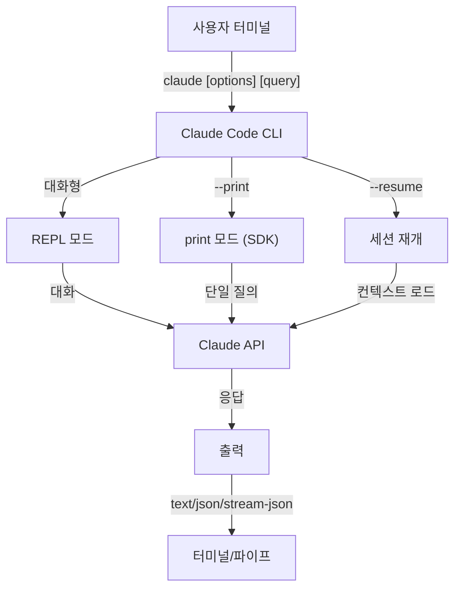
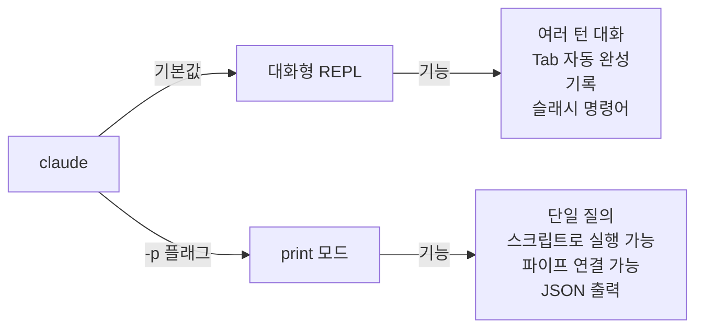

<picture>
  <source media="(prefers-color-scheme: dark)" srcset="../resources/logos/claude-howto-logo-dark.svg">
  
</picture>

# CLI 레퍼런스

## 개요

Claude Code CLI(명령줄 인터페이스)는 Claude Code를 사용하는 기본 방법입니다. 질의 실행, 세션 관리, 모델 설정, 그리고 Claude를 개발 워크플로우에 통합하는 강력한 옵션을 제공합니다.

## 아키텍처



## 런타임과 패키징

**v2.1.113**부터 Claude Code CLI는 선택적 npm 의존성을 통해 **플랫폼별 네이티브 바이너리**(macOS, Linux, Windows)를 실행합니다. 설치할 때 OS와 아키텍처에 맞는 바이너리가 선택되며, macOS와 Linux에서는 예전의 번들 JavaScript 런타임이 더 이상 기본값이 아닙니다.

**권장 설치 방법**은 네이티브 설치 프로그램입니다(`curl -fsSL https://claude.ai/install.sh | bash`, Windows에서는 `irm https://claude.ai/install.ps1 | iex`). 공식 README에서 npm 설치는 지원 중단되었으므로 네이티브 설치 프로그램, Homebrew(`brew install --cask claude-code`), WinGet(`winget install Anthropic.ClaudeCode`)을 쓰세요. 참고로 `npm install -g @anthropic-ai/claude-code`(Node.js 22+)도 플랫폼별 선택적 의존성을 통해 같은 네이티브 바이너리를 설치합니다.

**다운로드 호스트** (v2.1.116+): 네이티브 바이너리 아티팩트는 `https://downloads.claude.ai/claude-code-releases`에서 제공됩니다.

> **회사 / 프록시 사용자**: 네트워크에 명시적인 허용 목록이 필요하다면 프록시 송신 규칙에 `downloads.claude.ai`(와 `https://downloads.claude.ai/claude-code-releases`)를 추가하세요. 이전에 `storage.googleapis.com`이나 npm 레지스트리만 허용 목록에 넣었던 환경은 규칙을 갱신해야 합니다. 그렇지 않으면 `claude update`와 첫 설치가 실패합니다.

예전 JavaScript 번들은 Windows와 이 번들에 고정한 환경을 위해 여전히 만들어지며, 이렇게 설치한 경우에는 Glob과 Grep이 계속 독립된 기본 도구로 제공됩니다([도구](#도구와-권한-관리) 아래의 Glob/Grep 각주 참고).

## CLI 명령어

| 명령어 | 설명 | 예 |
|---------|-------------|---------|
| `claude` | 대화형 REPL 시작 | `claude` |
| `claude "query"` | 첫 프롬프트와 함께 REPL 시작 | `claude "이 프로젝트를 설명해 줘"` |
| `claude -p "query"` | print 모드 - 질의 후 종료 | `claude -p "이 함수를 설명해 줘"` |
| `cat file \| claude -p "query"` | 파이프로 받은 내용 처리 | `cat logs.txt \| claude -p "설명해 줘"` |
| `claude -c` | 가장 최근 대화 이어 가기 | `claude -c` |
| `claude -c -p "query"` | print 모드로 이어 가기 | `claude -c -p "타입 오류가 있는지 확인해 줘"` |
| `claude -r "<session>" "query"` | ID나 이름으로 세션 재개 | `claude -r "auth-refactor" "이 PR을 마무리해 줘"` |
| `claude update` | 최신 버전으로 업데이트 | `claude update` |
| `/doctor` (슬래시 명령어) | 설치, 설정, 플러그인 상태 진단. v2.1.116부터 **Claude가 응답하는 중에도** 열 수 있고, 상태 아이콘을 인라인으로 보여 주며, `f` 키를 누르면 발견된 문제를 자동으로 고칩니다. v2.1.178에서 레이아웃이 평평한 트리 형태로 바뀌어 상태 아이콘이 더 분명해지고 명령어가 강조 표시됩니다 | REPL 안에서 `/doctor` 실행 |
| `claude mcp` | MCP 서버 설정(인증용 `login`/`logout` 포함, v2.1.186+) | [MCP 문서](../05-mcp/) 참고 |
| `claude mcp serve` | Claude Code를 MCP 서버로 실행 | `claude mcp serve` |
| `claude agents` | **에이전트 뷰** 열기(연구 미리 보기, v2.1.139+) — 모든 Claude Code 세션과 상태를 나열하는 여러 세션 관리자. 아래 [에이전트 뷰](#에이전트-뷰-claude-agents-v21139) 참고. | `claude agents` |
| `claude auto-mode defaults` | 자동 모드 기본 규칙을 JSON으로 출력 | `claude auto-mode defaults` |
| `claude auto-mode reset` | 확인 질문을 거쳐 자동 모드 설정을 기본값으로 되돌림(`--yes`로 확인 건너뛰기)(v2.1.212) | `claude auto-mode reset --yes` |
| `claude remote-control` | Remote Control 서버 시작(서버 모드. 로컬 대화형 세션 없이 여러 세션을 처리하며, `--capacity` 기본값은 32) | `claude remote-control --name "내 프로젝트"` |
| `claude --remote-control [name]` | Remote Control을 켠 대화형 세션 시작(별칭 `--rc`) | `claude --rc` |
| `claude plugin` | 플러그인 관리(설치, 켜기, 끄기) | `claude plugin install my-plugin` |
| `claude plugin init <name>` | `~/.claude/skills/<name>/`(사용자 전역)에 새 플러그인의 뼈대를 만듭니다 — 다음 세션에서 `<name>@skills-dir`로 자동 로드되며 마켓플레이스가 필요 없습니다(v2.1.157+) | `claude plugin init my-plugin` |
| `claude plugin tag [path]` | `[path]`에 있는 플러그인에 `{name}--v{version}` 형식의 릴리스 git 태그를 만듭니다. 이때 `plugin.json`과 이를 감싸는 마켓플레이스 항목이 일치하는지 검증합니다(v2.1.118+) | `claude plugin tag ./my-plugin` |
| `claude install [version]` | 특정 네이티브 바이너리 버전 설치. `stable`, `latest`, 또는 명시적인 버전 문자열을 받습니다 | `claude install 2.1.131` |
| `claude purge [path]` | 프로젝트의 로컬 Claude Code 상태를 모두 삭제(대화 기록, 작업, 디버그 로그, 파일 편집 기록, 프롬프트 기록, `~/.claude.json` 항목). `[path]`를 생략하면 대화형 선택 창이 열립니다. 플래그: 미리 보기는 `--dry-run`, 확인을 건너뛰려면 `-y/--yes`, 항목마다 확인하려면 `-i/--interactive`, 모든 프로젝트는 `--all`(v2.1.126+) — v2.1.288에서 `claude project purge`에서 이름이 바뀌었으며, 예전 이름도 여전히 동작하고 안내 문구를 출력합니다 | `claude purge ~/work/repo --dry-run` |
| `claude plugin prune` | 고아가 된 자동 설치 플러그인 의존성 제거(부모 플러그인이 사라진 경우). `plugin uninstall --prune`도 대상을 제거한 뒤 같은 연쇄 정리를 합니다(v2.1.121+) | `claude plugin prune` |
| `claude ultrareview [target]` | `/ultrareview`를 비대화형으로 실행. 발견 사항을 stdout으로 출력하고, 성공하면 0, 실패하면 1로 종료합니다. 원본 페이로드는 `--json`, 기본 45분 제한을 바꾸려면 `--timeout <minutes>`(v2.1.260부터), 발견 사항을 PR에 다시 게시할지는 `--post` / `--no-post`로 정합니다. **Claude Code v2.1.227 이상 필요** | `claude ultrareview 1234 --json --no-post` |
| `claude self-hosted-runner [setup\|doctor\|orchestrator]` | Claude Code 클라우드 세션을 내 컴퓨터나 컨테이너에서 호스팅하는 러너를 시작합니다. `setup`은 운영자용 단계별 안내, `doctor`는 배포된 러너 진단, `orchestrator`는 필요할 때 러너를 띄웁니다(v2.1.299의 `--shutdown-drain-sec`을 쓰면 SIGTERM을 받았을 때 진행 중인 폴링과 실행 훅을 마무리합니다). **Team과 Enterprise 요금제 전용이며 Claude Code v2.1.224 이상이 필요합니다.** Windows에서는 시작할 때 `--base-dir`을 명시해야 합니다(v2.1.229) | `claude self-hosted-runner setup` |
| `claude auth login` | 로그인(`--email`, `--sso` 지원). v2.1.126부터는 브라우저 콜백이 localhost에 닿지 못할 때(WSL2, SSH, 컨테이너) 터미널에 붙여 넣은 OAuth 코드를 대신 받습니다 | `claude auth login --email user@example.com` |
| `claude auth logout` | 현재 계정에서 로그아웃 | `claude auth logout` |
| `claude auth status` | 인증 상태 확인(로그인되어 있으면 0, 아니면 1로 종료) | `claude auth status` |

## 핵심 플래그

| 플래그 | 설명 | 예 |
|------|-------------|---------|
| `-p, --print` | 대화형 모드 없이 응답 출력 | `claude -p "query"` |
| `-c, --continue` | 가장 최근 대화 불러오기 | `claude --continue` |
| `-r, --resume` | ID나 이름으로 특정 세션 재개 | `claude --resume auth-refactor` |
| `-v, --version` | 버전 번호 출력 | `claude -v` |
| `--system-prompt-snapshot off` | 대화와 함께 기록된 시스템 프롬프트를 재사용하지 않고 요청할 때마다 새로 렌더링합니다. 프롬프트 문구를 반복해서 다듬을 때 유용합니다(v2.1.257+) | `claude --system-prompt-snapshot off` |
| `-w, --worktree` | 격리된 git worktree에서 시작. v2.1.233부터 GitHub PR URL뿐 아니라 GitLab 병합 요청(MR) URL도 받습니다 | `claude -w` |
| `-n, --name` | 세션 표시 이름 | `claude -n "auth-refactor"` |
| `--from-pr <url-or-number>` | 풀/병합 요청에 연결된 세션 재개. v2.1.119부터 GitHub(클라우드 + Enterprise), GitLab MR, Bitbucket PR URL을 받습니다. 이전에는 GitHub.com만 지원 | `claude --from-pr 42` 또는 `claude --from-pr https://gitlab.example.com/org/repo/-/merge_requests/17` |
| `--cloud [description\|session_id\|url]` | 주어진 설명으로 claude.ai에 클라우드 세션을 만들거나, 세션 ID나 claude.ai/code URL로 기존 세션에 연결 | `claude --cloud "API를 구현해 줘"` |
| `--remote "task"` | **`--cloud`의 지원 중단된 별칭**(기존 세션에 연결하는 형식 포함). 대신 `--cloud`를 쓰세요 | `claude --remote "API를 구현해 줘"` |
| `--remote-control, --rc` | Remote Control을 켠 대화형 세션 | `claude --rc` |
| `--teleport [session]` | 웹 세션을 로컬에서 재개. 인수 없이 쓰면 웹 세션 선택 창이 열리고, 세션 ID를 넘기면 그 세션을 바로 재개합니다. claude.ai 구독 필요 | `claude --teleport` |
| `--teammate-mode` | 에이전트 팀 표시 모드 | `claude --teammate-mode tmux` |
| `--bare` | 최소 모드(훅, 스킬, 플러그인, MCP, 자동 메모리, CLAUDE.md 건너뜀) | `claude --bare` |
| `--safe-mode` | 설정 문제를 가려내기 위해 모든 사용자 지정(CLAUDE.md, 플러그인, 스킬, 훅, MCP)을 끈 채로 시작. `CLAUDE_CODE_SAFE_MODE=1`도 같음(v2.1.169) | `claude --safe-mode` |
| `--restricted` | 신뢰할 수 없거나 여럿이 함께 쓰는 환경을 위해 세션을 잠급니다. 명령어와 코드를 실행하는 기본 제공 도구와 WebFetch를 제거하고, 사용자/프로젝트/로컬 설정을 무시하며, 파일 도구를 작업 디렉토리로 제한하고, `bypassPermissions`와 클라우드 세션을 거부합니다. `CLAUDE_CODE_RESTRICTED=1`도 같음(v2.1.248+) | `claude --restricted -p "이 저장소를 요약해 줘"` |
| `--permission-mode auto` | 자동 권한 모드로 시작(v2.1.111에서 제거된 `--enable-auto-mode` 플래그를 대체) | `claude --permission-mode auto` |
| `--channels` | MCP 채널 플러그인 구독. 항목에는 `plugin:<name>@<marketplace>` 태그를 붙여야 하며, 이름만 쓰면 거부됩니다 | `claude --channels plugin:discord@my-marketplace` |
| `--chrome` / `--no-chrome` | Chrome 브라우저 통합 켜기/끄기 | `claude --chrome` |
| `--effort` | 사고 노력 수준 설정 | `claude --effort high` |
| `--desktop` | 현재 디렉토리에서 Claude 데스크톱 앱으로 세션 열기. 세션을 고르려면 `--continue`나 `--resume <id>`를 덧붙입니다(v2.1.285) | `claude --desktop --continue` |
| `--init` / `--init-only` | `--init`은 세션 전에 초기화(Setup) 훅을 실행하며 print 모드 전용입니다. `--init-only`는 Setup 훅과 `SessionStart` 훅을 실행한 뒤 종료합니다 | `claude -p --init "query"` |
| `--maintenance` | 세션 전에 유지 관리(Setup) 훅 실행(print 모드 전용) | `claude -p --maintenance "query"` |
| `--disable-slash-commands` | 모든 스킬과 슬래시 명령어 끄기 | `claude --disable-slash-commands` |
| `--no-session-persistence` | 세션 저장 끄기(print 모드) | `claude -p --no-session-persistence "query"` |
| `--exclude-dynamic-system-prompt-sections` | 프롬프트 캐시 적중률을 높이기 위해 시스템 프롬프트에서 동적 섹션 제외 | `claude -p --exclude-dynamic-system-prompt-sections "query"` |

### 제한 모드 (`--restricted`, v2.1.248+)

`--restricted`(또는 `CLAUDE_CODE_RESTRICTED=1`)는 입력을 내가 통제할 수 없는 누군가를 대신해 `claude`를 실행할 때 쓰는 모드입니다 — 공유 컴퓨터의 평가 하네스, 외부 기여자가 트리거한 CI 작업, 데모용 컴퓨터 같은 경우입니다. 다음을 모두 적용합니다.

- **명령어나 코드를 실행하는 도구를 제거합니다** — Bash, PowerShell, REPL, 그리고 WebFetch까지 제거하며, `--tools`에서 명시적으로 지정한 도구만 예외입니다.
- **사용자, 프로젝트, 로컬 설정 파일을 무시합니다.** 관리형 설정과 명시적인 `--settings` 파일은 계속 적용되므로, 관리자는 통제권을 유지하고 체크인된 `.claude/settings.json`은 샌드박스를 넓힐 수 없습니다.
- **파일 도구를 작업 디렉토리로 제한하므로**, 읽기와 쓰기가 시작한 경로 밖으로 나갈 수 없습니다.
- **`bypassPermissions`를 거부합니다**. 어떤 방식으로 요청하든 마찬가지입니다.
- **클라우드 세션 생성을 거부하므로**, 제한된 실행이 작업을 컴퓨터 밖으로 내보낼 수 없습니다.

```bash
# 평가 하네스: 셸 없음, 네트워크 가져오기 없음, 설정 상속 없음
claude --restricted -p "이 저장소의 아키텍처를 요약해 줘"

# 같은 잠금 상태에서 도구 하나만 의도적으로 다시 켜기
claude --restricted --tools WebFetch -p "링크된 RFC를 확인해 줘"
```

> **참고**: `--restricted`는 `--permission-mode`보다 거친 잠금입니다. 도구 사용을 묻는 대신 도구를 아예 제거하므로, 제한된 세션은 세션 안에서 넓힐 수 없습니다.

### 대화형 모드와 print 모드 비교



**대화형 모드** (기본값):
```bash
# 대화형 세션 시작
claude

# 첫 프롬프트와 함께 시작
claude "인증 흐름을 설명해 줘"
```

**print 모드** (비대화형):
```bash
# 단일 질의 후 종료
claude -p "이 함수는 무슨 일을 해?"

# 파일 내용 처리
cat error.log | claude -p "이 오류를 설명해 줘"

# 다른 도구와 연결
claude -p "TODO 목록을 보여 줘" | grep "URGENT"
```

## 모델과 설정

| 플래그 | 설명 | 예 |
|------|-------------|---------|
| `--model` | 모델 설정(sonnet, opus, haiku 또는 전체 이름) | `claude --model opus` |
| `--fallback-model` | 기본 모델이 과부하 상태이거나 사용할 수 없을 때 자동으로 대체 모델 사용. `fallbackModel` 설정으로 최대 세 개까지 지정할 수 있습니다. v2.1.166부터는 대화형 세션에도 적용됩니다(이전에는 print 모드 전용) | `claude -p --fallback-model sonnet "query"` |
| `--agent` | 세션에 쓸 에이전트 지정 | `claude --agent my-custom-agent` |
| `--agents` | JSON으로 사용자 지정 서브에이전트 정의 | [에이전트 설정](#에이전트-설정) 참고 |
| `--effort` | 노력 수준 설정(low, medium, high, xhigh, max) | `claude --effort xhigh` |

### 모델 선택 예

```bash
# 복잡한 작업에는 Opus 5.5 사용
claude --model opus "캐싱 전략을 설계해 줘"

# 빠른 작업에는 Haiku 사용(v2.1.293부터 Anthropic API에서는 Haiku 5.5, Bedrock·Vertex·Foundry에서는 Haiku 4.5)
claude --model haiku -p "이 JSON을 보기 좋게 정리해 줘"

# 전체 모델 이름
claude --model claude-sonnet-4-6 "이 코드를 리뷰해 줘"

# 안정성을 위해 대체 모델 지정
claude -p --model opus --fallback-model sonnet "아키텍처를 분석해 줘"

# opusplan 사용(Opus가 계획하고 Sonnet이 실행)
claude --model opusplan "캐싱 계층을 설계하고 구현해 줘"
```

> **게이트웨이 모델 탐색 (v2.1.129+, 옵트인)**: `ANTHROPIC_BASE_URL`이 Anthropic 호환 게이트웨이를 가리킬 때 `CLAUDE_CODE_ENABLE_GATEWAY_MODEL_DISCOVERY=1`을 설정하면 게이트웨이의 `/v1/models` 엔드포인트로 `/model` 목록을 채웁니다. 이 환경 변수가 없으면 `/model`은 기본 제공 고정 목록을 씁니다. 탐색 호출이 사용자에게 사용 권한이 없는 모델까지 보여 줄 수 있으므로 이 플래그는 직접 켜야 하는 옵트인 방식입니다(v2.1.129에서 변경). v2.1.126에서 암묵적으로 켜지게 바뀌었다가 그 동작이 되돌려졌습니다.

> **사용자 지정 기본 URL 뒤의 1M 컨텍스트 (v2.1.285)**: `ANTHROPIC_BASE_URL`이 사용자 지정 엔드포인트를 가리키는 세션도 이제 1M 컨텍스트 윈도우를 가진 모델(Opus 4.7+, Sonnet 5+, Fable)에서는 그 1M 창을 씁니다. 게이트웨이가 200K까지만 지원한다면 `/autocompact 200k`를 실행하세요.

> **서드파티 제공업체에서 기본 1M 컨텍스트 (v2.1.287)**: 이제 Amazon Bedrock, Google Vertex AI, Microsoft Foundry, Claude 앱 게이트웨이에서 Opus 4.7+와 Fable이 `[1m]` 접미사 없이도 기본으로 1M 컨텍스트 윈도우를 씁니다. 200K로 유지하려면 `CLAUDE_CODE_DISABLE_1M_CONTEXT=1`을 설정하세요.

> **조직 기본 모델 (v2.1.196)**: 조직 관리자가 기본 모델을 설정하면 `/model`에 "Org default"(조직 기본값) 또는 "Role default"(역할 기본값)로 표시됩니다.

## 시스템 프롬프트 사용자 지정

| 플래그 | 설명 | 예 |
|------|-------------|---------|
| `--system-prompt` | 기본 프롬프트 전체를 교체 | `claude --system-prompt "당신은 Python 전문가입니다"` |
| `--system-prompt-file` | 파일에서 프롬프트를 로드해 기본 프롬프트를 교체 | `claude -p --system-prompt-file ./prompt.txt "query"` |
| `--append-system-prompt` | 기본 프롬프트에 덧붙이기 | `claude --append-system-prompt "항상 TypeScript를 사용하세요"` |
| `--append-subagent-system-prompt` | 모든 서브에이전트의 시스템 프롬프트에 텍스트 덧붙이기(비대화형) | `claude -p --append-subagent-system-prompt "출처를 밝히세요" "query"` |
| `--append-subagent-system-prompt-file` | (v2.1.261) 덧붙일 텍스트를 대신 파일에서 로드합니다. 명령줄로 넘기기에 너무 긴 프롬프트용입니다. 비대화형 전용이며 `--append-subagent-system-prompt`와 **함께 쓸 수 없습니다** | `claude -p --append-subagent-system-prompt-file ./subagent-rules.txt "query"` |

### 시스템 프롬프트 예

```bash
# 페르소나를 통째로 지정
claude --system-prompt "당신은 시니어 보안 엔지니어입니다. 취약점에 집중하세요."

# 특정 지시 사항 덧붙이기
claude --append-system-prompt "코드 예제에는 항상 단위 테스트를 포함하세요"

# 복잡한 프롬프트를 파일에서 로드
claude -p --system-prompt-file ./prompts/code-reviewer.txt "main.py를 리뷰해 줘"
```

### 시스템 프롬프트 플래그 비교

| 플래그 | 동작 | 대화형 | print |
|------|----------|-------------|-------|
| `--system-prompt` | 기본 시스템 프롬프트 전체를 교체 | ✅ | ✅ |
| `--system-prompt-file` | 파일의 프롬프트로 교체 | ✅ | ✅ |
| `--append-system-prompt` | 기본 시스템 프롬프트에 덧붙임 | ✅ | ✅ |

**모든 시스템 프롬프트 플래그는 대화형 모드와 print 모드 모두에서 동작합니다(파일 형식은 v2.1.69부터). `--system-prompt`와 `--system-prompt-file`은 기본 프롬프트를 교체하고, 덧붙이기 플래그는 기본 프롬프트에 내용을 더합니다.**

## 도구와 권한 관리

| 플래그 | 설명 | 예 |
|------|-------------|---------|
| `--tools` | 쓸 수 있는 기본 제공 도구 제한 | `claude -p --tools "Bash,Edit,Read" "query"` |
| `--allowedTools` | 묻지 않고 실행되는 도구 | `"Bash(git log:*)" "Read"` |
| `--disallowedTools` | 컨텍스트에서 제거되는 도구 | `"Bash(rm:*)" "Edit"` |
| `--dangerously-skip-permissions` | 모든 권한 확인 건너뛰기 | `claude --dangerously-skip-permissions` |
| `--permission-mode` | 지정한 권한 모드로 시작 | `claude --permission-mode auto` |
| `--permission-prompt-tool` | 권한 처리에 쓸 MCP 도구 | `claude -p --permission-prompt-tool mcp_auth "query"` |
| `--permission-prompts` | (v2.1.259) print 모드에서 권한 확인에 누가 응답할지 정합니다. 기본값 `host`는 Agent SDK 호스트나 `--permission-prompt-tool` 도구로 보내며, 응답할 수 있는 사람이 없을 때 `none`을 넘기면 Claude Code가 대신 거부합니다 | `claude -p --permission-prompts none "query"` |

> **v2.1.111 업데이트**: `--enable-auto-mode`가 제거되었습니다. 이제 자동 모드는 기본적으로 `Shift+Tab` 순환에 들어 있으며, 처음부터 자동 모드로 시작하려면 `--permission-mode auto`를 쓰세요.

> **Glob / Grep 각주 (v2.1.113+)**: 네이티브 macOS/Linux 빌드에서는 `Glob`과 `Grep`이 별도의 기본 도구가 아니라, Bash 도구를 통해 호출되는 내장 `bfs`, `ugrep` 바이너리로 제공됩니다. Windows와 npm 번들(JS) 설치에서는 여전히 독립 도구로 노출됩니다. 서브에이전트의 `allowedTools` / `disallowedTools` 목록에서는 이 백엔드 교체가 드러나지 않으므로, 모든 플랫폼에서 설정에 계속 `Glob` / `Grep`이라고 쓰면 됩니다.

> **PowerShell 자동 승인 (v2.1.119)**: PowerShell 도구 명령어도 Bash 명령어와 똑같은 방식으로 권한 모드에서 자동 승인할 수 있습니다. PowerShell 권한의 범위를 정할 때는 `Bash(...)` 규칙에 이미 쓰고 있는 매처 문법을 그대로 쓰세요 — 예: `PowerShell(Get-ChildItem:*)`.

> **재개할 때도 `--permission-mode` 적용 (v2.1.132+)**: 이제 `claude -p --continue --permission-mode plan`(그리고 `--resume`)이 이 플래그를 따릅니다. 이전 버전은 세션을 재개할 때 `--permission-mode`를 아무 알림 없이 무시했기 때문에, 플래그를 다시 넘기지 않고 재개한 계획 모드 세션이 조용히 더 느슨한 모드로 바뀌었습니다 — 이 문제가 고쳐졌습니다.

> **권한 강화 (v2.1.214)**: 데몬 전환 플래그(예: `--url`, `--connection`, `--identity`)를 쓰는 Docker/Podman 명령어는 이제 자동으로 실행되지 않고 권한 확인을 거칩니다. `-m`/`--magic-file`이나 `-f`/`--files-from`을 쓰는 `file` 명령어도 이제 권한이 필요합니다. 10,000자가 넘는 Bash 명령어는 허용 규칙과 관계없이 항상 권한을 묻습니다.

### 권한 예

```bash
# 코드 리뷰용 읽기 전용 모드
claude --permission-mode plan "이 코드베이스를 리뷰해 줘"

# 안전한 도구만 쓰도록 제한
claude --tools "Read,Grep,Glob" -p "TODO 주석을 모두 찾아 줘"

# 특정 git 명령어는 묻지 않고 허용
claude --allowedTools "Bash(git status:*)" "Bash(git log:*)"

# 위험한 작업 차단
claude --disallowedTools "Bash(rm -rf:*)" "Bash(git push --force:*)"
```

> **매개변수 매칭 `Tool(param:value)` (v2.1.178)**: 권한 규칙은 `Tool`(모든 사용) 또는 `Tool(specifier)` 형식을 따릅니다. v2.1.178부터는 지정자가 명령어나 경로 패턴뿐 아니라 도구 입력의 **매개변수**에도 일치할 수 있습니다 — 와일드카드를 지원하는 `Tool(param:value)` 형식을 쓰면 됩니다. 이미 `Bash(...)` 명령어 접두사(예: `Bash(npm run test *)`)와 `Read(...)` 경로 glob(예: `Read(./.env.*)`)에 쓰던 매칭을 일반화한 것으로, 다른 도구도 인수로 범위를 정할 수 있게 됩니다. 정확한 매개변수 이름은 도구마다 다르므로, 규칙을 쓰기 전에 [권한 레퍼런스](https://code.claude.com/docs/ko/settings)에서 도구별 최신 예시 문자열을 확인하세요.

## 출력과 형식

| 플래그 | 설명 | 옵션 | 예 |
|------|-------------|---------|---------|
| `--output-format` | 출력 형식 지정(print 모드) | `text`, `json`, `stream-json` | `claude -p --output-format json "query"` |
| `--input-format` | 입력 형식 지정(print 모드) | `text`, `stream-json` | `claude -p --input-format stream-json` |
| `--verbose` | 자세한 로그 켜기 | | `claude --verbose` |
| `--include-partial-messages` | 스트리밍 이벤트 포함 | `stream-json` 필요 | `claude -p --output-format stream-json --include-partial-messages "query"` |
| `--forward-subagent-text` | 서브에이전트의 텍스트 출력을 스트림으로 전달. v2.1.219부터는 깊이 2 이상에서 생성된 서브에이전트의 출력도 그 서브에이전트를 생성한 `Agent` `tool_use` id를 키로 하여 전달됩니다(`CLAUDE_CODE_MAX_SUBAGENT_SPAWN_DEPTH`로 기본으로 켜지는 중첩을 이렇게 관찰할 수 있습니다) | `stream-json` 필요 | `claude -p --output-format stream-json --forward-subagent-text "query"` |
| `--json-schema` | 스키마에 맞게 검증된 JSON 받기 | | `claude -p --json-schema '{"type":"object"}' "query"` |
| `--max-budget-usd` | print 모드의 최대 지출 금액. v2.1.217부터는 한도에 도달하면 실행 중인 백그라운드 서브에이전트도 멈추고 새 서브에이전트 생성도 거부합니다(이전에는 한도를 넘어도 백그라운드 에이전트가 계속 실행됨) | | `claude -p --max-budget-usd 5.00 "query"` |

### 출력 형식 예

```bash
# 일반 텍스트(기본값)
claude -p "이 코드를 설명해 줘"

# 프로그램에서 쓰기 위한 JSON
claude -p --output-format json "main.py의 함수를 모두 나열해 줘"

# 실시간 처리를 위한 스트리밍 JSON
claude -p --output-format stream-json "긴 보고서를 만들어 줘"

# 스키마 검증을 거친 구조화된 출력
claude -p --json-schema '{"type":"object","properties":{"bugs":{"type":"array"}}}' \
  "이 코드에서 버그를 찾아 JSON으로 돌려줘"
```

## 작업 공간과 디렉토리

| 플래그 | 설명 | 예 |
|------|-------------|---------|
| `--add-dir` | 작업 디렉토리 추가 | `claude --add-dir ../apps ../lib` |
| `--setting-sources` | 쉼표로 구분한 설정 소스 | `claude --setting-sources user,project` |

> **`/config` 변경 사항 저장 (v2.1.119)**: `/config` 명령어로 대화형으로 바꾼 설정은 이제 `~/.claude/settings.json`에 기록되며 일반적인 우선순위 체계(정책 → 로컬 → 프로젝트 → 사용자)를 따릅니다. v2.1.119 이전에는 일부 `/config` 변경 사항이 현재 세션에만 적용되었습니다. 전체 우선순위는 [메모리와 설정](../02-memory/README.md)을 참고하세요.
| `--settings` | 파일이나 JSON에서 설정 로드. 파일은 2 MiB 이하여야 합니다(v2.1.214) | `claude --settings ./settings.json` |
| `--plugin-dir` | 디렉토리에서 플러그인 로드(여러 번 지정 가능). v2.1.265부터는 **플러그인 폴더**도 받습니다 — 매니페스트가 있는 하위 폴더는 모두 로드되며, 세션 실행 중에 추가되거나 제거된 하위 폴더도 반영됩니다 | `claude --plugin-dir ./my-plugin` |

### 여러 디렉토리 예

```bash
# 여러 프로젝트 디렉토리에 걸쳐 작업
claude --add-dir ../frontend ../backend ../shared "API 엔드포인트를 모두 찾아 줘"

# 사용자 지정 설정 로드
claude --settings '{"model":"opus","verbose":true}' "복잡한 작업"
```

## MCP 설정

| 플래그 | 설명 | 예 |
|------|-------------|---------|
| `--mcp-config` | JSON에서 MCP 서버 로드 | `claude --mcp-config ./mcp.json` |
| `--strict-mcp-config` | 지정한 MCP 설정만 사용 | `claude --strict-mcp-config --mcp-config ./mcp.json` |
| `--channels` | MCP 채널 플러그인 구독. 항목에는 `plugin:<name>@<marketplace>` 태그를 붙여야 하며, 이름만 쓰면 거부됩니다 | `claude --channels plugin:discord@my-marketplace` |

### MCP 예

```bash
# GitHub MCP 서버 로드
claude --mcp-config ./github-mcp.json "열려 있는 PR 목록을 보여 줘"

# 엄격 모드 - 지정한 서버만 사용
claude --strict-mcp-config --mcp-config ./production-mcp.json "스테이징에 배포해 줘"
```

## 세션 관리

| 플래그 | 설명 | 예 |
|------|-------------|---------|
| `--session-id` | 특정 세션 ID(UUID) 사용 | `claude --session-id "550e8400-..."` |
| `--fork-session` | 재개할 때 새 세션 만들기 | `claude --resume abc123 --fork-session` |

### 세션 예

```bash
# 마지막 대화 이어 가기
claude -c

# 이름 붙은 세션 재개
claude -r "feature-auth" "로그인 구현을 계속해 줘"

# 실험을 위해 세션 포크
claude --resume feature-auth --fork-session "다른 방식으로 시도해 줘"

# 특정 세션 ID 사용
claude --session-id "550e8400-e29b-41d4-a716-446655440000" "계속해 줘"
```

> **v2.1.299**: 종료할 때 출력되는 재개 명령어가 세션을 ID로 가리킵니다.

### 세션 포크

실험을 위해 기존 세션에서 분기를 만듭니다.

```bash
# 다른 방식을 시도하기 위해 세션 포크
claude --resume abc123 --fork-session "다른 구현을 시도해 줘"

# 사용자 지정 메시지와 함께 포크
claude -r "feature-auth" --fork-session "다른 아키텍처로 테스트해 줘"
```

**활용 사례:**
- 원래 세션을 잃지 않고 다른 구현 시도
- 여러 접근 방식을 병렬로 실험
- 성공한 작업에서 분기를 만들어 변형 시도
- 메인 세션에 영향을 주지 않고 호환성을 깨는 변경 테스트

원래 세션은 그대로 남고, 포크는 새로운 독립 세션이 됩니다.

### 프로젝트 상태 정리 (v2.1.126+)

`claude purge`는 프로젝트의 로컬 Claude Code 상태를 모두 삭제합니다 — 대화 기록, 작업 목록, 디버그 로그, 파일 편집 기록, 프롬프트 기록 줄, 그리고 `~/.claude.json`에 있는 그 프로젝트의 항목까지 지웁니다. v2.1.288 이전에는 `claude project purge`라는 이름이었으며, 이 이름도 여전히 동작하고 안내 문구를 출력합니다. 먼저 `--dry-run`으로 무엇이 삭제될지 미리 확인하세요. `--all`은 컴퓨터의 모든 프로젝트를 차례로 처리합니다.

```bash
# 삭제될 내용 미리 보기(안전)
claude purge ~/work/repo --dry-run

# 특정 프로젝트의 상태를 묻지 않고 삭제
claude purge ~/work/repo --yes

# 모든 프로젝트를 하나씩 확인하며 처리
claude purge --all --interactive
```

## 고급 기능

| 플래그 | 설명 | 예 |
|------|-------------|---------|
| `--chrome` | Chrome 브라우저 통합 켜기 | `claude --chrome` |
| `--no-chrome` | Chrome 브라우저 통합 끄기 | `claude --no-chrome` |
| `--ide` | 사용할 수 있으면 IDE에 자동 연결 | `claude --ide` |
| `--max-turns` | 에이전트 턴 수 제한(비대화형) | `claude -p --max-turns 3 "query"` |
| `--debug` | 필터를 지원하는 디버그 모드 켜기(필터는 `=` 형식에서만 적용) | `claude --debug=api,mcp` |
| `--enable-lsp-logging` | 자세한 LSP 로그 켜기 | `claude --enable-lsp-logging` |
| `--betas` | API 요청에 넣을 베타 헤더 | `claude --betas interleaved-thinking` |
| `--plugin-dir` | 디렉토리에서 플러그인 로드(여러 번 지정 가능). v2.1.265부터는 **플러그인 폴더**도 받습니다 — 매니페스트가 있는 하위 폴더는 모두 로드되며, 세션 실행 중에 추가되거나 제거된 하위 폴더도 반영됩니다 | `claude --plugin-dir ./my-plugin` |
| `--effort` | 사고 노력 수준 설정 | `claude --effort high` |
| `--bare` | 최소 모드(훅, 스킬, 플러그인, MCP, 자동 메모리, CLAUDE.md 건너뜀) | `claude --bare` |
| `--channels` | MCP 채널 플러그인 구독(`plugin:<name>@<marketplace>` 태그 필요) | `claude --channels plugin:discord@my-marketplace` |
| `--tmux` | worktree용 tmux 세션 만들기(`--worktree` 필요) | `claude --worktree feature-x --tmux` |
| `--fork-session` | 재개할 때 새 세션 ID 만들기 | `claude --resume abc --fork-session` |
| `--max-budget-usd` | 최대 지출 금액(print 모드). 한도에 도달하면 백그라운드 서브에이전트도 멈춤(v2.1.217) | `claude -p --max-budget-usd 5.00 "query"` |
| `--json-schema` | 검증된 JSON 출력 | `claude -p --json-schema '{"type":"object"}' "q"` |
| `--ax-screen-reader` | 화면 낭독기를 위한 일반 텍스트 렌더링 모드(v2.1.208) | `claude --ax-screen-reader` |

### 플랫폼과 테마 참고 사항 (v2.1.112)

- **Windows의 PowerShell 도구**: Windows에 전용 PowerShell 도구가 순차적으로 배포되고 있으며 환경 변수로 제어할 수 있습니다.
- **Auto (match terminal) 테마**: 새 "Auto (match terminal)"(자동, 터미널에 맞춤) 테마는 Claude Code의 라이트/다크 모양을 터미널에 맞춥니다.
- **덜 번거로운 권한 확인**: 읽기 전용 `Bash` 호출과 `Glob` 패턴은 더 이상 권한 확인을 띄우지 않습니다.

### 고급 예

```bash
# 자율적으로 진행하는 턴 수 제한
claude -p --max-turns 5 "이 모듈을 리팩토링해 줘"

# API 호출 디버그
claude --debug=api "테스트 질의"

# IDE 통합 켜기
claude --ide "이 파일 작업을 도와줘"
```

## 에이전트 설정

`--agents` 플래그는 세션에서 쓸 사용자 지정 서브에이전트를 정의하는 JSON 객체를 받습니다.

**v2.1.243**부터 `--agents`는 잘못된 JSON이나 잘못된 에이전트 정의를 조용히 무시하지 않고, `--mcp-config`가 이미 그랬던 것처럼 명확한 오류와 함께 종료합니다.

### 에이전트 JSON 형식

```json
{
  "agent-name": {
    "description": "필수: 이 에이전트를 언제 호출할지",
    "prompt": "필수: 에이전트의 시스템 프롬프트",
    "tools": ["선택", "도구", "이름", "배열"],
    "model": "선택: sonnet|opus|haiku"
  }
}
```

**필수 필드:**
- `description` - 이 에이전트를 언제 쓸지 설명하는 자연어 문장
- `prompt` - 에이전트의 역할과 동작을 정의하는 시스템 프롬프트

**선택 필드:**
- `tools` - 쓸 수 있는 도구 배열(생략하면 모든 도구를 상속)
  - 형식: `["Read", "Grep", "Glob", "Bash"]`
- `model` - 사용할 모델: `sonnet`, `opus`, `haiku`

### 전체 에이전트 예

```json
{
  "code-reviewer": {
    "description": "코드 리뷰 전문가. 코드를 변경한 뒤 적극적으로(proactively) 사용.",
    "prompt": "당신은 시니어 코드 리뷰어입니다. 코드 품질, 보안, 모범 사례에 집중하세요.",
    "tools": ["Read", "Grep", "Glob", "Bash"],
    "model": "sonnet"
  },
  "debugger": {
    "description": "오류와 테스트 실패를 다루는 디버깅 전문가.",
    "prompt": "당신은 디버깅 전문가입니다. 오류를 분석하고 근본 원인을 찾아 해결책을 제시하세요.",
    "tools": ["Read", "Edit", "Bash", "Grep"],
    "model": "opus"
  },
  "documenter": {
    "description": "가이드를 만드는 문서화 전문가.",
    "prompt": "당신은 테크니컬 라이터입니다. 명확하고 빠짐없는 문서를 작성하세요.",
    "tools": ["Read", "Write"],
    "model": "haiku"
  }
}
```

### 에이전트 명령어 예

```bash
# 사용자 지정 에이전트를 인라인으로 정의
claude --agents '{
  "security-auditor": {
    "description": "취약점 분석을 맡는 보안 전문가",
    "prompt": "당신은 보안 전문가입니다. 취약점을 찾아 수정 방법을 제안하세요.",
    "tools": ["Read", "Grep", "Glob"],
    "model": "opus"
  }
}' "이 코드베이스의 보안 문제를 감사해 줘"

# 파일에서 에이전트 로드
claude --agents "$(cat ~/.claude/agents.json)" "auth 모듈을 리뷰해 줘"

# 다른 플래그와 함께 사용
claude -p --agents "$(cat agents.json)" --model sonnet "성능을 분석해 줘"
```

### 에이전트 우선순위

에이전트 정의가 여러 개 있으면 다음 우선순위로 로드됩니다.
1. **CLI 정의** (`--agents` 플래그) - 세션 전용
2. **프로젝트 수준** (`.claude/agents/`) - 현재 프로젝트
3. **사용자 수준** (`~/.claude/agents/`) - 모든 프로젝트

CLI에서 정의한 에이전트는 그 세션 동안 프로젝트 에이전트와 사용자 에이전트를 모두 재정의합니다. 이름이 겹치면 프로젝트 수준 에이전트가 사용자 수준 에이전트를 재정의합니다. 플러그인 수준 에이전트까지 포함한 전체 우선순위 표는 [레슨 04 — 서브에이전트](../04-subagents/README.md#파일-위치)를 참고하세요.

### 에이전트 뷰 (`claude agents`, v2.1.139+)

> **연구 미리 보기** — 일상적으로 쓸 만큼 안정적이지만 바뀔 수 있습니다.

`claude agents`는 **에이전트 뷰**를 엽니다 — 컴퓨터에 있는 모든 Claude Code 세션을 현재 상태(`running`, `blocked on you`, `done`)와 함께 한 목록으로 보여 줍니다. 백그라운드 에이전트, 예약 작업, `--bg`로 시작한 세션을 실행할 때 여러 터미널 탭을 오가던 일을 대신합니다.

```bash
# 에이전트 뷰 열기
claude agents
```

에이전트 뷰에서(또는 `claude --bg <prompt>`로) 세션을 띄울 때는 `claude` 자체에 넘기는 것과 같은 설정 플래그를 넘길 수 있습니다. 에이전트 뷰에서 세션을 띄우는 경로에 추가된 플래그는 다음과 같습니다.

| 플래그 | 도입 버전 | 설명 |
|------|-------|-------------|
| `--cwd <path>` | v2.1.141 | 세션 목록(또는 새 세션)의 범위를 특정 작업 디렉토리로 한정 |
| `--add-dir <path>` | v2.1.142 | 띄운 세션의 작업 공간에 디렉토리 추가 |
| `--settings <path>` | v2.1.142 | 띄운 세션에 특정 `settings.json` 사용 |
| `--mcp-config <path>` | v2.1.142 | 띄운 세션에 특정 MCP 설정 사용 |
| `--plugin-dir <path>` | v2.1.142 | 띄운 세션에 특정 플러그인 디렉토리 사용 |
| `--permission-mode <mode>` | v2.1.142 | 띄운 세션의 권한 모드 설정(`plan`, `acceptEdits`, `auto` 등) |
| `--model <model>` | v2.1.142 | 띄운 세션의 모델 고정 |
| `--effort <level>` | v2.1.142 | 노력 수준 고정(`low`/`medium`/`high`/`xhigh`/`max`) |
| `--dangerously-skip-permissions` | v2.1.142 | 띄운 세션을 권한 확인 없이 실행(샌드박스에서만 사용) |
| `--json` | v2.1.145 | 스크립트에서 쓸 수 있도록 에이전트 목록을 기계가 읽을 수 있는 JSON으로 출력(상태 표시줄, 세션 선택기, tmux-resurrect 연동 등) |

작업은 끝났지만 백그라운드 셸이 열려 있는 세션은 "Working"에서 "Completed"로 옮겨집니다(v2.1.141 수정). 연결된 에이전트 세션 안에서는 `Shift+Tab`으로 자동 모드를 포함한 권한 모드를 순환합니다(v2.1.143).

**GitLab 병합 요청 (v2.1.233)** — 에이전트 뷰는 GitHub PR URL뿐 아니라 GitLab MR URL도 인식하며, 병합 요청을 `!N`으로 표시합니다(GitHub 풀 요청은 그대로 `#N`). 같은 릴리스에서 `--worktree`도 GitLab MR URL을 받게 되었습니다.

**세션 고정** — `claude agents`에서 세션을 고르고 `Ctrl+T`를 누르면 고정됩니다(v2.1.147). 고정된 백그라운드 세션은 유휴 상태에서도 계속 살아 있고, Claude Code 업데이트를 적용할 때 그 자리에서 다시 시작되며, 메모리가 부족할 때는 고정되지 않은 세션이 먼저 정리된 뒤에야 정리됩니다. (이 `Ctrl+T`는 에이전트 뷰에서만 해당하며, 메인 세션에서는 작업 목록 보기를 켜고 끕니다.)

**새 세션의 기본값 (v2.1.299)** — 에이전트 뷰에서 `/effort`와 `/fast`는 새 세션이 시작할 때의 값을 정합니다. 인수 없이 `/model`, `/effort`, `/fast`를 입력하면 선택 창이 열립니다.

---

## 활용도 높은 사례

### 1. CI/CD 통합

CI/CD 파이프라인에서 Claude Code로 코드 리뷰, 테스트, 문서화를 자동화하세요.

**GitHub Actions 예:**

```yaml
name: AI Code Review

on: [pull_request]

jobs:
  review:
    runs-on: ubuntu-latest
    steps:
      - uses: actions/checkout@v4

      - name: Install Claude Code
        run: npm install -g @anthropic-ai/claude-code

      - name: Run Code Review
        env:
          ANTHROPIC_API_KEY: ${{ secrets.ANTHROPIC_API_KEY }}
        run: |
          claude -p --output-format json \
            --max-turns 1 \
            "이 PR의 변경 사항에서 다음을 리뷰해 줘:
            - 보안 취약점
            - 성능 문제
            - 코드 품질
            결과는 'issues' 배열을 담은 JSON으로 출력해 줘" > review.json

      - name: Post Review Comment
        uses: actions/github-script@v7
        with:
          script: |
            const fs = require('fs');
            const review = JSON.parse(fs.readFileSync('review.json', 'utf8'));
            // 리뷰 코멘트를 가공해 게시
```

**Jenkins 파이프라인:**

```groovy
pipeline {
    agent any
    stages {
        stage('AI Review') {
            steps {
                sh '''
                    claude -p --output-format json \
                      --max-turns 3 \
                      "테스트 커버리지를 분석하고 빠진 테스트를 제안해 줘" \
                      > coverage-analysis.json
                '''
            }
        }
    }
}
```

**헤드리스 `ultrareview` (v2.1.227+ 필요):**

```yaml
# .github/workflows/ultrareview.yml
- name: Claude ultrareview
  run: claude ultrareview ${{ github.event.pull_request.number }} --json --no-post > review.json
```

`claude ultrareview`는 리뷰에서 문제가 없으면 0, 발견 사항이 보고되면 1로 종료하므로 그대로 PR 게이트로 쓸 수 있습니다. 기본 45분 제한을 바꾸려면 `--timeout <minutes>`를 쓰세요(v2.1.260부터). `--post`는 완료된 발견 사항을 풀 요청에 게시하고, `--no-post`는 stdout에만 남깁니다 — 이후 CI 단계에서 보고서를 직접 포맷할 때 원하는 동작입니다.

### 2. 스크립트 파이핑

파일, 로그, 데이터를 Claude로 보내 분석합니다.

**로그 분석:**

```bash
# 오류 로그 분석
tail -1000 /var/log/app/error.log | claude -p "이 오류들을 요약하고 해결 방법을 제안해 줘"

# 접근 로그에서 패턴 찾기
cat access.log | claude -p "의심스러운 접근 패턴을 찾아 줘"

# git 기록 분석
git log --oneline -50 | claude -p "최근 개발 활동을 요약해 줘"
```

**코드 처리:**

```bash
# 특정 파일 리뷰
cat src/auth.ts | claude -p "이 인증 코드에 보안 문제가 있는지 리뷰해 줘"

# 문서 생성
cat src/api/*.ts | claude -p "마크다운으로 API 문서를 만들어 줘"

# TODO를 찾아 우선순위 정하기
grep -r "TODO" src/ | claude -p "이 TODO들을 중요도 순으로 정리해 줘"
```

### 3. 여러 세션 워크플로우

여러 대화 스레드로 복잡한 프로젝트를 관리합니다.

```bash
# 기능 브랜치 세션 시작
claude -r "feature-auth" "사용자 인증을 구현하자"

# 나중에 세션 이어 가기
claude -r "feature-auth" "비밀번호 재설정 기능을 추가해 줘"

# 다른 방식을 시도하기 위해 포크
claude --resume feature-auth --fork-session "대신 OAuth를 시도해 줘"

# 다른 기능 세션으로 전환
claude -r "feature-payments" "Stripe 통합을 계속 진행해 줘"
```

### 4. 사용자 지정 에이전트 설정

팀 워크플로우에 맞는 전문 에이전트를 정의합니다.

```bash
# 에이전트 설정을 파일로 저장
cat > ~/.claude/agents.json << 'EOF'
{
  "reviewer": {
    "description": "PR 리뷰를 맡는 코드 리뷰어",
    "prompt": "코드의 품질, 보안, 유지 보수성을 리뷰하세요.",
    "model": "opus"
  },
  "documenter": {
    "description": "문서화 전문가",
    "prompt": "명확하고 빠짐없는 문서를 작성하세요.",
    "model": "sonnet"
  },
  "refactorer": {
    "description": "코드 리팩토링 전문가",
    "prompt": "깔끔한 코드를 위한 리팩토링을 제안하고 구현하세요.",
    "tools": ["Read", "Edit", "Glob"]
  }
}
EOF

# 세션에서 에이전트 사용
claude --agents "$(cat ~/.claude/agents.json)" "auth 모듈을 리뷰해 줘"
```

### 5. 일괄 처리

일관된 설정으로 여러 질의를 처리합니다.

```bash
# 여러 파일 처리
for file in src/*.ts; do
  echo "Processing $file..."
  claude -p --model haiku "이 파일을 요약해 줘: $(cat $file)" >> summaries.md
done

# 일괄 코드 리뷰
find src -name "*.py" -exec sh -c '
  echo "## $1" >> review.md
  cat "$1" | claude -p "간단히 코드 리뷰를 해 줘" >> review.md
' _ {} \;

# 모든 모듈의 테스트 생성
for module in $(ls src/modules/); do
  claude -p "src/modules/${module}의 단위 테스트를 만들어 줘" > "tests/$module.test.ts"
done
```

### 6. 보안을 고려한 개발

권한 제어로 안전하게 운영합니다.

```bash
# 읽기 전용 보안 감사
claude --permission-mode plan \
  --tools "Read,Grep,Glob" \
  "이 코드베이스의 보안 취약점을 감사해 줘"

# 위험한 명령어 차단
claude --disallowedTools "Bash(rm:*)" "Bash(curl:*)" "Bash(wget:*)" \
  "이 프로젝트 정리를 도와줘"

# 제한된 자동화
claude -p --max-turns 2 \
  --allowedTools "Read" "Glob" \
  "하드코딩된 자격 증명을 모두 찾아 줘"
```

### 7. JSON API 통합

`jq` 파싱과 함께 Claude를 도구에서 호출할 수 있는 프로그래밍 가능한 API로 씁니다.

```bash
# 구조화된 분석 받기
claude -p --output-format json \
  --json-schema '{"type":"object","properties":{"functions":{"type":"array"},"complexity":{"type":"string"}}}' \
  "main.py를 분석해서 함수 목록과 복잡도 등급을 돌려줘"

# jq와 연동해 처리(스키마 출력은 .structured_output에 들어감)
claude -p --output-format json \
  --json-schema '{"type":"object","properties":{"endpoints":{"type":"array"}}}' \
  "API 엔드포인트를 모두 나열해 줘" | jq '.structured_output.endpoints[]'

# 스크립트에서 사용
RESULT=$(claude -p --output-format json \
  --json-schema '{"type":"object","properties":{"secure":{"type":"boolean"},"issues":{"type":"array"}},"required":["secure","issues"]}' \
  "이 코드는 안전해?" < code.py)
if echo "$RESULT" | jq -e '.structured_output.secure == false' > /dev/null; then
  echo "Security issues found!"
  echo "$RESULT" | jq '.structured_output.issues[]'
fi
```

### jq 파싱 예

`jq`로 Claude의 JSON 출력을 파싱하고 처리합니다. 응답 텍스트는 `.result`에 있고, `--json-schema`를 쓰면 검증된 객체는 `.structured_output`에 있습니다(아래 `$SCHEMA`는 각 필터가 읽는 필드를 정의한 스키마를 뜻합니다).

```bash
# 응답 텍스트 추출
claude -p --output-format json "이 코드를 분석해 줘" | jq -r '.result'

# 배열 요소 필터링
claude -p --output-format json --json-schema "$SCHEMA" "문제 목록을 보여 줘" | jq -r '.structured_output.issues[] | select(.severity=="high")'

# 여러 필드 추출
claude -p --output-format json --json-schema "$SCHEMA" "프로젝트를 설명해 줘" | jq -r '.structured_output | {name, version, description}'

# CSV로 변환
claude -p --output-format json --json-schema "$SCHEMA" "함수 목록을 보여 줘" | jq -r '.structured_output.functions[] | [.name, .lineCount] | @csv'

# 조건부 처리
claude -p --output-format json --json-schema "$SCHEMA" "보안을 점검해 줘" | jq 'if (.structured_output.vulnerabilities | length) > 0 then "UNSAFE" else "SAFE" end'

# 중첩된 값 추출
claude -p --output-format json --json-schema "$SCHEMA" "성능을 분석해 줘" | jq '.structured_output.metrics.cpu.usage'

# 배열 전체 처리
claude -p --output-format json --json-schema "$SCHEMA" "TODO를 찾아 줘" | jq '.structured_output.todos | length'

# 출력 변환
claude -p --output-format json --json-schema "$SCHEMA" "개선할 점을 나열해 줘" | jq '.structured_output.improvements | map({title: .title, priority: .priority})'
```

---

## 모델

Claude Code는 성능이 서로 다른 여러 모델을 지원합니다.

| 모델 | ID | 컨텍스트 윈도우 | 참고 |
|-------|-----|----------------|-------|
| Opus 5.5 | `claude-opus-5-5` | 1M 토큰 | v2.1.280부터 Pro, Max, Team, Enterprise, Anthropic API, AWS의 Claude Platform, Amazon Bedrock, Google Cloud의 Agent Platform에서 기본 모델이자 기본 Opus 모델(이전에 Pro와 Team Standard의 기본값은 Sonnet 5). Microsoft Foundry에서는 여전히 `opus`가 Opus 4.6으로, `default`가 Sonnet 4.5로 연결됩니다. 적응형 노력 수준 `low → max`, 기본 노력 수준 `medium`. 사고를 끌 수 없습니다. v2.1.280+ 필요 |
| Sonnet 5.5 | `claude-sonnet-5-5` | 1M 토큰 | v2.1.284부터 Anthropic API의 기본 Sonnet 모델(그곳에서는 `sonnet` 별칭이 이 모델로 연결됨). 적응형 노력 수준 `low → max`, 기본 노력 수준 `medium`. 사고를 끌 수 없고, 빠른 모드에서는 쓸 수 없습니다. v2.1.284+ 필요 |
| Haiku 5.5 | `claude-haiku-5-5` | 1M 토큰 | v2.1.293부터 Anthropic API의 기본 Haiku 모델(그곳에서는 `haiku` 별칭이 이 모델로 연결됨. Bedrock, Vertex, Foundry, AWS의 Claude Platform에서는 여전히 `haiku`가 Haiku 4.5로 연결됨). 적응형 노력 수준 `low → max`, 기본 노력 수준 `medium`. 사고를 끌 수 없습니다. v2.1.293+ 필요 |
| Sonnet 5 | `claude-sonnet-5` | 1M 토큰 | v2.1.197부터 v2.1.280까지 Pro / Team Standard 좌석의 기본값(v2.1.280에서 이 요금제들은 Opus 5.5로 바뀜). 네이티브 1M 토큰 컨텍스트 윈도우 |
| Opus 5 | `claude-opus-5` | 1M 토큰 | v2.1.219부터 v2.1.280까지 기본 Opus 모델(지금은 Opus 5.5). 여전히 선택 가능. 적응형 노력 수준 `low → max`, 기본 노력 수준 `high` |
| Opus 4.8 | `claude-opus-4-8` | 1M 토큰 | 이전 플래그십 Opus로 여전히 선택 가능. 적응형 노력 수준 `low → max`, 기본 노력 수준 `high`(v2.1.154) |
| Sonnet 4.6 | `claude-sonnet-4-6` | 1M 토큰 | 속도와 성능의 균형. v2.1.117에서 Pro/Max 구독자의 기본 노력 수준이 `medium`에서 `high`로 올라감 |
| Haiku 4.5 | `claude-haiku-4-5` | 200K 토큰 | 이전 Haiku. Bedrock, Vertex, Foundry, AWS의 Claude Platform에서는 여전히 `haiku` 별칭이 이 모델을 가리킴. 노력 수준 없음 |
| Fable 5.1 | `claude-fable-5-1` | — | 현재 Fable 모델. `fable` 별칭이 이 모델로 연결됨(v2.1.257) |
| Fable 5 | `claude-fable-5` | — | 일반 사용에 안전하도록 만든 Mythos급 모델(v2.1.170) |

> **참고**: Claude API, AWS의 Claude Platform, Microsoft Foundry에서 Sonnet 4.5는 2026년 11월 30일에 지원이 종료됩니다. `default`와 `sonnet`이 여전히 Sonnet 4.5로 연결되는 Foundry에서는 더 새로운 모델을 명시적으로 설정하세요.

### 모델 선택

```bash
# 짧은 이름 사용
claude --model opus "복잡한 아키텍처를 리뷰해 줘"
claude --model sonnet "이 기능을 구현해 줘"
claude --model haiku -p "이 JSON을 보기 좋게 정리해 줘"

# opusplan 별칭 사용(Opus가 계획하고 Sonnet이 실행)
claude --model opusplan "API를 설계하고 구현해 줘"

# 세션 중에 빠른 모드 켜고 끄기
/fast
```

> **Fable 5.1과 `fable` 별칭 (v2.1.257)**: Fable 5.1(`claude-fable-5-1`)은 **v2.1.257**에 포함되었으며, 이제 `fable` 별칭은 Fable 5가 아니라 이 모델로 연결됩니다. 공식 model-config 페이지에는 Fable 5.1에 "Claude Code v2.1.255 이상이 필요하다"고 나와 있지만 2.1.255는 공개된 적이 없으므로, 실제로 설치해서 쓸 수 있는 첫 릴리스는 v2.1.257입니다. Claude 앱 게이트웨이에서는 `fable`과 `best`가 여전히 **Fable 5**로 연결되므로, 그곳에서는 `/model`에서 5.1을 직접 고르세요. 조직에서 최신 Fable 모델을 쓸 수 없으면 `fable`과 `best`는 이전 Fable 모델로 한 번 재시도합니다(v2.1.301).

> **빠른 모드는 Opus 5.5, Opus 5, Opus 4.8에서 실행 (v2.1.280)**: v2.1.219부터 `/fast`는 **Opus 5와 Opus 4.8**에 적용되며, Opus 4.7은 빠른 모드에서 빠졌습니다. Opus 5의 빠른 모드 요금은 Mtok당 $10/$50입니다. 빠른 모드는 v2.1.154에서 처음 Opus 4.8로 옮겨졌고(표준 요금의 약 2배로 출력 속도는 약 2.5배), 그 전에는 v2.1.142에서 Opus 4.6에서 Opus 4.7로 바뀌었습니다. `CLAUDE_CODE_OPUS_4_6_FAST_MODE_OVERRIDE` 환경 변수는 **v2.1.154에서 지원 중단되고 2026-06-01에 제거되었습니다**. Opus 4.6에서는 더 이상 빠른 모드를 쓸 수 없으니 Opus 5나 Opus 4.8을 고르세요. **v2.1.280부터 빠른 모드의 기본 모델은 Opus 5.5입니다**(Mtok당 $8/$40). Opus 5와 Opus 4.8은 $10/$50으로 계속 지원됩니다.

### 노력 수준 (Opus 5 / Sonnet 5 / Opus 4.8 / Opus 4.7)

Opus 5, Sonnet 5, Opus 4.8, Opus 4.7은 노력 수준을 갖춘 적응형 추론을 지원하며, 가벼운 것부터 무거운 순서로 `low`(○), `medium`(◐), `high`(●), `xhigh`, `max`가 있습니다. Opus 5.5, Sonnet 5.5, Haiku 5.5도 다섯 수준을 모두 지원합니다. **기본값**은 Opus 5.5(v2.1.280부터 기본 모델), Sonnet 5.5, Haiku 5.5에서 `medium`, Opus 5, Sonnet 5, Opus 4.8(v2.1.154부터), Opus 4.6, Sonnet 4.6에서 `high`, Opus 4.7에서 `xhigh`입니다. `xhigh`는 Opus 5.5, Sonnet 5.5, Haiku 5.5, Opus 5, Sonnet 5, Opus 4.8, Opus 4.7에서 쓸 수 있고, `max`는 Opus 5.5, Sonnet 5.5, Haiku 5.5, Opus 5, Sonnet 5, Opus 4.8/4.7/4.6, Sonnet 4.6에서 동작합니다(세션 한정). Haiku 4.5에는 노력 수준이 없습니다. Opus 4.6 / Sonnet 4.6에서는 v2.1.117에서 Pro/Max 구독자의 기본 노력 수준이 `medium`에서 `high`로 올라갔습니다.

```bash
# CLI 플래그로 노력 수준 설정
claude --effort high "복잡한 리뷰"

# 슬래시 명령어로 노력 수준 설정
/effort high

# 환경 변수로 노력 수준 설정
export CLAUDE_CODE_EFFORT_LEVEL=high   # low, medium, high, xhigh(Opus 5.5, Sonnet 5.5, Haiku 5.5, Opus 5, Sonnet 5, Opus 4.8/4.7), max 중 하나 — Opus 5의 기본값은 high
```

프롬프트에 "ultrathink"라는 키워드를 넣으면 깊은 추론이 켜집니다. `/effort` 슬라이더에는 **Ultracode** 토글(Tab 또는 `/effort ultracode [on|off]`)도 있는데, 이는 모델의 노력 수준이 **아닙니다** — 세션이 어떤 노력 수준으로 실행되든 Claude가 동적 워크플로우를 조율하게 합니다. v2.1.284부터는 더 이상 `xhigh`를 강제하지 않으며 수준을 바꿔도 켜진 채로 유지됩니다. `--effort ultracode`와 Agent SDK의 `effortLevel: "ultracode"`는 여전히 `xhigh`로 설정합니다.

---

## 주요 환경 변수

| 변수 | 설명 |
|----------|-------------|
| `ANTHROPIC_API_KEY` | 인증용 API 키 |
| `ANTHROPIC_MODEL` | 기본 모델 재정의 |
| `ANTHROPIC_DEFAULT_MODEL` | (v2.1.236) 새 세션이 시작할 때 쓰는 모델을 정합니다. 모델을 고정하는 `ANTHROPIC_MODEL`과 달리, `/model`로 고른 모델이 여전히 이 값보다 우선하며 **재시작 후에도 유지됩니다** — 이 차이가 이 변수의 핵심입니다. |
| `ANTHROPIC_CUSTOM_MODEL_OPTION` | API용 사용자 지정 모델 옵션 |
| `ANTHROPIC_DEFAULT_OPUS_MODEL` | 기본 Opus 모델 ID 재정의 |
| `ANTHROPIC_DEFAULT_SONNET_MODEL` | 기본 Sonnet 모델 ID 재정의 |
| `ANTHROPIC_DEFAULT_HAIKU_MODEL` | 기본 Haiku 모델 ID 재정의 |
| `MAX_THINKING_TOKENS` | 확장 사고 토큰 예산 설정 |
| `CLAUDE_CODE_EFFORT_LEVEL` | 노력 수준 설정(`low`/`medium`/`high`/`xhigh`/`max`) — 기본값은 Opus 5.5, Sonnet 5.5, Haiku 5.5에서 `medium`, Opus 5, Sonnet 5, Opus 4.8에서 `high`(Opus 4.7에서는 `xhigh`). `xhigh`에는 Opus 5.5, Sonnet 5.5, Haiku 5.5, Opus 5, Sonnet 5, Opus 4.8/4.7이 필요하고, `max`는 Opus 5.5, Sonnet 5.5, Haiku 5.5, Opus 5, Sonnet 5, Opus 4.8/4.7/4.6, Sonnet 4.6에서 동작합니다 |
| `CLAUDE_CODE_SIMPLE` | 최소 모드. `--bare` 플래그가 설정함 |
| `CLAUDE_CODE_SAFE_MODE` | `1`로 설정하면 모든 사용자 지정(CLAUDE.md, 플러그인, 스킬, 훅, MCP)을 끈 채로 시작 — 설정 문제를 가려내기 위한 `--safe-mode`의 환경 변수 형식(v2.1.169) |
| `CLAUDE_CODE_DISABLE_BUNDLED_SKILLS` | `1`로 설정하면 번들로 제공되는 스킬, 워크플로우, 명령어를 모델에게 숨김(v2.1.169) |
| `CLAUDE_CODE_DISABLE_AUTO_MEMORY` | `1`로 설정하면 자동 메모리를 끔(자동 메모리 파일을 만들거나 로드하지 않음) |
| `CLAUDE_CODE_DISABLE_BACKGROUND_TASKS` | 백그라운드 작업 실행 끄기 |
| `CLAUDE_CODE_DISABLE_CRON` | 예약/cron 작업 끄기 |
| `CLAUDE_CODE_DISABLE_GIT_INSTRUCTIONS` | git 관련 지시 사항 끄기 |
| `CLAUDE_CODE_DISABLE_TERMINAL_TITLE` | 터미널 제목 업데이트 끄기 |
| `CLAUDE_CODE_DISABLE_1M_CONTEXT` | 1M 토큰 컨텍스트 윈도우 끄기 |
| `CLAUDE_CODE_DISABLE_MOUSE_CLICKS` | 전체 화면 모드에서 마우스 클릭/드래그/호버 끄기. 휠 스크롤은 계속 동작(v2.1.195+) |
| `CLAUDE_CODE_DISABLE_NONSTREAMING_FALLBACK` | 비스트리밍 대체 요청 끄기 |
| `CLAUDE_CODE_ENABLE_TASKS` | 기본은 작업(Task) 도구. `0`으로 설정하면 예전 `TodoWrite` 도구로 되돌림 |
| `CLAUDE_CODE_TASK_LIST_ID` | 여러 세션이 공유하는 이름 붙은 작업 디렉토리 |
| `CLAUDE_CODE_ENABLE_PROMPT_SUGGESTION` | 프롬프트 제안 켜기/끄기(`true`/`false`) |
| `CLAUDE_CODE_EXPERIMENTAL_AGENT_TEAMS` | 실험적 기능인 에이전트 팀 켜기 |
| `CLAUDE_CODE_NEW_INIT` | 새 초기화 흐름 사용 |
| `CLAUDE_CODE_SUBAGENT_MODEL` | 서브에이전트 실행에 쓸 모델 |
| `CLAUDE_CODE_PLUGIN_SEED_DIR` | 플러그인 시드 파일 디렉토리 |
| `CLAUDE_CODE_SUBPROCESS_ENV_SCRUB` | 하위 프로세스에서 지울 환경 변수 |
| `CLAUDE_AUTOCOMPACT_PCT_OVERRIDE` | 자동 컴팩션 비율 재정의 |
| `CLAUDE_STREAM_IDLE_TIMEOUT_MS` | 스트림 유휴 타임아웃(밀리초) |
| `SLASH_COMMAND_TOOL_CHAR_BUDGET` | 슬래시 명령어 도구의 글자 수 예산 |
| `ENABLE_TOOL_SEARCH` | 도구 검색 기능 켜기 |
| `MAX_MCP_OUTPUT_TOKENS` | MCP 도구 출력의 최대 토큰 수 |
| `CLAUDE_CODE_PERFORCE_MODE` | `1`로 설정하면 Perforce 모드를 켭니다 — 파일을 기본적으로 읽기 전용으로 취급합니다(Perforce/P4 버전 관리 워크플로우용)(v2.1.98에서 추가) |
| `DISABLE_UPDATES` | 수동 `claude update`를 포함한 모든 업데이트 경로를 막습니다. 백그라운드 자동 업데이트만 막는 `DISABLE_AUTOUPDATER`보다 엄격합니다(v2.1.118+) |
| `CLAUDE_CODE_HIDE_CWD` | `1`로 설정하면 시작 로고에서 현재 작업 디렉토리를 숨깁니다(개인 정보 보호 / 화면 공유용)(v2.1.119+) |
| `CLAUDE_CODE_FORK_SUBAGENT` | `0`으로 설정하면 포크 서브에이전트를 끕니다. v2.1.302부터 터미널, `claude -p`, Agent SDK, 데스크톱 앱, VS Code에서 기본으로 켜져 있습니다. v2.1.302 이전에는 `claude -p`와 Agent SDK에서 켜려면 `1`로 설정했습니다. |
| `CLAUDE_CODE_DISABLE_ALTERNATE_SCREEN` | `1`로 설정하면 전체 화면용 대체 화면(alternate screen) 렌더러를 쓰지 않고, 세션이 일반 터미널 스크롤백에 머뭅니다. 대화 기록을 로그로 파이프하거나 `script(1)`과 함께 쓸 때 유용합니다(v2.1.132+). |
| `CLAUDE_CODE_SESSION_ID` | Claude Code가 실행하는 모든 Bash 도구 하위 프로세스에 설정되며, 훅 입력 JSON의 `session_id`와 같습니다. bash 로그를 훅 텔레메트리와 연결할 때 쓰세요(v2.1.132+). |
| `CLAUDE_CODE_ENABLE_FEEDBACK_SURVEY_FOR_OTEL` | `1`로 설정하면 OpenTelemetry 데이터를 수집하는 조직에서 Anthropic의 세션 품질 설문을 다시 켭니다. OTEL 배포에서는 기본으로 꺼져 있습니다(v2.1.136+). |
| `OTEL_LOG_TOOL_DETAILS` | `1`로 설정하면 OpenTelemetry 이벤트에서 사용자 지정 명령어와 MCP 명령어 이름을 가리지 않습니다(v2.1.117+). 기본값은 여전히 가림 처리입니다. `tool_decision` 이벤트에 `classifier_category`도 추가합니다(v2.1.301). |
| `CLAUDE_CODE_OTEL_CONTENT_MAX_LENGTH` | OpenTelemetry 콘텐츠 속성에 적용하는 잘라내기 한도 설정(기본값 60 KB)(v2.1.214) |
| `FORCE_HYPERLINK` | `0`으로 설정하면 하단의 클릭할 수 있는 PR 배지 하이퍼링크를 끕니다. 이 링크는 이제 터미널 지원 여부를 자동으로 감지하지 못해도 렌더링됩니다(v2.1.217) |
| `ANTHROPIC_BEDROCK_SERVICE_TIER` | Bedrock 서비스 등급 선택: `default`, `flex`, `priority`(v2.1.122+) |
| `AI_AGENT` | 하위 프로세스에 자동으로 설정되어, 외부 CLI(예: `gh`)가 트래픽을 Claude Code에서 온 것으로 식별할 수 있게 합니다(v2.1.120+) |
| `CLAUDE_CODE_FORCE_SYNC_OUTPUT` | `1`로 설정하면 자동 감지가 놓치는 터미널(예: Emacs `eat`)에서 동기 출력을 강제합니다(v2.1.129+) |
| `CLAUDE_CODE_PACKAGE_MANAGER_AUTO_UPDATE` | `1`로 설정하면 (보통 자동 업데이트되지 않는) Homebrew/WinGet 설치에서 백그라운드 업그레이드를 켭니다(v2.1.129+) |
| `CLAUDE_CODE_ENABLE_GATEWAY_MODEL_DISCOVERY` | `1`로 설정하면 `ANTHROPIC_BASE_URL`이 설정되어 있을 때 게이트웨이 `/v1/models` 탐색을 사용합니다. 설정하지 않으면 `/model`은 기본 제공 고정 목록을 보여 줍니다(v2.1.129+) |
| `CLAUDE_CODE_DISABLE_STRUCTURED_OUTPUTS` | `1`로 설정하면 구조화된 출력용 `output_config.format` 필드와 짝을 이루는 `anthropic-beta` 값을 보내지 않습니다. 업스트림이 이를 거부하는 LLM 게이트웨이용입니다. `CLAUDE_CODE_DISABLE_EXPERIMENTAL_BETAS`가 끄는 다른 출시 전 기능은 그대로 켜 둡니다(v2.1.288) |
| `CLAUDE_CODE_ENABLE_AUTO_MODE` | Bedrock, Vertex, Foundry에서 자동 모드를 켜던 예전 옵트인 변수(v2.1.158–v2.1.206). v2.1.207부터 이 제공업체들의 Sonnet 5, Opus 4.7/4.8, Fable 5에서는 자동 모드를 기본으로 쓸 수 있습니다(Opus 5는 v2.1.219에서 추가). 이 변수는 호환성을 위해 받아들이지만 아무 효과가 없습니다 |
| `CLAUDE_CODE_MAX_WEB_SEARCHES_PER_SESSION` | 검색이 끝없이 반복되는 것을 막기 위한 세션당 WebSearch 도구 호출 상한. 기본값 200(v2.1.212). v2.1.290부터는 대화형 세션에서 예산이 시간이 지나면 다시 채워집니다 — `CLAUDE_CODE_WEB_SEARCH_REFILLS_PER_HOUR` 참고 |
| `CLAUDE_CODE_WEB_SEARCH_REFILLS_PER_HOUR` | 세션의 WebSearch 예산이 다시 채워지는 속도(시간당 호출 수). 대화형 세션의 기본값은 `100`, 비대화형(`-p`) 세션에서는 `0`(다시 채우지 않음). 숫자만 쓸 수 있습니다(v2.1.290) |
| `CLAUDE_CODE_MAX_CONCURRENT_SUBAGENTS` | 동시에 실행되는 서브에이전트 수의 상한. 기본값 20(v2.1.217) |
| `CLAUDE_CODE_MAX_SUBAGENT_SPAWN_DEPTH` | 서브에이전트를 얼마나 깊이 중첩해서 생성할 수 있는지 정합니다. v2.1.219부터 기본값은 **3단계**입니다(이전에는 1). 중첩을 완전히 끄려면 `1`로 설정하세요 |
| `CLAUDE_CODE_MCP_AUTO_BACKGROUND_MS` | 오래 걸리는 MCP 도구 호출이 자동으로 백그라운드로 넘어가기까지의 기준 시간(밀리초). 기본값 120000(2분)(v2.1.212) |
| `CLAUDE_AX_SCREEN_READER` | `1`로 설정하면 일반 텍스트 화면 낭독기 렌더링 모드를 켭니다. `--ax-screen-reader`나 설정의 `"axScreenReader": true`와 같은 효과(v2.1.208) |
| `CLAUDE_CLIENT_PRESENCE_FILE` | 마커 파일을 가리키게 하면 컴퓨터 앞에 있는 동안에는 모바일 푸시 알림을 보내지 않습니다(v2.1.181+). 참고: 이름은 `CLAUDE_CODE_CLIENT_PRESENCE_FILE`이 아니라 `CLAUDE_CLIENT_PRESENCE_FILE`입니다. |
| `CLAUDE_CODE_MAX_RETRIES` | API 재시도 최대 횟수. v2.1.186부터 최대 15로 제한됩니다. |
| `CLAUDE_CODE_RETRY_WATCHDOG` | 무인 세션에 권장되는 재시도 제어. `CLAUDE_CODE_MAX_RETRIES`를 높이는 대신 씁니다(v2.1.186+). |
| `CLAUDE_CODE_RETRY_WATCHDOG_MAX_WAIT_MS` | `CLAUDE_CODE_RETRY_WATCHDOG`가 설정되어 있을 때 API 요청 하나가 `429`와 `529` 오류를 기다리며 보낼 수 있는 최대 시간(밀리초). 이 시간을 다 쓰면 그다음 같은 오류에서 요청이 끝납니다. 숫자만으로 쓴 양의 정수(예: 30분은 `1800000`)이며, 설정하지 않으면 제한이 없습니다(v2.1.295) |
| `CLAUDE_CODE_RETRY_WATCHDOG_MAX_USAGE_LIMIT_WAIT_MS` | 무인 재시도 모드(`CLAUDE_CODE_RETRY_WATCHDOG`)가 기다려 주는 사용 한도 초기화의 최대 시간. 이보다 늦게 초기화되는 한도에 걸린 요청은 기다리지 않고 끝납니다(v2.1.301) |
| `CLAUDE_CODE_OVERLOADED_RETRY_BASE_DELAY_MS` | `529` 과부하 오류로 거부된 요청을 자동 재시도할 때 쓰는 지수 백오프의 시작 지연 시간(밀리초)으로, 기본값 500 대신 씁니다. 500부터 32000까지의 정수를 숫자로만 쓰며, `CLAUDE_CODE_RETRY_WATCHDOG=1`이거나 빠른 모드에서는 효과가 없습니다(v2.1.292) |
| `CLAUDE_ENABLE_STREAM_WATCHDOG` | 스트리밍 유휴 감시(스트림 이벤트가 5분 동안 없으면 중단하거나 재시도)는 모든 제공업체에서 기본으로 켜져 있습니다. 끄려면 `0`으로 설정하세요(v2.1.196). |
| `CLAUDE_CODE_MCP_TOOL_IDLE_TIMEOUT` | 응답 없이 멈춘 원격 MCP 도구 호출을 5분 동안 유휴 상태이면 중단하는 기본 동작을 재정의합니다(v2.1.187+). |
| `CLAUDE_CODE_OPUS_4_6_FAST_MODE_OVERRIDE` | **제거됨(v2.1.160부터 아무 동작도 하지 않음).** 예전에는 빠른 모드(`/fast`)를 Opus 4.6에 고정했습니다. `/fast`는 **Opus 5.5(v2.1.280부터 기본값), Opus 5, Opus 4.8**에만 적용되며, Opus 4.6과 Opus 4.7은 더 이상 빠른 모드 대상이 아닙니다. |
| `CLAUDE_CODE_MCP_STARTUP_WAIT_MS` | 첫 비대화형 턴이 아직 연결 중인 MCP 서버를 기다리는 최대 시간을 정합니다. 기다리지 않으려면 `0`으로 설정합니다(v2.1.274). 단, v2.1.284부터는 `--allowedTools`나 `mcp_tool` 훅이 지정한 서버는 첫 턴에서 여전히 최대 2초를 기다립니다 |
| `MCP_PROTOCOL_NEGOTIATION` | v2 MCP 클라이언트 런타임에서만, Claude Code가 서버에 MCP 프로토콜 리비전 2026-07-28 지원 여부를 확인할지 정합니다. `auto`는 HTTP, claude.ai 커넥터, stdio 서버를 확인하고, `legacy`는 아무것도 확인하지 않습니다. 다른 값은 디버그 로그에 경고를 남기고 무시됩니다(v2.1.221) |
| `CLAUDE_CODE_DISABLE_WEB_FETCH` | WebFetch 도구 끄기(v2.1.285) |
| `CLAUDE_CODE_NONSTREAMING_TIMEOUT_RETRIES` | 시간 초과된 비스트리밍 대체 요청을 다시 보내는 횟수의 상한(v2.1.285) |
| `CLAUDE_CODE_WEBFETCH_DEADLINE_MS` | v2.1.268에서 도입된 WebFetch의 300초 마감 시간을 재정의. `0`이면 마감 시간 없음(v2.1.268) |
| `CLAUDE_CODE_WORKFLOW_MAX_CONCURRENT_AGENTS` | Workflow 도구의 실행당 동시 에이전트 한도를 높입니다. 1–256 사이 값(v2.1.269) |
| `CLAUDE_CODE_AUTO_MODE_SERVER` | `0`으로 설정하면 서버 측 검토 대신 Claude Code 자체의 자동 모드 분류기 요청을 씁니다 — Bedrock, Vertex, Foundry, 게이트웨이에서는 v2.1.278부터, Anthropic API 직접 연결에서는 v2.1.281부터 적용됩니다(직접 연결에서는 이때 로컬 분류기가 사용량에 포함되며, `1`로 설정하면 옵트인됩니다) |
| `CLAUDE_CODE_AUTO_MODE_MODEL` | 클라이언트 측 자동 모드 분류기가 쓰는 모델. 서버 측 자동 모드의 모델은 바꾸지 않습니다(v2.1.302) |
| `CLAUDE_CODE_DISABLE_DANGEROUS_RM_TIMEOUT` | `1`로 설정하면 `--dangerously-skip-permissions`와 자동 모드에서 위험한 `rm` 확인 창에 걸린 2분 타임아웃을 끕니다. 이 타임아웃이 켜져 있으면 무인 세션이 계속 진행되도록 명령어를 고쳐 쓰라는 힌트와 함께 명령어를 거부합니다(v2.1.281) |
| `CLAUDE_CODE_DISABLE_FILE_MENTIONS` | `1`로 설정하면 파일과 디렉토리의 `@` 멘션을 펼치지 않습니다. Claude는 멘션된 경로와 함께 파일 도구로 읽으라는 메모를 받습니다. 프로젝트 설정과 로컬 설정에서는 무시됩니다(v2.1.299) |
| `CLAUDE_CODE_IDLE_COMPACT_MIN_TOKENS` | 유휴 컴팩션이 적용되는 컨텍스트 크기(토큰)(기본값 `200000`, `100000`보다 작은 값은 `100000`으로 올라감). 유휴 컴팩션은 `"idleCompaction": false`로 끄거나 `/config`의 `Idle compaction` 행에서 끌 수 있습니다(v2.1.302). v2.1.299에서 추가되었으며 v2.1.290+ 필요 |
| `CLAUDE_CODE_GZIP_REQUEST_BODIES` | `0`으로 설정하면 `api.anthropic.com`으로 보내는 큰 API, 텔레메트리, 아티팩트 게시 요청 본문의 gzip 압축을 끕니다. 프록시 뒤에 있거나, 클라이언트 인증서를 쓰거나, `NODE_EXTRA_CA_CERTS`를 쓰면 압축은 자동으로 건너뜁니다. Claude Code가 감지하지 못하는 TLS 검사 프록시가 압축된 요청을 제대로 처리하지 못하면 `0`을 쓰세요. v2.1.300부터는 텔레메트리가 꺼져 있어도 압축이 적용됩니다(v2.1.300) |
| `CLAUDE_CODE_ARTIFACT_PUBLISH_EDITS` | `0`으로 설정하면 Claude가 아티팩트를 게시하면서 그 파일에 작은 변경을 함께 적용하지 않습니다. 대신 파일 도구로 파일을 편집한 뒤 별도 단계로 게시합니다(v2.1.300) |
| `CLAUDE_CODE_ENABLE_TODO_TOOLS` | `1`로 설정하면 할 일/작업 추적 도구(`TaskCreate`/`Get`/`Update`/`List`, `TodoWrite`)를 되살립니다. 이 도구들은 Claude 3.x 모델, Opus 4부터 4.7까지, Sonnet 4부터 4.6까지, Haiku 4.5에서만 기본으로 제공됩니다(v2.1.268) |
| `CLAUDE_CODE_WEBFETCH_CACHE_TTL_MS` | WebFetch가 가져온 URL을 캐시하는 시간. 기본값 15분(v2.1.233) |
| `CLAUDE_CODE_TOOL_MEMORY_LIMIT` | Linux 전용: Bash 명령어에 메모리 cgroup을 적용하도록 옵트인(v2.1.233) |
| `ANTHROPIC_BEDROCK_REGION_PREFIX` | 특정 Bedrock 교차 리전 추론 프로필을 우선 사용(v2.1.224) |
| `CLAUDE_CODE_DISABLE_UNKNOWN_MODEL_WINDOW_ENFORCEMENT` | `1`로 설정하면 인식되지 않는 모델 ID에 대해 v2.1.223 이전의 자동 컴팩션 동작으로 되돌립니다(v2.1.223) |
| `CLAUDE_CODE_WORKFLOW_PREFIX_STAGGER_MS` | `0`으로 설정하면 동적 워크플로우 팬아웃에서 프리픽스 시차 실행을 끕니다(v2.1.229) |
| `CLAUDE_CODE_USER_DIALOG_TIMEOUT_MS` | `dialogExpiry` 설정을 재정의(v2.1.224) |
| `CLAUDE_CODE_PROJECT_DIR_NAME` | Claude Code가 프로젝트 경로에서 만들어 내는 프로젝트별 대화 기록 디렉토리 이름을 재정의(v2.1.234) |

> **이 여덟 행은 변경 로그 기반입니다.** CLI 레퍼런스 페이지에는 환경 변수 전용
> 섹션이 없으므로, 레퍼런스 페이지가 아니라 v2.1.221–v2.1.234 변경 로그 항목을
> 바탕으로 문서화했습니다.

> **`CLAUDE_CODE_DISABLE_1M_CONTEXT` 적용 범위 확대 (v2.1.223)**: 이제 이 변수는 정해진 모델 ID 목록만이 아니라 1M 토큰 창을 기본으로 갖춘 **모든** Claude 모델을 자동 컴팩션으로 200K까지로 묶어 둡니다.

> **Vertex AI에서의 `ENABLE_TOOL_SEARCH` (v2.1.119+)**: **Google Cloud Vertex AI 배포에서는 도구 검색이 기본으로 꺼져 있습니다**. Vertex에서 도구 검색 기능을 쓰려면 `export ENABLE_TOOL_SEARCH=true`로 명시적으로 켜야 합니다. Anthropic API를 직접 쓸 때는 여전히 기본으로 켜져 있습니다.

> **프로젝트 설정의 OpenTelemetry 변수 (v2.1.282)**: 프로젝트 설정과 로컬 설정은 내보내기를 켜거나, 내보낼 엔드포인트를 정하거나, 콘텐츠를 수집하는 OpenTelemetry 변수(예: `CLAUDE_CODE_ENABLE_TELEMETRY`, `OTEL_LOG_*`)를 무시합니다.

---

## settings.json 키

이 키들은 플래그나 환경 변수로 넘기지 않고 `settings.json` 파일(사용자 범위는 `~/.claude/settings.json`, 프로젝트 범위는 `.claude/settings.json`)에 둡니다. 아래 표는 최근 추가된 UI/UX 키 몇 가지를 다룹니다. 관리형 `enforceAvailableModels` 키는 [고급 기능 → 관리형 설정](../09-advanced-features/README.md#사용할-수-있는-관리형-설정)을 참고하세요.

| 키 | 설명 |
|-----|-------------|
| `respondToBashCommands` | (v2.1.186) `!` bash 명령어의 출력에 자동으로 응답합니다. 기본값 `true`. 출력을 컨텍스트로만 쓰는 (v2.1.186 이전) 동작을 원하면 `false`로 설정하세요. [고급 기능 → Bash 모드](../09-advanced-features/README.md#bash-모드) 참고. |
| `wheelScrollAccelerationEnabled` | (v2.1.174) `false`로 설정하면 전체 화면 렌더러에서 마우스 휠 스크롤 가속을 끕니다. 휠을 빠르게 굴렸을 때 너무 많이 스크롤되는 경우에 유용합니다. |
| `footerLinksRegexes` | (v2.1.176) 일치하는 링크를 하단 행에 배지로 렌더링할 정규식 배열. 사용자 설정이나 관리형 설정에서 지정할 수 있습니다. |
| `language` | Claude가 응답할 때 쓰는 선호 언어와 음성 받아쓰기 언어를 정합니다(예: `"french"`, `"japanese"`). **v2.1.176**부터는 자동으로 만들어지는 세션 제목의 언어도 고정합니다. |
| `sandbox.filesystem.disabled` | (v2.1.216) 네트워크 송신 제어는 유지한 채 파일 시스템 샌드박싱을 건너뜁니다. 파일 샌드박싱 때문에 도구가 동작하지 않지만 네트워크 정책은 계속 적용해야 하는 워크플로우용입니다. |
| `emojiCompletionEnabled` | (v2.1.217) 프롬프트 입력에서 이모지 단축 코드 자동 완성을 켭니다(예: `:heart:`를 입력하면 ❤️가 들어감). 끄려면 `false`로 설정하세요. |
| `workflowSizeGuideline` | (v2.1.219) 어떤 설정 파일에서든 권고용 동적 워크플로우 규모 가이드라인을 정합니다. 이 가이드라인은 Claude가 목표로 삼는 지침일 뿐 강제 상한이 아닙니다 — 기본값은 중간 규모(에이전트 10개 미만 목표)이고 Pro 요금제로 로그인한 경우에는 소규모이며(v2.1.271+), 다른 규모나 제한 없음을 고를 수 있습니다. 이 키가 설정되어 있는 동안에는 `/config`에서 "Dynamic workflow size" 행이 숨겨집니다. 강제되는 동시 실행 한도인 `CLAUDE_CODE_MAX_CONCURRENT_SUBAGENTS`와는 다릅니다. |
| `spellcheck` | (v2.1.235) `PATH`에 있는 `aspell`, `hunspell`, `ispell` 중 하나를 이 순서대로 찾아 프롬프트 입력의 맞춤법 오류에 밑줄을 긋습니다. 값은 객체 형식 — `{"enabled": true, "language": "en_GB"}` — 이며 기본값은 꺼짐입니다. **사용자 설정, `--settings` 플래그, 관리형 설정에서만 읽습니다**: 프로젝트의 `.claude/settings.json`이나 `.claude/settings.local.json`에 있는 `spellcheck` 블록은 무시됩니다. [고급 기능 → 사용자별 추가 설정](../09-advanced-features/README.md#사용자별-추가-설정)도 참고하세요. |
| `modelPicker` | (v2.1.243) `/model` 선택 창에 표시할 모델을 원하는 순서와 이름표로 고릅니다. 설정 계층 사이에서 **병합되지 않고 대체되는** 몇 안 되는 설정 중 하나입니다. |
| `promptCacheTtl` | (v2.1.243) 메인 대화의 프롬프트 캐시 수명을 고릅니다. |
| `subagentPromptCacheTtl` | (v2.1.243) 서브에이전트와 메인 대화 밖의 다른 요청에 대해 같은 선택을 합니다. |
| `modelPricing` | (v2.1.243) **관리형 설정.** 조직의 계약 요금을 지정해 `/cost`, 상태 표시줄, 텔레메트리가 정가 대신 그 요금으로 보고하게 합니다. |
| `availableModelsMatch` | (v2.1.283) **관리형 설정.** `"exact"`로 설정하면 `availableModels` 항목은 그 항목이 가리키는 모델 버전만 허용하므로, 새 릴리스는 목록에 추가될 때까지 계속 차단됩니다. |
| `deniedModels` | (v2.1.283) **관리형 설정.** `availableModels`가 허용하더라도 특정 모델을 차단합니다. |
| `keybindingFlavor` | **v2.1.261부터 지원 중단되었으며 아무 효과가 없습니다.** 프롬프트의 단어 편집 키는 Bash처럼 항상 readline 규칙을 따릅니다. `Ctrl+W`는 공백까지 뒤로 지우고, `Alt+F`와 `Alt+D`는 단어 끝에서 멈추며, 문장 부호는 단어를 나눕니다. Claude Code는 여전히 이 키를 받아들이므로, 이 키를 설정한 설정 파일도 그대로 유효합니다. (v2.1.238–v2.1.260에서는 `"classic"`과 `"readline"` 중에서 골랐습니다.) |
| `bashOutputMaxChars` | (v2.1.261) **성공한** Bash나 PowerShell 명령어의 출력 중 Claude가 인라인으로 받는 글자 수(최대 128K). 한도를 넘으면 Claude Code가 출력을 파일에 저장하고, Claude는 짧은 미리 보기와 파일 경로를 받습니다. 이 값을 설정하면 Claude Code는 `BASH_MAX_OUTPUT_LENGTH`를 무시합니다. |
| `taskOutputMaxChars` | (v2.1.261) **v2.1.278에서 대체되었으며 아무 효과가 없습니다.** 예전에는 `TaskOutput` 도구로 **백그라운드 작업**의 출력을 읽을 때 Claude가 인라인으로 받는 글자 수를 제한했습니다. v2.1.278에서 `TaskOutput` 도구가 제거되었으므로(이제 Claude는 `Read`로 백그라운드 작업의 출력 파일을 읽습니다) 이 키와 `TASK_MAX_OUTPUT_LENGTH` 모두 효과가 없습니다. Claude Code는 여전히 이 키를 받아들이므로, 이 키를 설정한 설정 파일도 그대로 유효합니다. |
| `maxEffortLevel` | (v2.1.267) Bedrock, Vertex, Foundry를 포함한 모든 제공업체에서 Claude Code가 쓸 수 있는 노력 수준의 상한을 정합니다. 최상위에 설정하거나 `modelSettings` 아래에 모델별로 설정합니다. 사용자는 여전히 더 낮은 수준을 고를 수 있습니다. |
| `bashEditDiffEnabled` | (v2.1.269) Bash 도구 결과에 명령어가 변경한 파일의 diff를 포함합니다. |
| `syncClaudeAiSkills` / `syncClaudeAiPlugins` | (v2.1.275) 둘 중 하나를 `false`로 설정하면 claude.ai 계정에서 켠 스킬이나 플러그인을 터미널 세션으로 동기화하지 않습니다. |
| `attribution` | (v2.1.281) `"attribution": false`로 설정하면 커밋과 PR의 모든 저작자 표시를 숨깁니다. 이전 CLI 버전은 이 값이 들어 있는 설정 파일을 건너뛰므로, 여러 버전이 함께 쓰는 파일에서는 객체 형식을 유지하세요. |
| `maxProseWidth` | (v2.1.282) 넓은 터미널에서 Claude가 쓰는 산문의 너비를 제한합니다. 표와 코드 블록은 전체 너비를 그대로 씁니다. |
| `idleCompaction` | (v2.1.290) 자리를 비운 긴 대화를 프롬프트 캐시가 만료되기 직전에 컴팩션해, 다음 메시지에서 대화 전체 대신 요약을 보내게 합니다. 1시간 캐시 TTL을 쓰는 대화형 세션에서 컨텍스트가 200K 토큰(`CLAUDE_CODE_IDLE_COMPACT_MIN_TOKENS`)에 이르고 약 54분이 지나면 기본으로 동작합니다. 끄려면 `false`로 설정하거나 `/config`의 `Idle compaction` 행에서 끄세요(v2.1.302). `DISABLE_AUTO_COMPACT`도 이 기능을 끕니다. |

```json
{
  "wheelScrollAccelerationEnabled": false,
  "language": "french",
  "footerLinksRegexes": ["https://jira\\.example\\.com/.*"]
}
```

> **역주**: Claude가 기본으로 한국어로 응답하게 하려면 `"language": "korean"`으로 설정하세요.

---

## 빠른 참조

### 가장 많이 쓰는 명령어

```bash
# 대화형 세션
claude

# 빠른 질문
claude -p "어떻게 하면..."

# 대화 이어 가기
claude -c

# 파일 처리
cat file.py | claude -p "이걸 리뷰해 줘"

# 스크립트용 JSON 출력
claude -p --output-format json "query"
```

### 플래그 조합

| 활용 사례 | 명령어 |
|----------|---------|
| 빠른 코드 리뷰 | `cat file \| claude -p "리뷰해 줘"` |
| 구조화된 출력 | `claude -p --output-format json "query"` |
| 안전한 탐색 | `claude --permission-mode plan` |
| 안전장치를 갖춘 자율 실행 | `claude --permission-mode auto` |
| CI/CD 통합 | `claude -p --max-turns 3 --output-format json` |
| 작업 재개 | `claude -r "session-name"` |
| 사용자 지정 모델 | `claude --model opus "복잡한 작업"` |
| 최소 모드 | `claude --bare "간단한 질의"` |
| 예산 상한을 둔 실행 | `claude -p --max-budget-usd 2.00 "코드를 분석해 줘"` |

---

## 문제 해결

### 명령어를 찾을 수 없음

**문제:** `claude: command not found`

**해결 방법:**
- Claude Code 설치: `curl -fsSL https://claude.ai/install.sh | bash`(네이티브, 권장) 또는 `npm install -g @anthropic-ai/claude-code`
- PATH에 `~/.local/bin`(네이티브 설치)이나 npm 전역 bin 디렉토리가 들어 있는지 확인
- `claude doctor` 실행

### API 키 문제

**문제:** 인증 실패

**해결 방법:**
- API 키 설정: `export ANTHROPIC_API_KEY=your-key`
- 키가 유효하고 크레딧이 충분한지 확인
- 요청한 모델에 대한 키 권한 확인

### 세션을 찾을 수 없음

**문제:** 세션을 재개할 수 없음

**해결 방법:**
- 사용할 수 있는 세션 목록을 보고 올바른 이름/ID 찾기
- 세션은 일정 기간 활동이 없으면 만료될 수 있음
- `-c`로 가장 최근 세션 이어 가기

### 출력 형식 문제

**문제:** JSON 출력 형식이 잘못됨

**해결 방법:**
- `--json-schema`로 구조 강제
- 프롬프트에 JSON에 관한 명시적인 지시 추가
- 프롬프트에서 JSON을 요청하는 데 그치지 말고 `--output-format json` 사용

### 권한 거부

**문제:** 도구 실행이 차단됨

**해결 방법:**
- `--permission-mode` 설정 확인
- `--allowedTools`와 `--disallowedTools` 플래그 검토
- 자동화에는 `--dangerously-skip-permissions` 사용(주의해서)

---

## 추가 자료

- **[공식 CLI 레퍼런스](https://code.claude.com/docs/ko/cli-reference)** - 전체 명령어 레퍼런스
- **[헤드리스 모드 문서](https://code.claude.com/docs/ko/headless)** - 자동화된 실행
- **[슬래시 명령어](../01-slash-commands/)** - Claude 안에서 쓰는 사용자 지정 단축 명령
- **[메모리 가이드](../02-memory/)** - CLAUDE.md로 유지되는 컨텍스트
- **[MCP 프로토콜](../05-mcp/)** - 외부 도구 통합
- **[고급 기능](../09-advanced-features/)** - 계획 모드, 확장 사고
- **[서브에이전트 가이드](../04-subagents/)** - 작업 위임 실행

---

*[Claude How To](../) 가이드 시리즈의 일부입니다*

---

**최종 업데이트**: 2026년 10월 18일
**Claude Code 버전**: 2.1.302
**출처**:
- https://raw.githubusercontent.com/anthropics/claude-code/main/CHANGELOG.md
- https://code.claude.com/docs/ko/workflows#set-a-size-guideline
- https://code.claude.com/docs/en/tools-reference#task-tool-availability
- https://code.claude.com/docs/ko/cli-reference
- https://code.claude.com/docs/ko/env-vars
- https://code.claude.com/docs/en/changelog#2-1-174
- https://code.claude.com/docs/en/changelog#2-1-176
- https://code.claude.com/docs/en/changelog
- https://code.claude.com/docs/ko/settings
- https://github.com/anthropics/claude-code/blob/main/CHANGELOG.md
- https://code.claude.com/docs/ko/troubleshooting
- https://code.claude.com/docs/ko/commands
- https://code.claude.com/docs/ko/model-config
- https://platform.claude.com/docs/en/about-claude/models/overview
- https://www.anthropic.com/news/claude-opus-4-8
- https://github.com/anthropics/claude-code/releases/tag/v2.1.117
- https://github.com/anthropics/claude-code/releases/tag/v2.1.139
- https://github.com/anthropics/claude-code/releases/tag/v2.1.142
- https://github.com/anthropics/claude-code/releases/tag/v2.1.154
- https://code.claude.com/docs/ko/plugins
- https://code.claude.com/docs/ko/overview
- https://code.claude.com/docs/ko/sub-agents
- https://code.claude.com/docs/ko/headless
- https://code.claude.com/docs/ko/cli-reference.md
- https://code.claude.com/docs/ko/settings.md
- https://code.claude.com/docs/en/settings-reference
- https://code.claude.com/docs/ko/fast-mode
- https://github.com/anthropics/claude-code/releases/tag/v2.1.281
- https://github.com/anthropics/claude-code/releases/tag/v2.1.282
- https://github.com/anthropics/claude-code/releases/tag/v2.1.283
- https://code.claude.com/docs/en/settings-reference#ultracode
- https://github.com/anthropics/claude-code/releases/tag/v2.1.284
- https://github.com/anthropics/claude-code/releases/tag/v2.1.285
- https://code.claude.com/docs/ko/permission-modes
- https://github.com/anthropics/claude-code/releases/tag/v2.1.287
- https://github.com/anthropics/claude-code/releases/tag/v2.1.288
- https://github.com/anthropics/claude-code/releases/tag/v2.1.290
- https://github.com/anthropics/claude-code/releases/tag/v2.1.293
- https://code.claude.com/docs/ko/cli-reference#cli-commands
- https://code.claude.com/docs/ko/remote-control
- https://code.claude.com/docs/ko/setup
- https://code.claude.com/docs/ko/troubleshoot-install#command-not-found-claude-after-installation
- https://code.claude.com/docs/en/self-hosted-environments-reference
- https://code.claude.com/docs/en/settings-reference#idlecompaction
- https://code.claude.com/docs/ko/prompt-caching#compacting-the-conversation
- https://code.claude.com/docs/ko/agent-view
- https://code.claude.com/docs/en/changelog#2-1-299
- https://code.claude.com/docs/en/changelog#2-1-300
- https://code.claude.com/docs/en/changelog#2-1-301
- https://code.claude.com/docs/en/changelog#2-1-302
- https://github.com/anthropics/claude-code
- https://platform.claude.com/docs/en/about-claude/model-deprecations
**호환 모델**: Claude Fable 5, Claude Opus 5, Claude Sonnet 5, Claude Sonnet 4.6, Claude Opus 4.8, Claude Haiku 4.5
