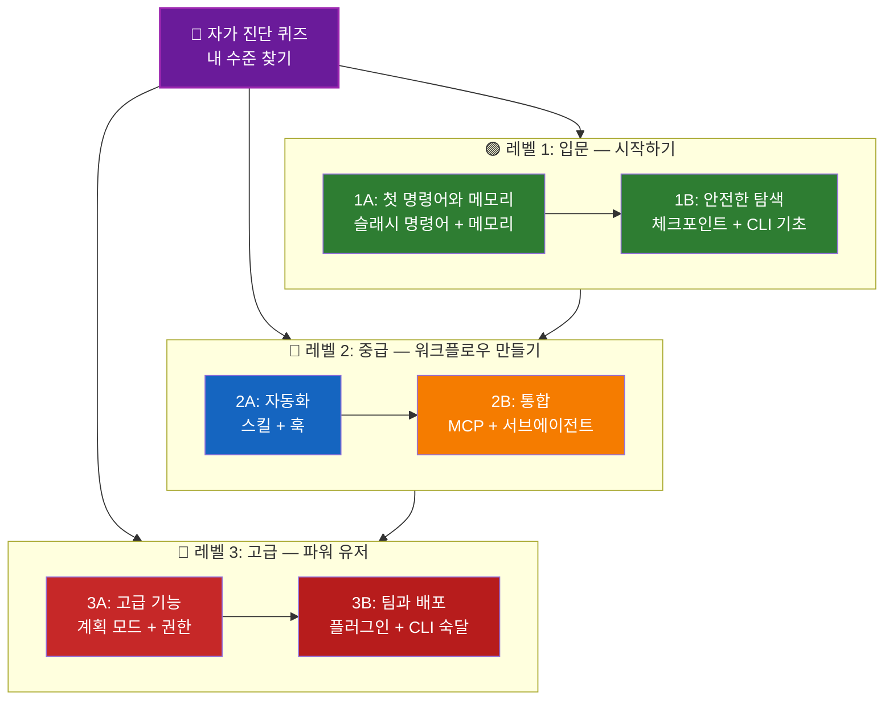

<picture>
  <source media="(prefers-color-scheme: dark)" srcset="resources/logos/claude-howto-logo-dark.svg">
  
</picture>

# 📚 Claude Code 학습 로드맵

**Claude Code가 처음인가요?** 이 가이드는 자신의 속도에 맞춰 Claude Code의 기능을 익히도록 돕습니다. 완전히 처음이든 경험 많은 개발자든, 먼저 아래 자가 진단 퀴즈로 나에게 맞는 경로를 찾으세요.

---

## 🧭 내 수준 찾기

모두가 같은 지점에서 출발하지는 않습니다. 간단한 자가 진단으로 알맞은 시작 지점을 찾으세요.

**다음 항목에 솔직하게 답해 보세요:**

- [ ] Claude Code를 실행해 대화할 수 있다 (`claude`)
- [ ] CLAUDE.md 파일을 만들거나 편집해 본 적이 있다
- [ ] 기본 제공 슬래시 명령어를 3개 이상 써 봤다 (예: /help, /compact, /model)
- [ ] 사용자 정의 슬래시 명령어나 스킬(SKILL.md)을 만들어 봤다
- [ ] MCP 서버를 설정해 봤다 (예: GitHub, 데이터베이스)
- [ ] ~/.claude/settings.json에 훅을 설정해 봤다
- [ ] 사용자 정의 서브에이전트(.claude/agents/)를 만들거나 써 봤다
- [ ] 스크립트나 CI/CD에서 print 모드(`claude -p`)를 써 봤다

**내 레벨:**

| 체크 수 | 레벨 | 시작 지점 | 소요 시간 |
|--------|-------|----------|------------------|
| 0~2개 | **레벨 1: 입문** — 시작하기 | [마일스톤 1A](#마일스톤-1a-첫-명령어와-메모리) | 약 3시간 |
| 3~5개 | **레벨 2: 중급** — 워크플로우 만들기 | [마일스톤 2A](#마일스톤-2a-자동화스킬--훅) | 약 5시간 |
| 6~8개 | **레벨 3: 고급** — 파워 유저와 팀 리더 | [마일스톤 3A](#마일스톤-3a-고급-기능) | 약 5시간 |

> **팁**: 확신이 서지 않으면 한 레벨 낮춰 시작하세요. 기초 개념을 놓치는 것보다 익숙한 내용을 빠르게 복습하는 편이 낫습니다.

> **대화형 버전**: Claude Code에서 `/self-assessment`를 실행하면 대화형 퀴즈가 안내에 따라 진행됩니다. 10개 기능 영역 전체의 숙련도를 평가하고 맞춤 학습 경로를 만들어 줍니다.

---

## 🎯 학습 철학

이 저장소의 폴더에는 세 가지 핵심 원칙에 따라 **권장 학습 순서**대로 번호가 붙어 있습니다:

1. **의존 관계** - 기초 개념을 먼저 배웁니다
2. **복잡도** - 쉬운 기능을 고급 기능보다 먼저 배웁니다
3. **사용 빈도** - 가장 자주 쓰는 기능을 일찍 배웁니다

이렇게 하면 탄탄한 기초를 쌓으면서 바로 생산성 효과도 얻을 수 있습니다.

---

## 🗺️ 학습 경로



**색상 안내:**
- 💜 보라: 자가 진단 퀴즈
- 🟢 초록: 레벨 1 — 입문 경로
- 🔵 파랑 / 🟡 금색: 레벨 2 — 중급 경로
- 🔴 빨강: 레벨 3 — 고급 경로

---

## 📊 전체 로드맵 표

| 순서 | 기능 | 난이도 | 소요 시간 | 레벨 | 선행 학습 | 배우는 이유 | 핵심 이점 |
|------|---------|-----------|------|-------|--------------|----------------|--------------|
| **1** | [슬래시 명령어](01-slash-commands/) | ⭐ 입문 | 30분 | 레벨 1 | 없음 | 빠른 생산성 향상(기본 제공 명령어 60개 이상 + 번들 스킬) | 즉각적인 자동화, 팀 표준 |
| **2** | [메모리](02-memory/) | ⭐⭐ 입문+ | 45분 | 레벨 1 | 없음 | 모든 기능의 기본 | 계속 유지되는 컨텍스트, 선호 설정 |
| **3** | [체크포인트](08-checkpoints/) | ⭐⭐ 중급 | 45분 | 레벨 1 | 세션 관리 | 안전한 탐색 | 실험, 복구 |
| **4** | [CLI 기초](10-cli/) | ⭐⭐ 입문+ | 30분 | 레벨 1 | 없음 | 핵심 CLI 사용법 | 대화형 모드와 print 모드 |
| **5** | [스킬](03-skills/) | ⭐⭐ 중급 | 1시간 | 레벨 2 | 슬래시 명령어 | 자동으로 발휘되는 전문성 | 재사용 가능한 기능, 일관성 |
| **6** | [훅](06-hooks/) | ⭐⭐ 중급 | 1시간 | 레벨 2 | 도구, 명령어 | 워크플로우 자동화(이벤트 33가지, 타입 5가지) | 검증, 품질 게이트 |
| **7** | [MCP](05-mcp/) | ⭐⭐⭐ 중급+ | 1시간 | 레벨 2 | 설정 | 실시간 데이터 접근 | 실시간 통합, API |
| **8** | [서브에이전트](04-subagents/) | ⭐⭐⭐ 중급+ | 1.5시간 | 레벨 2 | 메모리, 명령어 | 복잡한 작업 처리(Explore와 Plan을 포함한 기본 제공 6종) | 위임, 전문화된 역량 |
| **9** | [고급 기능](09-advanced-features/) | ⭐⭐⭐⭐⭐ 고급 | 2~3시간 | 레벨 3 | 앞의 모든 내용 | 파워 유저 도구 | 계획 모드, 자동 모드, 채널, 음성 받아쓰기, 권한 |
| **10** | [플러그인](07-plugins/) | ⭐⭐⭐⭐ 고급 | 2시간 | 레벨 3 | 앞의 모든 내용 | 완성형 솔루션 | 팀 온보딩, 배포 |
| **11** | [CLI 숙달](10-cli/) | ⭐⭐⭐ 고급 | 1시간 | 레벨 3 | 권장: 전체 | 명령줄 사용법 숙달 | 스크립팅, CI/CD, 자동화 |

**총 학습 시간**: 약 11~13시간(내 레벨로 바로 건너뛰면 시간을 아낄 수 있습니다)

---

## 🟢 레벨 1: 입문 — 시작하기

**대상**: 퀴즈에서 0~2개를 체크한 사용자
**소요 시간**: 약 3시간
**중점**: 즉각적인 생산성, 기본 개념 이해
**결과**: 일상적으로 편하게 쓰는 사용자, 레벨 2 준비 완료

### 마일스톤 1A: 첫 명령어와 메모리

**주제**: 슬래시 명령어 + 메모리
**소요 시간**: 1~2시간
**난이도**: ⭐ 입문
**목표**: 사용자 정의 명령어와 계속 유지되는 컨텍스트로 생산성을 바로 끌어올리기

#### 학습 성과
✅ 반복 작업을 위한 사용자 정의 슬래시 명령어 만들기
✅ 팀 표준을 담은 프로젝트 메모리 설정하기
✅ 개인 선호 설정 구성하기
✅ Claude가 컨텍스트를 자동으로 로드하는 방식 이해하기

#### 실습

```bash
# 실습 1: 첫 슬래시 명령어 설치
mkdir -p .claude/commands
cp 01-slash-commands/optimize.md .claude/commands/

# 실습 2: 프로젝트 메모리 만들기
cp 02-memory/project-CLAUDE.md ./CLAUDE.md

# 실습 3: 사용해 보기
# Claude Code에서 /optimize 입력
```

#### 달성 기준
- [ ] `/optimize` 명령어를 호출하는 데 성공했다
- [ ] Claude가 CLAUDE.md에 적은 프로젝트 표준을 기억한다
- [ ] 슬래시 명령어와 메모리를 각각 언제 써야 하는지 이해한다

#### 다음 단계
익숙해지면 다음 문서를 읽으세요:
- [01-slash-commands/README.md](01-slash-commands/README.md)
- [02-memory/README.md](02-memory/README.md)

> **이해도 점검**: Claude Code에서 `/lesson-quiz slash-commands`나 `/lesson-quiz memory`를 실행해 배운 내용을 확인하세요.

---

### 마일스톤 1B: 안전한 탐색

**주제**: 체크포인트 + CLI 기초
**소요 시간**: 1시간
**난이도**: ⭐⭐ 입문+
**목표**: 안전하게 실험하는 법과 핵심 CLI 명령어 익히기

#### 학습 성과
✅ 안전한 실험을 위해 체크포인트를 만들고 복원하기
✅ 대화형 모드와 print 모드의 차이 이해하기
✅ 기본 CLI 플래그와 옵션 사용하기
✅ 파이프로 파일 처리하기

#### 실습

```bash
# 실습 1: 체크포인트 워크플로우 해 보기
# Claude Code에서:
# 실험적인 변경을 한 뒤 Esc+Esc를 누르거나 /rewind 사용
# 실험 직전의 체크포인트 선택
# "Restore code and conversation"(코드와 대화 복원)을 골라 되돌아가기

# 실습 2: 대화형 모드와 print 모드 비교
claude "이 프로젝트를 설명해 줘"           # 대화형 모드
claude -p "이 함수를 설명해 줘"            # print 모드(비대화형)

# 실습 3: 파이프로 파일 내용 처리
cat error.log | claude -p "이 오류를 설명해 줘"
```

#### 달성 기준
- [ ] 체크포인트를 만들고 그 시점으로 되돌렸다
- [ ] 대화형 모드와 print 모드를 모두 써 봤다
- [ ] 파일을 파이프로 Claude에 넘겨 분석했다
- [ ] 안전한 실험을 위해 언제 체크포인트를 써야 하는지 이해한다

#### 다음 단계
- 읽기: [08-checkpoints/README.md](08-checkpoints/README.md)
- 읽기: [10-cli/README.md](10-cli/README.md)
- **레벨 2 준비 완료!** [마일스톤 2A](#마일스톤-2a-자동화스킬--훅)로 넘어가세요

> **이해도 점검**: `/lesson-quiz checkpoints`나 `/lesson-quiz cli`를 실행해 레벨 2로 넘어갈 준비가 됐는지 확인하세요.

---

## 🔵 레벨 2: 중급 — 워크플로우 만들기

**대상**: 퀴즈에서 3~5개를 체크한 사용자
**소요 시간**: 약 5시간
**중점**: 자동화, 통합, 작업 위임
**결과**: 자동화된 워크플로우와 외부 통합, 레벨 3 준비 완료

### 사전 점검

레벨 2를 시작하기 전에 다음 레벨 1 개념이 익숙한지 확인하세요:

- [ ] 슬래시 명령어를 만들고 쓸 수 있다 ([01-slash-commands/](01-slash-commands/))
- [ ] CLAUDE.md로 프로젝트 메모리를 설정해 봤다 ([02-memory/](02-memory/))
- [ ] 체크포인트를 만들고 복원하는 법을 안다 ([08-checkpoints/](08-checkpoints/))
- [ ] 명령줄에서 `claude`와 `claude -p`를 쓸 수 있다 ([10-cli/](10-cli/))

> **부족한 부분이 있나요?** 계속하기 전에 위에 링크된 튜토리얼을 복습하세요.

---

### 마일스톤 2A: 자동화(스킬 + 훅)

**주제**: 스킬 + 훅
**소요 시간**: 2~3시간
**난이도**: ⭐⭐ 중급
**목표**: 자주 하는 워크플로우와 품질 검사를 자동화하기

#### 학습 성과
✅ YAML frontmatter(`effort`, `shell` 필드 포함)로 전문 기능이 자동으로 호출되게 하기
✅ 33가지 훅 이벤트로 이벤트 기반 자동화 설정하기
✅ 5가지 훅 타입(command, http, mcp_tool, prompt, agent) 모두 사용하기
✅ 코드 품질 기준 강제하기
✅ 내 워크플로우에 맞는 사용자 정의 훅 만들기

#### 실습

```bash
# 실습 1: 스킬 설치
cp -r 03-skills/code-review-specialist ~/.claude/skills/

# 실습 2: 훅 설정
mkdir -p ~/.claude/hooks
cp 06-hooks/pre-tool-check.sh ~/.claude/hooks/
chmod +x ~/.claude/hooks/pre-tool-check.sh

# 실습 3: 설정 파일에 훅 구성
# ~/.claude/settings.json에 추가:
{
  "hooks": {
    "PreToolUse": [
      {
        "matcher": "Bash",
        "hooks": [
          {
            "type": "command",
            "command": "~/.claude/hooks/pre-tool-check.sh"
          }
        ]
      }
    ]
  }
}
```

#### 달성 기준
- [ ] 관련 있을 때 코드 리뷰 스킬이 자동으로 호출된다
- [ ] PreToolUse 훅이 도구 실행 전에 실행된다
- [ ] 스킬 자동 호출과 훅 이벤트 트리거의 차이를 이해한다

#### 다음 단계
- 나만의 사용자 정의 스킬 만들기
- 워크플로우에 맞는 훅 추가로 설정하기
- 읽기: [03-skills/README.md](03-skills/README.md)
- 읽기: [06-hooks/README.md](06-hooks/README.md)

> **이해도 점검**: 다음으로 넘어가기 전에 `/lesson-quiz skills`나 `/lesson-quiz hooks`를 실행해 지식을 점검하세요.

---

### 마일스톤 2B: 통합(MCP + 서브에이전트)

**주제**: MCP + 서브에이전트
**소요 시간**: 2~3시간
**난이도**: ⭐⭐⭐ 중급+
**목표**: 외부 서비스를 통합하고 복잡한 작업을 위임하기

#### 학습 성과
✅ GitHub, 데이터베이스 등의 실시간 데이터에 접근하기
✅ 전문화된 AI 에이전트에게 작업 위임하기
✅ MCP와 서브에이전트를 각각 언제 써야 하는지 이해하기
✅ 통합 워크플로우 만들기

#### 실습

```bash
# 실습 1: GitHub MCP 설정
claude mcp add --transport http github https://api.githubcopilot.com/mcp/ --header "Authorization: Bearer YOUR_GITHUB_PAT"

# 실습 2: MCP 통합 테스트
# Claude Code에서: /mcp__github__list_prs

# 실습 3: 서브에이전트 설치
mkdir -p .claude/agents
cp 04-subagents/*.md .claude/agents/
```

#### 통합 실습
다음 전체 워크플로우를 시도해 보세요:
1. MCP로 GitHub PR 가져오기
2. Claude가 code-reviewer 서브에이전트에 리뷰를 위임하게 하기
3. 훅으로 테스트를 자동 실행하기

#### 달성 기준
- [ ] MCP로 GitHub 데이터를 조회하는 데 성공했다
- [ ] Claude가 복잡한 작업을 서브에이전트에 위임한다
- [ ] MCP와 서브에이전트의 차이를 이해한다
- [ ] MCP + 서브에이전트 + 훅을 하나의 워크플로우로 조합했다

#### 다음 단계
- 추가 MCP 서버 설정하기(데이터베이스, Slack 등)
- 내 분야에 맞는 사용자 정의 서브에이전트 만들기
- 읽기: [05-mcp/README.md](05-mcp/README.md)
- 읽기: [04-subagents/README.md](04-subagents/README.md)
- **레벨 3 준비 완료!** [마일스톤 3A](#마일스톤-3a-고급-기능)로 넘어가세요

> **이해도 점검**: `/lesson-quiz mcp`나 `/lesson-quiz subagents`를 실행해 레벨 3으로 넘어갈 준비가 됐는지 확인하세요.

---

## 🔴 레벨 3: 고급 — 파워 유저와 팀 리더

**대상**: 퀴즈에서 6~8개를 체크한 사용자
**소요 시간**: 약 5시간
**중점**: 팀 도구, CI/CD, 엔터프라이즈 기능, 플러그인 개발
**결과**: 팀 워크플로우와 CI/CD를 구성할 수 있는 파워 유저

### 사전 점검

레벨 3을 시작하기 전에 다음 레벨 2 개념이 익숙한지 확인하세요:

- [ ] 자동으로 호출되는 스킬을 만들고 쓸 수 있다 ([03-skills/](03-skills/))
- [ ] 이벤트 기반 자동화를 위한 훅을 설정해 봤다 ([06-hooks/](06-hooks/))
- [ ] 외부 데이터를 위한 MCP 서버를 설정할 수 있다 ([05-mcp/](05-mcp/))
- [ ] 작업 위임에 서브에이전트를 쓰는 법을 안다 ([04-subagents/](04-subagents/))

> **부족한 부분이 있나요?** 계속하기 전에 위에 링크된 튜토리얼을 복습하세요.

---

### 마일스톤 3A: 고급 기능

**주제**: 고급 기능(계획 모드, 권한, 확장 사고, 자동 모드, 채널, 음성 받아쓰기, 원격/데스크톱/웹)
**소요 시간**: 2~3시간
**난이도**: ⭐⭐⭐⭐⭐ 고급
**목표**: 고급 워크플로우와 파워 유저 도구 숙달하기

#### 학습 성과
✅ 복잡한 기능을 위한 계획 모드
✅ 6가지 모드(manual — 이전 이름 default, acceptEdits, plan, auto, dontAsk, bypassPermissions)로 세밀한 권한 제어
✅ Alt+T / Option+T 토글로 확장 사고 켜고 끄기
✅ 백그라운드 작업 관리
✅ 학습한 선호 설정을 기억하는 자동 메모리
✅ 백그라운드 안전 분류기를 쓰는 자동 모드
✅ 실행 중인 세션으로 이벤트(CI 결과, 채팅 메시지, 웹훅)를 보내는 채널
✅ 손을 쓰지 않고 상호작용하는 음성 받아쓰기
✅ Remote Control(정식 출시 — 내 컴퓨터가 Claude 앱에 기기 카드로 표시됨), 데스크톱 앱, 웹 세션
✅ 여러 에이전트가 협업하는 에이전트 팀

#### 실습

```bash
# 실습 1: 계획 모드 사용
/plan 사용자 인증 시스템 구현

# 실습 2: 권한 모드 써 보기 (6가지: manual [이전 이름 default], acceptEdits, plan, auto, dontAsk, bypassPermissions)
claude --permission-mode plan "이 코드베이스를 분석해 줘"
claude --permission-mode acceptEdits "auth 모듈을 리팩토링해 줘"
claude --permission-mode auto "기능을 구현해 줘"

# 실습 3: 확장 사고 켜기
# 세션 중에 Alt+T(macOS에서는 Option+T)를 눌러 켜고 끔

# 실습 4: 고급 체크포인트 워크플로우
# 1. "깨끗한 상태" 체크포인트 만들기
# 2. 계획 모드로 기능 설계
# 3. 서브에이전트에 위임해 구현
# 4. 백그라운드에서 테스트 실행
# 5. 테스트가 실패하면 체크포인트로 되감기
# 6. 다른 접근 방식 시도

# 실습 5: 자동 모드 써 보기 (백그라운드 안전 분류기)
claude --permission-mode auto "사용자 설정 페이지를 구현해 줘"

# 실습 6: 에이전트 팀 켜기
export CLAUDE_CODE_EXPERIMENTAL_AGENT_TEAMS=1
# Claude에게 요청: "팀 방식으로 기능 X를 구현해 줘"

# 실습 7: 예약 작업
/loop 5m /check-status
# 작업은 세션 안에서만 유지됨. 계속 유지되는 예약에는 루틴이나 데스크톱 예약 작업 사용

# 실습 8: 채널 (연구 미리보기)
# 채널은 실행 중인 세션으로 이벤트를 보내는 MCP 서버

# 실습 9: 음성 받아쓰기
# 손을 쓰지 않고 Claude Code와 상호작용하도록 음성 입력 사용
```

#### 달성 기준
- [ ] 복잡한 기능에 계획 모드를 써 봤다
- [ ] 권한 모드(plan, acceptEdits, auto, dontAsk)를 설정해 봤다
- [ ] Alt+T / Option+T로 확장 사고를 켜고 꺼 봤다
- [ ] 백그라운드 안전 분류기와 함께 자동 모드를 써 봤다
- [ ] 오래 걸리는 작업에 백그라운드 작업을 써 봤다
- [ ] 외부 이벤트를 세션으로 보내는 채널을 살펴봤다
- [ ] 손을 쓰지 않는 입력을 위해 음성 받아쓰기를 써 봤다
- [ ] Remote Control, 데스크톱 앱, 웹 세션을 이해한다
- [ ] 세션 간 `SendMessage`에 `notify_when_idle`을 써서 다른 세션이 유휴 상태가 되면 알림을 받아 봤다
- [ ] 에이전트 팀을 켜고 협업 작업에 써 봤다
- [ ] 반복 작업이나 예약 모니터링에 `/loop`를 써 봤다

#### 다음 단계
- 읽기: [09-advanced-features/README.md](09-advanced-features/README.md)

> **이해도 점검**: `/lesson-quiz advanced`를 실행해 파워 유저 기능을 얼마나 익혔는지 점검하세요.

---

### 마일스톤 3B: 팀과 배포(플러그인 + CLI 숙달)

**주제**: 플러그인 + CLI 숙달 + CI/CD
**소요 시간**: 2~3시간
**난이도**: ⭐⭐⭐⭐ 고급
**목표**: 팀 도구를 만들고, 플러그인을 제작하고, CI/CD 통합을 숙달하기

#### 학습 성과
✅ 완성된 번들 플러그인을 설치하고 직접 만들기
✅ 스크립팅과 자동화를 위한 CLI 숙달
✅ `claude -p`로 CI/CD 통합 설정하기
✅ 자동화 파이프라인을 위한 JSON 출력
✅ 세션 관리와 일괄 처리

#### 실습

```bash
# 실습 1: 완성된 플러그인 설치
claude --plugin-dir ./07-plugins/pr-review  # 저장소 루트에서 실행

# 실습 2: CI/CD용 print 모드
claude -p "모든 테스트를 실행하고 보고서를 만들어 줘"

# 실습 3: 스크립트용 JSON 출력
claude -p --output-format json "모든 함수 목록을 보여 줘"

# 실습 4: 세션 관리와 재개
claude -r "feature-auth" "구현을 계속해 줘"

# 실습 5: 제약 조건을 둔 CI/CD 통합
claude -p --max-turns 3 --output-format json "코드를 리뷰해 줘"

# 실습 6: 일괄 처리
for file in *.md; do
  claude -p --output-format json "다음 내용을 요약해 줘: $(cat $file)" > ${file%.md}.summary.json
done
```

#### CI/CD 통합 실습
간단한 CI/CD 스크립트를 만들어 보세요:
1. `claude -p`로 변경된 파일 리뷰하기
2. 결과를 JSON으로 출력하기
3. `jq`로 특정 문제만 골라 처리하기
4. GitHub Actions 워크플로우에 통합하기

#### 달성 기준
- [ ] 플러그인을 설치해서 써 봤다
- [ ] 팀을 위한 플러그인을 만들거나 수정해 봤다
- [ ] CI/CD에서 print 모드(`claude -p`)를 써 봤다
- [ ] 스크립팅용 JSON 출력을 만들어 봤다
- [ ] 이전 세션을 재개하는 데 성공했다
- [ ] 일괄 처리 스크립트를 만들어 봤다
- [ ] Claude를 CI/CD 워크플로우에 통합해 봤다

#### CLI 실전 활용 사례
- **코드 리뷰 자동화**: CI/CD 파이프라인에서 코드 리뷰 실행
- **로그 분석**: 오류 로그와 시스템 출력 분석
- **문서 생성**: 문서 일괄 생성
- **테스트 인사이트**: 테스트 실패 분석
- **성능 분석**: 성능 지표 검토
- **데이터 처리**: 데이터 파일 변환과 분석

#### 다음 단계
- 읽기: [07-plugins/README.md](07-plugins/README.md)
- 읽기: [10-cli/README.md](10-cli/README.md)
- 팀 전체가 쓰는 CLI 단축 명령과 플러그인 만들기
- 일괄 처리 스크립트 설정하기

> **이해도 점검**: `/lesson-quiz plugins`나 `/lesson-quiz cli`를 실행해 숙달 정도를 확인하세요.

---

## 🧪 지식 점검

이 저장소에는 Claude Code에서 언제든 이해도를 평가할 수 있는 대화형 스킬 두 가지가 들어 있습니다:

| 스킬 | 명령어 | 용도 |
|-------|---------|---------|
| **자가 진단** | `/self-assessment` | 10개 기능 전체의 숙련도를 평가합니다. 빠른 진단(2분)이나 심층 진단(5분)을 골라 맞춤 기술 프로필과 학습 경로를 받습니다. |
| **레슨 퀴즈** | `/lesson-quiz [lesson]` | 10개 문항으로 특정 레슨의 이해도를 테스트합니다. 레슨 전(사전 테스트), 레슨 중(진도 확인), 레슨 후(숙달 확인)에 쓸 수 있습니다. |

**예:**
```
/self-assessment                  # 전체 수준 확인
/lesson-quiz hooks                # 레슨 06(훅) 퀴즈
/lesson-quiz 03                   # 레슨 03(스킬) 퀴즈
/lesson-quiz advanced-features    # 레슨 09 퀴즈
```

---

## ⚡ 빠른 시작 경로

### 15분밖에 없다면
**목표**: 첫 성과 얻기

1. 슬래시 명령어 하나 복사: `cp 01-slash-commands/optimize.md .claude/commands/`
2. Claude Code에서 사용해 보기: `/optimize`
3. 읽기: [01-slash-commands/README.md](01-slash-commands/README.md)

**결과**: 동작하는 슬래시 명령어가 생기고 기본기를 이해하게 됩니다

---

### 1시간이 있다면
**목표**: 필수 생산성 도구 설정하기

1. **슬래시 명령어**(15분): `/optimize`와 `/pr`을 복사해서 테스트
2. **프로젝트 메모리**(15분): 프로젝트 표준을 담은 CLAUDE.md 만들기
3. **스킬 설치**(15분): code-review-specialist 스킬 설정
4. **함께 써 보기**(15분): 세 기능이 어떻게 맞물려 동작하는지 확인

**결과**: 명령어, 메모리, 자동 스킬로 기본적인 생산성 향상

---

### 주말이 있다면
**목표**: 대부분의 기능을 능숙하게 쓰기

**토요일 오전**(3시간):
- 마일스톤 1A 완료: 슬래시 명령어 + 메모리
- 마일스톤 1B 완료: 체크포인트 + CLI 기초

**토요일 오후**(3시간):
- 마일스톤 2A 완료: 스킬 + 훅
- 마일스톤 2B 완료: MCP + 서브에이전트

**일요일**(4시간):
- 마일스톤 3A 완료: 고급 기능
- 마일스톤 3B 완료: 플러그인 + CLI 숙달 + CI/CD
- 팀을 위한 사용자 정의 플러그인 만들기

**결과**: 다른 사람을 가르치고 복잡한 워크플로우를 자동화할 수 있는 Claude Code 파워 유저가 됩니다

---

## 💡 학습 팁

### ✅ 이렇게 하세요

- **퀴즈부터 풀어** 시작 지점을 찾으세요
- 마일스톤마다 **실습을 끝까지 하세요**
- **간단하게 시작해서** 복잡도를 점점 높이세요
- 다음 기능으로 넘어가기 전에 **각 기능을 테스트하세요**
- 내 워크플로우에 잘 맞는 것을 **기록해 두세요**
- 고급 주제를 배울 때 앞의 개념을 **다시 찾아보세요**
- 체크포인트로 **안전하게 실험하세요**
- 팀과 **지식을 나누세요**

### ❌ 이렇게 하지 마세요

- 높은 레벨로 건너뛸 때 **사전 점검을 건너뛰지 마세요**
- **한꺼번에 모두 배우려 하지 마세요** - 감당하기 어렵습니다
- **이해하지 못한 설정을 그대로 복사하지 마세요** - 문제가 생겨도 디버깅할 수 없습니다
- **테스트를 잊지 마세요** - 기능이 동작하는지 항상 확인하세요
- **마일스톤을 서둘러 넘기지 마세요** - 이해할 시간을 가지세요
- **문서를 무시하지 마세요** - README마다 유용한 내용이 있습니다
- **혼자서만 하지 마세요** - 팀원과 이야기하세요

---

## 🎓 학습 스타일

### 시각형 학습자
- 각 README의 Mermaid 다이어그램 살펴보기
- 명령어 실행 흐름 따라가 보기
- 나만의 워크플로우 다이어그램 그려 보기
- 위의 시각적 학습 경로 활용하기

### 실습형 학습자
- 모든 실습을 끝까지 해 보기
- 여러 가지로 바꿔 가며 실험하기
- 일부러 망가뜨리고 고쳐 보기(체크포인트를 쓰세요!)
- 나만의 예제 만들기

### 읽기형 학습자
- 각 README를 꼼꼼히 읽기
- 코드 예제 살펴보기
- 비교 표 검토하기
- 자료 모음에 링크된 블로그 글 읽기

### 소통형 학습자
- 페어 프로그래밍 세션 만들기
- 팀원에게 개념 가르치기
- Claude Code 커뮤니티 토론에 참여하기
- 직접 만든 설정 공유하기

---

## 📈 진도 관리

다음 체크리스트로 레벨별 진도를 기록하세요. 언제든 `/self-assessment`를 실행하면 최신 기술 프로필을 받을 수 있고, 튜토리얼을 마칠 때마다 `/lesson-quiz [lesson]`을 실행해 이해도를 확인할 수 있습니다.

### 🟢 레벨 1: 입문
- [ ] [01-slash-commands](01-slash-commands/) 완료
- [ ] [02-memory](02-memory/) 완료
- [ ] 첫 사용자 정의 슬래시 명령어 만들기
- [ ] 프로젝트 메모리 설정
- [ ] **마일스톤 1A 달성**
- [ ] [08-checkpoints](08-checkpoints/) 완료
- [ ] [10-cli](10-cli/) 기초 완료
- [ ] 체크포인트를 만들고 그 시점으로 되돌리기
- [ ] 대화형 모드와 print 모드 사용
- [ ] **마일스톤 1B 달성**

### 🔵 레벨 2: 중급
- [ ] [03-skills](03-skills/) 완료
- [ ] [06-hooks](06-hooks/) 완료
- [ ] 첫 스킬 설치
- [ ] PreToolUse 훅 설정
- [ ] **마일스톤 2A 달성**
- [ ] [05-mcp](05-mcp/) 완료
- [ ] [04-subagents](04-subagents/) 완료
- [ ] GitHub MCP 연결
- [ ] 사용자 정의 서브에이전트 만들기
- [ ] 여러 통합을 하나의 워크플로우로 조합
- [ ] **마일스톤 2B 달성**

### 🔴 레벨 3: 고급
- [ ] [09-advanced-features](09-advanced-features/) 완료
- [ ] 계획 모드 활용 성공
- [ ] 권한 모드 설정(auto를 포함한 6가지 모드)
- [ ] 안전 분류기와 함께 자동 모드 사용
- [ ] 확장 사고 토글 사용
- [ ] 채널과 음성 받아쓰기 살펴보기
- [ ] **마일스톤 3A 달성**
- [ ] [07-plugins](07-plugins/) 완료
- [ ] [10-cli](10-cli/) 고급 사용법 완료
- [ ] print 모드(`claude -p`)로 CI/CD 설정
- [ ] 자동화를 위한 JSON 출력 만들기
- [ ] Claude를 CI/CD 파이프라인에 통합
- [ ] 팀 플러그인 만들기
- [ ] **마일스톤 3B 달성**

---

## 🆘 자주 겪는 학습 어려움

### 어려움 1: "개념이 한꺼번에 너무 많아요"
**해결책**: 한 번에 마일스톤 하나에만 집중하세요. 다음으로 넘어가기 전에 실습을 모두 마치세요.

### 어려움 2: "어떤 기능을 언제 써야 할지 모르겠어요"
**해결책**: 메인 README의 [활용 사례 매트릭스](README.md#use-case-matrix)를 참고하세요.

### 어려움 3: "설정이 동작하지 않아요"
**해결책**: [문제 해결](README.md#troubleshooting) 섹션을 확인하고 파일 위치를 점검하세요.

### 어려움 4: "개념이 서로 겹치는 것 같아요"
**해결책**: [기능 비교](README.md#feature-comparison) 표를 보고 차이점을 파악하세요.

### 어려움 5: "전부 기억하기 어려워요"
**해결책**: 나만의 치트 시트를 만드세요. 체크포인트로 안전하게 실험하세요.

### 어려움 6: "경험은 있는데 어디서 시작할지 모르겠어요"
**해결책**: 위의 [자가 진단 퀴즈](#-내-수준-찾기)를 풀어 보세요. 내 레벨로 건너뛴 뒤 사전 점검으로 부족한 부분을 찾으세요.

---

## 🎯 모두 마친 다음에는?

모든 마일스톤을 마쳤다면:

1. **팀 문서 만들기** - 팀의 Claude Code 설정을 문서로 남기세요
2. **사용자 정의 플러그인 만들기** - 새로운 매니페스트 필드(`workflows`, `channels`, `dependencies`)까지 활용해 팀의 워크플로우를 패키징하세요
3. **`/design` 써 보기** - HTML을 직접 작성하는 대신 디자인 캔버스에서 UI 목업, 화면 흐름, 랜딩 페이지를 스케치하세요(v2.1.265+)
4. **Remote Control 살펴보기** - 로컬 Claude Code 세션을 휴대폰, 브라우저, Claude 앱에서 이어 가거나, Claude 앱의 기기 카드로 휴대폰에서 세션을 시작하세요
5. **웹 세션 써 보기** - 브라우저 기반 인터페이스로 Claude Code를 써서 원격으로 개발하세요
6. **데스크톱 앱 사용하기** - 네이티브 데스크톱 애플리케이션으로 Claude Code 기능을 쓰세요
7. **자동 모드 사용하기** - 백그라운드 안전 분류기와 함께 Claude가 자율적으로 작업하게 하세요
8. **자동 메모리 활용하기** - Claude가 시간이 지나며 내 선호를 자동으로 학습하게 하세요
9. **에이전트 팀 구성하기** - 여러 측면이 얽힌 복잡한 작업에서 여러 에이전트를 조율하세요
10. **채널 사용하기** - 실행 중인 세션으로 이벤트(CI 결과, 채팅 메시지, 웹훅)를 보내는 MCP 서버를 연결하세요
11. **음성 받아쓰기 써 보기** - 손을 쓰지 않는 음성 입력으로 Claude Code와 상호작용하세요
12. **예약 작업 사용하기** - `/loop`와 cron 도구로 반복 점검을 자동화하세요
13. **예제 기여하기** - 커뮤니티와 공유하세요
14. **다른 사람 이끌어 주기** - 팀원이 배우도록 도와주세요
15. **워크플로우 최적화하기** - 사용 경험을 바탕으로 계속 개선하세요
16. **최신 정보 따라가기** - Claude Code 릴리스와 새 기능을 꾸준히 확인하세요

---

## 📚 추가 자료

### 공식 문서
- [Claude Code 문서](https://code.claude.com/docs/ko/overview)
- [Anthropic 문서](https://docs.anthropic.com)
- [MCP 프로토콜 명세](https://modelcontextprotocol.io)

### 블로그 글
- [Discovering Claude Code Slash Commands](https://medium.com/@luongnv89/discovering-claude-code-slash-commands-cdc17f0dfb29)

### 커뮤니티
- [Anthropic Cookbook](https://github.com/anthropics/anthropic-cookbook)
- [MCP 서버 저장소](https://github.com/modelcontextprotocol/servers)

---

## 💬 피드백과 지원

- **문제를 발견했나요?** 저장소에 이슈를 등록하세요
- **제안이 있나요?** 풀 리퀘스트를 보내 주세요
- **도움이 필요한가요?** 문서를 확인하거나 커뮤니티에 물어보세요

---

**최종 업데이트**: 2026년 10월 18일
**Claude Code 버전**: 2.1.302
**출처**:
- https://code.claude.com/docs/ko/overview
- https://code.claude.com/docs/ko/hooks
- https://code.claude.com/docs/ko/permission-modes
- https://github.com/anthropics/claude-code/releases/tag/v2.1.144
- https://github.com/anthropics/claude-code/releases/tag/v2.1.145
- https://code.claude.com/docs/ko/model-config
- https://code.claude.com/docs/ko/agent-teams
- https://code.claude.com/docs/ko/mcp
- https://code.claude.com/docs/en/plugins/install
- https://code.claude.com/docs/ko/channels
- https://code.claude.com/docs/ko/remote-control
- https://code.claude.com/docs/ko/scheduled-tasks
- https://code.claude.com/docs/ko/commands
- https://code.claude.com/docs/ko/sub-agents
**호환 모델**: Claude Fable 5.1, Claude Fable 5, Claude Opus 5, Claude Sonnet 5, Claude Sonnet 4.6, Claude Opus 4.8, Claude Haiku 4.5
**관리**: Claude How-To 기여자
**라이선스**: 교육 목적으로 자유롭게 사용하고 수정할 수 있음

---

[← 메인 README로 돌아가기](README.md)
