<picture>
  <source media="(prefers-color-scheme: dark)" srcset="resources/logos/claude-howto-logo-dark.svg">
  
</picture>

# Claude 개념 완전 가이드

Claude Code의 기능이 어떻게 동작하고 서로 맞물리는지 개념 중심으로 정리한 개요입니다. 슬래시 명령어, 서브에이전트, 메모리, MCP, 스킬, 플러그인, 훅 등을 아키텍처 다이어그램, 결정 표, 비교로 살펴봅니다.

> **이 가이드 활용법**: 이 페이지는 *개념*을 설명합니다 — 각 기능이 무엇이고, 내부에서 어떻게 동작하며, 언제 쓰면 좋은지 다룹니다. **복사해서 쓰는 템플릿과 전체 레퍼런스는 번호가 붙은 모듈**(`01-`부터 `10-`까지)에 있으며, 각 섹션에서 해당 모듈로 연결됩니다. 여기서 전체 그림을 잡은 뒤, 실제로 설정할 때는 모듈로 넘어가세요.

---

## 목차

1. [슬래시 명령어](#슬래시-명령어) — [모듈](01-slash-commands/)
2. [서브에이전트](#서브에이전트) — [모듈](04-subagents/)
3. [메모리](#메모리) — [모듈](02-memory/)
4. [MCP 프로토콜](#mcp-프로토콜) — [모듈](05-mcp/)
5. [에이전트 스킬](#에이전트-스킬) — [모듈](03-skills/)
6. [플러그인](#claude-code-플러그인) — [모듈](07-plugins/)
7. [비교와 통합](#비교와-통합)
8. [요약 표](#요약-표)
9. [빠른 시작 가이드](#빠른-시작-가이드)
10. [훅](#훅) — [모듈](06-hooks/)
11. [체크포인트와 되감기](#체크포인트와-되감기) — [모듈](08-checkpoints/)
12. [고급 기능](#고급-기능) — [모듈](09-advanced-features/)
13. [모델과 추론 노력 수준](#모델과-추론-노력-수준) — [모듈](10-cli/)
14. [자료](#자료)

---

## 슬래시 명령어

### 개요

슬래시 명령어는 마크다운 파일로 저장해 두고 사용자가 직접 호출하면 Claude Code가 실행하는 단축 명령입니다. 팀에서 자주 쓰는 프롬프트와 워크플로우를 표준화할 수 있습니다.

### 아키텍처

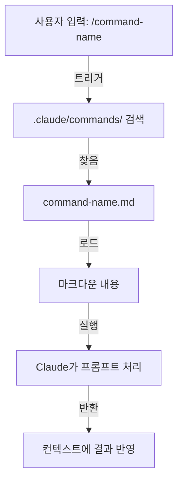

### 파일 구조

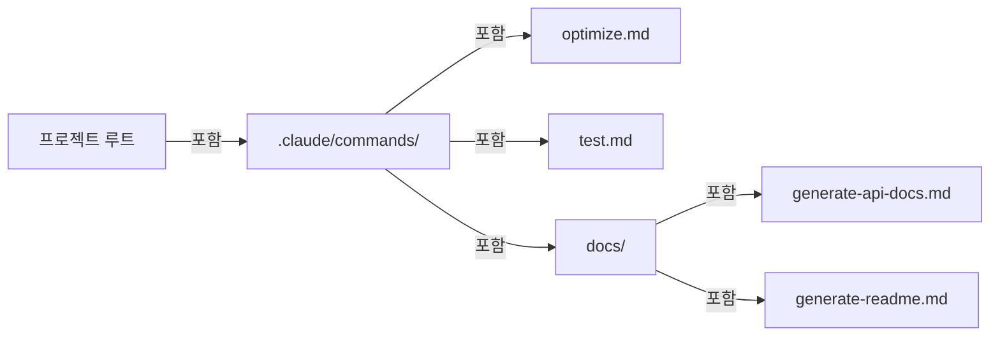

### 명령어 구성 표

| 위치 | 범위 | 사용 대상 | 활용 사례 | Git 추적 |
|----------|-------|--------------|----------|-------------|
| `.claude/commands/` | 프로젝트 전용 | 팀원 | 팀 워크플로우, 공유 표준 | ✅ 예 |
| `~/.claude/commands/` | 개인 | 개별 사용자 | 여러 프로젝트에서 쓰는 개인 단축 명령 | ❌ 아니요 |
| 하위 디렉토리 | 네임스페이스 | 상위 디렉토리를 따름 | 분류별 정리 | ✅ 예 |

### 기능과 역량

| 기능 | 예 | 지원 |
|---------|---------|-----------|
| 셸 스크립트 실행 | `bash scripts/deploy.sh` | ✅ 예 |
| 파일 참조 | `@path/to/file.js` | ✅ 예 |
| Bash 통합 | `$(git log --oneline)` | ✅ 예 |
| 인수 | `/pr --verbose` | ✅ 예 |
| MCP 명령어 | `/mcp__github__list_prs` | ✅ 예 |

### 실전 예제

복사해서 쓰는 명령어 템플릿 8개가 **[01-slash-commands/](01-slash-commands/)에** 있습니다 — `/optimize`, `/pr`, `/commit`, `/push-all`, `/generate-api-docs`, `/doc-refactor`, `/setup-ci-cd`, `/unit-test-expand`.

**[01-slash-commands/README.md](01-slash-commands/README.md)에는** 전체 기본 제공 명령어 레퍼런스(60개 이상)와 frontmatter 필드 표도 있습니다.

### 명령어 수명 주기 다이어그램

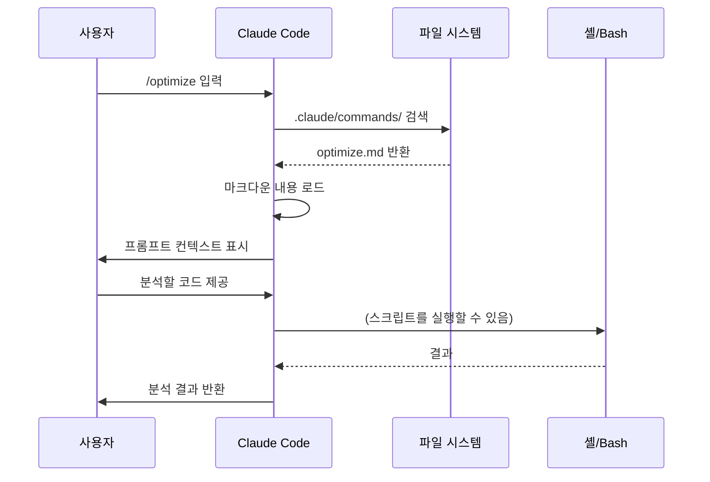

### 모범 사례

| ✅ 권장 | ❌ 비권장 |
|------|---------|
| 명확하고 동작 중심적인 이름 사용 | 일회성 작업을 위한 명령어 만들기 |
| description에 트리거 단어 기록 | 명령어 안에 복잡한 로직 구현 |
| 명령어는 한 가지 작업에 집중 | 중복되는 명령어 만들기 |
| 프로젝트 명령어는 버전 관리 | 민감한 정보 하드코딩 |
| 하위 디렉토리로 정리 | 명령어 목록을 길게 늘어놓기 |
| 간단하고 읽기 쉬운 프롬프트 사용 | 줄임말이나 알아보기 힘든 표현 사용 |

---

## 서브에이전트

### 개요

서브에이전트는 격리된 컨텍스트 윈도우와 사용자 정의 시스템 프롬프트를 가진 전문 AI 어시스턴트입니다. 관심사를 깔끔하게 분리하면서 작업을 위임해 실행할 수 있습니다.

서브에이전트는 자신의 서브에이전트를 생성할 수 있으며, **중첩은 기본으로 켜져 있고 깊이 3까지 가능합니다(v2.1.219)** — 따라서 계층이 아래 그림처럼 메인 → 서브에이전트 한 단계로 제한되지 않습니다. 한도를 바꾸려면 `CLAUDE_CODE_MAX_SUBAGENT_SPAWN_DEPTH`를 설정하고, 중첩을 끄려면 `1`로 설정하세요. (이력: v2.1.172~v2.1.216에서는 바꿀 방법 없이 기본으로 5단계까지 중첩됐고, v2.1.217에서 깊이 1의 선택 기능이 되었다가, v2.1.219에서 기본값이 3이 되었습니다.)

### 아키텍처 다이어그램

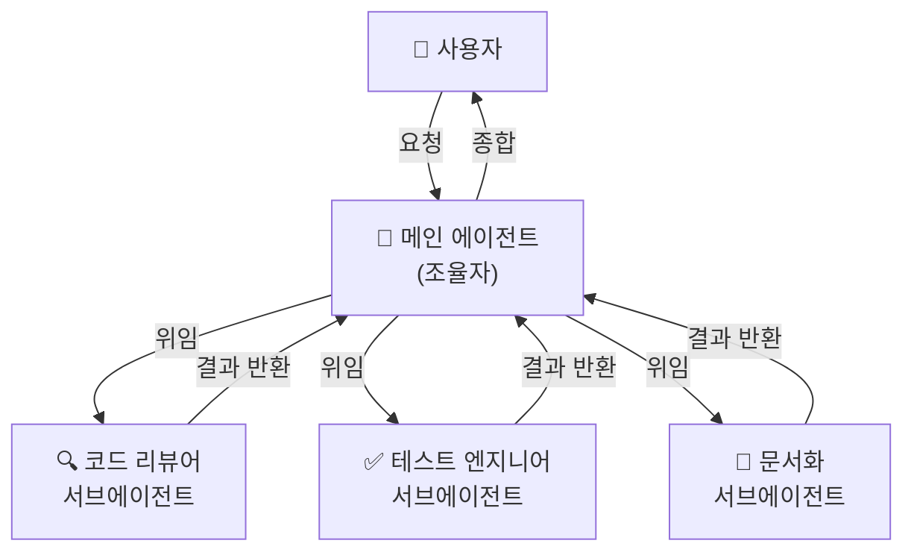

### 서브에이전트 수명 주기

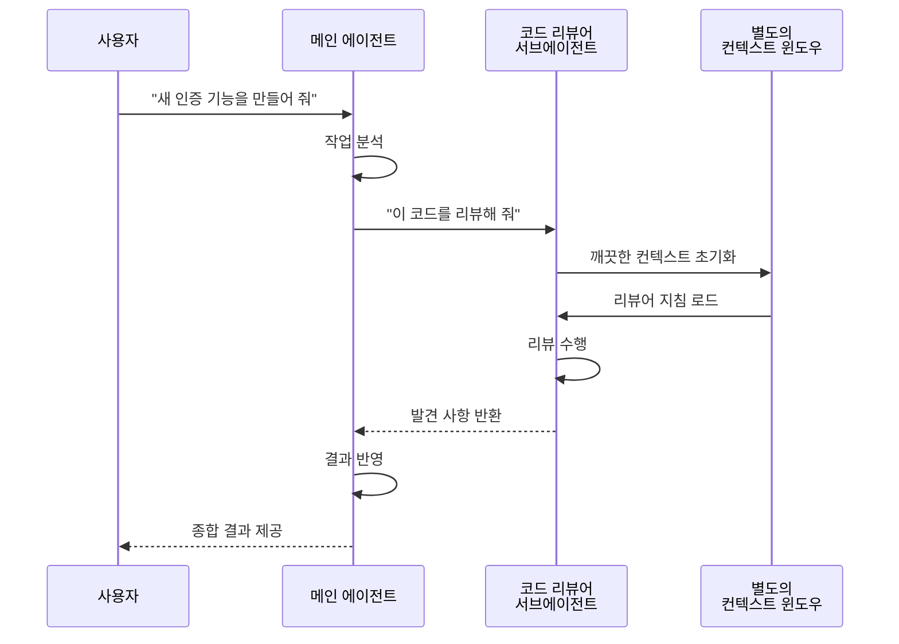

### 서브에이전트 설정 표

| 설정 | 타입 | 목적 | 예 |
|---------------|------|---------|---------|
| `name` | String | 에이전트 식별자 | `code-reviewer` |
| `description` | String | 목적과 트리거 용어 | `Comprehensive code quality analysis` |
| `tools` | List/String | 허용할 도구 | `Read, Grep, Glob, Bash` |
| *(마크다운 본문)* | Markdown | 시스템 프롬프트 / 동작 지침 | 사용자 정의 가이드라인 |

### 도구 접근 계층

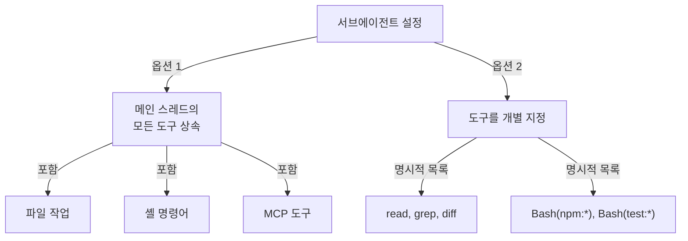

### 실전 예제

바로 쓸 수 있는 서브에이전트 정의 9개가 **[04-subagents/](04-subagents/)에** 있습니다 — `code-reviewer`, `clean-code-reviewer`, `secure-reviewer`, `test-engineer`, `documentation-writer`, `implementation-agent`, `performance-optimizer`, `debugger`, `data-scientist`.

**[04-subagents/README.md](04-subagents/README.md)는** 전체 frontmatter 레퍼런스, 도구 접근 규칙, 중첩 한도, 에이전트 팀을 다룹니다.

### 서브에이전트 컨텍스트 관리

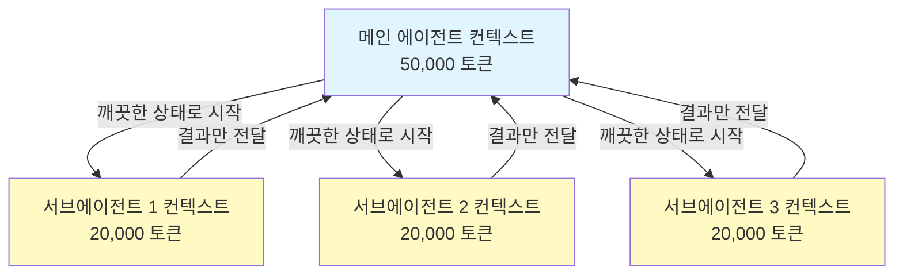

### 서브에이전트를 써야 할 때

| 상황 | 서브에이전트 사용 | 이유 |
|----------|--------------|-----|
| 단계가 많은 복잡한 기능 | ✅ 예 | 관심사 분리, 컨텍스트 오염 방지 |
| 빠른 코드 리뷰 | ❌ 아니요 | 불필요한 오버헤드 |
| 병렬 작업 실행 | ✅ 예 | 서브에이전트마다 자체 컨텍스트 |
| 전문 지식 필요 | ✅ 예 | 사용자 정의 시스템 프롬프트 |
| 오래 걸리는 분석 | ✅ 예 | 메인 컨텍스트 소진 방지 |
| 단일 작업 | ❌ 아니요 | 불필요하게 지연 시간이 늘어남 |

### 에이전트 팀

에이전트 팀은 관련된 작업을 하는 여러 에이전트를 조율합니다. 한 번에 서브에이전트 하나에게 위임하는 대신, 메인 에이전트가 에이전트 여럿으로 이루어진 그룹을 조율해 서로 협업하고, 중간 결과를 공유하고, 공동의 목표를 향해 작업하게 합니다. 프런트엔드 에이전트, 백엔드 에이전트, 테스트 에이전트가 병렬로 일하는 풀스택 기능 개발 같은 대규모 작업에 유용합니다.

---

## 메모리

### 개요

메모리는 Claude가 세션과 대화를 넘어 컨텍스트를 유지하게 합니다. 두 가지 형태가 있는데, claude.ai의 자동 종합과 Claude Code의 파일 시스템 기반 CLAUDE.md입니다.

### 메모리 아키텍처

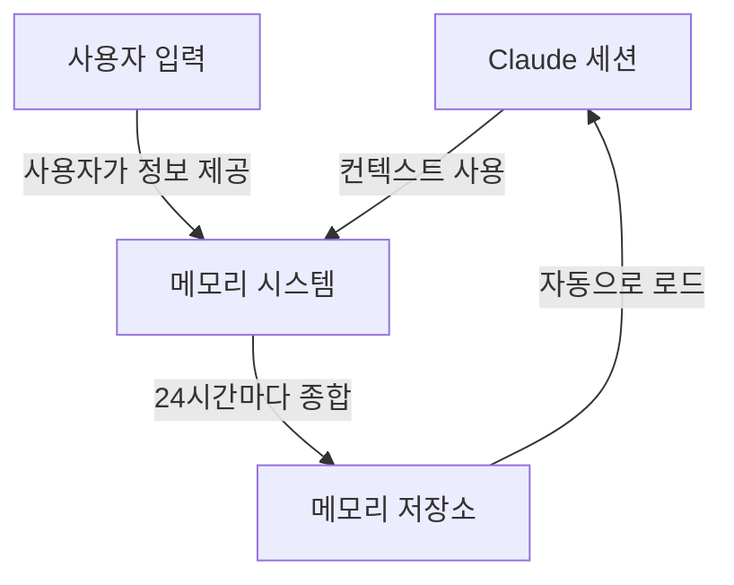

### Claude Code의 메모리 계층 (7단계)

Claude Code는 7단계에서 메모리를 로드합니다. CLAUDE.md 파일들은 서로 덮어쓰지 않고 컨텍스트에 이어 붙으며, 관리형 → 사용자 → 프로젝트 → 로컬 순서로 로드됩니다(더 구체적인 파일일수록 나중에 읽힙니다):

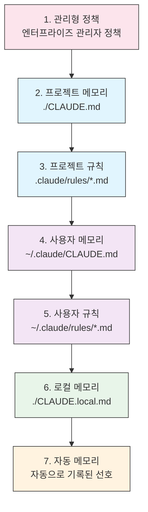

### 메모리 위치 표

| 단계 | 위치 | 범위 | 우선순위 | 공유 | 적합한 용도 |
|------|----------|-------|----------|--------|----------|
| 1. 관리형 정책 | 엔터프라이즈 관리자 | 조직 | 가장 높음 | 조직 전체 사용자 | 규정 준수, 보안 정책 |
| 2. 프로젝트 | `./CLAUDE.md` | 프로젝트 | 높음 | 팀(Git) | 팀 표준, 아키텍처 |
| 3. 프로젝트 규칙 | `.claude/rules/*.md` | 프로젝트 | 높음 | 팀(Git) | 모듈식 프로젝트 규칙 |
| 4. 사용자 | `~/.claude/CLAUDE.md` | 개인 | 중간 | 개인 | 개인 선호 설정 |
| 5. 사용자 규칙 | `~/.claude/rules/*.md` | 개인 | 중간 | 개인 | 개인 규칙 모듈 |
| 6. 로컬 | `./CLAUDE.local.md` | 로컬 | 낮음 | 공유 안 함 | 컴퓨터별 설정 |
| 7. 자동 메모리 | 자동 | 저장소별 | 가장 낮음 | 개인 | 학습한 선호와 패턴 |

### 자동 메모리

자동 메모리는 세션 중에 관찰한 사용자의 선호와 패턴을 자동으로 기록합니다. Claude는 사용자와의 상호작용에서 배우고 다음을 기억합니다:

- 코딩 스타일 선호
- 자주 하는 수정
- 프레임워크와 도구 선택
- 커뮤니케이션 스타일 선호

자동 메모리는 백그라운드에서 동작하며 따로 설정할 필요가 없습니다.

### 메모리 갱신 수명 주기

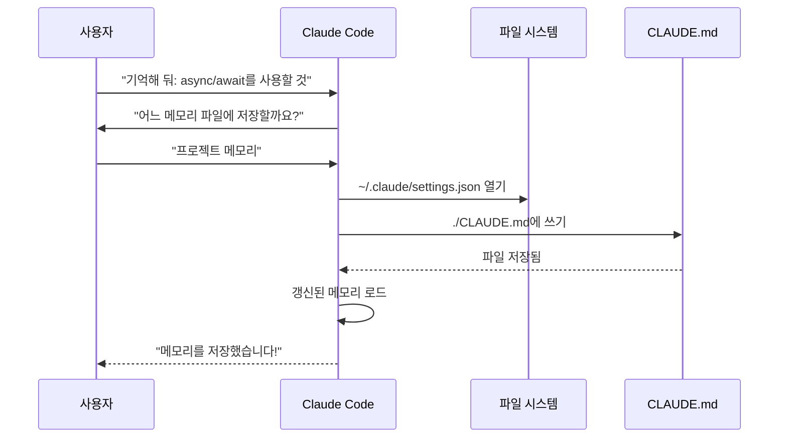

### 실전 예제

복사해서 쓰는 메모리 템플릿이 **[02-memory/](02-memory/)에** 있습니다:

- **`project-CLAUDE.md`** — `./CLAUDE.md`용 팀 전체 프로젝트 표준
- **`personal-CLAUDE.md`** — `~/.claude/CLAUDE.md`용 개인 선호 설정
- **`directory-api-CLAUDE.md`** — 하위 트리에 적용할 디렉토리 범위 표준

**[02-memory/README.md](02-memory/README.md)는** 전체 계층, 가져오기(import) 문법, `.claude/rules/`, 자동 메모리, CLAUDE.md를 200줄 이하로 유지하는 방법을 다룹니다.

### Claude 웹/데스크톱의 메모리

#### 메모리 종합 타임라인


### 자동 메모리 내용

자동 메모리는 Claude가 세션을 거치며 사용자에 대해 배운 내용을 `~/.claude/projects/<project>/memory/`에 저장하며, `MEMORY.md`로 색인합니다. 파일 구조, 로딩 한도, 켜고 끄는 방법은 **[02-memory/README.md](02-memory/README.md)를** 참고하세요.

### 메모리 기능 비교

| 기능 | Claude 웹/데스크톱 | Claude Code (CLAUDE.md) |
|---------|-------------------|------------------------|
| 자동 종합 | ✅ 24시간마다 | ❌ 수동 |
| 프로젝트 간 공유 | ✅ 공유됨 | ❌ 프로젝트별 |
| 팀 접근 | ✅ 공유 프로젝트 | ✅ Git으로 추적 |
| 검색 가능 | ✅ 기본 제공 | ✅ `/memory`로 |
| 편집 가능 | ✅ 채팅 안에서 | ✅ 파일 직접 편집 |
| 가져오기/내보내기 | ✅ 예 | ✅ 복사/붙여넣기 |
| 지속성 | ✅ 24시간 이상 | ✅ 무기한 |

---

## MCP 프로토콜

### 개요

MCP(Model Context Protocol)는 Claude가 외부 도구, API, 실시간 데이터 소스에 접근하는 표준 방식입니다. 메모리와 달리 MCP는 바뀌는 데이터에 실시간으로 접근하게 해 줍니다.

### MCP 아키텍처

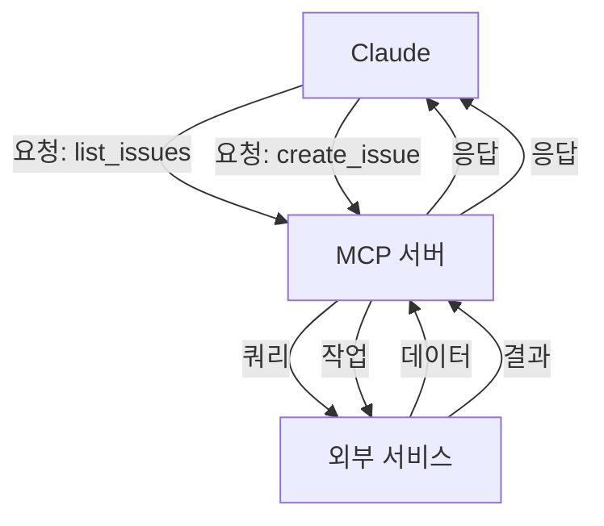

### MCP 생태계

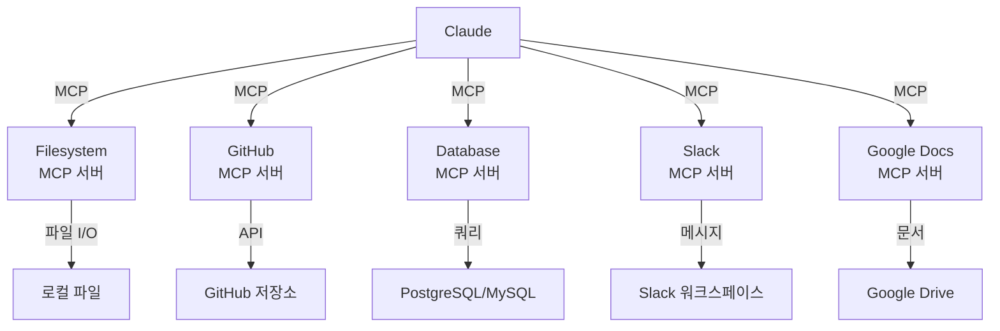

### MCP 설정 과정

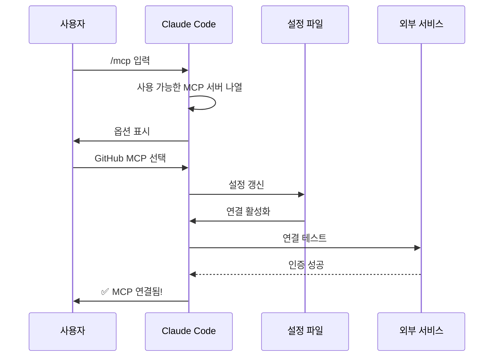

### 사용 가능한 MCP 서버 표

| MCP 서버 | 목적 | 주요 도구 | 인증 | 실시간 |
|------------|---------|--------------|------|-----------|
| **Filesystem** | 파일 작업 | read, write, delete | OS 권한 | ✅ 예 |
| **GitHub** | 저장소 관리 | list_prs, create_issue, push | OAuth | ✅ 예 |
| **Slack** | 팀 커뮤니케이션 | send_message, list_channels | 토큰 | ✅ 예 |
| **Database** | SQL 쿼리 | query, insert, update | 자격 증명 | ✅ 예 |
| **Google Docs** | 문서 접근 | read, write, share | OAuth | ✅ 예 |
| **Asana** | 프로젝트 관리 | create_task, update_status | API 키 | ✅ 예 |
| **Stripe** | 결제 데이터 | list_charges, create_invoice | API 키 | ✅ 예 |
| **Memory** | 지속 메모리 | store, retrieve, delete | 로컬 | ❌ 아니요 |

### 실전 예제

바로 쓸 수 있는 MCP 서버 설정이 **[05-mcp/](05-mcp/)에** 있습니다: `github-mcp.json`, `database-mcp.json`, `filesystem-mcp.json`, `multi-mcp.json`(서버 4개를 파일 하나에).

**[05-mcp/README.md](05-mcp/README.md)는** 전체 `claude mcp add` 문법, 전송 방식, 범위, OAuth, 엔터프라이즈 허용 목록을 다룹니다.

### MCP와 메모리: 결정 매트릭스

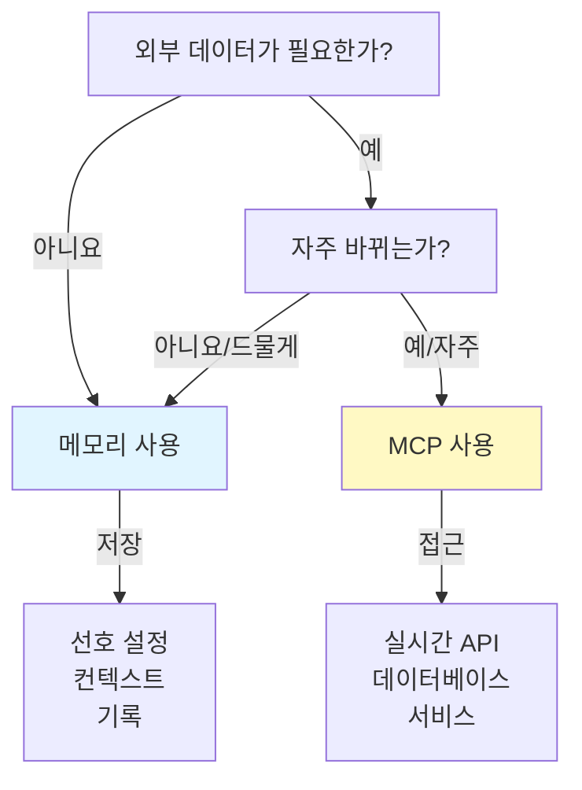

### 요청/응답 패턴

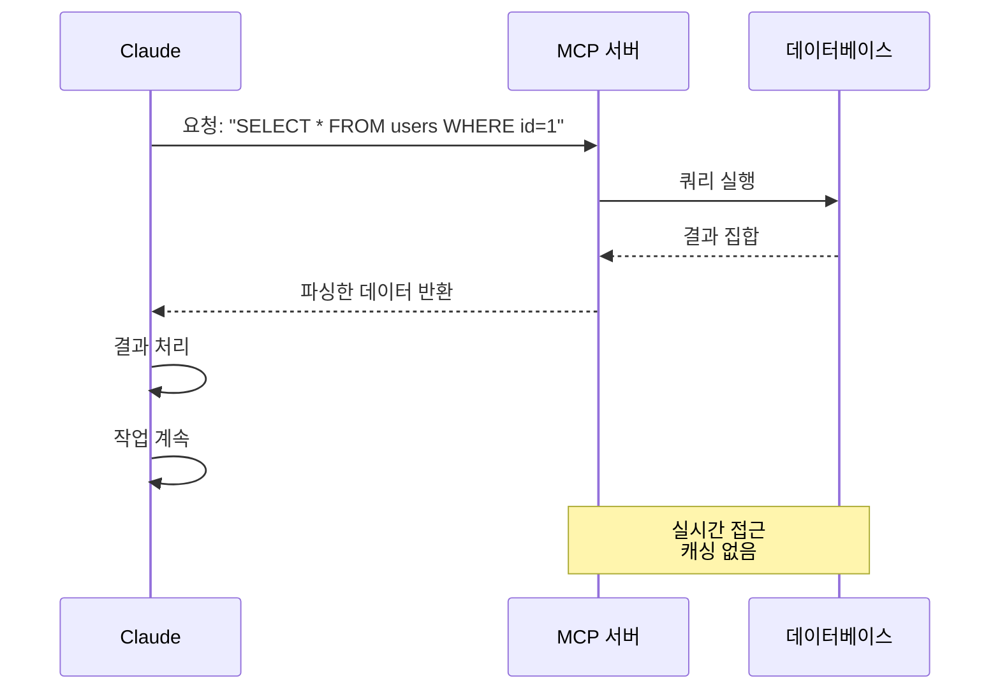

---

## 에이전트 스킬

### 개요

에이전트 스킬은 지침, 스크립트, 리소스를 담은 폴더로 패키징된, 모델이 호출하는 재사용 가능한 기능입니다. Claude는 관련 있는 스킬을 자동으로 찾아 사용합니다.

### 스킬 아키텍처

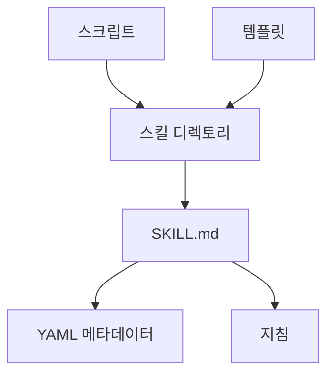

### 스킬 로딩 과정

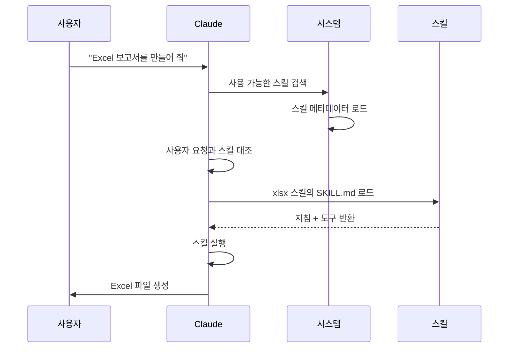

### 스킬 유형과 위치 표

| 유형 | 위치 | 범위 | 공유 | 동기화 | 적합한 용도 |
|------|----------|-------|--------|------|----------|
| 미리 만들어진 스킬 | 기본 제공 | 전역 | 모든 사용자 | 자동 | 문서 작성 |
| 개인 | `~/.claude/skills/` | 개인 | 아니요 | 수동 | 개인 자동화 |
| 프로젝트 | `.claude/skills/` | 팀 | 예 | Git | 팀 표준 |
| 플러그인 | 플러그인 설치로 | 경우에 따라 다름 | 경우에 따라 다름 | 자동 | 통합 기능 |

### 미리 만들어진 스킬

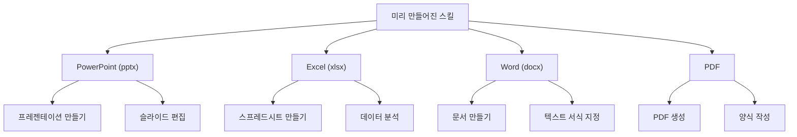

### 번들 스킬

Claude Code에는 설치 없이 바로 쓸 수 있는 번들 스킬이 들어 있습니다. 예를 들면 다음과 같습니다:

| 스킬 | 명령어 | 목적 |
|-------|---------|---------|
| **Batch** | `/batch` | 여러 파일이나 항목에 걸쳐 작업 실행 |
| **Claude API** | `/claude-api` | 프로젝트 언어에 맞는 Claude API와 Managed Agents 레퍼런스 로드. 코드가 `anthropic`이나 `@anthropic-ai/sdk`를 가져오면 자동으로 활성화 |
| **Code Review** | `/code-review` | 선택한 노력 수준으로 현재 diff의 정확성 버그 리뷰. v2.1.154에서 다시 분리된 `/simplify`(품질/재사용 정리)와는 별개의 스킬입니다. v2.1.246부터는 어디서든 Claude가 스스로 시작할 수도 있습니다 |
| **Simplify** | `/simplify` | 품질, 재사용, 정리 리뷰 — v2.1.154부터 다시 `/code-review`와 별개 |
| **Debug** | `/debug` | 현재 세션의 디버그 로깅을 켜고 세션 디버그 로그를 읽어 문제 해결 |
| **Fewer Permission Prompts** | `/fewer-permission-prompts` | 대화 기록을 살펴 자주 쓰는 읽기 전용 도구의 허용 목록을 우선순위대로 제안 |
| **Loop** | `/loop` | 타이머로 반복 작업 예약 |
| **Run** | `/run` | 프로젝트의 앱을 실행하고 조작해 변경 사항 검증(v2.1.145+) |
| **Run Skill Generator** | `/run-skill-generator` | `/run`과 `/verify`에 앱을 빌드하고 실행하고 조작하는 방법을 알려 주는 프로젝트별 스킬 작성(v2.1.145+) |
| **Verify** | `/verify` | 변경 사항이 실제로 동작하는지 검증(v2.1.145+). v2.1.215부터는 직접 호출할 때만 실행 |

이 번들 스킬은 항상 쓸 수 있으며 설치나 설정이 필요 없습니다.

### 실전 예제

스크립트, 템플릿, 참고 파일을 갖춘 완성된 스킬 6개가 **[03-skills/](03-skills/)에** 있습니다:

- **`code-review-specialist/`** — 리뷰 체크리스트, 발견 사항 템플릿, Python 지표 스크립트 2개
- **`refactor/`** — 코드 스멜 목록, 리팩토링 목록, 계획 템플릿, 분석 스크립트 2개
- **`doc-generator/`** — 소스에서 API 문서 생성
- **`blog-draft/`** — 버전 관리되는 출력 규칙을 갖춘 개요와 초안 템플릿
- **`brand-voice/`** — 톤 규칙과 메시지 템플릿(`user-invocable: false` 사용 예)
- **`claude-md/`** — CLAUDE.md 파일 생성, 갱신, 점검

전체 frontmatter 레퍼런스와 점진적 공개 모델은 **[03-skills/README.md](03-skills/README.md)를** 참고하세요.

### 스킬 발견과 호출

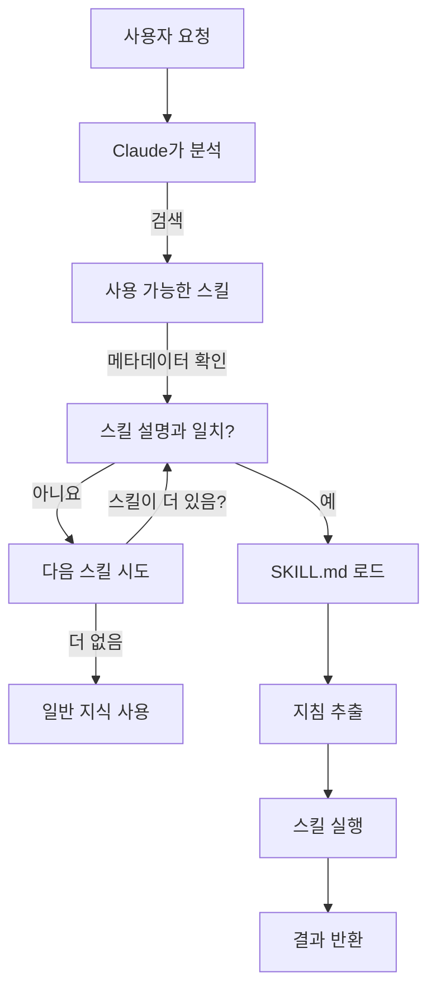

### 스킬과 다른 기능 비교

```mermaid
graph TB
    A["Claude 확장하기"]
    B["슬래시 명령어"]
    C["서브에이전트"]
    D["메모리"]
    E["MCP"]
    F["스킬"]

    A --> B
    A --> C
    A --> D
    A --> E
    A --> F

    B -->|사용자 호출| G["빠른 단축 명령"]
    C -->|자동 위임| H["격리된 컨텍스트"]
    D -->|지속| I["세션 간 컨텍스트"]
    E -->|실시간| J["외부 데이터 접근"]
    F -->|자동 호출| K["자율 실행"]
```

---

## Claude Code 플러그인

### 개요

Claude Code 플러그인은 여러 사용자 정의 구성 요소(슬래시 명령어, 서브에이전트, MCP 서버, 훅)를 묶어 명령어 하나로 설치하는 모음입니다. 여러 기능을 하나의 일관되고 공유 가능한 패키지로 합친, 가장 높은 수준의 확장 방식입니다.

### 아키텍처

```mermaid
graph TB
    A["플러그인"]
    B["슬래시 명령어"]
    C["서브에이전트"]
    D["MCP 서버"]
    E["훅"]
    F["설정"]

    A -->|묶음| B
    A -->|묶음| C
    A -->|묶음| D
    A -->|묶음| E
    A -->|묶음| F
```

### 플러그인 로딩 과정

```mermaid
sequenceDiagram
    participant User as 사용자
    participant Claude as Claude Code
    participant Plugin as 플러그인 마켓플레이스
    participant Install as 설치
    participant SlashCmds as 슬래시 명령어
    participant Subagents as 서브에이전트
    participant MCPServers as MCP 서버
    participant Hooks as 훅
    participant Tools as 설정된 도구

    User->>Claude: claude --plugin-dir ./07-plugins/pr-review
    Claude->>Plugin: 플러그인 매니페스트 다운로드
    Plugin-->>Claude: 플러그인 정의 반환
    Claude->>Install: 구성 요소 추출
    Install->>SlashCmds: 설정
    Install->>Subagents: 설정
    Install->>MCPServers: 설정
    Install->>Hooks: 설정
    SlashCmds-->>Tools: 사용 준비 완료
    Subagents-->>Tools: 사용 준비 완료
    MCPServers-->>Tools: 사용 준비 완료
    Hooks-->>Tools: 사용 준비 완료
    Tools-->>Claude: 플러그인 설치됨 ✅
```

### 플러그인 유형과 배포

| 유형 | 범위 | 공유 | 관리 주체 | 예 |
|------|-------|--------|-----------|----------|
| 공식 | 전역 | 모든 사용자 | Anthropic | PR Review, Security Guidance |
| 커뮤니티 | 공개 | 모든 사용자 | 커뮤니티 | DevOps, Data Science |
| 조직 | 내부 | 팀원 | 회사 | 내부 표준, 도구 |
| 개인 | 개인 | 단일 사용자 | 개발자 | 사용자 정의 워크플로우 |

### 플러그인 정의 구조

매니페스트는 `.claude-plugin/plugin.json`에 있는 JSON입니다. `name`만 필수이고, 인식되지 않는 최상위 키는 제거됩니다:

```json
{
  "name": "plugin-name",
  "version": "1.0.0",
  "description": "이 플러그인이 하는 일"
}
```

### 플러그인 구조

```
my-plugin/
├── .claude-plugin/
│   └── plugin.json
├── commands/
│   ├── task-1.md
│   ├── task-2.md
│   └── workflows/
├── agents/
│   ├── specialist-1.md
│   ├── specialist-2.md
│   └── configs/
├── skills/
│   └── skill-name/
│       └── SKILL.md
├── hooks/
│   └── hooks.json
├── .mcp.json
├── bin/
│   └── my-tool
├── .lsp.json
├── settings.json
├── templates/
│   └── issue-template.md
├── scripts/
│   ├── helper-1.sh
│   └── helper-2.py
├── docs/
│   ├── README.md
│   └── USAGE.md
└── tests/
    └── plugin.test.js
```

### 실전 예제

설치해서 쓸 수 있는 완성된 플러그인 3개가 **[07-plugins/](07-plugins/)에** 있습니다:

- **`pr-review/`** — 리뷰 명령어, 전문 에이전트 3개, GitHub MCP, 리뷰 전 훅
- **`documentation/`** — 문서 생성 명령어, 에이전트 3개, 재사용 가능한 템플릿
- **`devops-automation/`** — 배포/롤백/상태/장애 대응 명령어, 에이전트 3개, Kubernetes MCP, 셸 스크립트

각 플러그인에는 `.claude-plugin/plugin.json` 매니페스트와 디렉토리 구조가 포함되어 있습니다.

### 플러그인 마켓플레이스

```mermaid
graph TB
    A["플러그인 마켓플레이스"]
    B["공식<br/>Anthropic"]
    C["커뮤니티<br/>마켓플레이스"]
    D["엔터프라이즈<br/>레지스트리"]

    A --> B
    A --> C
    A --> D

    B -->|분류| B1["개발"]
    B -->|분류| B2["DevOps"]
    B -->|분류| B3["문서화"]

    C -->|검색| C1["DevOps 자동화"]
    C -->|검색| C2["모바일 개발"]
    C -->|검색| C3["데이터 사이언스"]

    D -->|내부| D1["회사 표준"]
    D -->|내부| D2["레거시 시스템"]
    D -->|내부| D3["규정 준수"]
```

### 플러그인 설치와 수명 주기

```mermaid
graph LR
    A["찾기"] -->|둘러보기| B["마켓플레이스"]
    B -->|선택| C["플러그인 페이지"]
    C -->|보기| D["구성 요소"]
    D -->|설치| E["/plugin install"]
    E -->|추출| F["설정"]
    F -->|활성화| G["사용"]
    G -->|확인| H["업데이트"]
    H -->|사용 가능| G
    G -->|완료| I["끄기"]
    I -->|나중에| J["켜기"]
    J -->|복귀| G
```

### 플러그인 기능 비교

| 기능 | 슬래시 명령어 | 스킬 | 서브에이전트 | 플러그인 |
|---------|---------------|-------|----------|--------|
| **설치** | 직접 복사 | 직접 복사 | 직접 설정 | 명령어 하나 |
| **설정 시간** | 5분 | 10분 | 15분 | 2분 |
| **묶음** | 파일 하나 | 파일 하나 | 파일 하나 | 여러 개 |
| **버전 관리** | 수동 | 수동 | 수동 | 자동 |
| **팀 공유** | 파일 복사 | 파일 복사 | 파일 복사 | 설치 ID |
| **업데이트** | 수동 | 수동 | 수동 | 자동 제공 |
| **의존성** | 없음 | 없음 | 없음 | 포함 가능 |
| **마켓플레이스** | 아니요 | 아니요 | 아니요 | 예 |
| **배포 방식** | 저장소 | 저장소 | 저장소 | 마켓플레이스 |

### 플러그인 활용 사례

| 활용 사례 | 권장 | 이유 |
|----------|-----------------|-----|
| **팀 온보딩** | ✅ 플러그인 사용 | 모든 설정을 즉시 준비 |
| **프레임워크 설정** | ✅ 플러그인 사용 | 프레임워크별 명령어를 묶음 |
| **엔터프라이즈 표준** | ✅ 플러그인 사용 | 중앙 배포, 버전 관리 |
| **빠른 작업 자동화** | ❌ 명령어 사용 | 지나치게 복잡함 |
| **단일 분야 전문성** | ❌ 스킬 사용 | 너무 무거우니 대신 스킬 사용 |
| **전문 분석** | ❌ 서브에이전트 사용 | 직접 만들거나 스킬 사용 |
| **실시간 데이터 접근** | ❌ MCP 사용 | 단독으로 쓰고 묶지 않음 |

### 플러그인을 만들어야 할 때

```mermaid
graph TD
    A["플러그인을 만들어야 할까?"]
    A -->|구성 요소가 여러 개 필요| B{"명령어, 서브에이전트,<br/>MCP 중 여러 개가<br/>필요한가?"}
    B -->|예| C["✅ 플러그인 만들기"]
    B -->|아니요| D["개별 기능 사용"]
    A -->|팀 워크플로우| E{"팀과<br/>공유하는가?"}
    E -->|예| C
    E -->|아니요| F["로컬 설정으로 유지"]
    A -->|복잡한 설정| G{"자동 설정이<br/>필요한가?"}
    G -->|예| C
    G -->|아니요| D
```

### 플러그인 게시하기

**게시 단계:**

1. 모든 구성 요소를 갖춘 플러그인 구조 만들기
2. `.claude-plugin/plugin.json` 매니페스트 작성
3. 문서를 담은 `README.md` 작성
4. `claude --plugin-dir ./my-plugin`으로 로컬 테스트
5. 플러그인 마켓플레이스에 제출
6. 검토와 승인 받기
7. 마켓플레이스에 게시됨
8. 사용자가 명령어 하나로 설치 가능

### 플러그인 README 예시

**[07-plugins/](07-plugins/)의** 완성된 플러그인 3개를 참고하세요 — `pr-review/`, `documentation/`, `devops-automation/`에는 각각 그대로 복사해 쓸 수 있는 `README.md`, 매니페스트, 명령어, 에이전트, MCP 설정이 들어 있습니다.

### 플러그인과 수동 설정 비교

**수동 설정(2시간 이상):**
- 슬래시 명령어를 하나씩 설치
- 서브에이전트를 개별로 만들기
- MCP를 따로 설정
- 훅을 직접 설정
- 모든 것을 문서화
- 팀과 공유(제대로 설정하길 바랄 뿐)

**플러그인 사용(2분):**
```bash
claude --plugin-dir ./07-plugins/pr-review
# ✅ 모든 것이 설치되고 설정됨
# ✅ 바로 사용 가능
# ✅ 팀원 누구나 똑같은 설정을 재현 가능
```

---

## 비교와 통합

### 기능 비교 매트릭스

| 기능 | 호출 방식 | 지속성 | 범위 | 활용 사례 |
|---------|-----------|------------|-------|----------|
| **슬래시 명령어** | 수동 (`/cmd`) | 세션 안에서만 | 명령어 하나 | 빠른 단축 명령 |
| **서브에이전트** | 자동 위임 | 격리된 컨텍스트 | 전문 작업 | 작업 분배 |
| **메모리** | 자동 로드 | 세션 간 유지 | 사용자/팀 컨텍스트 | 장기 학습 |
| **MCP 프로토콜** | 자동 조회 | 실시간 외부 데이터 | 실시간 데이터 접근 | 동적 정보 |
| **스킬** | 자동 호출 | 파일 시스템 기반 | 재사용 가능한 전문성 | 자동화된 워크플로우 |

### 상호작용 타임라인

```mermaid
graph LR
    A["세션 시작"] -->|로드| B["메모리 (CLAUDE.md)"]
    B -->|발견| C["사용 가능한 스킬"]
    C -->|등록| D["슬래시 명령어"]
    D -->|연결| E["MCP 서버"]
    E -->|준비 완료| F["사용자 상호작용"]

    F -->|/cmd 입력| G["슬래시 명령어"]
    F -->|요청| H["스킬 자동 호출"]
    F -->|조회| I["MCP 데이터"]
    F -->|복잡한 작업| J["서브에이전트에 위임"]

    G -->|사용| B
    H -->|사용| B
    I -->|사용| B
    J -->|사용| B
```

### 실전 통합 예제: 고객 지원 자동화

#### 아키텍처

```mermaid
graph TB
    User["고객 이메일"] -->|수신| Router["지원 라우터"]

    Router -->|분석| Memory["메모리<br/>고객 이력"]
    Router -->|조회| MCP1["MCP: 고객 DB<br/>이전 티켓"]
    Router -->|확인| MCP2["MCP: Slack<br/>팀 상태"]

    Router -->|복잡한 건 라우팅| Sub1["서브에이전트: 기술 지원<br/>컨텍스트: 기술 문제"]
    Router -->|간단한 건 라우팅| Sub2["서브에이전트: 청구<br/>컨텍스트: 결제 문제"]
    Router -->|긴급 건 라우팅| Sub3["서브에이전트: 에스컬레이션<br/>컨텍스트: 우선 처리"]

    Sub1 -->|서식 지정| Skill1["스킬: 응답 생성기<br/>브랜드 보이스 유지"]
    Sub2 -->|서식 지정| Skill2["스킬: 응답 생성기"]
    Sub3 -->|서식 지정| Skill3["스킬: 응답 생성기"]

    Skill1 -->|생성| Output["서식이 적용된 응답"]
    Skill2 -->|생성| Output
    Skill3 -->|생성| Output

    Output -->|게시| MCP3["MCP: Slack<br/>팀에 알림"]
    Output -->|전송| Reply["고객 답장"]
```

#### 요청 흐름

```markdown
## 고객 지원 요청 흐름

### 1. 이메일 수신
"파일을 업로드하려고 하면 500 오류가 납니다. 이것 때문에 작업이 막혀 있어요!"

### 2. 메모리 조회
- 지원 표준이 담긴 CLAUDE.md 로드
- 고객 이력 확인: VIP 고객, 이번 달 세 번째 문제

### 3. MCP 쿼리
- GitHub MCP: 열린 이슈 나열(관련 버그 보고서 발견)
- Database MCP: 시스템 상태 확인(보고된 장애 없음)
- Slack MCP: 엔지니어링 팀이 알고 있는지 확인

### 4. 스킬 감지와 로딩
- 요청이 "기술 지원" 스킬과 일치
- 스킬에서 지원 응답 템플릿 로드

### 5. 서브에이전트 위임
- 기술 지원 서브에이전트로 라우팅
- 컨텍스트 제공: 고객 이력, 오류 상세, 알려진 문제
- 서브에이전트가 쓸 수 있는 도구: read, bash, grep

### 6. 서브에이전트 처리
기술 지원 서브에이전트:
- 코드베이스에서 파일 업로드 시 발생하는 500 오류 검색
- 커밋 8f4a2c의 최근 변경 사항 발견
- 우회 방법 문서 작성

### 7. 스킬 실행
응답 생성기 스킬:
- 브랜드 보이스 가이드라인 사용
- 공감하는 어조로 응답 작성
- 우회 방법 단계 포함
- 관련 문서 링크

### 8. MCP 출력
- #support Slack 채널에 업데이트 게시
- 엔지니어링 팀 태그
- Jira MCP로 티켓 갱신

### 9. 응답
고객이 받는 내용:
- 문제를 공감하며 확인하는 인사
- 원인 설명
- 바로 쓸 수 있는 우회 방법
- 근본 수정 일정
- 관련 이슈 링크
```

### 전체 기능 조율

```mermaid
sequenceDiagram
    participant User as 사용자
    participant Claude as Claude Code
    participant Memory as 메모리<br/>CLAUDE.md
    participant MCP as MCP 서버
    participant Skills as 스킬
    participant SubAgent as 서브에이전트

    User->>Claude: 요청: "인증 시스템을 만들어 줘"
    Claude->>Memory: 프로젝트 표준 로드
    Memory-->>Claude: 인증 표준, 팀 관행
    Claude->>MCP: GitHub에서 비슷한 구현 조회
    MCP-->>Claude: 코드 예제, 모범 사례
    Claude->>Skills: 일치하는 스킬 감지
    Skills-->>Claude: 보안 리뷰 스킬 + 테스트 스킬
    Claude->>SubAgent: 구현 위임
    SubAgent->>SubAgent: 기능 구현
    Claude->>Skills: 보안 리뷰 스킬 적용
    Skills-->>Claude: 보안 체크리스트 결과
    Claude->>SubAgent: 테스트 위임
    SubAgent-->>Claude: 테스트 결과
    Claude->>User: 완성된 시스템 전달
```

### 기능별 사용 시점

```mermaid
graph TD
    A["새 작업"] --> B{"작업 유형?"}

    B -->|반복되는 워크플로우| C["슬래시 명령어"]
    B -->|실시간 데이터 필요| D["MCP 프로토콜"]
    B -->|다음에도 기억| E["메모리"]
    B -->|전문 하위 작업| F["서브에이전트"]
    B -->|특정 분야 작업| G["스킬"]

    C --> C1["✅ 팀 단축 명령"]
    D --> D1["✅ 실시간 API 접근"]
    E --> E1["✅ 지속되는 컨텍스트"]
    F --> F1["✅ 병렬 실행"]
    G --> G1["✅ 자동 호출되는 전문성"]
```

### 선택 결정 트리

```mermaid
graph TD
    Start["Claude를 확장해야 하나요?"]

    Start -->|빠른 반복 작업| A{"수동인가 자동인가?"}
    A -->|수동| B["슬래시 명령어"]
    A -->|자동| C["스킬"]

    Start -->|외부 데이터 필요| D{"실시간인가?"}
    D -->|예| E["MCP 프로토콜"]
    D -->|아니요/세션 간| F["메모리"]

    Start -->|복잡한 프로젝트| G{"역할이 여러 개인가?"}
    G -->|예| H["서브에이전트"]
    G -->|아니요| I["스킬 + 메모리"]

    Start -->|장기 컨텍스트| J["메모리"]
    Start -->|팀 워크플로우| K["슬래시 명령어 +<br/>메모리"]
    Start -->|완전 자동화| L["스킬 +<br/>서브에이전트 +<br/>MCP"]
```

---

## 요약 표

| 측면 | 슬래시 명령어 | 서브에이전트 | 메모리 | MCP | 스킬 | 플러그인 |
|--------|---|---|---|---|---|---|
| **설정 난이도** | 쉬움 | 보통 | 쉬움 | 보통 | 보통 | 쉬움 |
| **학습 곡선** | 낮음 | 보통 | 낮음 | 보통 | 보통 | 낮음 |
| **팀 이점** | 높음 | 높음 | 보통 | 높음 | 높음 | 매우 높음 |
| **자동화 수준** | 낮음 | 높음 | 보통 | 높음 | 높음 | 매우 높음 |
| **컨텍스트 관리** | 단일 세션 | 격리 | 지속 | 실시간 | 지속 | 모든 기능 |
| **유지 보수 부담** | 낮음 | 보통 | 낮음 | 보통 | 보통 | 낮음 |
| **확장성** | 좋음 | 매우 좋음 | 좋음 | 매우 좋음 | 매우 좋음 | 매우 좋음 |
| **공유 용이성** | 보통 | 보통 | 좋음 | 좋음 | 좋음 | 매우 좋음 |
| **버전 관리** | 수동 | 수동 | 수동 | 수동 | 수동 | 자동 |
| **설치** | 직접 복사 | 직접 설정 | 해당 없음 | 직접 설정 | 직접 복사 | 명령어 하나 |

---

## 빠른 시작 가이드

### 1주차: 간단하게 시작
- 자주 하는 작업용 슬래시 명령어 2~3개 만들기
- 설정에서 메모리 켜기
- CLAUDE.md에 팀 표준 기록하기

### 2주차: 실시간 접근 추가
- MCP 1개 설정(GitHub나 데이터베이스)
- `/mcp`로 설정하기
- 워크플로우에서 실시간 데이터 조회하기

### 3주차: 작업 분배
- 특정 역할을 위한 첫 서브에이전트 만들기
- Claude에게 만들어 달라고 하거나 `.claude/agents/<name>.md` 파일 추가(`/agents` 마법사는 제거됨)
- 간단한 작업으로 위임 테스트하기

### 4주차: 모든 것을 자동화
- 반복 자동화를 위한 첫 스킬 만들기
- 스킬 마켓플레이스를 쓰거나 직접 만들기
- 모든 기능을 조합해 전체 워크플로우 만들기

### 계속해서
- 메모리를 매달 검토하고 갱신하기
- 패턴이 보이면 새 스킬 추가하기
- MCP 쿼리 최적화하기
- 서브에이전트 프롬프트 다듬기

---

## 훅

### 개요

훅은 Claude Code 이벤트에 반응해 자동으로 실행되는 이벤트 기반 셸 명령어입니다. 사람이 개입하지 않아도 자동화, 검증, 사용자 정의 워크플로우를 실행할 수 있습니다.

### 훅 이벤트

Claude Code는 5가지 훅 타입(command, http, mcp_tool, prompt, agent)에 걸쳐 **33가지 훅 이벤트를** 지원합니다:

| 훅 이벤트 | 발생 시점 | 활용 사례 |
|------------|---------|-----------|
| **SessionStart** | 세션 시작/재개/clear/compact | 환경 준비, 초기화 |
| **Setup** | `--init-only`로 실행하거나, `-p`와 함께 `--init` / `--maintenance`로 실행할 때(일반 시작에서는 발생하지 않음) | 도구 준비, 의존성 설치 |
| **InstructionsLoaded** | CLAUDE.md나 규칙 파일 로드 | 검증, 변환, 보강 |
| **UserPromptSubmit** | 사용자가 프롬프트 제출 | 입력 검증, 프롬프트 필터링 |
| **UserPromptExpansion** | 입력한 슬래시 명령어(스킬, 사용자 정의 명령어, MCP 프롬프트)가 프롬프트로 확장됨. 차단할 수 있음 | `/command` 직접 사용 차단이나 기록, 스킬별 컨텍스트 추가 |
| **PreToolUse** | 어떤 도구든 실행되기 전 | 검증, 승인 관문, 로깅 |
| **PermissionRequest** | 권한 대화 상자 표시 | 자동 승인/거부 흐름 |
| **PermissionDenied** | 자동 모드가 도구 호출을 거부(사용자가 직접 거부할 때는 발생하지 않음) | 로깅, 분석, 정책 적용 |
| **PostToolUse** | 도구 성공 후 | 자동 포맷팅, 알림, 정리 |
| **PostToolUseFailure** | 도구 실행 실패 | 오류 처리, 로깅 |
| **PostToolBatch** | 여러 도구 사용이 한 묶음으로 끝난 후 | 종합 보고, 일괄 검증 |
| **Notification** | 알림 전송 | 경고, 외부 통합 |
| **MessageDisplay** | 어시스턴트 메시지 텍스트가 표시되는 동안 | 표시되는 메시지 텍스트 변환이나 숨기기 |
| **SubagentStart** | 서브에이전트 생성 | 컨텍스트 주입, 초기화 |
| **SubagentStop** | 서브에이전트 종료 | 결과 검증, 로깅 |
| **Stop** | Claude 응답 완료 | 요약 생성, 정리 작업 |
| **StopFailure** | API 오류로 턴 종료 | 오류 복구, 로깅 |
| **TeammateIdle** | 에이전트 팀의 팀원 유휴 | 작업 분배, 조율 |
| **TaskCompleted** | 작업 완료 표시. 할 일 도구가 켜져 있을 때만 발생하며, 할 일 도구는 Claude 3.x 모델, Opus 4–4.7, Sonnet 4–4.6, Haiku 4.5에서만 기본으로 제공됩니다. `CLAUDE_CODE_ENABLE_TODO_TOOLS=1`로 다시 켤 수 있음(v2.1.233) | 작업 후 처리 |
| **TaskCreated** | TaskCreate로 작업 생성. 할 일 도구가 켜져 있을 때만 발생하며, 할 일 도구는 Claude 3.x 모델, Opus 4–4.7, Sonnet 4–4.6, Haiku 4.5에서만 기본으로 제공됩니다. `CLAUDE_CODE_ENABLE_TODO_TOOLS=1`로 다시 켤 수 있음(v2.1.233) | 작업 추적, 로깅 |
| **ConfigChange** | 설정 파일 변경 | 검증, 전파 |
| **CwdChanged** | 작업 디렉토리 변경 | 디렉토리별 준비 작업 |
| **DirectoryAdded** | `/add-dir`이나 SDK의 `register_repo_root` 제어 요청으로 세션 도중 새 작업 디렉토리 등록 | 새로 추가된 디렉토리용 도구 준비 |
| **FileChanged** | 감시 중인 파일 변경 | 파일 모니터링, 다시 빌드 트리거 |
| **PreCompact** | 컨텍스트 컴팩션 전 | 상태 보존 |
| **PostCompact** | 컴팩션 완료 후 | 압축 후 작업 |
| **PreModelSwitch** | 요청된 모델 전환이 적용되기 전 | 모델 변경 허용이나 거부 |
| **PostModelSwitch** | 세션의 모델이 바뀐 후 | 모델 변경 기록이나 대응 |
| **WorktreeCreate** | worktree 생성 중 | 기본 git worktree 생성 방식을 대체. worktree 경로를 출력해야 함 |
| **WorktreeRemove** | worktree 제거 중 | 정리, 리소스 해제 |
| **Elicitation** | MCP 서버가 사용자 입력 요청 | 입력 검증 |
| **ElicitationResult** | 사용자가 입력 요청에 응답 | 응답 처리 |
| **SessionEnd** | 세션 종료 | 정리, 마지막 로깅 |

### 자주 쓰는 훅

훅은 `~/.claude/settings.json`(사용자 수준)이나 `.claude/settings.json`(프로젝트 수준)에서 설정합니다:

```json
{
  "hooks": {
    "PostToolUse": [
      {
        "matcher": "Write",
        "hooks": [
          {
            "type": "command",
            "command": "jq -r '.tool_input.file_path' | xargs npx prettier --write"
          }
        ]
      }
    ],
    "PreToolUse": [
      {
        "matcher": "Edit",
        "hooks": [
          {
            "type": "command",
            "command": "jq -r '.tool_input.file_path' | xargs npx eslint"
          }
        ]
      }
    ]
  }
}
```

### 훅 환경 변수

- 훅 입력은 stdin으로 JSON 형태로 전달됩니다(`session_id`, `tool_name`, `tool_input.file_path`, …) — `jq`로 읽으세요
- `$CLAUDE_CODE_SESSION_ID` - 현재 세션 식별자
- `$CLAUDE_PROJECT_DIR` - 프로젝트 디렉토리 경로

### 모범 사례

✅ **권장:**
- 훅은 빠르게 유지하기(1초 미만)
- 검증과 자동화에 훅 사용하기
- 오류를 부드럽게 처리하기
- 절대 경로 사용하기

❌ **비권장:**
- 사용자 입력을 기다리는 훅 만들기
- 오래 걸리는 작업에 훅 사용하기
- 자격 증명 하드코딩하기

**참고**: 자세한 예제는 [06-hooks/](06-hooks/)를 참고하세요

---

## 체크포인트와 되감기

### 개요

체크포인트를 쓰면 대화 상태를 저장하고 이전 시점으로 되감을 수 있어, 안전하게 실험하고 여러 접근 방식을 탐색할 수 있습니다.

### 핵심 개념

| 개념 | 설명 |
|---------|-------------|
| **체크포인트** | 메시지, 파일, 컨텍스트를 포함한 대화 상태의 스냅샷 |
| **되감기** | 이후 변경 사항을 버리고 이전 체크포인트로 돌아가기 |
| **분기점** | 여러 접근 방식을 탐색하는 출발점이 되는 체크포인트 |

### 체크포인트 사용하기

체크포인트는 사용자가 프롬프트를 보낼 때마다 자동으로 만들어집니다. 되감으려면:

```bash
# Esc를 두 번 누르면 체크포인트 브라우저가 열립니다
Esc + Esc

# 또는 /rewind 명령어 사용
/rewind
```

체크포인트를 고르면 여섯 가지 옵션 중 하나를 선택합니다:
1. **Restore code and conversation**(코드와 대화 복원) -- 둘 다 그 시점으로 되돌림
2. **Restore conversation**(대화 복원) -- 메시지는 되감고 현재 코드는 유지
3. **Restore code**(코드 복원) -- 파일은 되돌리고 대화는 유지
4. **Summarize from here**(여기부터 요약) -- 대화를 요약으로 압축
5. **Summarize up to here**(여기까지 요약) -- 이 시점 이전의 모든 내용을 요약으로 압축
6. **Never mind**(취소) -- 취소

### 활용 사례

| 상황 | 워크플로우 |
|----------|----------|
| **접근 방식 탐색** | 저장 → A 시도 → 저장 → 되감기 → B 시도 → 비교 |
| **안전한 리팩토링** | 저장 → 리팩토링 → 테스트 → 실패하면 되감기 |
| **A/B 테스트** | 저장 → 디자인 A → 저장 → 되감기 → 디자인 B → 비교 |
| **실수 복구** | 문제 발견 → 마지막 정상 상태로 되감기 |

### 설정

체크포인팅은 기본으로 켜져 있으며 `fileCheckpointingEnabled`로 제어합니다:

```json
{
  "fileCheckpointingEnabled": true
}
```

**참고**: 자세한 예제는 [08-checkpoints/](08-checkpoints/)를 참고하세요

---

## 고급 기능

### 계획 모드

코딩 전에 상세한 구현 계획을 세웁니다.

**켜는 방법:**
```bash
/plan 사용자 인증 시스템 구현
```

**이점:**
- 소요 시간 추정이 포함된 명확한 로드맵
- 위험 평가
- 체계적인 작업 분해
- 검토하고 수정할 기회

### 확장 사고

복잡한 문제를 위한 깊은 추론입니다.

**켜는 방법:**
- 세션 중에 `Alt+T`(macOS에서는 `Option+T`)로 켜고 끔
- Opus 4.7+, Sonnet 5+, Haiku 5.5, Fable은 항상 적응형 추론을 쓰므로 고정된 `MAX_THINKING_TOKENS` 예산이 적용되지 않습니다. 깊이는 `/effort`로 조절하세요

```bash
# 노력 수준으로 추론 깊이 조절
/effort high
```

**이점:**
- 트레이드오프를 철저히 분석
- 더 나은 아키텍처 결정
- 엣지 케이스 고려
- 체계적인 평가

### 백그라운드 작업

대화를 막지 않고 오래 걸리는 작업을 실행합니다.

**사용법:**
```bash
사용자: 백그라운드에서 테스트를 실행해 줘

Claude: bg-1234 작업을 시작했습니다

/tasks               # 백그라운드 작업 확인과 관리 (별칭: /bashes)
```

### 권한 모드

Claude가 할 수 있는 일을 제어합니다.

| 모드 | 설명 | 활용 사례 |
|------|-------------|----------|
| **manual** | 민감한 작업에서 확인을 요청하는 표준 권한(v2.1.200부터 Manual로 표시되며 설정값은 여전히 `default`이고, 훅과 SDK도 이 값을 보고함) | 일반 개발 |
| **acceptEdits** | 확인 없이 파일 편집 자동 승인 | 신뢰하는 편집 워크플로우 |
| **plan** | 분석과 계획만, 파일 수정 없음 | 코드 리뷰, 아키텍처 계획 |
| **auto** | 분류기가 안전한 작업은 승인하고 위험한 작업은 차단. 연속 3번 또는 총 20번 차단되어야 다시 확인을 요청 | 안전을 갖춘 적절한 자율성 |
| **dontAsk** | 확인이 필요한 모든 작업을 자동 거부. 사전 승인된 도구와 읽기만 실행 | 제한된 CI와 스크립트 |
| **bypassPermissions** | 제한 없는 전체 접근, 안전 검사 없음 | CI/CD 파이프라인, 신뢰하는 스크립트 |

**사용법:**
```bash
claude --permission-mode plan          # 읽기 전용 분석
claude --permission-mode acceptEdits   # 편집 자동 승인
claude --permission-mode auto          # 안전한 작업 자동 승인
claude --permission-mode dontAsk       # 사전 승인된 도구만 실행하고 나머지는 거부
```

### 헤드리스 모드 (print 모드)

`-p`(print) 플래그로 대화형 입력 없이 Claude Code를 실행해 자동화와 CI/CD에 활용합니다.

**사용법:**
```bash
# 특정 작업 실행
claude -p "모든 테스트를 실행해 줘"

# 분석할 입력을 파이프로 전달
cat error.log | claude -p "이 오류를 설명해 줘"

# CI/CD 통합 (GitHub Actions)
- name: AI Code Review
  run: claude -p "PR 변경 사항을 리뷰하고 문제를 보고해 줘"

# 스크립트용 JSON 출력
claude -p --output-format json "src/의 모든 함수를 나열해 줘"
```

### 예약 작업

`/loop` 명령어로 작업을 반복 일정에 따라 실행합니다.

**사용법:**
```bash
/loop every 30m "테스트를 실행하고 실패를 보고해 줘"
/loop every 2h "의존성 업데이트가 있는지 확인해 줘"
/loop every 1d "코드 변경 사항의 일일 요약을 만들어 줘"
```

예약 작업은 백그라운드에서 실행되고 끝나면 결과를 보고합니다. 지속적인 모니터링, 주기적인 점검, 자동 유지 보수 워크플로우에 유용합니다.

### Chrome 통합

Claude Code는 Chrome 브라우저와 통합해 웹 자동화 작업을 할 수 있습니다. 개발 워크플로우 안에서 바로 웹 페이지 이동, 양식 작성, 스크린샷 찍기, 웹사이트 데이터 추출 같은 일을 할 수 있습니다.

### 세션 관리

여러 작업 세션을 관리합니다.

**명령어:**
```bash
/resume                # 이전 대화 재개
/rename "Feature"      # 현재 세션 이름 지정
/fork                  # 새 세션으로 포크
claude -c              # 가장 최근 대화 이어 가기
claude -r "Feature"    # 이름이나 ID로 세션 재개
```

### 대화형 기능

**키보드 단축키:**
- `Ctrl + R` - 명령어 기록 검색
- `Tab` - 자동 완성
- `↑ / ↓` - 명령어 기록
- `Ctrl + L` - 화면 지우기

**여러 줄 입력:** `\` + Enter, Option+Enter(macOS), Shift+Enter, Ctrl+J를 누르면 새 줄이 시작됩니다. `\end` 같은 종료 표시는 없습니다.

### 설정

전체 설정 예시:

```json
{
  "alwaysThinkingEnabled": true,
  "showThinkingSummaries": true,
  "permissions": {
    "defaultMode": "manual"
  }
}
```

백그라운드 작업을 위한 `settings.json` 블록은 따로 없습니다 — 이 기능은 `CLAUDE_CODE_DISABLE_BACKGROUND_TASKS` 환경 변수로 제어하고, 동시 실행 수는 `CLAUDE_CODE_MAX_CONCURRENT_SUBAGENTS`(기본값 `20`)로 제어합니다.

**참고**: 전체 가이드는 [09-advanced-features/](09-advanced-features/)를 참고하세요

---

## 모델과 추론 노력 수준

Claude Code는 적응형 추론 노력 수준을 지원하는 다음 모델을 쓸 수 있습니다:

| 모델 | 컨텍스트 윈도우 | 노력 수준 | 기본 노력 수준(Claude Code) |
|-------|----------------|---------------|------------------------------|
| Claude Opus 5.5 | 100만 토큰(네이티브) | `low`, `medium`, `high`, `xhigh`, `max` | `medium` — v2.1.280부터 기본 모델이자 기본 Opus 모델(Claude Code v2.1.280+ 필요) |
| Claude Sonnet 5.5 | 100만 토큰(네이티브) | `low`, `medium`, `high`, `xhigh`, `max` | `medium` — v2.1.284부터 Anthropic API의 기본 Sonnet 모델(Claude Code v2.1.284+ 필요) |
| Claude Haiku 5.5 | 100만 토큰(네이티브) | `low`, `medium`, `high`, `xhigh`, `max` | `medium` — v2.1.293부터 Anthropic API의 기본 Haiku 모델(Claude Code v2.1.293+ 필요) |
| Claude Opus 5 | 100만 토큰(네이티브) | `low`, `medium`, `high`, `xhigh`, `max` | `high` — v2.1.219부터 v2.1.280 전까지 기본 Opus 모델(Claude Code v2.1.219+ 필요) |
| Claude Sonnet 5 | 100만 토큰(네이티브) | `low`, `medium`, `high`, `xhigh`, `max` | `high` — v2.1.197부터 v2.1.280 전까지 Pro/Team Standard의 기본 모델(지금은 Opus 5.5) |
| Claude Opus 4.8 | 100만 토큰(네이티브) | `low`, `medium`, `high`, `xhigh`, `max` | `high`(v2.1.154부터) |
| Claude Opus 4.7 (레거시) | 100만 토큰(네이티브) | `low`, `medium`, `high`, `xhigh`, `max` | `xhigh`(Opus 4.7 출시일인 2026-04-16부터) |
| Claude Sonnet 4.6 | 100만 토큰 | `low`, `medium`, `high`, `max` | Pro/Max 구독자는 `high`(v2.1.117에서 `medium`에서 상향) |
| Claude Haiku 4.5 | 20만 토큰 | — (노력 수준 미지원) | — |

> **참고**: `xhigh`는 Opus 5.5, Sonnet 5.5, Haiku 5.5, Opus 5, Sonnet 5, Opus 4.8, Opus 4.7에서 쓸 수 있고, `max`는 Opus 5.5, Sonnet 5.5, Haiku 5.5, Opus 5, Sonnet 5, Opus 4.8/4.7/4.6, Sonnet 4.6에서 동작합니다(세션 한정). Haiku 4.5는 노력 수준을 지원하지 않습니다.

> **참고**: v2.1.117에서 Opus 4.7 세션이 `/context`를 네이티브 100만 윈도우 대신 20만 기준으로 계산하던 버그가 고쳐졌습니다 — Opus 4.7에서 실제로 100만 컨텍스트를 쓰려면 v2.1.117 이상으로 업그레이드하세요. Opus 5와 Opus 4.8도 네이티브 100만 토큰 윈도우를 가집니다.

> **참고**: v2.1.118에서 `/cost`와 `/stats`가 `/usage`로 통합되었습니다. 이제 `/usage`가 비용/통계 등의 탭을 갖춘 대표 명령어이며, `/cost`와 `/stats`는 해당 탭을 바로 여는 단축 별칭으로 남아 있습니다. v2.1.149부터 비용 보기는 지출을 분류별(스킬, 서브에이전트, 플러그인, MCP 서버별 비용)로도 나눠 보여 줍니다.

## 자료

- [Claude Code 문서](https://code.claude.com/docs/ko/overview)
- [Claude Code 변경 로그](https://code.claude.com/docs/en/changelog)
- [MCP GitHub 서버](https://github.com/modelcontextprotocol/servers)
- [Anthropic Cookbook](https://github.com/anthropics/anthropic-cookbook)

---
**최종 업데이트**: 2026년 10월 18일
**Claude Code 버전**: 2.1.302
**출처**:
- https://code.claude.com/docs/en/plugins/manifest-reference
- https://code.claude.com/docs/en/plugins/create
- https://code.claude.com/docs/en/plugins/install
- https://code.claude.com/docs/en/settings-reference
- https://code.claude.com/docs/ko/interactive-mode
- https://code.claude.com/docs/ko/checkpointing
- https://code.claude.com/docs/ko/memory
- https://code.claude.com/docs/ko/skills
- https://code.claude.com/docs/en/tools-reference#task-tool-availability
- https://www.anthropic.com/news/claude-sonnet-5
- https://code.claude.com/docs/ko/cli-reference
- https://code.claude.com/docs/ko/model-config
- https://github.com/anthropics/claude-code/blob/main/CHANGELOG.md
- https://code.claude.com/docs/ko/hooks
- https://code.claude.com/docs/ko/sub-agents
- https://code.claude.com/docs/ko/permission-modes
- https://code.claude.com/docs/ko/commands
- https://code.claude.com/docs/ko/remote-control
- https://code.claude.com/docs/ko/hooks#userpromptexpansion
**호환 모델**: Claude Fable 5.1, Claude Fable 5, Claude Opus 5, Claude Sonnet 5, Claude Sonnet 4.6, Claude Opus 4.8, Claude Haiku 4.5
