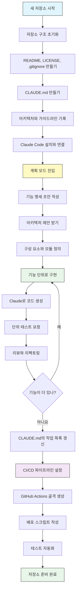
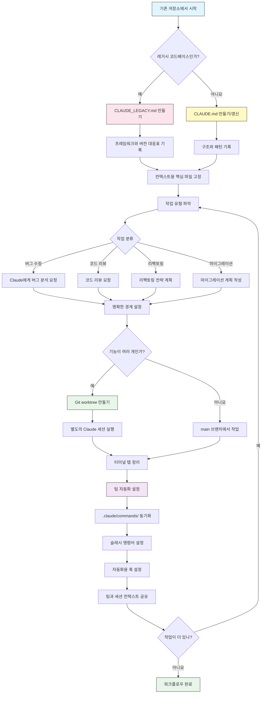

<picture>
  <source media="(prefers-color-scheme: dark)" srcset="resources/logos/claude-howto-logo-dark.svg">
  
</picture>

# 유용한 자료 모음

## 공식 문서

| 자료 | 설명 | 링크 |
|----------|-------------|------|
| Claude Code 문서 | Claude Code 공식 문서 | [code.claude.com/docs/ko/overview](https://code.claude.com/docs/ko/overview) |
| Anthropic 문서 | Anthropic 전체 문서 | [docs.anthropic.com](https://docs.anthropic.com) |
| MCP 프로토콜 | Model Context Protocol 명세 | [modelcontextprotocol.io](https://modelcontextprotocol.io) |
| MCP 서버 | 공식 MCP 서버 구현 | [github.com/modelcontextprotocol/servers](https://github.com/modelcontextprotocol/servers) |
| Anthropic Cookbook | 코드 예제와 튜토리얼 | [github.com/anthropics/anthropic-cookbook](https://github.com/anthropics/anthropic-cookbook) |
| Claude Code 스킬 | 커뮤니티 스킬 저장소 | [github.com/anthropics/skills](https://github.com/anthropics/skills) |
| 에이전트 팀 | 여러 에이전트의 조율과 협업 | [code.claude.com/docs/ko/agent-teams](https://code.claude.com/docs/ko/agent-teams) |
| 예약 작업 | /loop와 cron으로 반복 작업 실행 | [code.claude.com/docs/ko/scheduled-tasks](https://code.claude.com/docs/ko/scheduled-tasks) |
| Chrome 통합 | 브라우저 자동화 | [code.claude.com/docs/ko/chrome](https://code.claude.com/docs/ko/chrome) |
| 키 바인딩 | 키보드 단축키 사용자 지정 | [code.claude.com/docs/ko/keybindings](https://code.claude.com/docs/ko/keybindings) |
| 데스크톱 앱 | 네이티브 데스크톱 애플리케이션 | [code.claude.com/docs/ko/desktop](https://code.claude.com/docs/ko/desktop) |
| Remote Control | 원격 세션 제어 | [code.claude.com/docs/ko/remote-control](https://code.claude.com/docs/ko/remote-control) |
| 자동 모드 | 자동 권한 관리 | [code.claude.com/docs/ko/permissions](https://code.claude.com/docs/ko/permissions) |
| 채널 | 다중 채널 커뮤니케이션 | [code.claude.com/docs/ko/channels](https://code.claude.com/docs/ko/channels) |
| 음성 받아쓰기 | Claude Code 음성 입력 | [code.claude.com/docs/ko/voice-dictation](https://code.claude.com/docs/ko/voice-dictation) |
| 코드 리뷰 | Claude GitHub 앱을 통한 관리형 풀 리퀘스트 리뷰(Team, Enterprise) | [code.claude.com/docs/ko/code-review](https://code.claude.com/docs/ko/code-review) |

## Anthropic 엔지니어링 블로그

| 글 | 설명 | 링크 |
|---------|-------------|------|
| Code Execution with MCP | 코드 실행으로 MCP 컨텍스트 비대 문제를 해결하는 방법 — 토큰 98.7% 절감 | [anthropic.com/engineering/code-execution-with-mcp](https://www.anthropic.com/engineering/code-execution-with-mcp) |

---

## 30분 만에 Claude Code 마스터하기

_영상(영어)_: https://www.youtube.com/watch?v=6eBSHbLKuN0

_**전체 팁**_
- **고급 기능과 단축키 살펴보기**
  - 릴리스 노트에서 Claude의 새로운 코드 편집 기능과 컨텍스트 기능을 정기적으로 확인하세요.
  - 키보드 단축키를 익혀 채팅, 파일, 편집기 보기 사이를 빠르게 전환하세요.

- **효율적인 설정**
  - 나중에 쉽게 찾을 수 있도록 프로젝트별 세션을 만들고 명확한 이름과 설명을 붙이세요.
  - 가장 많이 쓰는 파일이나 폴더를 고정해 Claude가 언제든 접근할 수 있게 하세요.
  - Claude 통합(예: GitHub, 많이 쓰는 IDE)을 설정해 코딩 과정을 간소화하세요.

- **효과적인 코드베이스 Q&A**
  - 아키텍처, 디자인 패턴, 특정 모듈에 대해 Claude에게 자세히 질문하세요.
  - 질문에 파일과 줄 위치를 넣으세요(예: "`app/models/user.py`의 로직은 무엇을 하나요?").
  - 큰 코드베이스에서는 요약이나 매니페스트를 제공해 Claude가 집중하도록 도우세요.
  - **예시 프롬프트**: _"src/auth/AuthService.ts:45-120에 구현된 인증 흐름을 설명해 줄래? src/middleware/auth.ts의 미들웨어와는 어떻게 연동돼?"_

- **코드 편집과 리팩토링**
  - 코드 블록 안에 인라인 주석이나 요청을 넣어 범위가 분명한 편집을 받으세요("이 함수를 더 명확하게 리팩토링해 줘").
  - 변경 전/후를 나란히 비교해 달라고 요청하세요.
  - 큰 편집을 마친 뒤에는 품질 보증을 위해 Claude에게 테스트나 문서를 만들게 하세요.
  - **예시 프롬프트**: _"api/users.js의 getUserData 함수를 프로미스 대신 async/await를 쓰도록 리팩토링해 줘. 변경 전/후 비교를 보여 주고, 리팩토링한 버전의 단위 테스트도 만들어 줘."_

- **컨텍스트 관리**
  - 붙여 넣는 코드와 컨텍스트는 현재 작업에 관련된 것으로만 제한하세요.
  - 구조화된 프롬프트("파일 A는 이것, 함수 B는 이것, 질문은 X")를 쓰면 가장 좋은 결과를 얻습니다.
  - 컨텍스트 한도를 넘지 않도록 프롬프트 창에서 큰 파일은 빼거나 접으세요.
  - **예시 프롬프트**: _"models/User.js의 User 모델과 utils/validation.js의 validateUser 함수야. 하위 호환성을 유지하면서 이메일 검증을 추가하려면 어떻게 해야 해?"_

- **팀 도구 통합**
  - Claude 세션을 팀의 저장소와 문서에 연결하세요.
  - 반복되는 엔지니어링 작업에는 기본 제공 템플릿을 쓰거나 직접 만드세요.
  - 세션 기록과 프롬프트를 팀원과 공유하며 협업하세요.

- **성능 높이기**
  - Claude에게 명확하고 목표 중심적인 지시를 하세요(예: "이 클래스를 글머리 기호 다섯 개로 요약해 줘").
  - 컨텍스트 윈도우에서 불필요한 주석과 상용구 코드를 줄이세요.
  - Claude의 출력이 방향을 벗어나면 컨텍스트를 초기화하거나 질문을 바꿔 말해 방향을 맞추세요.
  - **예시 프롬프트**: _"src/db/Manager.ts의 DatabaseManager 클래스를 주요 책임과 핵심 메서드 위주로 글머리 기호 다섯 개로 요약해 줘."_

- **실전 활용 예**
  - 디버깅: 오류와 스택 트레이스를 붙여 넣고 가능한 원인과 해결책을 물어보세요.
  - 테스트 생성: 복잡한 로직에 대한 속성 기반 테스트, 단위 테스트, 통합 테스트를 요청하세요.
  - 코드 리뷰: 위험한 변경, 엣지 케이스, 코드 스멜을 찾아 달라고 Claude에게 요청하세요.
  - **예시 프롬프트**:
    - _"이런 오류가 나: 'TypeError: Cannot read property 'map' of undefined at line 42 in components/UserList.jsx'. 스택 트레이스와 관련 코드도 함께 붙여 넣을게. 원인이 뭐고 어떻게 고칠 수 있어?"_
    - _"PaymentProcessor 클래스의 단위 테스트를 빠짐없이 만들어 줘. 실패한 거래, 타임아웃, 잘못된 입력 같은 엣지 케이스도 포함해 줘."_
    - _"이 풀 리퀘스트의 diff를 리뷰하고 잠재적인 보안 문제, 성능 병목, 코드 스멜을 찾아 줘."_

- **워크플로우 자동화**
  - 반복 작업(포맷팅, 정리, 반복적인 이름 바꾸기 등)을 Claude 프롬프트로 스크립트화하세요.
  - 코드 diff를 바탕으로 Claude에게 PR 설명, 릴리스 노트, 문서 초안을 쓰게 하세요.
  - **예시 프롬프트**: _"git diff를 바탕으로 변경 사항 요약, 수정한 파일 목록, 테스트 단계, 예상 영향을 담은 자세한 PR 설명을 써 줘. 2.3.0 버전의 릴리스 노트도 만들어 줘."_

**팁**: 가장 좋은 결과를 얻으려면 이 방법들을 함께 쓰세요 — 먼저 중요한 파일을 고정하고 목표를 요약한 다음, 범위를 좁힌 프롬프트와 Claude의 리팩토링 도구로 코드베이스와 자동화를 조금씩 개선하세요.

**Claude Code 권장 워크플로우**

### Claude Code 권장 워크플로우

#### 새 저장소의 경우

1. **저장소와 Claude 통합 초기화**
   - 새 저장소에 필수 구조를 갖추세요: README, LICENSE, .gitignore, 루트 설정 파일.
   - 아키텍처, 상위 목표, 코딩 가이드라인을 설명하는 `CLAUDE.md` 파일을 만드세요.
   - Claude Code를 설치하고 저장소에 연결해 코드 제안, 테스트 골격 생성, 워크플로우 자동화에 활용하세요.

2. **계획 모드와 명세 활용**
   - 기능을 구현하기 전에 계획 모드(`shift-tab` 또는 `/plan`)로 상세한 명세 초안을 작성하세요.
   - Claude에게 아키텍처 제안과 초기 프로젝트 구조를 요청하세요.
   - 명확하고 목표 중심적인 순서로 프롬프트를 이어 가세요 — 구성 요소 개요, 주요 모듈, 각 모듈의 책임을 차례로 요청합니다.

3. **반복 개발과 리뷰**
   - 핵심 기능을 작은 단위로 구현하면서 Claude에게 코드 생성, 리팩토링, 문서화를 요청하세요.
   - 단계마다 단위 테스트와 예제를 요청하세요.
   - CLAUDE.md에 진행 중인 작업 목록을 유지하세요.

4. **CI/CD와 배포 자동화**
   - Claude로 GitHub Actions, npm/yarn 스크립트, 배포 워크플로우의 골격을 만드세요.
   - CLAUDE.md를 갱신하고 그에 맞는 명령어나 스크립트를 요청해 파이프라인을 쉽게 조정하세요.

#### 기존 저장소의 경우

1. **저장소와 컨텍스트 설정**
   - `CLAUDE.md`를 추가하거나 갱신해 저장소 구조, 코딩 패턴, 핵심 파일을 기록하세요. 레거시 저장소라면 프레임워크, 버전 대응표, 지침, 버그, 업그레이드 메모를 담은 `CLAUDE_LEGACY.md`를 쓰세요.
   - Claude가 컨텍스트로 써야 할 주요 파일을 고정하거나 강조하세요.

2. **컨텍스트 기반 코드 Q&A**
   - 특정 파일이나 함수를 지목해 Claude에게 코드 리뷰, 버그 설명, 리팩토링, 마이그레이션 계획을 요청하세요.
   - Claude에게 명확한 경계를 정해 주세요(예: "이 파일들만 수정해" 또는 "새 의존성은 추가하지 마").

3. **브랜치, worktree, 다중 세션 관리**
   - 기능 개발이나 버그 수정을 격리하려면 git worktree를 여러 개 쓰고, worktree마다 별도의 Claude 세션을 실행하세요.
   - 병렬 워크플로우를 위해 터미널 탭이나 창을 브랜치나 기능별로 정리하세요.

4. **팀 도구와 자동화**
   - 팀 전체의 일관성을 위해 `.claude/commands/`로 사용자 정의 명령어를 동기화하세요.
   - 반복 작업, PR 생성, 코드 포맷팅을 Claude의 슬래시 명령어나 훅으로 자동화하세요.
   - 함께 문제를 해결하고 리뷰할 수 있도록 세션과 컨텍스트를 팀원과 공유하세요.

**팁**:
- 새 기능이나 수정은 매번 명세와 계획 모드 프롬프트로 시작하세요.
- 레거시 저장소나 복잡한 저장소에서는 자세한 지침을 CLAUDE.md/CLAUDE_LEGACY.md에 저장하세요.
- 명확하고 범위가 분명한 지시를 주고, 복잡한 작업은 여러 단계의 계획으로 나누세요.
- 정기적으로 세션을 정리하고, 컨텍스트를 줄이고, 끝난 worktree를 제거해 작업 환경을 깔끔하게 유지하세요.

이 단계들은 새 코드베이스와 기존 코드베이스 모두에서 Claude Code로 매끄럽게 작업하기 위한 핵심 권장 사항을 담고 있습니다.

---

## 새 기능과 역량

### 주요 기능 자료

| 기능 | 설명 | 더 알아보기 |
|---------|-------------|------------|
| **자동 메모리** | Claude가 세션을 거치며 사용자의 선호를 자동으로 배우고 기억 | [메모리 가이드](02-memory/) |
| **Remote Control** | 로컬 Claude Code 세션을 휴대폰, 브라우저, Claude 앱에서 이어서 진행 | [고급 기능](09-advanced-features/) |
| **웹 세션** | 브라우저 기반 인터페이스로 Claude Code에 접속해 원격 개발 | [CLI 레퍼런스](10-cli/) |
| **데스크톱 앱** | 향상된 UI를 갖춘 Claude Code 네이티브 데스크톱 애플리케이션 | [Claude Code 문서](https://code.claude.com/docs/ko/desktop) |
| **확장 사고** | `Alt+T`/`Option+T`로 깊은 추론을 켜고 끔. Opus 4.7+, Sonnet 5+, Haiku 5.5, Fable은 항상 적응형 추론을 쓰므로 고정된 `MAX_THINKING_TOKENS` 예산이 적용되지 않음(깊이는 `/effort`로 조절) | [고급 기능](09-advanced-features/) |
| **권한 모드** | 세밀한 제어: manual(이전 이름 default), acceptEdits, plan, auto, dontAsk, bypassPermissions | [고급 기능](09-advanced-features/) |
| **7단계 메모리** | 관리형 정책, 프로젝트, 프로젝트 규칙, 사용자, 사용자 규칙, 로컬, 자동 메모리 | [메모리 가이드](02-memory/) |
| **훅 이벤트** | 33가지 이벤트: PreToolUse, PostToolUse, PostToolUseFailure, Stop, StopFailure, SubagentStart, SubagentStop, Notification, Elicitation 등 | [훅 가이드](06-hooks/) |
| **에이전트 팀** | 여러 에이전트가 함께 복잡한 작업을 하도록 조율 | [서브에이전트 가이드](04-subagents/) |
| **예약 작업** | `/loop`와 cron 도구로 반복 작업 설정 | [고급 기능](09-advanced-features/) |
| **Chrome 통합** | Claude in Chrome 확장 프로그램으로 내 Chrome에서 브라우저 자동화 | [고급 기능](09-advanced-features/) |
| **키보드 사용자 지정** | 연속 키 조합(chord)을 포함한 키 바인딩 사용자 지정 | [고급 기능](09-advanced-features/) |
| **Monitor 도구** | 폴링 대신 백그라운드 명령어의 stdout 스트림을 지켜보며 이벤트에 반응(v2.1.98+) | [고급 기능](09-advanced-features/) |
| **/goal 모드** | 세션 수준의 완료 조건을 등록하면 조건을 충족할 때까지 Claude가 계속 작업(v2.1.139+) | [슬래시 명령어](01-slash-commands/) |
| **claude agents (에이전트 뷰)** | 터미널에서 백그라운드 에이전트를 나열하고 확인하고 재개. `--json`으로 기계가 읽을 수 있는 출력 제공(v2.1.139+, `--json`은 v2.1.145에서 추가) | [code.claude.com/docs/ko/agent-view](https://code.claude.com/docs/ko/agent-view) |
| **/run, /verify, /run-skill-generator** | 프로젝트를 실행하고, 수정이 제대로 동작하는지 확인하고, 프로젝트별 run/verify 스킬을 생성하는 번들 스킬(v2.1.145+) | [스킬 가이드](03-skills/) |

---
**최종 업데이트**: 2026년 10월 18일
**Claude Code 버전**: 2.1.302
**출처**:
- https://code.claude.com/docs/ko/overview
- https://code.claude.com/docs/en/changelog
- https://code.claude.com/docs/ko/agent-view
- https://code.claude.com/docs/ko/permission-modes
- https://github.com/anthropics/claude-code/releases/tag/v2.1.144
- https://github.com/anthropics/claude-code/releases/tag/v2.1.145
- https://code.claude.com/docs/ko/model-config
- https://code.claude.com/docs/ko/chrome
- https://code.claude.com/docs/ko/remote-control
- https://code.claude.com/docs/ko/code-review
**호환 모델**: Claude Fable 5, Claude Opus 5, Claude Sonnet 5, Claude Sonnet 4.6, Claude Opus 4.8, Claude Haiku 4.5
